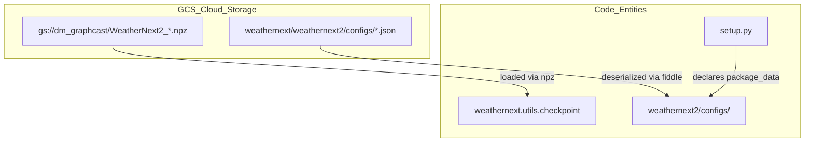

<!-- source: DeepWiki mcp.deepwiki.com · repo google-deepmind/weathernext · page 1.1 Getting Started: Installation and Dependencies · fetched 2026-10-26 -->

# Getting Started: Installation and Dependencies

<details>
<summary>Relevant source files</summary>

The following files were used as context for generating this wiki page:

- [README.md](README.md)
- [setup.py](setup.py)

</details>


This page provides the technical requirements and procedures for setting up the WeatherNext environment. It covers the supported Python versions, core library dependencies defined in `setup.py`, installation procedures via git tags, and the acquisition of pre-trained model weights from Google Cloud Storage.

## Python Environment and Package Installation

The WeatherNext codebase targets modern Linux environments and officially supports Python versions **3.10** and **3.11` [setup.py:60-61]().

### Installation via setup.py
Users can install the package directly from the repository. To pin a specific release (recommended due to the research nature of the codebase and lack of API stability guarantees), install via a git tag [README.md:131-137]():

```bash
# Install a specific tagged release
pip install git+https://github.com/google-deepmind/weathernext.git@v0.3.0
```

Alternatively, for local development:
```bash
git clone https://github.com/google-deepmind/weathernext.git
cd weathernext
pip install .
```

### Core Dependencies
The package dependencies are managed through `setup.py` and encompass numerical computing, graph neural networks, and meteorological libraries:

| Dependency | Purpose | Code Reference |
| :--- | :--- | :--- |
| `jax` | High-performance numerical computing and hardware acceleration | [setup.py:42]() |
| `dm-haiku` | Neural network library for JAX (parameter management) | [setup.py:37]() |
| `jraph` | Graph neural network primitives | [setup.py:43]() |
| `gdm-xarray-jax` | Xarray integration layer for JAX (`v0.1.1`) | [setup.py:39]() |
| `fiddle` | Configuration management framework | [setup.py:40]() |
| `dinosaur-dycore` | Dynamical core utilities for atmospheric modeling | [setup.py:36]() |
| `trimesh` | Geometric processing for icosahedral meshes | [setup.py:50]() |
| `xarray` | N-dimensional labeled arrays and datasets (`<=2026.2.0`) | [setup.py:52]() |

Sources: [setup.py:32-54](), [README.md:131-138]()

---

## Model Weights and Data Acquisition

Pre-trained weights and normalization artifacts for WeatherNext 2 and WeatherNext Cyclones are hosted on Google Cloud Storage under the public bucket `gs://dm_graphcast` [README.md:110-111]().

### Catalog of Released Checkpoints
*   **WeatherNext2_<2025**: 0.25° resolution operational model fine-tuned on ECMWF HRES initial conditions (data through 2024). Files: `WeatherNext2_<2025_model{1,2,3,4}.npz` [README.md:57-61]().
*   **WeatherNextCyclones_<2025**: 0.25° resolution operational cyclone forecasting model (data through 2024). Files: `WeatherNextCyclones_<2025_model{1,2,3,4}.npz` [README.md:65-70]().
*   **WeatherNextCyclones_<2024**: 0.25° resolution model reproducing 2024 results (data through 2023). Files: `WeatherNextCyclones_<2024_model{1,2,3,4}.npz` [README.md:72-74]().
*   **WeatherNextCyclones_<2023**: 0.25° resolution model reproducing 2023 results (data through 2022). Files: `WeatherNextCyclones_<2023_model{1,2,3,4}.npz` [README.md:75-77]().
*   **WeatherNextCyclones_Mini_<2024 / <2023**: 1.0° resolution lightweight versions intended for low-memory environments and local testing [README.md:81-88]().

Sources: [README.md:47-92](), [README.md:110-111]()

---

## System Architecture: Installation to Code Mapping

The following diagram maps external GCS assets and configuration structures to their respective ingestion points in the codebase.

### Asset Ingestion and Package Layout


Sources: [setup.py:29-31](), [README.md:110-111]()

---

## Hardware and Performance Considerations

*   **Accelerators**: WeatherNext models are optimized for Google Cloud TPUs (`v5e`, `v5p`), though they can run on high-end GPUs (e.g., H100 for full-resolution models) [README.md:95-108]().
*   **Colab / Local Executions**: The `WeatherNextCyclones_Mini` checkpoints can execute on constrained resources such as free Colab runtimes (`v5e-1`) or local GPUs (like P100 for Mini variants) [README.md:99-108]().

Sources: [README.md:94-108]()

---

