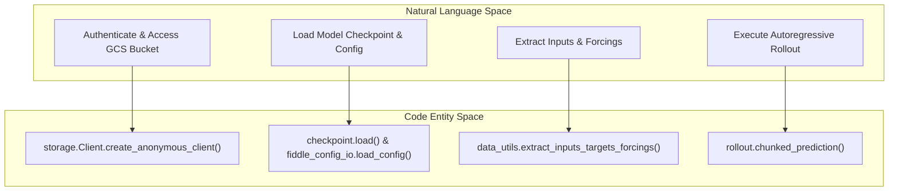
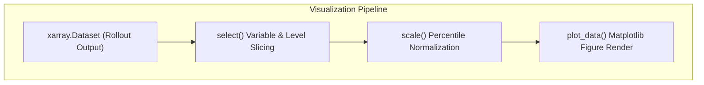

<!-- source: DeepWiki mcp.deepwiki.com · repo google-deepmind/weathernext · page 1.3 Running the Demo Notebooks · fetched 2026-10-26 -->

# Running the Running the Demo Notebooks

Relevant source files

The following files were used as context for generating this wiki page:

- [docs/weathernext1_gen/gencast_mini_demo.ipynb](docs/weathernext1_gen/gencast_mini_demo.ipynb)
- [docs/weathernext1_graph/graphcast_demo.ipynb](docs/weathernext1_graph/graphcast_demo.ipynb)
- [docs/weathernext2/images/jupyter-demo-open.png](docs/weathernext2/images/jupyter-demo-open.png)
- [docs/weathernext2/wn2_demo.ipynb](docs/weathernext2/wn2_demo.ipynb)

This page provides a technical guide for executing the WeatherNext demo notebooks, including `wn2_demo.ipynb`, the cyclone gridding/tracking demo, `graphcast_demo.ipynb`, and `gencast_mini_demo.ipynb`. These notebooks serve as the primary entry point for utilizing pre-trained models across the WeatherNext repository, demonstrating end-to-end workflows: cloud-based asset retrieval, configuration loading, model initialization, autoregressive rollout, and visualization.

## Available Demo Notebooks

The repository provides several interactive notebooks tailored to specific models, tasks, and hardware environments:

| Notebook Path | Model / Task Target | Primary Use Case & Environment |
| :--- | :--- | :--- |
| `docs/weathernext2/wn2_demo.ipynb` | WeatherNext 2 (FGN) | Multi-modal functional generative prediction, ensemble sampling, and cyclone tracking integration. |
| `docs/cyclones/demo_gridding_and_tracking.ipynb` | WeatherNext Cyclones | Gridding IBTrACS best-track data and executing the direct cyclone tracker (`direct_tracker.py`). |
| `docs/weathernext1_graph/graphcast_demo.ipynb` | GraphCast (Deterministic) | Running standard deterministic GraphCast forecasts at 0.25° and 1.0° resolutions. |
| `docs/weathernext1_gen/gencast_mini_demo.ipynb` | GenCast (Probabilistic) | Running the low-memory `GenCast 1p0deg Mini` diffusion ensemble on Colab TPU environments. |

Sources: `docs/weathernext2/wn2_demo.ipynb:1-50](), `docs/weathernext1_graph/graphcast_demo.ipynb:9-16](), `docs/weathernext1_gen/gencast_mini_demo.ipynb:30-41`().

## Data Loading and Model Initialization Flow

Notebook execution relies on connecting to Google Cloud Storage (GCS) buckets (such as `dm_graphcast` or project-specific buckets) to fetch weights, normalization statistics, and sample input datasets. The loading process utilizes `checkpoint.load` and configuration parsers.

### Natural Language to Code Entity Mapping

The following diagram bridges the high-level notebook steps to the underlying Python modules and functions responsible for model and data setup.

**Notebook-to-Code Execution Flow**

Sources: `docs/weathernext2/wn2_demo.ipynb:75-102](), `docs/weathernext1_graph/graphcast_demo.ipynb:103-108]().

## WeatherNext 2 Execution (`wn2_demo.ipynb`)

The WeatherNext 2 demo (`wn2_demo.ipynb`) demonstrates the Functional Generative Network (FGN) architecture, combining weather prediction with cyclone gridding and tracking utilities.

### Implementation Steps
1.  **Environment Setup & Dependencies**: Installs the `weathernext` package from source and reconfigures JAX/libtpu bindings for TPU acceleration [docs/weathernext2/wn2_demo.ipynb:56-61]().
2.  **Configuration and Checkpoints**: Utilizes `fiddle_config_io` to reconstruct model structures and loads parameters via `checkpoint.load` [docs/weathernext2/wn2_demo.ipynb:93-97]().
3.  **Predictor Construction**: Initializes the FGN predictor using `fgn.construct_predictor` [docs/weathernext2/wn2_demo.ipynb:98-98]().
4.  **Cyclone Tracking Integration**: Imports cyclone constants and configuration parameters (`direct_tracker_6h_v1_config`) to overlay tracked storm trajectories onto forecast outputs [docs/weathernext2/wn2_demo.ipynb:99-101]().

Sources: `docs/weathernext2/wn2_demo.ipynb:56-102`().

## Cyclone Gridding and Tracking Demo

The cyclone demo guides users through turning best-track data into gridded fields and extracting tracks from model predictions.

### Key Operations
*   **IBTrACS Rasterization**: Converts raw storm CSV/NetCDF records into gridded tensor fields using spatial radii and quadrant specifications [docs/weathernext2/wn2_demo.ipynb:101-102]().
*   **Direct Tracker Execution**: Runs initialization, momentum first-guess, and refinement algorithms defined in `direct_tracker.py` to identify cyclogenesis events.
*   **Round-Trip Validation**: Evaluates tracker consistency against ground-truth datasets using geodesic matching.

Sources: `docs/weathernext2/wn2_demo.ipynb:99-102]().

## GraphCast and GenCast Legacy Notebooks

The legacy notebooks provide reference implementations for deterministic and diffusion-based forecasting models.

### GraphCast (`graphcast_demo.ipynb`)
*   **Predictor Stack**: Wraps the core `graphcast.GraphCast` GNN model with normalization (`normalization.InputsAndResiduals`), precision casting (`casting.Bfloat16Cast`), and autoregressive looping (`autoregressive.Predictor`) [docs/weathernext1_graph/graphcast_demo.ipynb:72-79]().
*   **Chunked Rollout**: Executes memory-efficient multi-step rollouts via `rollout.chunked_prediction` [docs/weathernext1_graph/graphcast_demo.ipynb:77-77]().

### GenCast Mini (`gencast_mini_demo.ipynb`)
*   **Denoiser & Sampler**: Instantiates `denoiser.Denoiser` and integrates diffusion sampling workflows [docs/weathernext1_gen/gencast_mini_demo.ipynb:126-127]().
*   **NaN Cleaning**: Applies `nan_cleaning.NaNCleaner` to handle masked surface variables [docs/weathernext1_gen/gencast_mini_demo.ipynb:125-125]().

Sources: `docs/weathernext1_graph/graphcast_demo.ipynb:72-79](), `docs/weathernext1_gen/gencast_mini_demo.ipynb:120-127`().

## Visualization, Animation, and Validation Pipeline

All demo notebooks conclude by transforming raw `xarray.Dataset` outputs into visual animations or comparative plots.

### Key Helper Functions
*   **`select`**: Extracts specific variables, pressure levels, and batch indices from multi-dimensional arrays [docs/weathernext2/wn2_demo.ipynb:115-128]().
*   **`scale`**: Computes robust percentile limits (`np.nanpercentile`) to configure normalization and colormaps (`RdBu_r` or `viridis`) [docs/weathernext2/wn2_demo.ipynb:131-143]().
*   **`plot_data`**: Assembles multi-panel spatial figures and maps latitude/longitude coordinates to pixel grids for rendering overlays (such as cyclone DataFrames) [docs/weathernext2/wn2_demo.ipynb:144-173]().

**Visualization Data Flow**

Sources: `docs/weathernext2/wn2_demo.ipynb:115-173]().

---

