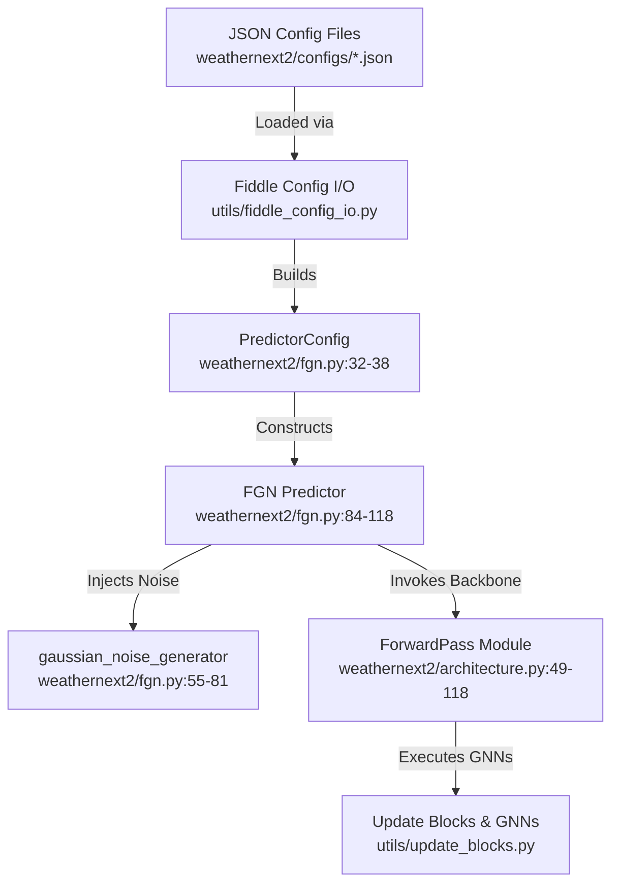
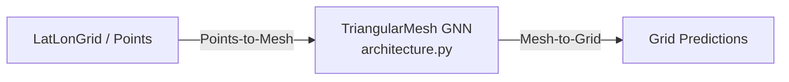

<!-- source: DeepWiki mcp.deepwiki.com · repo google-deepmind/weathernext · page 2 WeatherNext 2 (FGN) · fetched 2026-10-26 -->

# WeatherNext 2 (FGN)

Relevant source files

The following files were used as context for generating this wiki page:

- [weathernext/weathernext2/__init__.py](weathernext/weathernext2/__init__.py)
- [weathernext/weathernext2/architecture.py](weathernext/weathernext2/architecture.py)
- [weathernext/weathernext2/fgn.py](weathernext/weathernext2/fgn.py)

The WeatherNext 2 package (`weathernext/weathernext2/`) implements the Functional Generative Network (FGN) architecture, combining multimodality spatial message passing (grid-to-mesh-to-grid) with stochastic noise injection to generate probabilistic multi-step weather and cyclone forecasts. This parent page provides a high-level overview of the FGN predictor framework, the underlying neural network architecture, and configuration management.

For granular technical details, refer to the respective child pages:
- [FGN Predictor and Generative Noise](#2.1)
- [WN2 Architecture: Points–Mesh Forward Pass](#2.2)
- [Model Configuration: JSON Configs and Fiddle](#2.3)

---

## Architecture and Component Relationships

The WeatherNext 2 system links configuration files, wrapper layers, generative noise injectors, and graph-based forward passes into an end-to-end executable pipeline. 

### System Architecture Diagram

Sources: [weathernext/weathernext2/fgn.py:32-118](), [weathernext/weathernext2/architecture.py:49-118]()

---

## 2.1 FGN Predictor and Generative Noise

The Functional Generative Network (FGN) predictor coordinates ensemble generation by sampling random noise and feeding it alongside physical forcings into a deterministic underlying neural network. The core configuration and construction logic reside in `weathernext/weathernext2/fgn.py`.

The module defines `PredictorConfig` dataclass and `construct_predictor` to instantiate wrapped predictor pipelines [weathernext/weathernext2/fgn.py:32-45](). Stochastic behavior is achieved via `gaussian_noise_generator`, which appends white Gaussian noise to input fields or forcing datasets based on specified noise dictionaries [weathernext/weathernext2/fgn.py:55-81](). The primary `Predictor` class subclasses base predictors to handle batch-and-sample reshaping for parallel ensemble rollouts and implements CRPS loss calculations [weathernext/weathernext2/fgn.py:84-179]().

For detailed information on wrapper stacking, noise configuration variables, and loss implementations, see [FGN Predictor and Generative Noise](#2.1).

Sources: [weathernext/weathernext2/fgn.py:32-179]()

---

## 2.2 WN2 Architecture: Points–Mesh Forward Pass

The neural network backbone for WeatherNext 2 is defined in `weathernext/weathernext2/architecture.py` and supported by `architecture_utils.py`. The primary module `ForwardPass` implements the multimodality graph transformation pipeline [weathernext/weathernext2/architecture.py:49-118]().

Sources: [weathernext/weathernext2/architecture.py:49-130]()

`ForwardPass` manages latent and output dense layers, spatial feature generation, norm conditioning features, activation functions, and gradient checkpointing (`remat`) over grid-to-mesh, mesh, and mesh-to-grid GNN stages [weathernext/weathernext2/architecture.py:53-118]().

For detailed documentation on update block constructors, dense layer kwargs, spatial feature engineering, and mesh splitting parameters, see [WN2 Architecture: Points–Mesh Forward Pass](#2.2).

Sources: [weathernext/weathernext2/architecture.py:49-156]()

---

## 2.3 Model Configuration: JSON Configs and Fiddle

WeatherNext 2 models rely on declarative JSON configuration files stored under `weathernext2/configs/`. These configurations define parameters for variants such as `WeatherNext2`, `WeatherNextCyclones`, and `WeatherNextCyclones_Mini`. 

Serialization and reconstruction of these configurations into executable JAX/Haiku task definitions are managed using Fiddle integration utilities (`utils/fiddle_config_io.py`), allowing flexible parameter overrides for training and evaluation.

For a comprehensive breakdown of configuration schemas and serialization workflows, see [Model Configuration: JSON Configs and Fiddle](#2.3).

Sources: [weathernext/weathernext2/__init__.py:1-13]()

---

