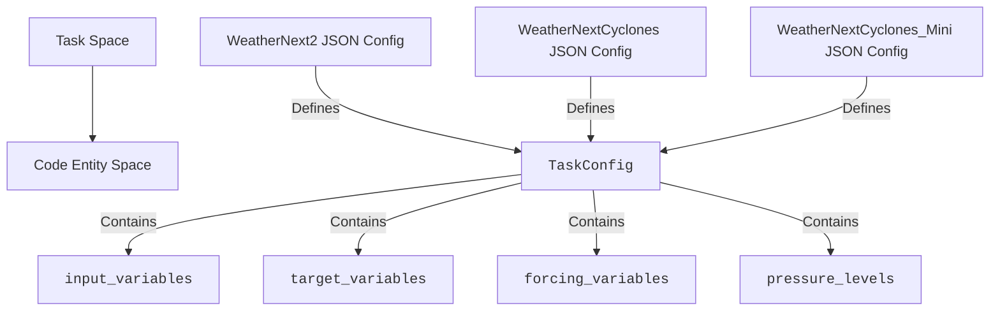
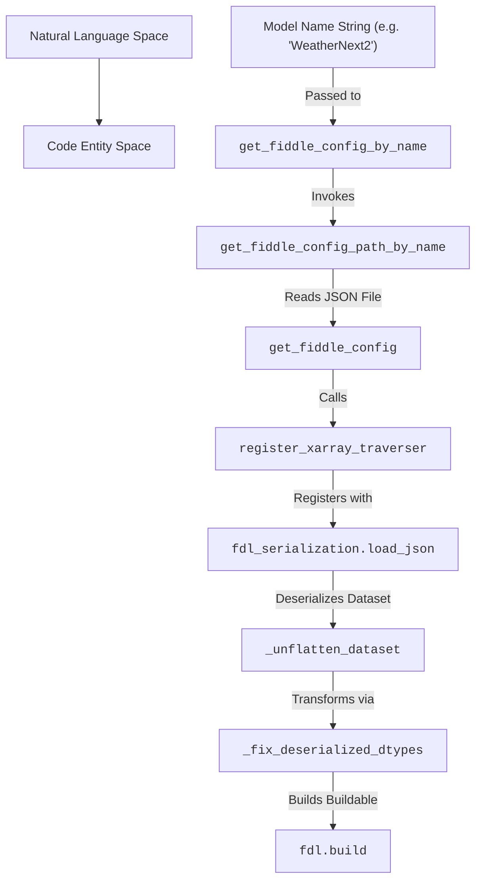

<!-- source: DeepWiki mcp.deepwiki.com · repo google-deepmind/weathernext · page 2.3 Model Configuration: JSON Configs and Fiddle · fetched 2026-10-26 -->

# Model Configuration: JSON Configs and Fiddle

Relevant source files

The following files were used as context for generating this wiki page:

- [weathernext/utils/fiddle_config_io.py](weathernext/utils/fiddle_config_io.py)
- [weathernext/utils/task.py](weathernext/utils/task.py)
- [weathernext/weathernext2/configs/WeatherNext2.json](weathernext/weathernext2/configs/WeatherNext2.json)
- [weathernext/weathernext2/configs/WeatherNextCyclones.json](weathernext/weathernext2/configs/WeatherNextCyclones.json)
- [weathernext/weathernext2/configs/WeatherNextCyclones_Mini.json](weathernext/weathernext2/configs/WeatherNextCyclones_Mini.json)

## Purpose and Scope
This page details the model configuration infrastructure for WeatherNext 2, focusing on the JSON configuration files stored under `weathernext2/configs/` (`WeatherNext2.json`, `WeatherNextCyclones.json`, and `WeatherNextCyclones_Mini.json`) and the serialization/deserialization utilities implemented in `utils/fiddle_config_io.py`. It explains how declarative model architectures and task definitions are serialized using Fiddle (`fdl`) and restored into executable JAX components.

---

## JSON Configuration Catalogs

WeatherNext 2 relies on declarative JSON configurations generated via Fiddle serialization. These files encode the complete architecture of the Functional Generative Network (FGN), predictor wrappers, normalization statistics, and task parameters.

Three primary configurations are provided in the repository:
*   `WeatherNext2.json`: The full-scale global WeatherNext 2 model configuration. It defines extensive atmospheric and surface input/target variables, multi-level pressure structures, and regional/global task settings.
*   `WeatherNextCyclones.json`: A specialized configuration tailored for tropical cyclone tracking and high-resolution regional forecasting, adjusting input variable subsets and predictor parameters.
*   `WeatherNextCyclones_Mini.json`: A lightweight, downscaled variation designed for testing, quick prototyping, and resource-constrained demonstration environments.

Each config file instantiates a root configuration node (`predictor_config_1`) that points to a model predictor tree, embedding task definitions corresponding to `TaskConfig` [weathernext/utils/task.py:20-28](). A `TaskConfig` explicitly declares:
*   `input_variables` [weathernext/utils/task.py:23-23](): Tuple of input atmospheric, surface, and temporal progression features (e.g., `temperature`, `geopotential`, `year_progress_sin`) [weathernext/weathernext2/configs/WeatherNext2.json:18-203]().
*   `target_variables` [weathernext/utils/task.py:24-25](): Tuple of target fields predicted by the model [weathernext/weathernext2/configs/WeatherNext2.json:221-272]().
*   `forcing_variables` [weathernext/utils/task.py:26-26](): External forcing fields supplied during rollout.
*   `pressure_levels` [weathernext/utils/task.py:27-27](): Vertical pressure levels tracked by the model.
*   `input_duration` [weathernext/utils/task.py:28-28](): Temporal window length for model inputs.

### Diagram: Task and Model Configuration Mapping

Sources: `weathernext/utils/task.py`, `weathernext/weathernext2/configs/WeatherNext2.json`, `weathernext/weathernext2/configs/WeatherNextCyclones.json`, `weathernext/weathernext2/configs/WeatherNextCyclones_Mini.json`

---

## Fiddle Configuration IO (`utils/fiddle_config_io.py`)

The module `weathernext/utils/fiddle_config_io.py` provides utilities to load, deserialize, and reconstruct Fiddle-serialized model configurations from JSON strings and files. Because weather models handle complex data structures like `xarray.Dataset` (which contain coordinates, data variables, and attributes), custom node traversers are registered with Fiddle's serialization framework (`fdl_serialization`) [weathernext/utils/fiddle_config_io.py:21-22]().

### Key Functions and Serialization Mechanics

1.  **Xarray Dataset Traverser Registration**:
    *   `register_xarray_traverser()` [weathernext/utils/fiddle_config_io.py:91-102]() registers `xarray.Dataset` with `fdl_serialization.register_node_traverser` [weathernext/utils/fiddle_config_io.py:94-99]().
    *   `_flatten_dataset(ds)` [weathernext/utils/fiddle_config_io.py:83-84]() converts an `xarray.Dataset` into its dictionary representation via `ds.to_dict()` [weathernext/utils/fiddle_config_io.py:84-84]().
    *   `_unflatten_dataset(values, _)` [weathernext/utils/fiddle_config_io.py:87-88]() reconstructs the `xarray.Dataset` via `xarray.Dataset.from_dict(values[0])` [weathernext/utils/fiddle_config_io.py:88-88]().

2.  **Dtype Normalization**:
    *   `_fix_deserialized_dtypes(fdl_config)` [weathernext/utils/fiddle_config_io.py:104-125]() iterates over predictor wrappers [weathernext/utils/fiddle_config_io.py:106-106]() and their keyword arguments [weathernext/utils/fiddle_config_io.py:107-107]() to correct data type promotions introduced during JSON round-tripping.
    *   It explicitly casts coordinate levels (e.g., `level` coordinate converted from `int64` back to `int32`) [weathernext/utils/fiddle_config_io.py:111-115]() and verifies that floating-point data variables conform to `float64` expectations [weathernext/utils/fiddle_config_io.py:118-124]().

3.  **Loading Interfaces**:
    *   `get_fiddle_config(json_str)` [weathernext/utils/fiddle_config_io.py:127-132]() registers the xarray traverser [weathernext/utils/fiddle_config_io.py:129-129](), loads the JSON string via `fdl_serialization.load_json` [weathernext/utils/fiddle_config_io.py:130-130](), fixes dtypes [weathernext/utils/fiddle_config_io.py:131-131](), and builds the final Fiddle buildable object via `fdl.build(config)` [weathernext/utils/fiddle_config_io.py:132-132]().
    *   `get_fiddle_config_path_by_name(name)` [weathernext/utils/fiddle_config_io.py:135-137]() resolves configuration file paths [weathernext/utils/fiddle_config_io.py:137-137]().
    *   `get_fiddle_config_by_name(name)` [weathernext/utils/fiddle_config_io.py:140-143]() reads the config file for a given model name and returns the built Fiddle configuration [weathernext/utils/fiddle_config_io.py:141-143]().

### Diagram: Configuration Deserialization Data Flow

Sources: `weathernext/utils/fiddle_config_io.py`

---

