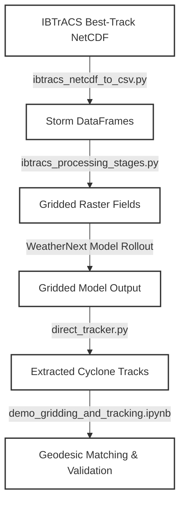
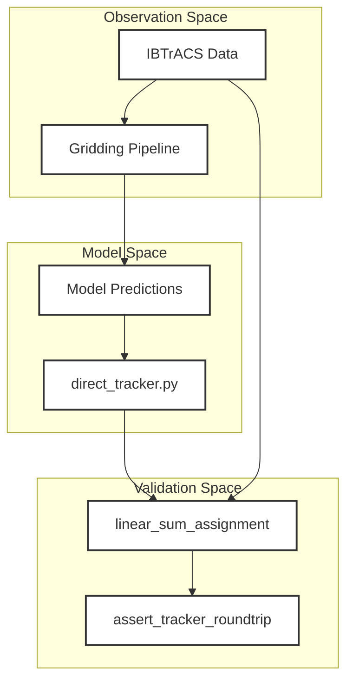

<!-- source: DeepWiki mcp.deepwiki.com · repo google-deepmind/weathernext · page 3 WeatherNext Cyclones: Gridding and Tracking · fetched 2026-10-26 -->

# WeatherNext Cyclones: Gridding and Tracking

Relevant source files

The following files were used as context for generating this wiki page:

- [weathernext/cyclones/__init__.py](weathernext/cyclones/__init__.py)
- [weathernext/cyclones/constants.py](weathernext/cyclones/constants.py)
- [weathernext/cyclones/cyclone_utils.py](weathernext/cyclones/cyclone_utils.py)

## Purpose and Scope

The `weathernext/cyclones` subpackage provides specialized data pipelines and tracking algorithms designed to process tropical cyclone best-track observations from IBTrACS, rasterize them into gridded model-compatible fields, and extract predicted cyclone tracks from gridded model outputs [weathernext/cyclones/constants.py:14-89](), [weathernext/cyclones/cyclone_utils.py:14-199](). 

As a parent page, this document outlines the high-level architecture of the cyclone subpackage, bridging observation data preparation, tracking dynamics, and round-trip validation. For comprehensive technical specifications, refer to the child pages:
- [IBTrACS Data Processing and Gridding](#3.1)
- [Direct Tracker Algorithm](#3.2)
- [Cyclone Demo and Round-Trip Validation](#3.3)

*Sources: weathernext/cyclones/constants.py:14-90, weathernext/cyclones/cyclone_utils.py:14-199*

---

## 3.1. IBTrACS Data Processing and Gridding

The data ingestion pipeline converts raw International Best Track Archive for Climate Stewardship (IBTrACS) NetCDF files into structured pandas DataFrames and spatial raster grids. This stage handles spatial coordinate conversions, wind-speed calibrations, quadrant radii mapping, and disc or Gaussian rasterization radii to prepare target fields for model training and evaluation [weathernext/cyclones/constants.py:25-85]().

Key utilities include filtering observed cyclone tracks up to initialization time $t_0$ (`filter_observed_df_for_cyclones_t0_and_before`), managing wind thresholds, and computing geodesic distances (`geodesic_distance`) [weathernext/cyclones/cyclone_utils.py:25-102]().

For detailed documentation on `ibtracs_netcdf_to_csv.py`, `ibtracs_processing_stages.py`, `ibtracs_processing_utils.py`, and `data_pipeline_utils.py`, see [IBTrACS Data Processing and Gridding](#3.1).

*Sources: weathernext/cyclones/constants.py:25-85, weathernext/cyclones/cyclone_utils.py:25-102*

---

## 3.2. Direct Tracker Algorithm

The direct tracker extracts discrete tropical cyclone tracks directly from gridded model prediction fields (`direct_tracker.py`). It employs a greedy cyclogenesis initialization strategy based on existence probability fields, incorporates a spherical geodesic momentum first guess (`cartesian_spherical_geodesic_momentum_update`), and refines positions using mean, mode, or mode-then-mean methods [weathernext/cyclones/cyclone_utils.py:164-199]().

Physical consistency and dissipation thresholds are managed through `tracker_utils.py` adhering to the `tracker_base.py` interface, with hyperparameters configured in `direct_tracker_6h_v1_config.py`.

For detailed information on tracker implementation, optimization refinement, and configuration parameters, see [Direct Tracker Algorithm](#3.2).

*Sources: weathernext/cyclones/cyclone_utils.py:164-199*

---

## 3.3. Cyclone Demo and Round-Trip Validation

End-to-end workflows are demonstrated in `docs/cyclones/demo_gridding_and_tracking.ipynb`. This notebook walks through gridding IBTrACS for a specified date range, executing model rollouts or tracker inference, performing geodesic matching via linear sum assignment (`linear_sum_assignment`), and executing round-trip validation assertions (`assert_tracker_roundtrip`) with strict numerical tolerances.

*Sources: weathernext/cyclones/cyclone_utils.py:25-70, weathernext/cyclones/constants.py:14-90*

For complete walkthroughs, code snippets, and assertion tolerances, see [Cyclone Demo and Round-Trip Validation](#3.3).

*Sources: weathernext/cyclones/cyclone_utils.py:25-70, weathernext/cyclones/constants.py:14-90*

---

