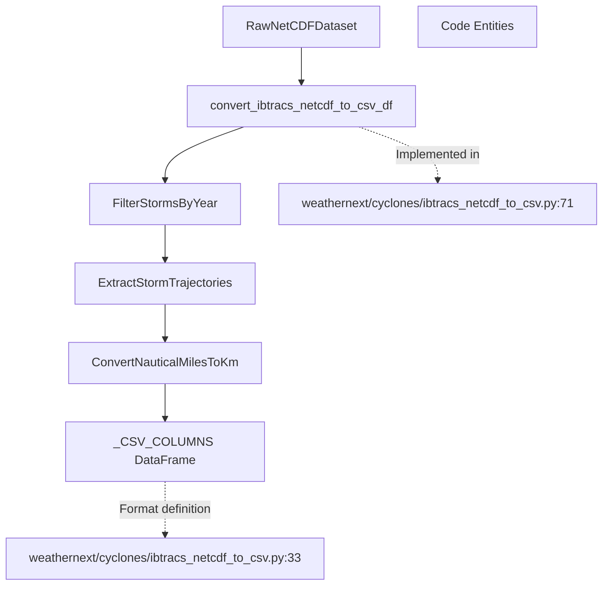
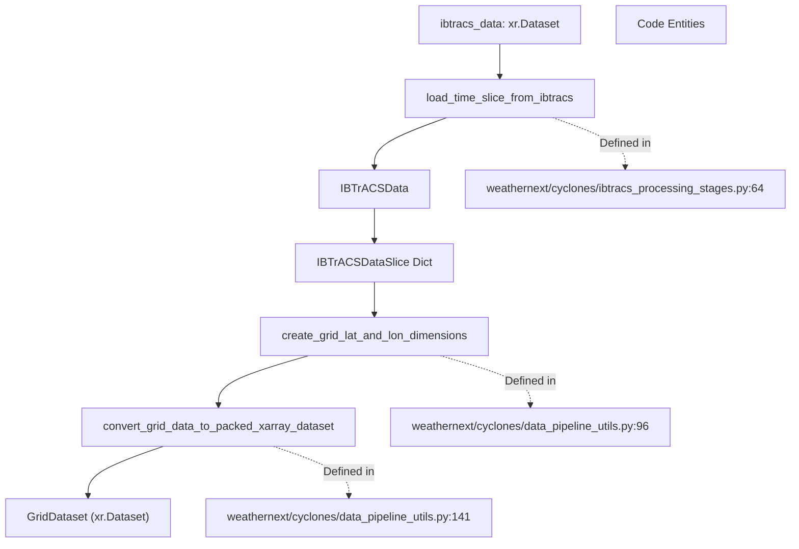

<!-- source: DeepWiki mcp.deepwiki.com · repo google-deepmind/weathernext · page 3.1 IBTrACS Data Processing and Gridding · fetched 2026-10-26 -->

# IBTrACS Data Processing and Gridding

Relevant source files

The following files were used as context for generating this wiki page:

- [weathernext/cyclones/data_pipeline_utils.py](weathernext/cyclones/data_pipeline_utils.py)
- [weathernext/cyclones/ibtracs_netcdf_to_csv.py](weathernext/cyclones/ibtracs_netcdf_to_csv.py)
- [weathernext/cyclones/ibtracs_processing_stages.py](weathernext/cyclones/ibtracs_processing_stages.py)
- [weathernext/cyclones/ibtracs_processing_utils.py](weathernext/cyclones/ibtracs_processing_utils.py)

## Purpose and Scope
This document details the data pipeline responsible for ingesting, standardizing, calibrating, and spatially gridding tropical cyclone best-track records from the International Best Track Archive for Climate Stewardship (IBTrACS). It covers raw NetCDF ingestion into tabular dataframes, time-slice extraction, rasterization via Gaussian and disc kernels, quadrant wind radii handling, and multi-agency wind speed aggregation. The key implementation components reside in `weathernext/cyclones/ibtracs_netcdf_to_csv.py`, `weathernext/cyclones/ibtracs_processing_stages.py`, `weathernext/cyclones/ibtracs_processing_utils.py`, and `weathernext/cyclones/data_pipeline_utils.py`.

Sources: `weathernext/cyclones/ibtracs_netcdf_to_csv.py:14-20]`, `weathernext/cyclones/ibtracs_processing_stages.py:14-19]`, `weathernext/cyclones/data_pipeline_utils.py:14-14]()`

---

## Raw NetCDF to Standardized CSV Conversion
The `weathernext/cyclones/ibtracs_netcdf_to_csv.py` module converts raw IBTrACS NetCDF datasets with dimensions `(storm, date_time)` into a flattened tabular `pandas.DataFrame` [weathernext/cyclones/ibtracs_netcdf_to_csv.py:14-20](). This ensures consistent downstream handling for both test datasets and tracking modules.

The conversion function `convert_ibtracs_netcdf_to_csv_df` filters storms by year, iterates through individual storm trajectories, extracts valid times, coordinates, and scalar attributes, and converts nautical miles to kilometers using the conversion factor `_NMILES_PER_KM = 0.539957` [weathernext/cyclones/ibtracs_netcdf_to_csv.py:61-180](). The resulting columns strictly conform to `_CSV_COLUMNS`, which include track identifiers, latitude, longitude, valid times, minimum sea level pressure, maximum sustained wind speeds, radius of maximum winds (RMW), and quadrant-specific wind radii for 34, 50, and 64-knot thresholds across northeast (`ne`), southeast (`se`), southwest (`sw`), and northwest (`nw`) quadrants [weathernext/cyclones/ibtracs_netcdf_to_csv.py:33-53]().

*Figure 1: Pipeline flow from raw IBTrACS NetCDF to standardized CSV dataframes.*

Sources: `weathernext/cyclones/ibtracs_netcdf_to_csv.py:33-180]()`

---

## Time-Slice Loading and Spatial Gridding Layouts
To transform tabular or track-based storm records into spatial fields aligned with numerical weather prediction grids, `weathernext/cyclones/ibtracs_processing_stages.py` provides `load_time_slice_from_ibtracs` [weathernext/cyclones/ibtracs_processing_stages.py:64-135](). This function queries storms active within a given `datetime`, extracts scalar and vector attributes, normalizes longitudes to the $[0, 360)$ range via `_lon_180_to_360`, and packages them into an `IBTrACSData` dataclass containing an `IBTrACSDataSlice` dictionary [weathernext/cyclones/ibtracs_processing_stages.py:47-135]().

Grid dimensions and spatial coordinate structures are managed by `weathernext/cyclones/data_pipeline_utils.py`. The number of latitude and longitude points for a rectilinear grid at a given `resolution` are computed using `num_lat_rectilinear_grid` and `num_lon_rectilinear_grid` [weathernext/cyclones/data_pipeline_utils.py:76-94]():

$$\text{num\_lat} = 2 \times \text{round}\left(\frac{90}{\text{resolution}}\right) + 1$$

$$\text{num\_lon} = \text{round}\left(\frac{360}{\text{resolution}}\right)$$

The function `convert_grid_data_to_packed_xarray_dataset` packs dictionary-mapped numpy arrays into an `xarray.Dataset` with standard coordinates: `single_level_temporal_variable`, `time`, `latitude`, and `longitude` [weathernext/cyclones/data_pipeline_utils.py:141-204]().

*Figure 2: Data flow for loading time-slices and packing into xarray datasets.*

Sources: `weathernext/cyclones/ibtracs_processing_stages.py:47-135]`, `weathernext/cyclones/data_pipeline_utils.py:76-204]()`

---

## Rasterization, Quadrant Radii, and Existence Fields
The mapping of storm point locations and radii onto a 2D spatial grid is handled via rasterization functions in `weathernext/cyclones/ibtracs_processing_stages.py` and helper routines in `weathernext/cyclones/ibtracs_processing_utils.py`. 

The core function `cyclone_existence_grids` generates spatial existence fields from storm coordinate slices (`latlon`) [weathernext/cyclones/ibtracs_processing_stages.py:138-199](). Depending on configuration flags, it computes:
* **Gaussian unit mode masks** (`exists_gaussian_unit_mode`) via `create_gaussian_disc_mask_from_latlon` [weathernext/cyclones/ibtracs_processing_stages.py:163-170]().
* **Probability masks** (`exists_gaussian_probability`) using gaussian normalization [weathernext/cyclones/ibtracs_processing_stages.py:191-198]().
* **Disc integral masks** (`exists_disc`) using `create_disc_integral_mask_from_latlon` [weathernext/cyclones/ibtracs_processing_stages.py:184-190]().
* **Sparse nearest neighbor masks** (`exists_sparse`) using `create_sparse_nearest_neighbour_mask_from_latlon` [weathernext/cyclones/ibtracs_processing_stages.py:178-183]().

The core variables maintained for cyclone modeling are enumerated in `CORE_CYCLONE_VARIABLES`, which aggregate existence probabilities, minimum sea level pressures (`usa_pres_disc`), wind radii per quadrant (`usa_r34`, `usa_r50`, `usa_r64`), and radius of maximum winds (`usa_rmw_disc`) [weathernext/cyclones/ibtracs_processing_utils.py:178-196](). Quadrant radii imputation flags (`QUADRANT_PRESENT_AND_NOT_IMPUTED_FLAG`, `QUADRANT_MISSING_IMPUTED_WITH_MEAN_FLAG`, etc.) govern how missing directional wind spans are handled [weathernext/cyclones/ibtracs_processing_utils.py:152-162]().

Sources: `weathernext/cyclones/ibtracs_processing_stages.py:138-199]`, `weathernext/cyclones/ibtracs_processing_utils.py:152-196]()`

---

## Wind-Speed Calibration and Aggregation
IBTrACS records wind speeds from multiple international meteorological agencies (`usa_wind`, `cma_wind`, `newdelhi_wind`, `reunion_wind`, `bom_wind`) [weathernext/cyclones/ibtracs_processing_utils.py:48-54](). Minimum sea level pressures are similarly gathered from agencies such as WMO, USA, CMA, HKO, Tokyo, and others [weathernext/cyclones/ibtracs_processing_utils.py:70-81]().

To reconcile discrepancies between reporting agencies, `ibtracs_processing_utils.py` defines calibration models (`WindCalibrationModel`) and establishes `IBTRACS_BASE_WIND_VARIABLE = "usa_wind"` as the primary reference standard [weathernext/cyclones/ibtracs_processing_utils.py:44-143](). Quadrant wind radius variables are structured as tuples mapping the source agency, corresponding wind speed variable, and threshold speed (34.0, 50.0, or 64.0 knots) via `_get_ibtracs_quadrant_variable_tuples()` [weathernext/cyclones/ibtracs_processing_utils.py:29-37]().

Sources: `weathernext/cyclones/ibtracs_processing_utils.py:29-143]()`

---

