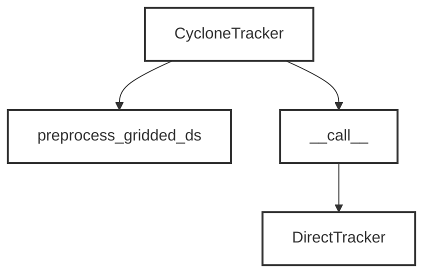
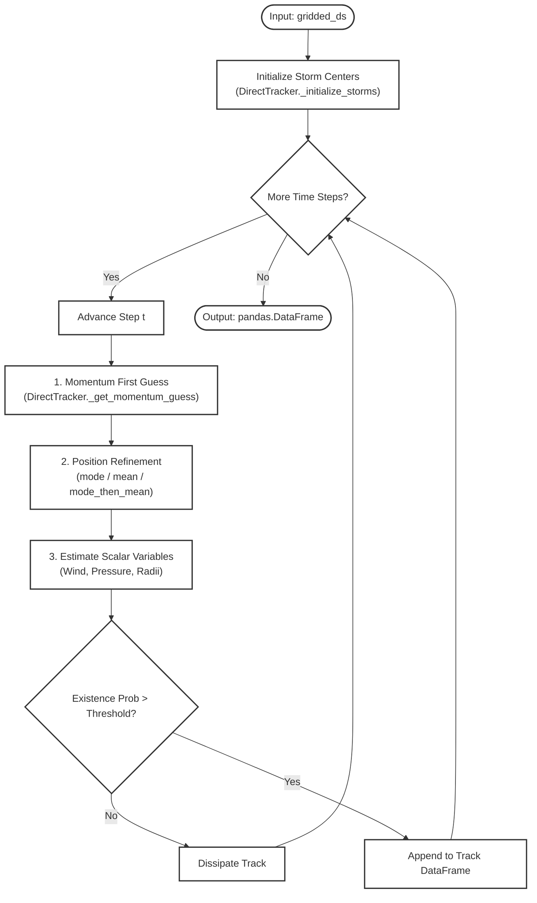

<!-- source: DeepWiki mcp.deepwiki.com · repo google-deepmind/weathernext · page 3.2 Direct Tracker Algorithm · fetched 2026-10-26 -->

# Direct Tracker Algorithm

<details>
<summary>Relevant source files</summary>

The following files were used as context for generating this wiki page:

- [weathernext/cyclones/direct_tracker.py](weathernext/cyclones/direct_tracker.py)
- [weathernext/cyclones/direct_tracker_6h_v1_config.py](weathernext/cyclones/direct_tracker_6h_v1_config.py)
- [weathernext/cyclones/tracker_base.py](weathernext/cyclones/tracker_base.py)
- [weathernext/cyclones/tracker_utils.py](weathernext/cyclones/tracker_utils.py)

</details>


## Purpose and Scope

This page documents the direct cyclone tracking algorithm implemented in `weathernext/cyclones/direct_tracker.py` [weathernext/cyclones/direct_tracker.py:1-57](). The direct tracker operates greedily on top of gridded model forecasts to identify, initialize, and follow tropical cyclone tracks over time without requiring future-looking optimization (unlike traditional methods like Tempest Extremes). This section covers the abstract interface defined in `tracker_base.py` [weathernext/cyclones/tracker_base.py:1-63](), the core tracking pipeline and refinement modes in `direct_tracker.py` [weathernext/cyclones/direct_tracker.py:16-56](), physical consistency enforcement and spatial utilities in `tracker_utils.py` [weathernext/cyclones/tracker_utils.py:1-194](), and configuration parameters provided by `direct_tracker_6h_v1_config.py` [weathernext/cyclones/direct_tracker_6h_v1_config.py:1-62]().

Sources:
- `weathernext/cyclones/direct_tracker.py` [weathernext/cyclones/direct_tracker.py:1-57]()
- `weathernext/cyclones/tracker_base.py` [weathernext/cyclones/tracker_base.py:1-63]()
- `weathernext/cyclones/tracker_utils.py` [weathernext/cyclones/tracker_utils.py:1-194]()
- `weathernext/cyclones/direct_tracker_6h_v1_config.py` [weathernext/cyclones/direct_tracker_6h_v1_config.py:1-62]()

---

## Tracker Base Interface (`tracker_base.py`)

All cyclone trackers in WeatherNext adhere to a common abstract base class, `CycloneTracker`, defined in `weathernext/cyclones/tracker_base.py` [weathernext/cyclones/tracker_base.py:23-28](). This interface standardizes how gridded model predictions are preprocessed and converted into pandas DataFrames containing individual storm trajectories.

### Core Interface Methods

| Method | Signature | Role |
| :--- | :--- | :--- |
| `__init__` | `(self, **tracker_kwargs)` | Initializes tracker hyperparameters and operational thresholds [weathernext/cyclones/tracker_base.py:30-33](). |
| `preprocess_gridded_ds` | `(self, gridded_ds: xr.Dataset, extras_ds: Optional[xr.Dataset]) -> xr.Dataset` | Preprocesses gridded prognostic fields before tracking [weathernext/cyclones/tracker_base.py:35-42](). |
| `__call__` | `(self, gridded_ds: xr.Dataset, initial_storms_df: Optional[pd.DataFrame], context_time_window_to_remove: Optional[pd.Timedelta]) -> pd.DataFrame` | Executes the tracking loop across forecast time steps, returning a consolidated track DataFrame [weathernext/cyclones/tracker_base.py:44-63](). |


*Figure 1: Bridge from abstract interface `CycloneTracker` to the concrete implementation `DirectTracker`.*

Sources:
- `weathernext/cyclones/tracker_base.py` [weathernext/cyclones/tracker_base.py:23-63]()

---

## Direct Tracker Pipeline and Execution (`direct_tracker.py`)

The `DirectTracker` class executes a greedy two-phase procedure: initialization followed by time-stepping evolution.


*Figure 2: Data flow and execution steps within `DirectTracker.__call__` in `direct_tracker.py`.*

### 1. Cyclogenesis Initialization
Storm centers can be initialized either from known IBTrACS records (`initial_storms_df`) or via **direct cyclogenesis** [weathernext/cyclones/direct_tracker.py:22-27](). 
* The tracker evaluates the existence probability field (`prob_cyclone_exists`) produced by the direct cyclone model at lead time $t=0$ [weathernext/cyclones/direct_tracker.py:24-25]().
* It searches local lat-lon boxes (`cyclogenesis_box_side_degrees`) for maxima exceeding `cyclogenesis_min_max_probability_threshold` [weathernext/cyclones/direct_tracker_6h_v1_config.py:37-41]().
* Candidates are selected greedily in descending order of probability, enforcing a minimum separation distance (`min_disc_radius_between_cyclogenesis_candidates_km`) [weathernext/cyclones/direct_tracker_6h_v1_config.py:36]().

### 2. Time Evolution and Momentum First Guess
For each active storm at step $t$, the tracker computes a first-guess position using a momentum update [weathernext/cyclones/direct_tracker.py:33-38]():
$$\mathbf{x}_{\text{guess}}^{(t)} = \mathbf{x}^{(t-1)} + \alpha (\mathbf{x}^{(t-1)} - \mathbf{x}^{(t-2)})$$
where $\alpha$ is the `momentum_constant` (default $0.9$) [weathernext/cyclones/direct_tracker_6h_v1_config.py:53](). If no previous center exists, zero momentum is assumed [weathernext/cyclones/direct_tracker.py:36-38]().

### 3. Refinement Modes
After obtaining the first guess, the tracker refines the position using one of three mutually exclusive tracking modes (`tracking_mode`) [weathernext/cyclones/direct_tracker.py:39-50]():
* `mean`: Computes the probability-weighted mean position within `disc_radius_mean_latlon_km` of the first guess [weathernext/cyclones/direct_tracker_6h_v1_config.py:33]().
* `mode`: Selects the highest probability grid point (mode) within `disc_radius_mode_latlon_km` [weathernext/cyclones/direct_tracker_6h_v1_config.py:32]().
* `mode-then-mean`: First locates the mode to robustly capture the probability blob without interference from adjacent storms, then applies mean refinement within a smaller radius (`disc_radius_cyclogenesis_refinement_km`) [weathernext/cyclones/direct_tracker.py:44-50](), [weathernext/cyclones/direct_tracker_6h_v1_config.py:47]().

### 4. Scalar Variable Estimation and Dissipation
Accompanying physical variables (e.g., maximum sustained winds, minimum sea level pressure, and quadrant radii listed in `ALL_SCALAR_VARIABLES_TO_TRACK`) are extracted by averaging field values weighted by the cyclone existence probability within specified disc radii [weathernext/cyclones/direct_tracker.py:51-54](), [weathernext/cyclones/direct_tracker.py:101-106](). A track is terminated when the mean existence probability falls below `dissipation_min_mean_probability_threshold` [weathernext/cyclones/direct_tracker.py:29-32](), [weathernext/cyclones/direct_tracker_6h_v1_config.py:51]().

Sources:
- `weathernext/cyclones/direct_tracker.py` [weathernext/cyclones/direct_tracker.py:16-56]()
- `weathernext/cyclones/direct_tracker_6h_v1_config.py` [weathernext/cyclones/direct_tracker_6h_v1_config.py:24-58]()

---

## Geospatial Utilities and Physical Consistency (`tracker_utils.py`)

Helper functions in `weathernext/cyclones/tracker_utils.py` [weathernext/cyclones/tracker_utils.py:1-194]() handle spatial indexing, interpolation, and physical constraints across longitude boundaries.

### Key Helper Functions

| Function Name | Code Reference | Description |
| :--- | :--- | :--- |
| `slice_data_array_latlon_box_with_lon_wraparound` | `weathernext/cyclones/tracker_utils.py:45-134` | Extracts an axis-aligned lat-lon bounding box while handling $0^\circ/360^\circ$ longitude boundary wrap-around [weathernext/cyclones/tracker_utils.py:45-53](). |
| `add_lon_wraparound` | `weathernext/cyclones/tracker_utils.py:136-150` | Appends a $360^\circ$ longitude duplicate slice to xarray Datasets for continuous interpolation [weathernext/cyclones/tracker_utils.py:136-149](). |
| `scipy_2d_interp_xarray_dataset` | `weathernext/cyclones/tracker_utils.py:152-190` | Wraps `scipy.interpolate.RegularGridInterpolator` to perform 2D spatial interpolation across multi-variable xarray datasets [weathernext/cyclones/tracker_utils.py:152-178](). |

### Physical Consistency Enforcement
When `enforce_physically_consistent_quadrants_and_winds` is enabled in configuration [weathernext/cyclones/direct_tracker_6h_v1_config.py:56](), the tracker clips physical variables such as sustained wind speeds, radius of maximum winds, and quadrant radii to non-negative values [weathernext/cyclones/tracker_utils.py:37-42]():
```python
NON_NEGATIVE_VARIABLES_TO_CLIP = [
    constants.MAX_SUSTAINED_WIND_SPEED_KNOTS,
    constants.RADIUS_OF_MAXIMUM_WINDS,
    constants.MIN_SEA_LEVEL_PRESSURE_HPA,
    *constants.QUADRANT_RADII_FLATTENED,
]
```

Sources:
- `weathernext/cyclones/tracker_utils.py` [weathernext/cyclones/tracker_utils.py:37-190]()
- `weathernext/cyclones/direct_tracker_6h_v1_config.py` [weathernext/cyclones/direct_tracker_6h_v1_config.py:56]()

---

## Configuration Parameters (`direct_tracker_6h_v1_config.py`)

The default configuration for the 6-hourly direct tracker is encapsulated in `DirectTracker6hV1Config` [weathernext/cyclones/direct_tracker_6h_v1_config.py:23-57]() and retrieved via `get_config()` [weathernext/cyclones/direct_tracker_6h_v1_config.py:60-62]().

```python
@dataclasses.dataclass
class DirectTracker6hV1Config:
  tracker_constructor: Any = direct_tracker.DirectTracker
  tracker_kwargs: dict[str, Any] = dataclasses.field(default_factory=lambda: {
      "temporal_resolution_hours": 6,
      "disc_radius_scalar_variables_km": None,
      "disc_radius_mode_latlon_km": 250.0,
      "disc_radius_mean_latlon_km": 250.0,
      "tracking_mode": "mode_then_mean",
      "disc_radius_mean_probability_of_existence_km": 500.0,
      "min_disc_radius_between_cyclogenesis_candidates_km": 500.0,
      "cyclogenesis_box_side_degrees": 5,
      "cyclogenesis_min_max_probability_threshold": 0.3,
      "cyclogenesis_min_mean_probability_threshold": 1e-5,
      "disc_radius_cyclogenesis_refinement_km": 250.0,
      "cyclogenesis_minimum_duration": pd.Timedelta("2.5d"),
      "dissipation_min_mean_probability_threshold": 1e-5,
      "momentum_constant": 0.9,
      "prune_nearby_cyclones": True,
      "distance_for_pruning_nearby_cyclones_km": 500.0,
      "enforce_physically_consistent_quadrants_and_winds": True,
  })
```

Sources:
- `weathernext/cyclones/direct_tracker_6h_v1_config.py` [weathernext/cyclones/direct_tracker_6h_v1_config.py:23-58]()

---

