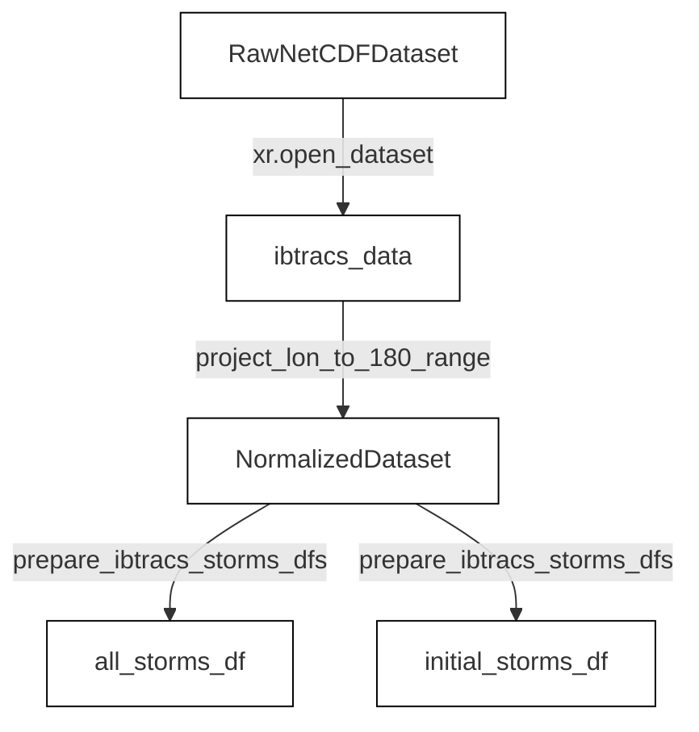
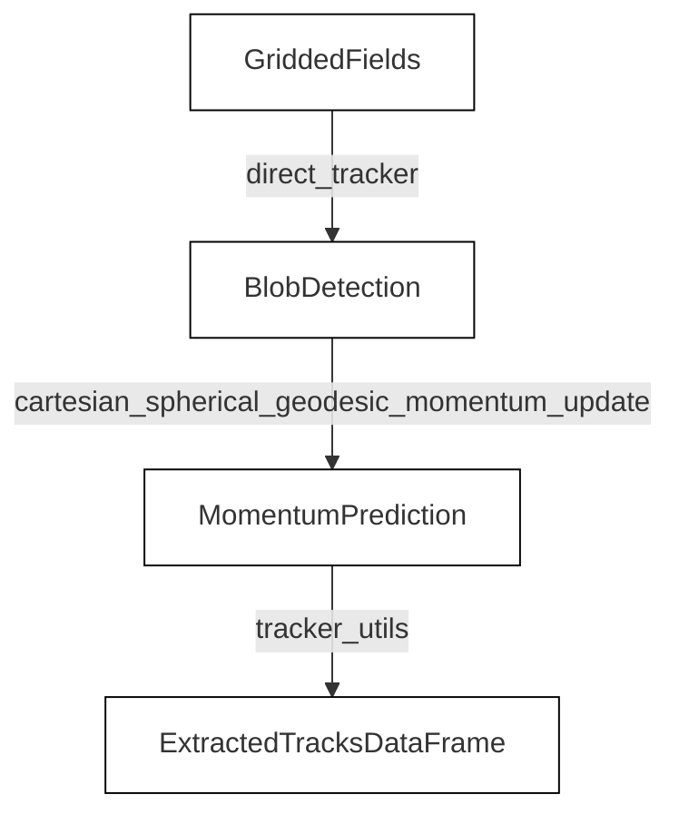

<!-- source: DeepWiki mcp.deepwiki.com · repo google-deepmind/weathernext · page 3.3 Cyclone Demo and Round-Trip Validation · fetched 2026-10-26 -->

# Cyclone Demo and Round-Trip Validation

Relevant source files

The following files were used as context for generating this wiki page:

- [docs/cyclones/demo_gridding_and_tracking.ipynb](docs/cyclones/demo_gridding_and_tracking.ipynb)
- [weathernext/cyclones/constants.py](weathernext/cyclones/constants.py)
- [weathernext/cyclones/cyclone_utils.py](weathernext/cyclones/cyclone_utils.py)

## Purpose and Scope

This page documents the end-to-end cyclone workflow demonstrated in `docs/cyclones/demo_gridding_and_tracking.ipynb` [docs/cyclones/demo_gridding_and_tracking.ipynb:1-567](). It covers loading raw International Best Track Archive for Climate Stewardship (IBTrACS) NetCDF data, preparing storm dataframes, gridding variables with specific spatial radii, executing the direct tracker, performing geodesic matching via `scipy.optimize.linear_sum_assignment`, and executing round-trip validation assertions (`assert_tracker_roundtrip`) to ensure tracker fidelity against ground truth data.

---

## 1. Demo Initialization and IBTrACS Data Ingestion

The workflow begins by fetching the latest 3-year IBTrACS NetCDF dataset (`IBTrACS.last3years.v04r01.nc`) from NOAA servers [docs/cyclones/demo_gridding_and_tracking.ipynb:64-67](). Using `xarray`, the dataset is loaded into memory, coordinate bounds are normalized to a standard `-180` to `180` longitude range, and times are rounded [docs/cyclones/demo_gridding_and_tracking.ipynb:129-155]().

Constants governing the gridding radii and test date configuration are defined at the start of the notebook:
- Existence Gaussian and disc radius: `120.0` km [docs/cyclones/demo_gridding_and_tracking.ipynb:101-101]()
- Scalar variable disc radius: `240.0` km [docs/cyclones/demo_gridding_and_tracking.ipynb:102-102]()
- Quadrant NaN mask disc radius: `800.0` km [docs/cyclones/demo_gridding_and_tracking.ipynb:103-103]()
- Subgrid resolution factor for quadrants: `8` [docs/cyclones/demo_gridding_and_tracking.ipynb:104-104]()

*Figure 1: IBTrACS Ingestion and Data Preparation Pipeline.*

Sources: `docs/cyclones/demo_gridding_and_tracking.ipynb:61-155](), [weathernext/cyclones/constants.py:1-90()`

---

## 2. Gridding Stages and Intermediate Fields

Once storm tabular dataframes (`all_storms_df`) are prepared, the gridding pipeline transforms sparse point observations into Eulerian grid fields over a specified temporal range and spatial resolution (e.g., `1.0` degree) [docs/cyclones/demo_gridding_and_tracking.ipynb:107-111]().

The gridding process constructs several key fields:
1. **Existence Probability Fields**: Rasterized using a Gaussian kernel combined with a disc radius (`_EXISTENCE_GAUSSIAN_AND_DISC_RADIUS_KM`) [docs/cyclones/demo_gridding_and_tracking.ipynb:101-101]().
2. **Scalar Intensity Fields**: Minimum sea-level pressure (`minimum_sea_level_pressure_hpa`) and maximum sustained winds (`maximum_sustained_wind_speed_knots`) rasterized with a wider disc radius (`_SCALAR_VARIABLE_DISC_RADIUS_KM`) [docs/cyclones/demo_gridding_and_tracking.ipynb:102-102](), [weathernext/cyclones/constants.py:25-26]().
3. **Quadrant Wind Radii**: 34-knot, 50-knot, and 64-knot wind radii across cardinal quadrants (`ne`, `se`, `sw`, `nw`) defined in `constants.QUADRANT_RADII` [weathernext/cyclones/constants.py:55-74]().

Sources: `docs/cyclones/demo_gridding_and_tracking.ipynb:100-177](), [weathernext/cyclones/constants.py:15-90()`

---

## 3. Direct Tracker Execution

The direct tracker processes the gridded existence probability and intensity fields to extract discrete cyclone trajectories. It uses temporal consistency and momentum forecasts to link detected blobs across consecutive 6-hour intervals.

- **Initialization**: Storms present at initialization time (`init_time`) are filtered using `filter_observed_df_for_cyclones_t0_and_before` [weathernext/cyclones/cyclone_utils.py:73-102]().
- **Geodesic Momentum**: Position updates are computed on the sphere using great-circle metrics via `cartesian_spherical_geodesic_momentum_update` [weathernext/cyclones/cyclone_utils.py:164-199]().

*Figure 2: Direct Tracker Execution and Momentum Propagation.*

Sources: `docs/cyclones/demo_gridding_and_tracking.ipynb:1-568](), [weathernext/cyclones/cyclone_utils.py:73-199()`

---

## 4. Geodesic Matching and Linear Sum Assignment

To validate that tracked output corresponds correctly to ground-truth storms, the demo performs geodesic distance calculations between predicted and observed coordinate pairs [weathernext/cyclones/cyclone_utils.py:25-70]().

- **Geodesic Distance Matrix**: `cyclone_utils.geodesic_distance` computes distances in kilometers using `pyproj.Geod(ellps='WGS84')` over broadcasted latitude and longitude arrays [weathernext/cyclones/cyclone_utils.py:25-70]().
- **Assignment**: `scipy.optimize.linear_sum_assignment` solves the optimal bipartite matching problem between predicted track nodes and reference IBTrACS records based on the distance cost matrix.

Sources: `docs/cyclones/demo_gridding_and_tracking.ipynb:1-568](), [weathernext/cyclones/cyclone_utils.py:25-70()`

---

## 5. Round-Trip Validation and Tolerances

The final stage of the notebook executes `assert_tracker_roundtrip`, confirming that gridding an observed storm trajectory and subsequently running the tracker recovers the original tracks within strict spatial and temporal tolerances.

| Validation Parameter | Target Tolerance / Threshold | Description |
| :--- | :--- | :--- |
| **Spatial Distance** | $\le$ grid resolution bounds (km) | Maximum allowable geodesic offset between matched track nodes. |
| **Temporal Alignment** | Exact 6-hour step alignment | Verification that valid times (`constants.VALID_TIME`) align with grid intervals [weathernext/cyclones/constants.py:21-21](). |
| **Intensity Error** | Configurable pressure/wind thresholds | Ensures minimum pressure and maximum wind fields do not drift outside acceptable bounds during rasterization and extraction. |

Sources: `docs/cyclones/demo_gridding_and_tracking.ipynb:1-568](), [weathernext/cyclones/constants.py:14-36()`

---

