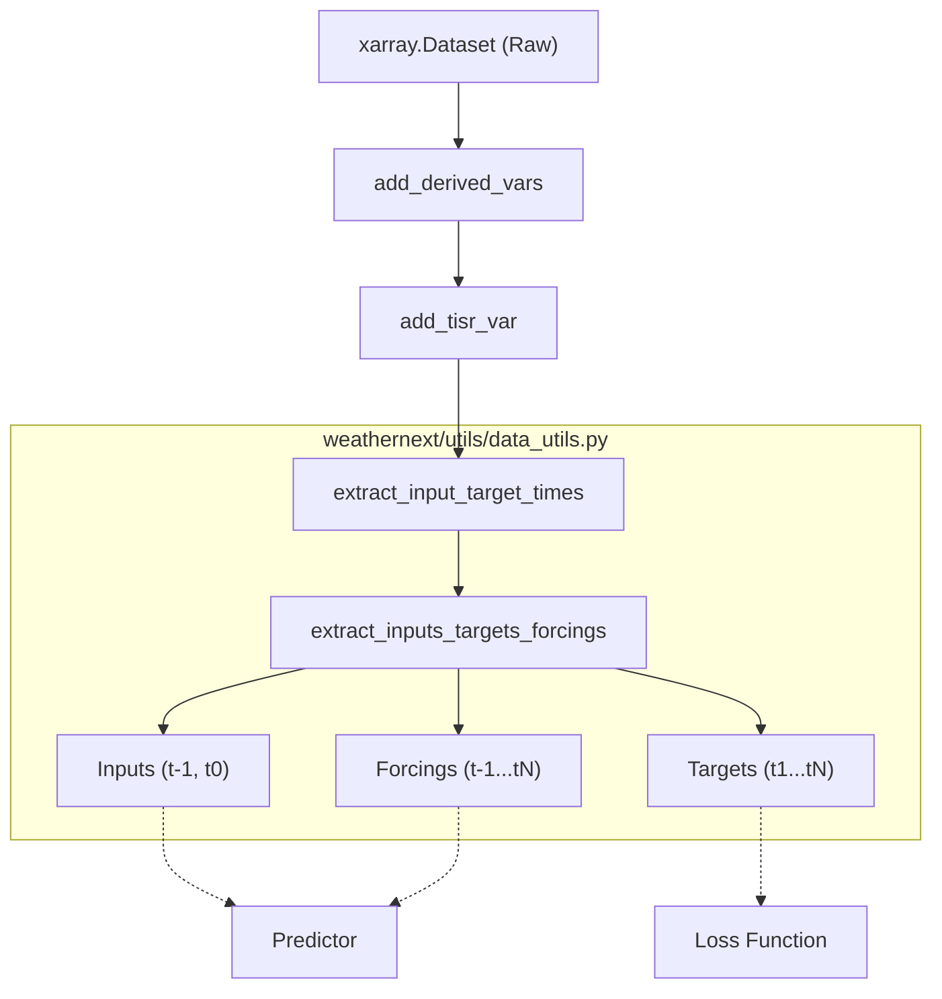
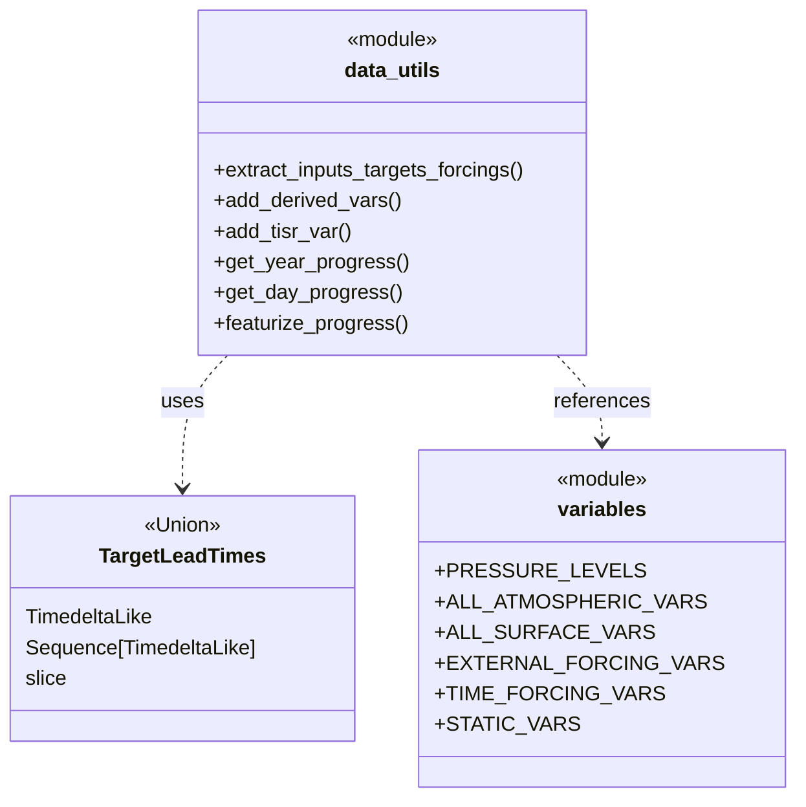

<!-- source: DeepWiki mcp.deepwiki.com · repo google-deepmind/weathernext · page 4.1 Data Utilities: Inputs, Targets, and Forcings · fetched 2026-10-26 -->

# Data Utilities: Inputs, Targets, and Forcings

Relevant source files

The following files were used as context for generating this wiki page:

- [weathernext/utils/data_utils.py](weathernext/utils/data_utils.py)
- [weathernext/utils/data_utils_test.py](weathernext/utils/data_utils_test.py)
- [weathernext/utils/variables.py](weathernext/utils/variables.py)

This page details the utility functions and constants within `weathernext/utils/data_utils.py` and `weathernext/utils/variables.py` responsible for transforming raw meteorological datasets into structured formats suitable for WeatherNext models. This includes temporal feature engineering, Top-of-Atmosphere Incident Solar Radiation (TISR) integration, time-sliced inputs, targets, forcing variables, and variable catalog definitions.

## Overview of Data Flow

The data utility layer acts as a bridge between raw `xarray.Dataset` objects (e.g., from ERA5 or HRES) and the model's expected input structure. The primary entry point for this transformation is `extract_inputs_targets_forcings`, which orchestrates time slicing, coordinate parsing, and feature augmentation.

### Data Extraction Pipeline
The following diagram illustrates how a raw dataset is processed into the components required for a forecast task.

**Diagram: Data Extraction and Feature Augmentation**

Sources: [weathernext/utils/data_utils.py:142-183](), [weathernext/utils/data_utils.py:184-201]()

---

## Temporal Feature Engineering

To help models understand cyclic temporal patterns, `weathernext/utils/data_utils.py` implements progress tracking for both days and years. These values are normalized to the `[0, 1)` interval and encoded using sine and cosine transformations to ensure continuity (e.g., ensuring a smooth transition across midnight or year boundaries).

### Year and Day Progress
*   **Year Progress**: Computed via `get_year_progress` based on seconds since the UNIX epoch, using an average year length of 365.24219 days [weathernext/utils/data_utils.py:35-36](), [weathernext/utils/data_utils.py:51-71]().
*   **Day Progress**: Computed via `get_day_progress`. Unlike year progress, day progress is local to specific longitudes, offsetting Greenwich Mean Time (GMT) progress by the longitude of each grid point [weathernext/utils/data_utils.py:74-100]().

### Sine/Cosine Encoding
The `featurize_progress` function takes a progress variable and generates three features:
1.  The original progress value.
2.  `sin(2 * pi * progress)`.
3.  `cos(2 * pi * progress)`.

These are stored with the suffixes `_sin` and `_cos` [weathernext/utils/data_utils.py:103-132]().

Sources: [weathernext/utils/data_utils.py:38-47](), [weathernext/utils/data_utils.py:103-132](), [weathernext/utils/data_utils_test.py:120-148]()

---

## Top-of-Atmosphere Incident Solar Radiation (TISR)

TISR is a critical forcing variable for weather models. The function `add_tisr_var` integrates this data into the dataset [weathernext/utils/data_utils.py:184-201]().

*   **Implementation**: It coordinates with `solar_radiation.get_toa_incident_solar_radiation_for_xarray` to compute radiation based on `datetime`, `lat`, and `lon` coordinates.
*   **Forcing Role**: TISR is treated as an external forcing variable because its future values are known exactly from celestial mechanics, allowing the model to leverage future TISR when predicting future weather states.

Sources: [weathernext/utils/data_utils.py:48-49](), [weathernext/utils/data_utils.py:184-201]()

---

## Time Slicing and Target Lead Times

The utility provides flexible formats to define which time steps constitute inputs and targets.

### TargetLeadTimes Type
The `TargetLeadTimes` type alias supports three formats for specifying forecast horizons:
*   A single `TimedeltaLike` object (e.g., `"6h"`).
*   A sequence of `TimedeltaLike` objects.
*   A `slice` object using `TimedeltaLike` as its start and stop bounds [weathernext/utils/data_utils.py:26-30]().

### Extraction Logic
*   **Input Times**: Typically two steps (e.g., $t-6h$ and $t$) to provide temporal context and tendencies.
*   **Target Times**: The sequence of future steps the model is tasked to predict.
*   **Forcing Times**: Spans both input and target times, as the model requires forcing data for every processed step.

Sources: [weathernext/utils/data_utils.py:26-30]()

---

## Variable Catalogs and Constants (`variables.py`)

Constants and metadata regarding meteorological variables are centralized in `weathernext/utils/variables.py`. This module defines standard pressure level groupings and variable categorical classifications:

*   **Pressure Levels**: Defines standard vertical coordinate sets including ERA5 (37 levels), HRES (25 levels), and WeatherBench (13 levels) [weathernext/utils/variables.py:17-35]().
*   **Atmospheric Variables**: `ALL_ATMOSPHERIC_VARS` lists 3D fields such as `temperature`, `u_component_of_wind`, and `specific_humidity` [weathernext/utils/variables.py:39-56]().
*   **Surface Variables**: `ALL_SURFACE_VARS` lists 2D fields like `2m_temperature`, `mean_sea_level_pressure`, and `total_precipitation_6hr` [weathernext/utils/variables.py:58-67]().
*   **Forcing and Static Variables**: External forcings like `toa_incident_solar_radiation`, time progress features (`year_progress_sin`, etc.), and static surface fields like `land_sea_mask` and `geopotential_at_surface` [weathernext/utils/variables.py:68-82]().

Sources: [weathernext/utils/variables.py:1-82]()

---

## Code Architecture Entity Mapping

**Diagram: Entity Mapping - Data Utilities and Variables**

Sources: [weathernext/utils/data_utils.py:16-30](), [weathernext/utils/variables.py:1-82]()

---

## Testing (`data_utils_test.py`)

The test suite in `weathernext/utils/data_utils_test.py` validates correctness across time calculations and dataset updates:
*   `test_year_progress_is_zero_at_year_start_or_end`: Verifies boundary conditions for year progress [weathernext/utils/data_utils_test.py:30-38]().
*   `test_day_progress_is_in_between_zero_and_one`: Checks longitude-dependent day progress ranges [weathernext/utils/data_utils_test.py:81-99]().
*   `test_featurize_progress_valid_values_and_dimensions`: Confirms trigonometric transformation correctness and matching dimensional constraints [weathernext/utils/data_utils_test.py:120-148]().
*   `test_add_derived_vars_variables_added`: Ensures datasets are correctly augmented with missing temporal coordinates without overriding existing keys [weathernext/utils/data_utils_test.py:157-190]().

Sources: [weathernext/utils/data_utils_test.py:23-190]()

---

