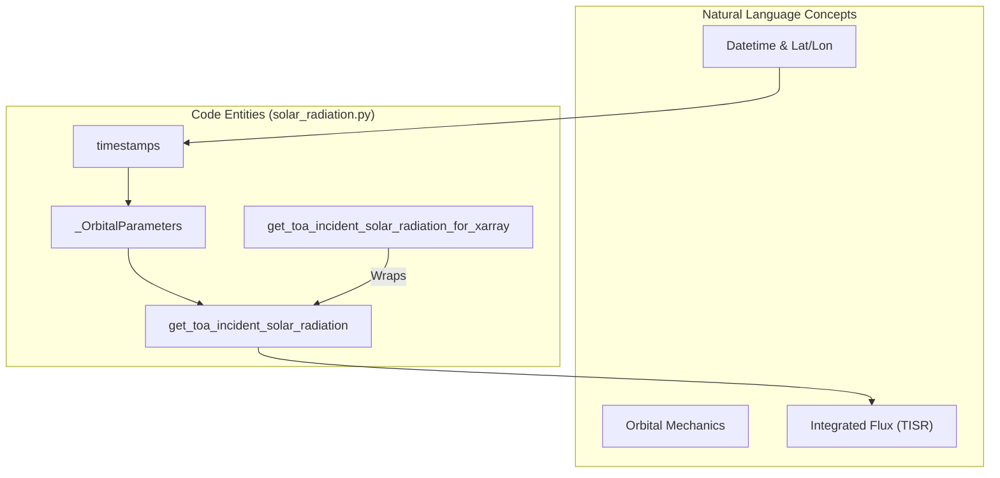

<!-- source: DeepWiki mcp.deepwiki.com · repo google-deepmind/weathernext · page 4.2 Solar Radiation Forcing · fetched 2026-10-26 -->

# Solar Radiation Forcing

Relevant source files

The following files were used as context for generating this wiki page:

- [weathernext/utils/solar_radiation.py](weathernext/utils/solar_radiation.py)
- [weathernext/utils/solar_radiation_test.py](weathernext/utils/solar_radiation_test.py)

Top-of-the-Atmosphere (TOA) incident solar radiation (TISR) is a critical forcing variable for weather models, representing the incoming solar energy flux. In the WeatherNext repository, TISR is computed as a function of time and spatial coordinates to match ERA5 specifications, where it represents the solar radiation flux integrated over a one-hour period ending at a specific timestamp [weathernext/utils/solar_radiation.py:14-22]().

Sources:
* [weathernext/utils/solar_radiation.py:14-22]()

---

## Core Logic: `solar_radiation.py`

The implementation computes the solar radiation by modeling Earth's orbital parameters and integrating the solar flux over a specified time window.

### Total Solar Irradiance (TSI)
The model supports multiple sources for TSI, which defines the energy input to the top of the atmosphere in $W \cdot m^{-2}$.
*   **`reference_tsi_data`**: Returns a constant reference value of 1361.0 $W \cdot m^{-2}$ [weathernext/utils/solar_radiation.py:74-80]().
*   **`era5_tsi_data`**: Provides historical and projected TSI values (1951–2034) used in ERA5, including a repeating 13-year cycle for future dates [weathernext/utils/solar_radiation.py:83-115]().
*   **`get_tsi`**: Interpolates the yearly TSI data to specific timestamps using fractional years [weathernext/utils/solar_radiation.py:131-153]().

### Orbital Mechanics and Flux Computation
The computation relies on `_OrbitalParameters`, which tracks Earth's position relative to the Sun [weathernext/utils/solar_radiation.py:156-175]().

| Entity | Role |
| :--- | :--- |
| `_OrbitalParameters` | Dataclass storing orbital and rotational state arrays for given timestamps [weathernext/utils/solar_radiation.py:156-175](). |

Sources:
* [weathernext/utils/solar_radiation.py:74-153]()
* [weathernext/utils/solar_radiation.py:156-175]()

---

## Integration and Data Flow

The solar radiation module bridges the gap between raw timestamps/coordinates and the xarray datasets used by the model.

### Mapping Natural Language to Code Entities (Calculation Flow)

Sources:
* [weathernext/utils/solar_radiation.py:131-153]()
* [weathernext/utils/solar_radiation.py:156-175]()

### Integration into Data Pipeline

**Key Integration Functions:**
1.  **`get_toa_incident_solar_radiation`**: The core JAX-compatible function computing radiation across latitudes and longitudes for a given set of timestamps [weathernext/utils/solar_radiation.py:14-35]().
2.  **`get_toa_incident_solar_radiation_for_xarray`**: A wrapper that extracts coordinates from an `xarray` object and returns a `DataArray` with the computed TISR [weathernext/utils/solar_radiation_test.py:50-76]().

Sources:
* [weathernext/utils/solar_radiation.py:14-35]()
* [weathernext/utils/solar_radiation_test.py:50-76]()

---

## Technical Details

### Integration Method
To match ERA5's hourly accumulation, the flux is integrated using a trapezoidal rule over `num_integration_bins` (default: 360) within the `integration_period` (default: 1 hour) [weathernext/utils/solar_radiation.py:36-41]().

### Performance
The computation is fully JAX-differentiable and supports JIT compilation via `get_toa_incident_solar_radiation` to accelerate processing over global grids [weathernext/utils/solar_radiation_test.py:115-161]().

### Coordinate Requirements
The xarray wrapper expects the following:
*   **Dimensions**: `lat` and `lon` [weathernext/utils/solar_radiation_test.py:50-76]().
*   **Coordinates**: `datetime` or a `time` coordinate resolving to valid timestamps [weathernext/utils/solar_radiation_test.py:78-97]().

Sources:
* [weathernext/utils/solar_radiation.py:36-41]()
* [weathernext/utils/solar_radiation_test.py:50-161]()

---

