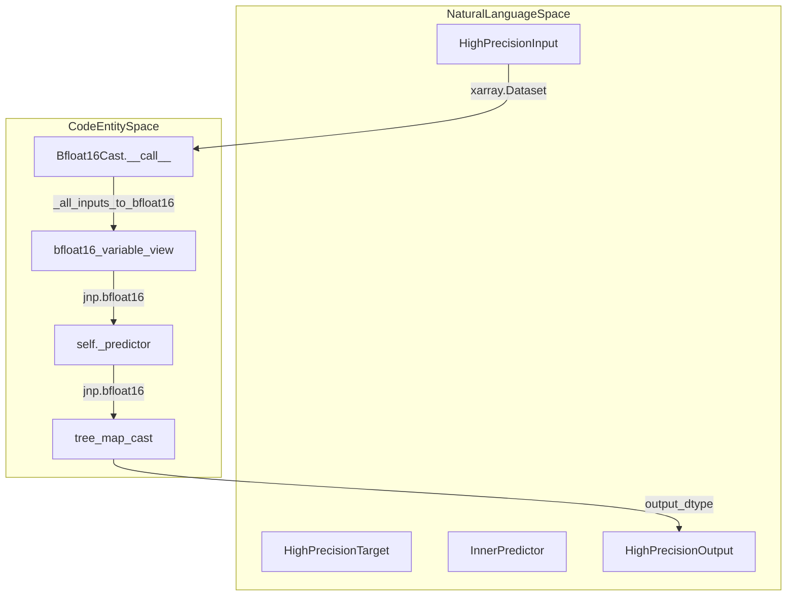
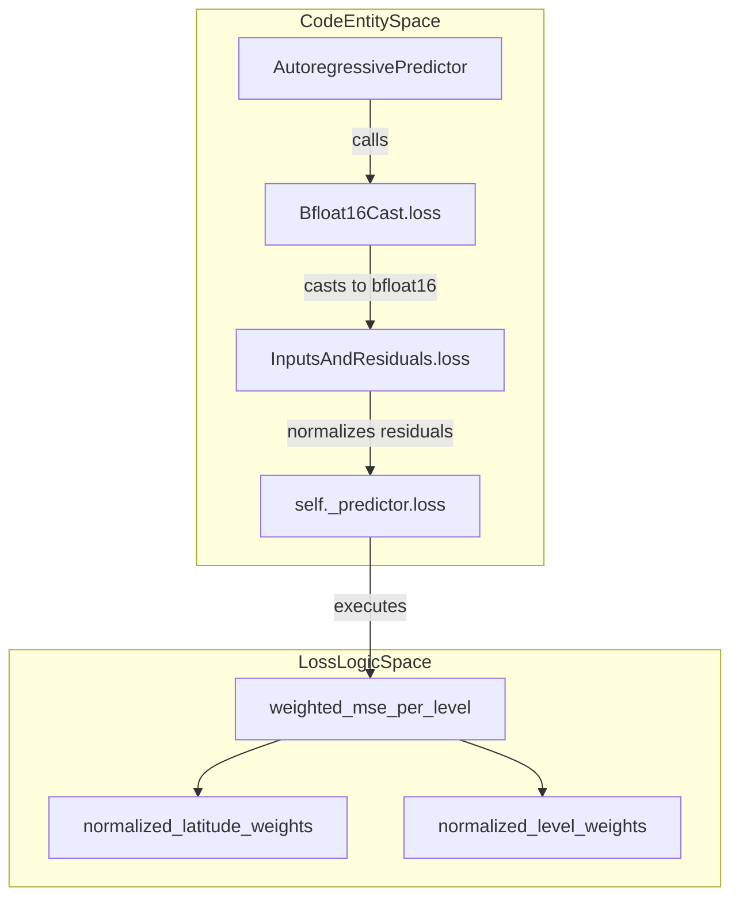

<!-- source: DeepWiki mcp.deepwiki.com · repo google-deepmind/weathernext · page 4.4 Predictor Wrappers: Normalization, Casting, and NaN Cleaning · fetched 2026-10-26 -->

# Predictor Wrappers: Normalization, Casting, and NaN Cleaning

Relevant source files

The following files were used as context for generating this wiki page:

- [weathernext/utils/casting.py](weathernext/utils/casting.py)
- [weathernext/utils/ensemble.py](weathernext/utils/ensemble.py)
- [weathernext/utils/nan_cleaning.py](weathernext/utils/nan_cleaning.py)
- [weathernext/utils/normalization.py](weathernext/utils/normalization.py)
- [weathernext/utils/predictor_base.py](weathernext/utils/predictor_base.py)

The WeatherNext codebase utilizes a layered wrapper pattern to enhance base predictors with critical data engineering, precision management, normalization, missing value cleaning, and ensemble dimension broadcasting. These wrappers implement the `Predictor` abstract base class, allowing them to be stacked modularly to handle precision (`bfloat16`), data normalization, residual prediction, missing values (NaNs), and sample dimensions.

### The Predictor Interface

All model wrappers and base models adhere to the `Predictor` interface defined in `weathernext/utils/predictor_base.py`. This interface ensures that regardless of internal model complexity (e.g., whether a model predicts residuals or raw values), the external API remains consistent, using `xarray.Dataset` objects for inputs, targets, and forcings.

The core methods defined in `Predictor` `[weathernext/utils/predictor_base.py:27-140]()` include:
*   `__call__`: Executes inference given inputs, a target template, and optional forcings `[weathernext/utils/predictor_base.py:44-84]()`.
*   `loss`: Computes training loss and diagnostics `[weathernext/utils/predictor_base.py:86-130]()`.
*   `loss_and_predictions`: A combined method used in autoregressive rollouts where both the loss and the output values are needed simultaneously `[weathernext/utils/predictor_base.py:132-155]()`.

Sources: `[weathernext/utils/predictor_base.py:27-155]()`

---

### Precision Management: Bfloat16Cast

The `Bfloat16Cast` wrapper is responsible for managing mixed-precision execution. It casts all input `xarray.Dataset` values to `jnp.bfloat16` before passing them to the inner predictor and ensures that outputs are cast back to the target dtype (typically `float32`) for evaluation `[weathernext/utils/casting.py:31-65]`.

A key feature of this wrapper is the `bfloat16_variable_view` context manager `[weathernext/utils/casting.py:155-184]`. It allows Haiku modules to maintain parameters in `float32` for stable gradient accumulation while using `bfloat16` for activations during the forward pass `[weathernext/utils/casting.py:156-168]()`.

#### Data Flow in Bfloat16Cast
The following diagram illustrates how `Bfloat16Cast` intercepts the data flow to manage types.

**Diagram: Bfloat16 Precision Wrapping**

Sources: `[weathernext/utils/casting.py:31-65]`, `[weathernext/utils/casting.py:155-184]()`

---

### Normalization and Residuals: InputsAndResiduals

The `InputsAndResiduals` wrapper implements two critical meteorological modeling patterns:
1.  **Standardization**: Inputs and forcings are normalized to zero-mean and unit variance using pre-computed statistics `[weathernext/utils/normalization.py:148-155]()`.
2.  **Residual Prediction**: Instead of predicting absolute values for variables present in the input (e.g., temperature), the model predicts the *change* (residual) relative to the last input frame `[weathernext/utils/normalization.py:113-128]()`.

The normalization logic is handled by `normalize` `[weathernext/utils/normalization.py:29-48]()` and `unnormalize` `[weathernext/utils/normalization.py:51-70]()` functions, which traverse the dataset using `xarray_tree.map_structure`.

| Component | Logic | Code Reference |
| :--- | :--- | :--- |
| **Input Normalization** | `(x - mean) / stddev` | `[weathernext/utils/normalization.py:40-44]()` |
| **Residual Target** | `(target - last_input) / residual_stddev` | `[weathernext/utils/normalization.py:139-144]()` |
| **Direct Target** | `(target - mean) / stddev` | `[weathernext/utils/normalization.py:146-146]()` |

Sources: `[weathernext/utils/normalization.py:29-160]()`

---

### Handling Missing Data: NaNCleaner

The `NaNCleaner` wrapper addresses issues with missing values, which are common in meteorological variables such as `sea_surface_temperature` where land masses result in `NaN` values in raw data `[weathernext/utils/nan_cleaning.py:28-32]()`.

*   **Cleaning**: Replaces `NaN` values with a provided `fill_value` (usually the mean or a constant) before the data enters the model `[weathernext/utils/nan_cleaning.py:47-53]()`.
*   **Reintroduction**: If `reintroduce_nans` is enabled, the wrapper uses the original input mask to place `NaN` values back into predictions, ensuring the model does not produce unmasked values over land `[weathernext/utils/nan_cleaning.py:55-64]()`.

Sources: `[weathernext/utils/nan_cleaning.py:28-126]()`

---

### Ensemble Wrappers: WithSampleDim

The `WithSampleDim` wrapper adds a leading sample dimension broadcasting datasets for ensemble predictions, typically used with generative or probabilistic models like FGN `[weathernext/utils/ensemble.py:22-33]()`.

*   **Broadcasting**: It maps `_add_sample_axis` across inputs, targets template, and forcings to expand the leading dimension by `num_samples` `[weathernext/utils/ensemble.py:29-43]()`.
*   **Loss Compatibility**: It also forwards loss calls by expanding dataset dimensions accordingly before invoking the underlying predictor `[weathernext/utils/ensemble.py:45-55]()`.

Sources: `[weathernext/utils/ensemble.py:22-55]()`

---

### Loss Function Integration

The wrappers coordinate transformations across loss values. The base loss calculation is computed on normalized residuals or variables within the wrapper stack `[weathernext/utils/normalization.py:162-175]()`.

**Diagram: Loss Computation Stack**

Sources: `[weathernext/utils/normalization.py:162-175]`, `[weathernext/utils/casting.py:67-91]()`

---

