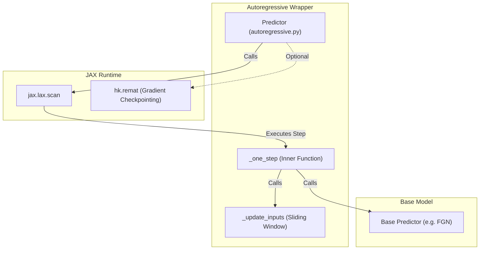
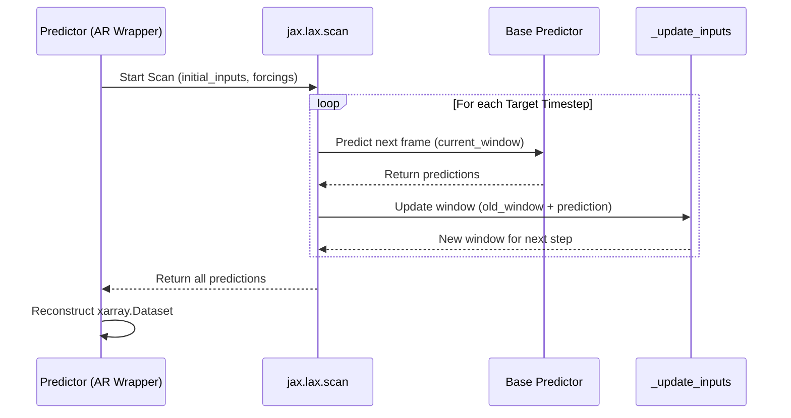

<!-- source: DeepWiki mcp.deepwiki.com · repo google-deepmind/weathernext · page 4.5 Autoregressive Predictor Wrapper · fetched 2026-10-26 -->

# Autoregressive Predictor Wrapper

Relevant source files

The following files were used as context for generating this wiki page:

- [weathernext/utils/autoregressive.py](weathernext/utils/autoregressive.py)

The **Autoregressive Predictor Wrapper** is a high-level component that transforms a single-step forecasting model into a multi-step rollout engine. It manages the sliding window of input states, handles the integration of static and time-dependent variables, and provides JAX-native optimizations like gradient checkpointing for Backpropagation Through Time (BPTT).

## Overview and Purpose

The `Predictor` class in `weathernext/utils/autoregressive.py` acts as a decorator for any base model implementing the `Predictor` interface. While the underlying model is typically designed to predict state $X_{t+1}$ given $X_t$ and $X_{t-1}$, the autoregressive wrapper enables the generation of long-range forecasts $X_{t+1}, \dots, X_{t+N}$ by recursively feeding its own predictions back as inputs.

Key responsibilities include:
*   **Sliding Window Management**: Maintaining the historical context required by the base model (e.g., multiple steps of history) as the rollout progresses [weathernext/utils/autoregressive.py:40-47]().
*   **Variable Handling**: Separating static inputs (e.g., orography) from time-dependent variables and forcings (e.g., solar radiation) [weathernext/utils/autoregressive.py:53-57]().
*   **Differentiable Rollout**: Utilizing `jax.lax.scan` to ensure the entire multi-step trajectory is differentiable for training [weathernext/utils/autoregressive.py:39-87]().
*   **Memory Optimization**: Providing gradient checkpointing to manage memory consumption during long BPTT sequences [weathernext/utils/autoregressive.py:67-82]().

Sources: [weathernext/utils/autoregressive.py:14-61](), [weathernext/utils/autoregressive.py:63-86]()

## Data Flow and Architecture

The wrapper bridges the gap between the high-level `xarray.Dataset` objects used in data processing and the low-level JAX arrays used in the model's forward pass.

### System Entity Mapping
The following diagram illustrates how the `Predictor` wrapper interacts with its internal components and the JAX runtime.

**Predictor Wrapper Entity Map**

Sources: [weathernext/utils/autoregressive.py:39-61](), [weathernext/utils/autoregressive.py:114-125]()

### Input and Target Management
The wrapper enforces strict rules on how variables are categorized to ensure the autoregressive loop is physically and mathematically consistent:

| Variable Category | Description | Constraints |
| :--- | :--- | :--- |
| **Static Inputs** | Variables that do not change over time (e.g., land-sea mask). | Must NOT have a `time` dimension [weathernext/utils/autoregressive.py:92-97](). |
| **Forcings** | External time-dependent variables provided as ground truth (e.g., TISR). | Must have a `time` dimension; cannot overlap with targets [weathernext/utils/autoregressive.py:105-112](). |
| **Targets** | Variables the model predicts and feeds back. | Must have a `time` dimension [weathernext/utils/autoregressive.py:101-103](). |

Sources: [weathernext/utils/autoregressive.py:88-112]()

## Implementation Details

### The Rollout Loop (`jax.lax.scan`)
The core of the multi-step prediction is implemented using `jax.lax.scan`. This allows JAX to compile the entire rollout into a single efficient XLA HLO, minimizing overhead between timesteps.

1.  **Preparation**: The wrapper flattens the `xarray.Dataset` into a structure of JAX arrays using `xarray_tree` [weathernext/utils/autoregressive.py:28-36]().
2.  **Initial State**: The initial inputs (e.g., $T_{-1}$ and $T_0$) are prepared as the starting carry for the scan [weathernext/utils/autoregressive.py:39-87]().
3.  **Iteration**: For each step in the `targets_template`, the inner step function:
    *   Applies the base predictor [weathernext/utils/autoregressive.py:63-87]().
    *   Injects noise if configured (only during training) [weathernext/utils/autoregressive.py:73-76]().
    *   Updates the sliding window via `_update_inputs`, dropping the oldest frame and appending the new prediction [weathernext/utils/autoregressive.py:114-125]().

### Gradient Checkpointing
For training, backpropagating through many timesteps (BPTT) can lead to Out-Of-Memory (OOM) errors. If `gradient_checkpointing=True` is set, the wrapper uses gradient checkpointing on the inner step function [weathernext/utils/autoregressive.py:77-82](). This trades computation for memory by re-calculating the forward pass of each step during the backward pass instead of storing all intermediate activations.

### Variable Reconstruction
After the `scan` completes, the results are a collection of JAX arrays with a new `time` dimension. The wrapper uses `_unflatten_and_expand_time` to restore these into a properly formatted `xarray.Dataset` that matches the `targets_template` [weathernext/utils/autoregressive.py:28-30]().

**Rollout Data Flow**

Sources: [weathernext/utils/autoregressive.py:28-36](), [weathernext/utils/autoregressive.py:114-125]()

## Key Functions

### `_update_inputs`
This function manages the "sliding window" of the autoregressive state. It concatenates the latest prediction (or forcing value) to the existing input buffer and discards the oldest timestep to maintain a constant buffer size [weathernext/utils/autoregressive.py:114-125]().

### `_get_and_validate_constant_inputs`
This utility identifies variables in the `inputs` dataset that are neither targets nor forcings. It ensures these "static" variables do not have a time dimension, preventing ambiguous state updates during the rollout [weathernext/utils/autoregressive.py:88-98]().

### `_validate_targets_and_forcings`
Validates that all target and forcing variables possess a proper `time` dimension and that no variable is redundantly specified as both a target and a forcing [weathernext/utils/autoregressive.py:100-113]().

Sources: [weathernext/utils/autoregressive.py:88-125]()

---

