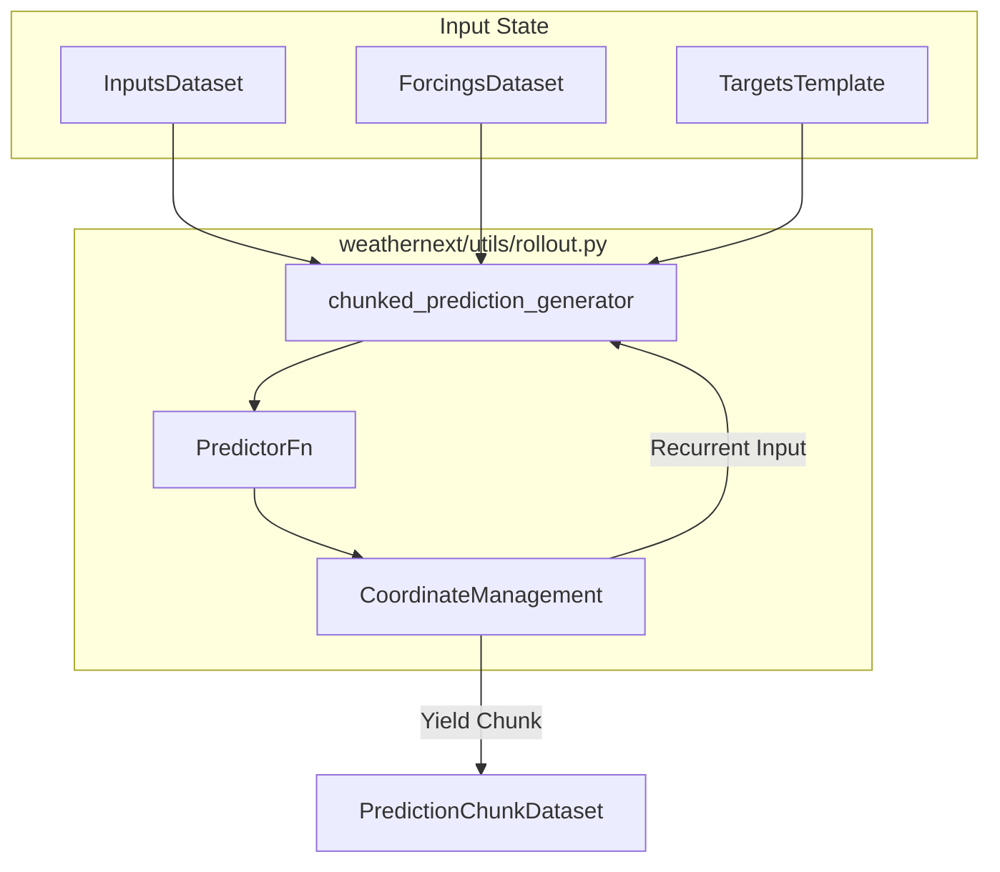
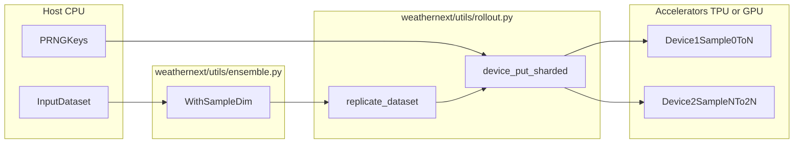

<!-- source: DeepWiki mcp.deepwiki.com · repo google-deepmind/weathernext · page 4.6 Chunked Prediction and Ensemble Rollout · fetched 2026-10-26 -->

# Chunked Prediction and Ensemble Rollout

Relevant source files

The following files were used as context for generating this wiki page:

- [weathernext/utils/ensemble.py](weathernext/utils/ensemble.py)
- [weathernext/utils/rollout.py](weathernext/utils/rollout.py)

This page documents the implementation of long-lead autoregressive rollouts and ensemble forecasting in the WeatherNext codebase. These utilities, primarily located in `weathernext/utils/rollout.py` and `weathernext/utils/ensemble.py`, enable memory-efficient predictions by processing the forecast trajectory in chunks and managing device sharding for parallel ensemble members.

## Overview of Rollout Mechanics

The rollout system bridges the gap between a single-step predictor (which predicts $t+1$ given $t$) and a full forecast trajectory. It handles the recursive feeding of predictions back as inputs while managing metadata like coordinates and random number generator (RNG) states.

### Predictor Protocol
The rollout functions interact with models through the `PredictorFn` protocol. This protocol defines a functional interface for the predictor call method, requiring explicit JAX RNG keys and `xarray.Dataset` objects for inputs, targets, and forcings [weathernext/utils/rollout.py:78-87]().

### Implementation Logic
Rollouts use generator-based loops to yield chunks of the trajectory. This approach is preferred for long-inference rollouts to minimize device memory pressure and allow for lazy evaluation via Dask, distinguishing it from the training-oriented differentiable wrappers in `autoregressive.py` [weathernext/utils/rollout.py:14-14]().

Sources: [weathernext/utils/rollout.py:14-14](), [weathernext/utils/rollout.py:78-87]()

## Data Flow and Chunking

The core iterators manage internal state, ensuring that each step's output is correctly formatted to serve as the input for the subsequent prediction step.

### Prediction Loop Data Flow

Title: "Chunked Prediction Iteration Flow"

Sources: [weathernext/utils/rollout.py:78-87](), [weathernext/utils/rollout.py:158-181]()

### Key Functions and Protocols

| Function / Protocol | Role | Key Features |
| :--- | :--- | :--- |
| `PredictorFn` | Protocol | Functional predictor signature accepting explicit `rng`, `inputs`, `targets_template`, and `forcings` [weathernext/utils/rollout.py:78-87](). |
| `replicate_dataset` | Prep utility | Prepares datasets for `xarray_jax.pmap` by adding replica dimensions and optional device placement [weathernext/utils/rollout.py:91-155](). |
| `device_put_sharded` | Sharding | Stacks and places arrays onto devices using `jax.sharding.Mesh` and `PartitionSpec` [weathernext/utils/rollout.py:42-75](). |
| `chunked_prediction_generator_multiple_runs` | Ensemble Rollout | Yields time and sample chunks across multiple ensemble runs [weathernext/utils/rollout.py:158-181](). |

Sources: [weathernext/utils/rollout.py:42-75](), [weathernext/utils/rollout.py:78-87](), [weathernext/utils/rollout.py:91-155](), [weathernext/utils/rollout.py:158-181]()

## Ensemble Forecasting and Device Sharding

For generative and stochastic models, the system supports parallelized ensemble forecasting via `chunked_prediction_generator_multiple_runs` and the `WithSampleDim` wrapper (`weathernext/utils/ensemble.py`) [weathernext/utils/ensemble.py:22-44]().

### Device Sharding Logic
The system uses `jax.device_put` alongside `jax.sharding.Mesh` to distribute ensemble members across TPU/GPU chips.
*   **RNG Splitting**: RNG keys are sharded across the sample axis so each device receives unique noise for its ensemble members [weathernext/utils/rollout.py:158-181]().
*   **Data Replication**: Inputs and targets are replicated across devices using `replicate_dataset` to ensure consistent shapes for `pmap` operations [weathernext/utils/rollout.py:91-155]().
*   **Sample Dimension Broadcasting**: `WithSampleDim` adds a leading sample dimension broadcasting input data across ensemble members [weathernext/utils/ensemble.py:22-44]().

Title: "Ensemble Sharding Architecture"

Sources: [weathernext/utils/ensemble.py:22-44](), [weathernext/utils/rollout.py:42-75](), [weathernext/utils/rollout.py:91-155]()

## Coordinate and Time Management

Precise management of `xarray` coordinates is critical for the autoregressive rollout loop to maintain physical consistency:
1.  **JAX Coordinate Filtering**: Coordinates marked with JAX attributes are handled explicitly during dataset replication and flattening [weathernext/utils/rollout.py:145-152]().
2.  **Replica Dimension Transposing**: Variables containing the replica dimension are transposed to guarantee leading-axis alignment with device meshes [weathernext/utils/rollout.py:112-118]().
3.  **Static Coordinate Preservation**: Non-JAX coordinates are preserved as static metadata across chunks and replications [weathernext/utils/rollout.py:150-152]().

Sources: [weathernext/utils/rollout.py:112-118](), [weathernext/utils/rollout.py:145-152]()

---

