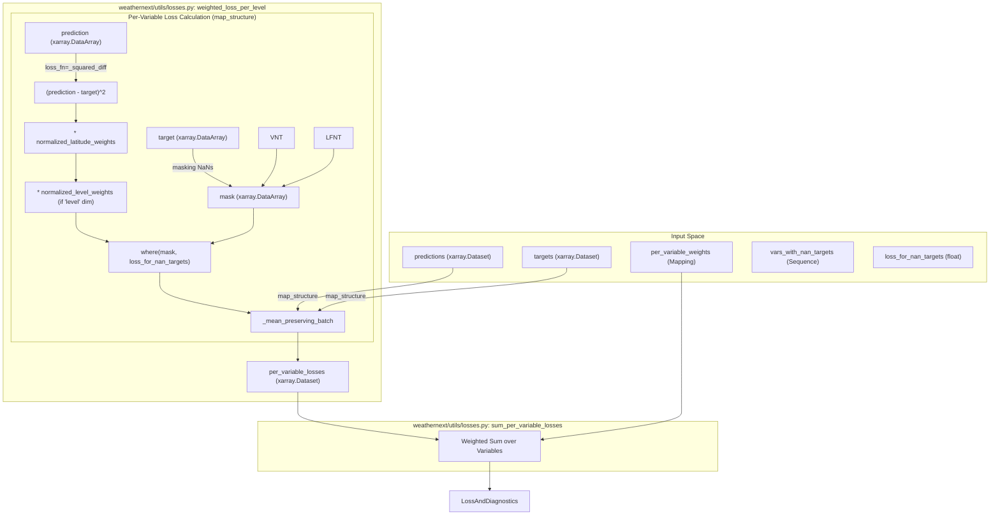
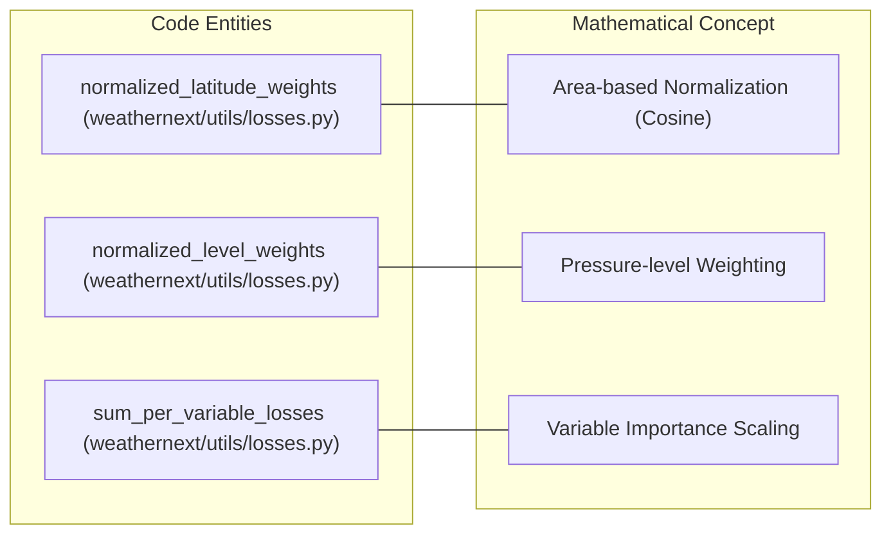

<!-- source: DeepWiki mcp.deepwiki.com · repo google-deepmind/weathernext · page 4.7 Loss Functions · fetched 2026-10-26 -->

# Loss Functions

Relevant source files

The following files were used as context for generating this wiki page:

- [weathernext/utils/losses.py](weathernext/utils/losses.py)

The `weathernext/utils/losses.py` module defines the mathematical objectives used to train and evaluate the weather forecasting models. It implements specialized weighting schemes for atmospheric data, accounting for the spherical geometry of the Earth and the varying physical significance of different pressure levels in the atmosphere.

## LossFunction Protocol

The codebase uses a `Protocol` to define the interface for loss calculations. This allows the `Predictor` classes to remain decoupled from specific loss implementations while ensuring type safety for training loops.

| Entity | Type | Description |
| :--- | :--- | :--- |
| `LossAndDiagnostics` | `tuple[xarray.DataArray, xarray.Dataset]` | A tuple containing the scalar loss per batch and a dataset of diagnostic metrics. [weathernext/utils/losses.py:25-25]() |
| `LossFunction` | `Protocol` | A callable interface that takes `predictions` and `targets` and returns `LossAndDiagnostics`. [weathernext/utils/losses.py:30-53]() |

Sources: [weathernext/utils/losses.py:25-53]()

## Weighted MSE Implementation

The primary loss function used is a weighted Mean Squared Error (MSE). Unlike standard MSE, this implementation applies weights across three dimensions: variables, latitudes, and pressure levels.

### `weighted_mse_per_level`
This function computes the MSE for each variable, applying latitude and level normalization before aggregating results.

1.  **Per-Variable Squared Difference**: It calculates `(prediction - target) ** 2` for every coordinate using `_squared_diff` [weathernext/utils/losses.py:63-65](), passed via the `loss_fn` argument to `weighted_loss_per_level` [weathernext/utils/losses.py:73-74]().
2.  **Latitude Weighting**: Applies cosine-based weighting using `normalized_latitude_weights` to account for the varying surface area of grid cells at different latitudes [weathernext/utils/losses.py:119-119]().
3.  **Level Weighting**: If the data contains a `level` dimension (3D variables), it scales the loss by the pressure level using `normalized_level_weights` [weathernext/utils/losses.py:120-121]().
4.  **NaN Handling**: For variables specified in `vars_with_nan_targets`, it masks out NaNs in the target and replaces the corresponding loss with `loss_for_nan_targets` [weathernext/utils/losses.py:108-117](), [weathernext/utils/losses.py:123-124]().
5.  **Batch Averaging**: Reduces all non-batch dimensions to produce a per-example loss using `_mean_preserving_batch` [weathernext/utils/losses.py:125-125](), [weathernext/utils/losses.py:131-132]().
6.  **Variable Summation**: Aggregates the individual variable losses using `sum_per_variable_losses` [weathernext/utils/losses.py:128-128]().

### Loss Calculation Flow
The following diagram illustrates how raw predictions are transformed into the final scalar loss.

**Diagram: Loss Computation Data Flow**

Sources: [weathernext/utils/losses.py:63-65](), [weathernext/utils/losses.py:73-74](), [weathernext/utils/losses.py:85-129](), [weathernext/utils/losses.py:131-132](), [weathernext/utils/losses.py:135-158]()

## Spatial and Vertical Weighting

Because meteorological data is often represented on a regular latitude-longitude grid, cells near the poles represent a smaller physical area than cells near the equator. Similarly, different atmospheric pressure levels represent different masses of air.

### Latitude Weighting (`normalized_latitude_weights`)
This function computes weights roughly proportional to the grid cell area [weathernext/utils/losses.py:167-167](). It supports two grid configurations:
*   **Without Poles**: For grids where latitudes are at `90 - d_lat/2` (e.g., ERA5). Weights are calculated as `cos(lat)` [weathernext/utils/losses.py:170-178]().
*   **With Poles**: For grids including exactly $\pm 90^\circ$. Pole cells are assigned a specific weight of $\sin(\Delta_{lat}/4)^2$ to account for their singular nature in the spherical coordinate system [weathernext/utils/losses.py:179-243]().

### Level Weighting (`normalized_level_weights`)
For 3D atmospheric variables, the loss is weighted by the pressure level (in hPa). The weights are proportional to the pressure value itself, normalized by the mean pressure across all levels in the dataset [weathernext/utils/losses.py:161-164]().

**Diagram: Weighting Logic Entity Mapping**

Sources: [weathernext/utils/losses.py:161-164](), [weathernext/utils/losses.py:167-243](), [weathernext/utils/losses.py:135-158]()

## Predictor Integration

The `Predictor` abstract base class defines a `loss` method that serves as the entry point for training. While the base implementation provides a dummy loss, subclasses override this to call the functions in `losses.py`.

*   **`loss`**: Returns `LossAndDiagnostics` (scalar loss + metadata).
*   **`loss_and_predictions`**: Returns both the loss and the raw predictions. This is critical for the `autoregressive.Predictor` wrapper, which needs predictions from step $N$ to calculate the loss at step $N+1$.

Sources: No specific lines from `predictor_base.py` were provided in the current file contents.

---

