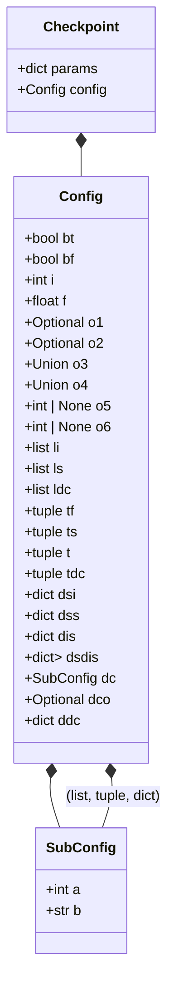
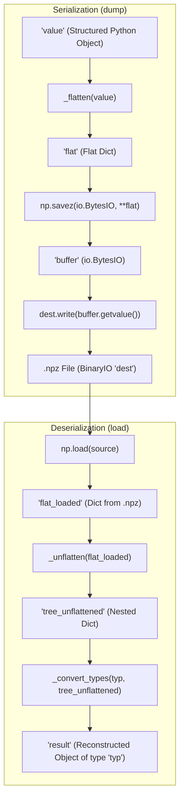

<!-- source: DeepWiki mcp.deepwiki.com · repo google-deepmind/weathernext · page 4.8 Checkpoint Serialization · fetched 2026-10-26 -->

# Checkpoint Serialization

Relevant source files

The following files were used as context for generating this wiki page:

- [weathernext/utils/checkpoint.py](weathernext/utils/checkpoint.py)
- [weathernext/utils/checkpoint_test.py](weathernext/utils/checkpoint_test.py)

The `weathernext/utils/checkpoint.py` module provides a specialized serialization framework designed to store and retrieve large-scale model parameters and configurations. It uses a custom tree-traversal logic to flatten nested Python structures (dataclasses, dictionaries, lists, and tuples) into a flat key-value format compatible with the `.npz` (NumPy zipped) format. This allows the models to be saved and loaded efficiently, including from Google Cloud Storage (GCS) as demonstrated in the repository's demo notebooks.

## Serialization Logic

The serialization process revolves around two primary operations: flattening a nested tree into a flat dictionary of NumPy-compatible arrays, and unflattening/type-casting that dictionary back into a structured Python object.

### Flattening and Unflattening
The `_flatten` function recursively traverses a tree of objects. When it encounters a nested structure, it joins the keys using a separator (`:`) to create a flat namespace [weathernext/utils/checkpoint.py:60-81]().

*   **Dataclasses**: Fields are converted to dictionary entries, excluding `None` values. This is done by iterating through `dataclasses.fields` and checking if the value is `None` [weathernext/utils/checkpoint.py:62-65]().
*   **Lists/Tuples**: Indices are converted to string keys to allow dictionary representation [weathernext/utils/checkpoint.py:66-67]().
*   **Leaves**: Must be basic types (int, float, bool, str) or NumPy arrays. The `dump` function asserts that all leaves are not `None` [weathernext/utils/checkpoint.py:79-80]().

The `_unflatten` function reverses this by splitting keys at the `_SEP` (which is `":"`) separator and rebuilding a nested dictionary structure [weathernext/utils/checkpoint.py:84-95]().

### Type Reconstruction
Because `_unflatten` only produces generic dictionaries, the `_convert_types` function uses a provided type schema (e.g., a `Checkpoint` dataclass) to cast the raw data back into specific Python types [weathernext/utils/checkpoint.py:98-170]().

*   **Optional Support**: `Optional` types (including `Union[T, None]` and `T | None`) are only supported within dataclasses. If a field corresponding to an `Optional` type is not present in the flattened dictionary, it is reconstructed as `None` [weathernext/utils/checkpoint.py:112-124]().
*   **Fixed and Arbitrary Tuples**: Supports both arbitrary-length tuples of a single type (e.g., `tuple[int, ...]`) and fixed-length tuples of arbitrary types (e.g., `tuple[int, str, float]`) [weathernext/utils/checkpoint.py:149-161]().
*   **Basic Types and NumPy Arrays**: Directly converts values to `int`, `float`, `str`, `bool`, or asserts that the value is already a `np.ndarray` [weathernext/utils/checkpoint.py:103-108]().

### Entity Mapping: Serialization Flow

The following diagram maps the logical flow of data from structured Python objects to the serialized `.npz` format.

| Data State | Code Entity | File Reference |
| :--- | :--- | :--- |
| **Structured Object** | `Checkpoint` / `Config` | [weathernext/utils/checkpoint_test.py:31-57](), [weathernext/utils/checkpoint_test.py:60-63]() |
| **Flat Dictionary** | `_flatten` output | [weathernext/utils/checkpoint.py:60-81]() |
| **Binary Stream** | `np.savez` via `dump` | [weathernext/utils/checkpoint.py:26-39]() |
| **Reconstructed Object** | `load` + `_convert_types` | [weathernext/utils/checkpoint.py:42-55]() |

Sources: [weathernext/utils/checkpoint.py:26-170](), [weathernext/utils/checkpoint_test.py:31-57](), [weathernext/utils/checkpoint_test.py:60-63]()

## The Checkpoint Structure

The `weathernext/utils/checkpoint_test.py` module defines example dataclasses `Config` and `Checkpoint` to demonstrate the serialization capabilities. The `Checkpoint` dataclass serves as a primary container for serialized model parameters and configuration.

| Field | Type | Description |
| :--- | :--- | :--- |
| `params` | `dict[str, Any]` | A dictionary representing model parameters, typically nested dictionaries of NumPy arrays. |
| `config` | `Config` | A dataclass holding various configuration parameters, including basic types, lists, tuples, and nested dataclasses. |

### Example Checkpoint Data Model

Sources: [weathernext/utils/checkpoint_test.py:26-57](), [weathernext/utils/checkpoint_test.py:60-63]()

## Key Functions

### dump
`dump(dest: BinaryIO, value: Any) -> None`
Serializes a tree of dicts/dataclasses to a file-like object. It first flattens the `value` using `_flatten` and then uses `np.savez` to write the flattened dictionary to an in-memory `io.BytesIO` buffer. Finally, the content of the buffer is written to the provided `dest` file object [weathernext/utils/checkpoint.py:26-39](). This approach ensures that `np.savez` can operate on a seekable buffer, even if `dest` itself is not seekable.

### load
`load(source: BinaryIO, typ: type[_T]) -> _T`
Reads from a file-like object using `np.load`. It then unflattens the resulting dictionary using `_unflatten` and recursively converts types based on the provided schema `typ` using `_convert_types` [weathernext/utils/checkpoint.py:42-55]().

### Logic Flow: Serialization and Deserialization

This diagram illustrates how the `weathernext/utils/checkpoint.py` module handles the transformation of a structured Python object into a flat file and back.

Sources: [weathernext/utils/checkpoint.py:26-95]()

## Cloud Integration

Checkpoints are typically stored as `.npz` files on Google Cloud Storage (GCS). The `checkpoint.py` module is designed to be compatible with such storage mechanisms.

*   **Loading from GCS**: The `load` function accepts any `BinaryIO` object [weathernext/utils/checkpoint.py:42-43](). This allows it to interface directly with cloud file systems (e.g., using `gcsfs` to open a GCS path as a file-like object) or other binary stream handlers.
*   **Memory Efficiency**: The `dump` function uses an internal `io.BytesIO` buffer to handle the serialization before writing to the destination [weathernext/utils/checkpoint.py:37-39](). This is particularly useful for `BinaryIO` objects that do not support seeking, which can be common with network-based file streams.

Sources: [weathernext/utils/checkpoint.py:16-55]()

---

