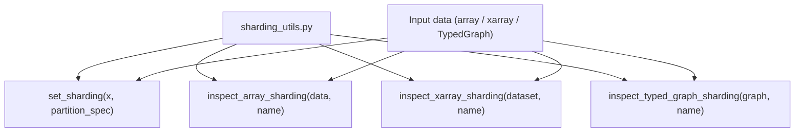
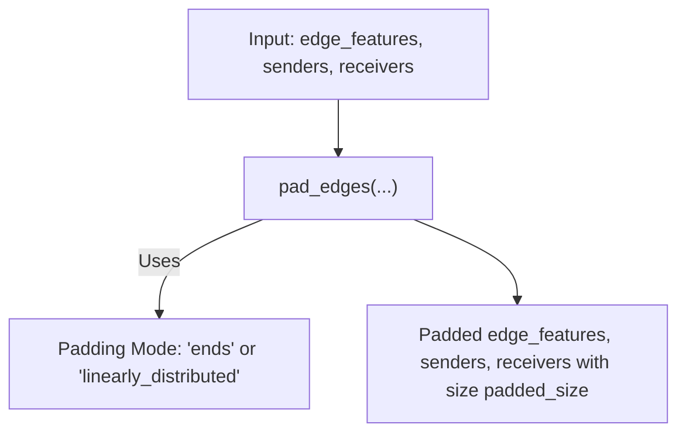
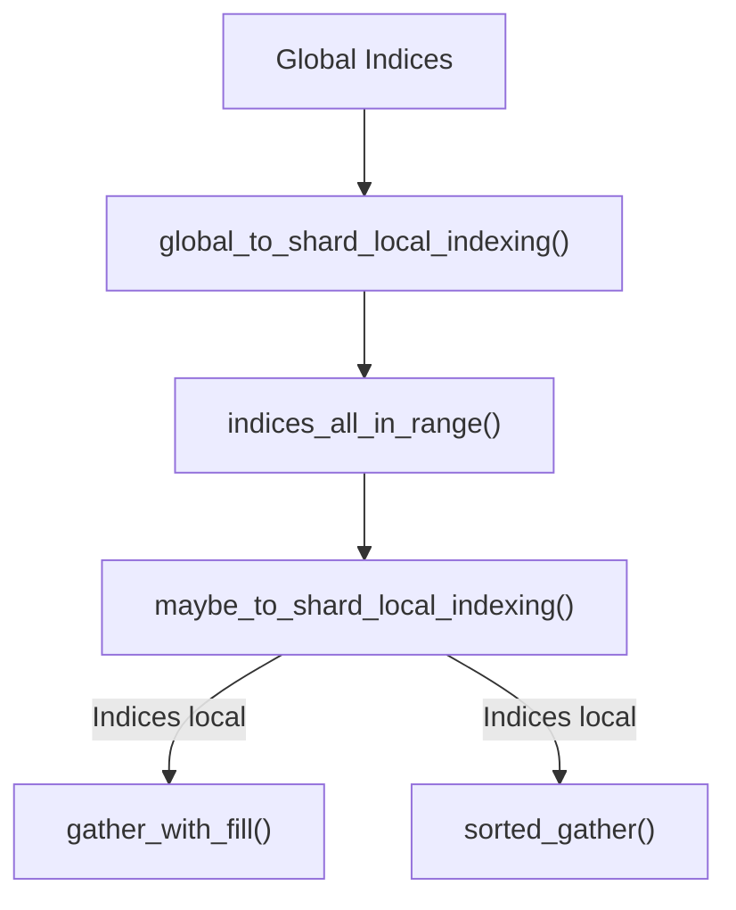
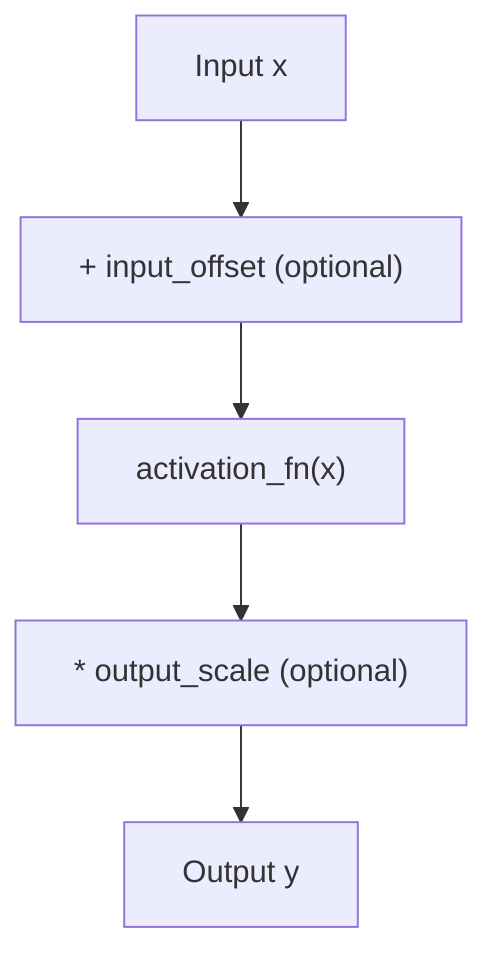
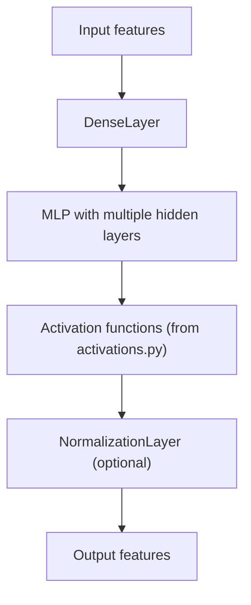
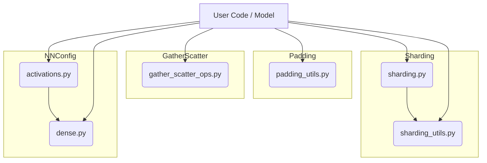

<!-- source: DeepWiki mcp.deepwiki.com · repo google-deepmind/weathernext · page 4.9 Sharding, Padding and Performance Utilities · fetched 2026-10-26 -->

# 4.9 Sharding, Padding and Performance Utilities

<details>
<summary>Relevant source files</summary>

The following files were used as context for generating this wiki page:

- [weathernext/utils/activations.py](weathernext/utils/activations.py)
- [weathernext/utils/dense.py](weathernext/utils/dense.py)
- [weathernext/utils/gather_scatter_ops.py](weathernext/utils/gather_scatter_ops.py)
- [weathernext/utils/padding_utils.py](weathernext/utils/padding_utils.py)
- [weathernext/utils/sharding.py](weathernext/utils/sharding.py)
- [weathernext/utils/sharding_utils.py](weathernext/utils/sharding_utils.py)

</details>


This page provides an in-depth technical overview of the utilities related to device sharding, array padding, gather/scatter operations, and performance-optimized activation and dense layers within the WeatherNext codebase. These utilities are critical for efficient distributed training and inference of weather models on TPU/GPU clusters by enabling structured device placement, handling irregular data sizes, and optimizing execution.

---

## Purpose and Scope

The files covered include:
- `sharding.py`: Defines conventions for device meshes and axis names used in sharding different logical dimensions (batch, ensemble, spatial, etc.). Provides helpers to query the global device mesh and shard counts.
- `sharding_utils.py`: Higher-level utilities for managing and inspecting sharding annotations on arrays, xarrays, and graph structures.
- `padding_utils.py`: Utilities to pad data arrays or graph edges to sizes compatible with sharding or hardware constraints.
- `gather_scatter_ops.py`: Efficient implementations of gather/scatter operations with safe padding handling and optional index re-mapping for local shards.
- `activations.py`: Wrappers to configure activation functions with optional input shifts and output scaling.
- `dense.py`: Dense layer construction supporting flexible MLP configurations, activation normalization options, and rematerialization for memory-efficient training.

Together, these modules underpin the parallelization, memory management, and compute efficiency strategies used in WeatherNext models, enabling scaling to large device clusters while maintaining correctness and performance.

---

## 1. Device Mesh and Sharding Conventions (`sharding.py`)

### Key Points

- Defines **named sharding axes** for the device mesh:
  - `BATCH_AXIS`: data parallelism over batch elements
  - Ensemble axes split into local (`sample_local`) and process-sharded (`sample_process`) replicas
  - Spatial partitioning axes also split into local and process-sharded (`spatial_local`, `spatial_process`)
  - `OUTER_VMAP_AXIS`: used for vmapping over an outer dimension (e.g., RNG batch)
  
- Provides utility functions:
  - `get_global_mesh()`: retrieves the global JAX device mesh used by pjit.
  - `is_global_mesh_defined()`: checks if the global mesh has been initialized and contains multiple devices.
  - `get_num_shards(axis_name)`: for a given axis or sequence of shard axis names, returns the product of device counts along the axis, or 1 if no mesh.

#### Design Notes

- The mesh axis naming scheme distinguishes between local device axes versus cross-process distributed axes to enable fine-grained control over where data and computations live.
- These conventions are fundamental to assigning data dimensions to the correct device shards, for example batch dimension mapped across TPU cores or ensemble replicates pinned per process.
- The utilities allow conditional behavior when a global mesh is not present (e.g., during CPU debugging).

```mermaid
flowchart LR
  subgraph DeviceMesh ["JAX Device Mesh"]
    GM[get_global_mesh()]
  end
  AxisNames["Sharding Axis Names"]
  BatchAxis["BATCH_AXIS = 'batch'"]
  EnsembleLocal["LOCAL_ENSEMBLE_AXIS = 'sample_local'"]
  EnsembleProcess["ENSEMBLE_PROCESS_AXIS = 'sample_process'"]
  SpatialLocal["LOCAL_SPATIAL_AXIS = 'spatial_local'"]
  SpatialProcess["SPATIAL_PROCESS_AXIS = 'spatial_process'"]

  AxisNames --> BatchAxis
  AxisNames --> EnsembleLocal
  AxisNames --> EnsembleProcess
  AxisNames --> SpatialLocal
  AxisNames --> SpatialProcess

  GM -- "provides device layout" --> get_num_shards["get_num_shards(axis_name)"]
  GM -- "used by" --> is_mesh_defined["is_global_mesh_defined()"]
```

Sources: `weathernext/utils/sharding.py:15-79`()

---

## 2. Sharding Management and Inspection (`sharding_utils.py`)

### Sharding Application

- Function `set_sharding(x, partition_spec)` applies JAX's `with_sharding_constraint` to annotate array `x` with a partition spec only if a global mesh is defined.
- This enables decorating data once with sharding specs, forwarding those constraints through the computation graphs.

### Sharding Inspection

- Functions for inspecting array and dataset sharding for debugging and verification:
  - `inspect_array_sharding(data, name)`: logs shape, dtype, and (optionally) sharding spec.
  - `inspect_xarray_sharding(dataset, name)`: iterates over xarray.DataArrays in a dataset to inspect their sharding.
  - `inspect_data_sharding(data, name)`: inspects `main`, `norm_conditioning`, and `other_conditioning` sub-arrays in a combined data structure.
  - `inspect_typed_graph_sharding(graph, name)`: inspects nodes and edges of a `TypedGraph` for sharding.

### Implementation Notes

- Sharding inspection uses `jax.debug.inspect_array_sharding`, which may be unstable and is disabled by default (`DISABLE_INSPECT_SHARDING`).
- Inspection is conditioned on whether a global mesh exists, to avoid errors in CPU runs.
- The module also performs safe tree traversal to inspect nested data structures (e.g., PyTrees representing datasets or graphs).



Sources: `weathernext/utils/sharding_utils.py:15-130`()

---

## 3. Array Padding for Sharding Compatibility (`padding_utils.py`)

### Problem Context

Shard-based parallelism requires arrays to have sizes divisible by shard counts. For graph edges or data batches smaller than these multiples, padding with dummy entries is necessary.

### Core Functions

- `get_num_padded_edges(num_edges, pad_edges_to_multiple_of)`: calculates required padded size.
- `pad_edges(edge_features, senders, receivers, padded_size, padding_mode, feature_padding_value)`: pads edges and connectivity arrays (senders, receivers) to `padded_size`.
  - Two padding modes:
    - `"ends"`: pads equally at beginning and end.
    - `"linearly_distributed"`: pads evenly distributed throughout the array.
  - Padding entries use index `-1` and feature padding value `-1.0` (not NaN to avoid propagation).
- `round_up_to_multiple_of_int(x, round_value)`: utility to round `x` up to nearest multiple.
- `get_indices_padding_locations(len_before, len_after, mode)`: helper returning new index positions values must occupy post-padding.

### Safety Checks

- Ensures that padded senders and receivers preserve original indices at new padding locations.
- Confirms that non-padding features remain consistent after padding.



Sources: `weathernext/utils/padding_utils.py:15-142`()

---

## 4. Efficient Gather and Scatter with Index Remapping (`gather_scatter_ops.py`)

### Overview

Supports efficient gather and scatter operations that work correctly with sharded, local-indexed inputs and padded indices:

- Functions:
  - `global_to_shard_local_indexing(input_indices, spatial_shards, global_index_range)`: remaps global indices to be local per shard.
  - `indices_all_in_range(indices, index_range)`: checks if all indices are within bounds `[0, index_range)`
  - `maybe_to_shard_local_indexing(indices, spatial_shards, global_index_range, remove_collectives_if_local)`: attempts to remap indices to shard-local if possible, enabling removal of cross-shard collectives for performance.
  - `gather_with_fill(x, indices, indices_are_sorted)`: gather rows from `x` safely where out-of-bound or padded indices `-1` are filled with zeros instead of errors.
  - `sorted_gather(x, indices)`: optimized gather assuming sorted indices to speed up backward gradient computation.
  
### Key Insights

- Ensures correctness even when some elements in the index are padding (`-1`).
- Reindexing indices to shard-local reduces communication overhead by allowing shard-local gather/scatter without cross-device synchronization.
- Logging and sanity checks ensure indices conform to expected ranges.



Sources: `weathernext/utils/gather_scatter_ops.py:15-183`()

---

## 5. Activation Functions with Scaling and Offsets (`activations.py`)

### Details

- Supports wrapping JAX activation functions with optional:
  - Input offset (`input_offset`)
  - Output scaling (`output_scale`)

- The function `shifted_activation(x, activation_fn, output_scale=None, input_offset=None)` applies:
  ```
  y = activation_fn(x + input_offset)
  y_scaled = y * output_scale
  ```
  in order for easier activation normalization or parameter tuning.

- Includes a simple wrapper `sigmoid(...)` for fiddle serialization compatibility.



Sources: `weathernext/utils/activations.py:15-45`()

---

## 6. Configurable Dense Layer Constructor (`dense.py`)

### `DenseLayer` class

- An Haiku module implementing an MLP with:
  - Configurable number of hidden layers and size (`num_hidden_layers`, `hidden_size`)
  - Configurable output dimension (`output_size`)
  - Choice of activation function by name (used inside `get_activation_fn()`)
  - Option to activate the final layer or not (`activate_final`)
  - Normalization optionally applied on activations via `NormalizationLayer`:
    - Supports layer norm, RMS norm, group norm
    - Can condition normalization on an external vector
  - Controls for:
    - Removing the first matmul (`drop_first_matmul`)
    - Rematerialization (`remat`) to trade compute for memory
    - Stacking layers

- Hidden layer sizes and output size define the layer sizes, with logic for adjusting layers if `activate_final` is true alongside `one_less_layer_when_activate_final`.

### `NormalizationLayer`

- Supports the same norm types, optionally uses conditioning vector to compute scaling.
- Uses Haiku implementations of `LayerNorm`, `RMSNorm`, and `GroupNorm`.

### Design Notes

- The abstraction is designed to be highly flexible and performant, fitting the various configuration needs across WeatherNext models.
- Rematerialization is critical for saving TPU memory on deep models.



Sources: `weathernext/utils/dense.py:15-141`()

---

# Summary Diagram: Linking Concepts and Code Entities



This diagram connects the primary modules: sharding primitives (`sharding.py`), higher-level sharding management including inspection (`sharding_utils.py`), padding utilities (`padding_utils.py`), gather/scatter optimized ops (`gather_scatter_ops.py`), and neural net building blocks for activations (`activations.py`) and dense layers (`dense.py`). All these modules interact to form the foundation for parallel, efficient, and scalable WeatherNext model training and inference.

---

# References

| File | Lines Covered | Description |
|-|-|-|
| weathernext/utils/sharding.py | 15-79 | Defines mesh axes, mesh querying functions |
| weathernext/utils/sharding_utils.py | 15-130 | Sharding application and inspection utilities |
| weathernext/utils/padding_utils.py | 15-142 | Padding utilities for edges and arrays |
| weathernext/utils/gather_scatter_ops.py | 15-183 | Gather/scatter with index remapping and out-of-bounds fill |
| weathernext/utils/activations.py | 15-45 | Activation functions with shift and scale |
| weathernext/utils/dense.py | 15-141 | Dense layer and normalization configuration |

Sources: 
- weathernext/utils/sharding.py:15-79
- weathernext/utils/sharding_utils.py:15-130
- weathernext/utils/padding_utils.py:15-142
- weathernext/utils/gather_scatter_ops.py:15-183
- weathernext/utils/activations.py:15-45
- weathernext/utils/dense.py:15-141

---

