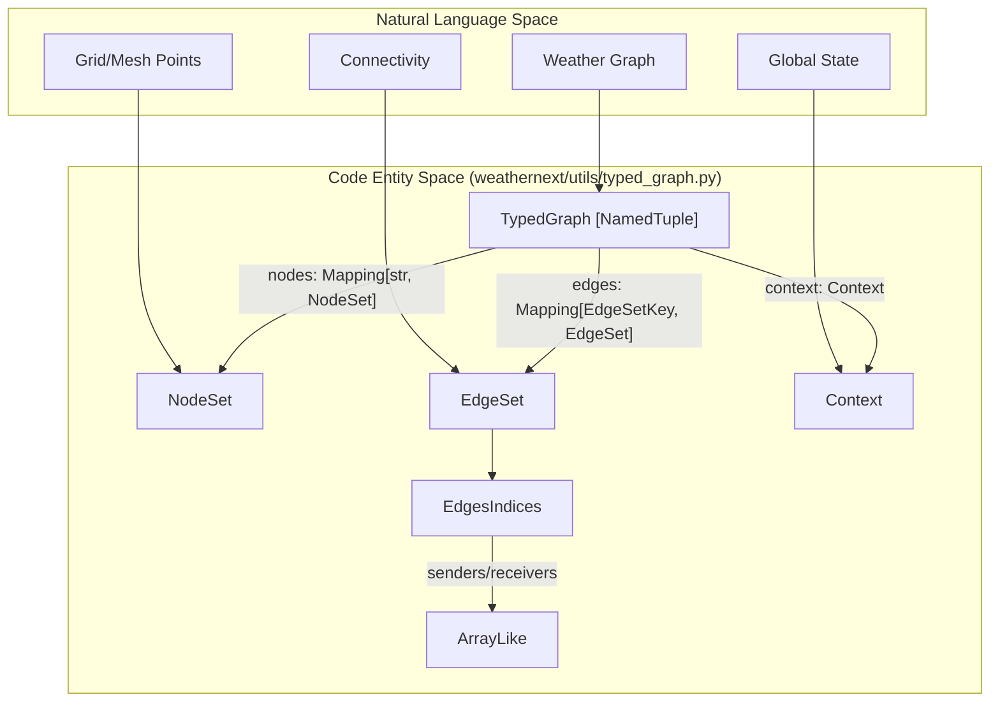
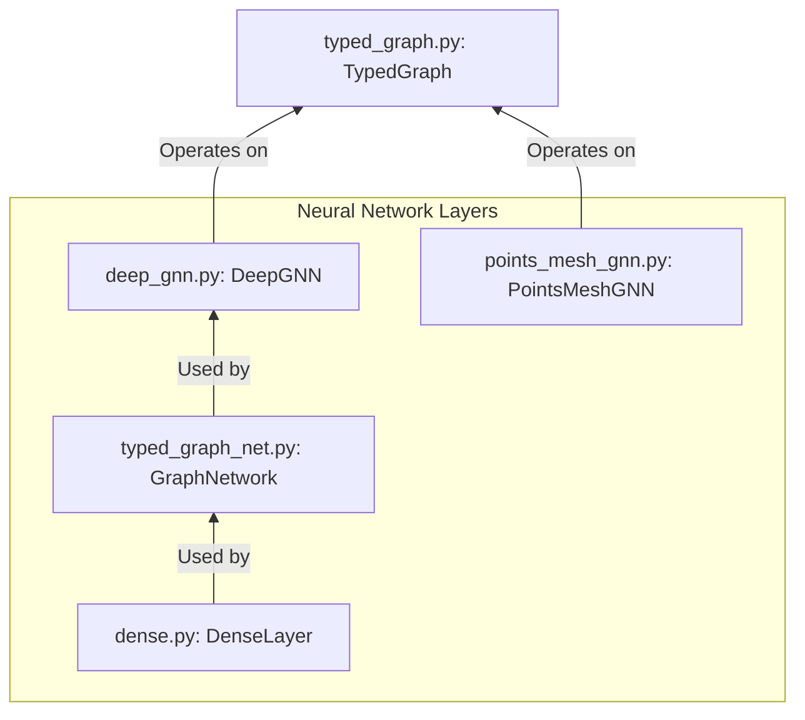

<!-- source: DeepWiki mcp.deepwiki.com · repo google-deepmind/weathernext · page 5 Graph and Transformer Building Blocks · fetched 2026-10-26 -->

# Graph and Transformer Building Blocks

Relevant source files

The following files were used as context for generating this wiki page:

- [weathernext/utils/deep_gnn.py](weathernext/utils/deep_gnn.py)
- [weathernext/utils/mesh_transformer.py](weathernext/utils/mesh_transformer.py)
- [weathernext/utils/typed_graph.py](weathernext/utils/typed_graph.py)

This page provides a high-level overview of the fundamental neural network primitives and data structures shared across various models in the WeatherNext codebase. These building blocks include specialized graph data structures, graph neural network (GNN) layers, mesh construction utilities, and transformer architectures. They form the core computational components for processing meteorological data across different spatial representations.

## TypedGraph Data Structures

The WeatherNext codebase utilizes a custom graph data structure called `TypedGraph` [weathernext/utils/typed_graph.py:78-88]() to represent complex meteorological data. Unlike simpler graph representations, `TypedGraph` supports multiple types of nodes and edges, which is crucial for handling diverse data modalities like grid points and icosahedral mesh nodes. It also defines a "flat batch axis" convention for efficient processing with JAX [weathernext/utils/typed_graph.py:24-31]().

The core components of a `TypedGraph` are:
*   `NodeSet`: Represents a collection of nodes of a specific type, holding their features and counts [weathernext/utils/typed_graph.py:45-49]().
*   `EdgeSet`: Represents a collection of edges of a specific type, including their features, counts, and `EdgesIndices` (sender/receiver node mappings) [weathernext/utils/typed_graph.py:57-61]().
*   `EdgeSetKey`: Uniquely identifies an `EdgeSet` by its name and the types of sender and receiver nodes it connects [weathernext/utils/typed_graph.py:71-76]().
*   `Context`: Stores global features associated with the entire graph [weathernext/utils/typed_graph.py:64-68]().

For details on the `TypedGraph` structure, its batching conventions, and related data modality containers, see [TypedGraph Data Structures](#5.1).

**TypedGraph Entity Mapping**

Sources: [weathernext/utils/typed_graph.py:45-88]()

## GNN Layers: TypedGraphNet, DeepGNN and Points–Mesh GNN

The codebase implements several GNN layers designed to operate on `TypedGraph` structures. These layers facilitate message passing and feature aggregation across different node and edge types.

*   **`TypedGraphNet`**: This module [weathernext/utils/typed_graph_net.py]() provides a flexible framework for defining interaction networks. It allows for independent update functions for node features, edge features, and global context, enabling complex message-passing patterns.
*   **`DeepGNN`**: Found in `weathernext/utils/deep_gnn.py`, this class implements a deep graph neural network that can perform multiple message-passing steps with configurable weight sharing [weathernext/utils/deep_gnn.py:45-62](). It orchestrates edge and node updates across all typed sets within a `TypedGraph`.
*   **`PointsMeshGNN`**: This specialized GNN [weathernext/utils/points_mesh_gnn.py]() handles interactions between point cloud data and mesh data, crucial for models that integrate observations with mesh-based simulations.

For a detailed explanation of these GNN layers, their message-passing mechanisms, and weight-sharing strategies, see [GNN Layers: TypedGraphNet, DeepGNN and Points–Mesh GNN](#5.2).

**GNN Layer Hierarchy**

Sources: [weathernext/utils/deep_gnn.py:45-62](), [weathernext/utils/typed_graph_net.py:41-83](), [weathernext/utils/dense.py:24-40]()

## Icosahedral Multi-Mesh and Grid Connectivity

The WeatherNext models often utilize icosahedral meshes for their spatial discretization. The `icosahedral_mesh.py` module provides utilities for constructing and manipulating these meshes.

*   **`TriangularMesh`**: Represents a single level of an icosahedral mesh, including its vertices, edges, and faces [weathernext/utils/icosahedral_mesh.py]().
*   **Mesh Hierarchy**: The system supports creating hierarchies of refined meshes, allowing for multi-resolution processing.
*   **Grid Connectivity**: Legacy utilities in `legacy/grid_mesh_connectivity.py` handle the crucial task of linking latitude/longitude grid points to the icosahedral mesh nodes, often using radius-based or k-nearest neighbor queries.

For an in-depth look at icosahedral mesh construction, refinement, and the connectivity between grids and meshes, see [Icosahedral Multi-Mesh and Grid Connectivity](#5.3).

## Mesh and Sparse Transformers

Transformer architectures are employed for processing features on mesh nodes, particularly for their ability to model long-range dependencies. The codebase includes specialized transformer implementations for this purpose.

*   **`MeshSparseTransformer`**: Defined in `weathernext/utils/mesh_transformer.py`, this class adapts a sparse transformer to operate on `TriangularMeshData` [weathernext/utils/mesh_transformer.py:56-125](). It handles the conversion of mesh connectivity into adjacency matrices for attention masking.
*   **`sparse_transformer.py`**: This module provides the core sparse transformer implementation, which can utilize various attention mechanisms like tri-block-diagonal or splash attention to handle the irregular connectivity of meshes efficiently [weathernext/utils/sparse_transformer.py]().
*   **Configuration**: These transformers are configured with parameters such as `d_model`, number of heads, and layers, and can handle axis swapping to align with transformer input expectations [weathernext/utils/mesh_transformer.py:118-123]().

For details on the sparse attention mechanisms, mask block sizes, and configuration of mesh transformers, see [Mesh and Sparse Transformers](#5.4).

## Update Blocks and Spatial Features

The WeatherNext 2 (WN2) architecture leverages a system of composable "update blocks" to construct its forward pass. These blocks are defined in `weathernext/utils/update_blocks.py` and `weathernext/utils/update_blocks_utils.py`.

*   **Composable Updates**: Update blocks are designed to be modular, allowing for flexible construction of complex neural network architectures by combining different types of processing units (e.g., GNNs, transformers, MLPs).
*   **Spatial Feature Engineering**: The `model_utils.py` module provides utilities for generating various spatial features, which are crucial inputs to the models. These include converting latitude/longitude to Cartesian coordinates, creating local coordinate frames, stacking dataset variables, and generating Fourier features.

For a comprehensive understanding of how these update blocks are constructed and used, and the details of spatial feature engineering, see [Update Blocks and Spatial Features](#5.5).

Sources:
*   [weathernext/utils/deep_gnn.py:1-165]()
*   [weathernext/utils/mesh_transformer.py:1-125]()
*   [weathernext/utils/typed_graph.py:1-97]()

---

