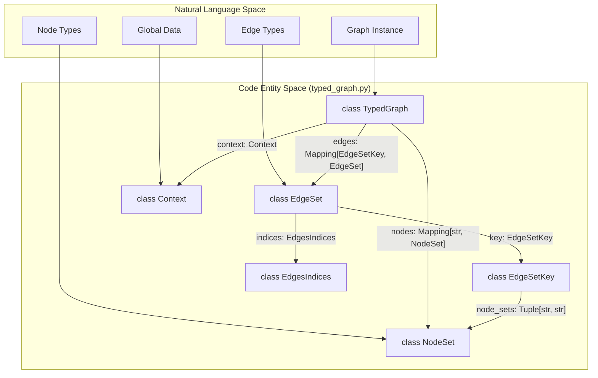
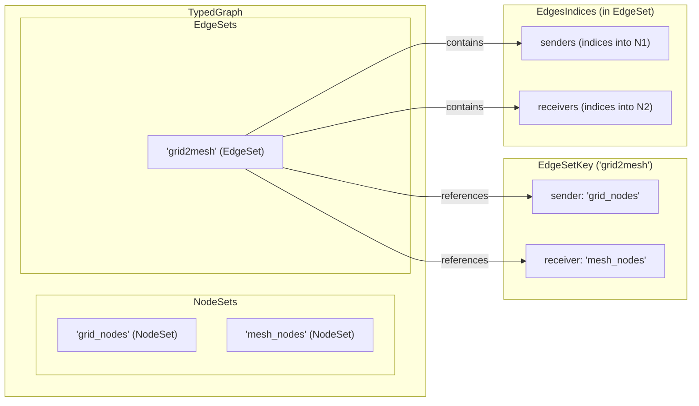

<!-- source: DeepWiki mcp.deepwiki.com · repo google-deepmind/weathernext · page 5.1 TypedGraph Data Structures · fetched 2026-10-26 -->

# TypedGraph Data Structures

Relevant source files

The following files were used as context for generating this wiki page:

- [weathernext/utils/data_modalities.py](weathernext/utils/data_modalities.py)
- [weathernext/utils/typed_graph.py](weathernext/utils/typed_graph.py)

The `TypedGraph` system provides a structured way to represent complex, heterogeneous graphs where nodes and edges belong to distinct types. Unlike standard graph representations that assume a single set of nodes and edges, `TypedGraph` allows for multiple `NodeSet` and `EdgeSet` entities, which is essential for the multi-mesh architecture used in WeatherNext models.

### Core Components

The data structures are implemented as `NamedTuple` objects in `weathernext/utils/typed_graph.py`, making them compatible with JAX transformations like `jit`, `vmap`, and `grad` [weathernext/utils/typed_graph.py:16-16]().

#### NodeSet
A `NodeSet` represents a collection of nodes of a specific type (e.g., "mesh_nodes" or "grid_nodes").
*   `n_node`: An array tracking the number of nodes per graph in a batch [weathernext/utils/typed_graph.py:47-47]().
*   `features`: A PyTree of arrays containing the node attributes, with the leading dimension corresponding to the total number of nodes in the batch [weathernext/utils/typed_graph.py:48-48]().

#### EdgeSet and EdgeSetKey
Edges are grouped into `EdgeSet` objects. Because `TypedGraph` is heterogeneous, every edge set must explicitly define which node types it connects.
*   **`EdgeSetKey`**: A unique identifier consisting of the edge set's `name` and a tuple of `(sender_node_set_name, receiver_node_set_name)` [weathernext/utils/typed_graph.py:71-75]().
*   **`EdgeSet`**: Contains the connectivity and features.
    *   `n_edge`: Number of edges per graph [weathernext/utils/typed_graph.py:59-59]().
    *   `indices`: An `EdgesIndices` object containing `senders` and `receivers` arrays [weathernext/utils/typed_graph.py:60-60]().
    *   `features`: A PyTree of edge attributes [weathernext/utils/typed_graph.py:61-61]().

#### Context
The `Context` (formerly referred to as "globals" in other GNN frameworks) stores attributes that apply to the entire graph rather than specific nodes or edges [weathernext/utils/typed_graph.py:64-68]().

#### TypedGraph
The top-level container that aggregates all components:
*   `context`: A single `Context` object [weathernext/utils/typed_graph.py:85-85]().
*   `nodes`: A mapping of strings (node type names) to `NodeSet` objects [weathernext/utils/typed_graph.py:86-86]().
*   `edges`: A mapping of `EdgeSetKey` to `EdgeSet` objects [weathernext/utils/typed_graph.py:87-87]().

**Sources:** [weathernext/utils/typed_graph.py:45-88]()

### The flat_batch_axis Convention

`TypedGraph` utilizes a "flat batch" convention for efficient processing in JAX. Instead of using a dedicated batch dimension (e.g., `[batch, nodes, features]`), all nodes/edges from all graphs in a batch are concatenated along a single leading axis [weathernext/utils/typed_graph.py:24-31]().

| Entity | Leading Axis Interpretation |
| :--- | :--- |
| **Nodes** | `num_flat_nodes` (Total nodes across all graphs in the batch) |
| **Edges** | `num_flat_edges` (Total edges across all graphs in the batch) |
| **Context** | `num_flat_graphs` (Number of graphs in the batch) |

This approach allows JAX to handle graphs of varying sizes within the same batch by treating them as one large disjoint graph [weathernext/utils/typed_graph.py:34-42]().

**Sources:** [weathernext/utils/typed_graph.py:24-43]()

### Comparison with jraph.GraphsTuple

While `TypedGraph` is inspired by `jraph.GraphsTuple`, there are critical differences designed to support heterogeneous architectures:

| Feature | `jraph.GraphsTuple` | `TypedGraph` |
| :--- | :--- | :--- |
| **Node Types** | Homogeneous (single array) | Heterogeneous (Mapping of `NodeSet`) |
| **Edge Types** | Homogeneous (single array) | Heterogeneous (Mapping of `EdgeSet`) |
| **Connectivity** | Global indices | Indices relative to the specific `NodeSet` |
| **Keys** | Implicit | Explicit `EdgeSetKey` (Name + Types) |

**Sources:** [weathernext/utils/typed_graph.py:78-88]()

### Data Entity Relationship

The following diagram illustrates how the Python classes in `typed_graph.py` relate to the logical concepts of a heterogeneous graph.

**TypedGraph Entity Mapping**

**Sources:** [weathernext/utils/typed_graph.py:45-88]()

### Implementation Details: Edge Lookup

The `TypedGraph` class provides helper methods to retrieve edge sets by their string name, abstracting away the complexity of the `EdgeSetKey` [weathernext/utils/typed_graph.py:89-97]().

*   `edge_key_by_name(name)`: Searches the `edges` mapping keys for an `EdgeSetKey` whose `name` matches the input [weathernext/utils/typed_graph.py:89-94]().
*   `edge_by_name(name)`: Returns the `EdgeSet` associated with that name [weathernext/utils/typed_graph.py:96-97]().

### Graph Connectivity Logic

The connectivity within a `TypedGraph` is defined by the interaction between `EdgesIndices` and the specific `NodeSet` objects referenced in the `EdgeSetKey`.

**Connectivity Data Flow**

**Sources:** [weathernext/utils/typed_graph.py:51-62](), [weathernext/utils/typed_graph.py:71-77]()

### Data Modalities

The `weathernext/utils/data_modalities.py` module defines abstract and concrete classes for handling different types of spatial data, such as grids, points, and meshes. These classes are designed to be generic containers for `ArrayTree` data, allowing for flexible data structures while maintaining consistent interfaces for operations like masking and padding.

#### `Data` Base Class

The abstract base class `Data` [weathernext/utils/data_modalities.py:79-104]() provides a common interface for all data modalities. It defines properties and methods for:
*   `point_dims_shape`: The leading shape of the point dimensions [weathernext/utils/data_modalities.py:108-110]().
*   `data`: The actual data, which can be any `ArrayTree` [weathernext/utils/data_modalities.py:113-115]().
*   `mask`: A boolean mask for the leading point dimensions [weathernext/utils/data_modalities.py:122-124]().
*   `masked_data`: Returns the data with invalid values (as per the mask) set to zero [weathernext/utils/data_modalities.py:117-119]().
*   `metadata`: A dictionary for associated metadata [weathernext/utils/data_modalities.py:127-129]().
*   `replace_data`: Returns a copy of the object with its data replaced [weathernext/utils/data_modalities.py:132-137]().
*   `with_global_data`: Adds its own point spatial dimensions to global data [weathernext/utils/data_modalities.py:140-143]().
*   `pad_data` and `pad_data_to_multiple_of`: Methods for padding the data along a specified axis [weathernext/utils/data_modalities.py:145-186]().

All arrays within a `Data` object are expected to be broadcastable against each other on their leading `point_dims` [weathernext/utils/data_modalities.py:98-99]().

#### `CombinedArrays`

A `NamedTuple` used to pack together different types of arrays, typically for inputs to linear layers or norm conditioning layers [weathernext/utils/data_modalities.py:37-43]().
*   `main`: The primary input/output array.
*   `norm_conditioning`: An array for normalization conditioning.
*   `other_conditioning`: Other conditioning arrays.

#### `ArrayTree` and `OtherArrayTree`

These `TypeVar` definitions [weathernext/utils/data_modalities.py:62-65]() are used to ensure type consistency across methods within the `Data` classes. They allow the system to work with various nested data structures (e.g., `np.ndarray`, `Mapping[str, npt.ArrayLike]`, `Iterable[npt.ArrayLike]`, `CombinedArrays`, or any `chex.ArrayTree`).

**Sources:** [weathernext/utils/data_modalities.py:37-193]()

---

