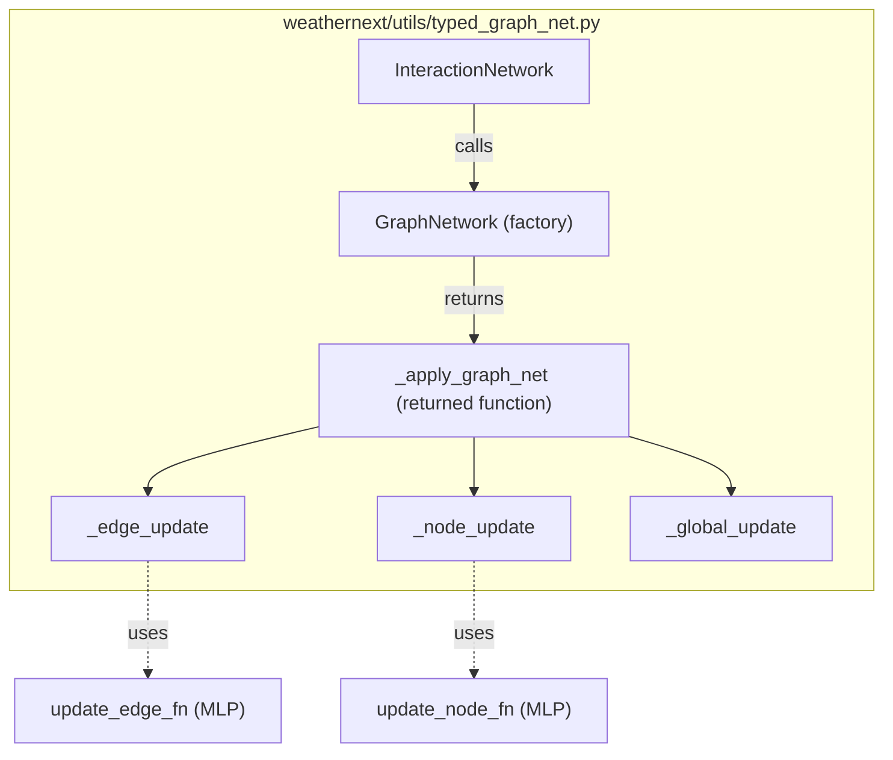
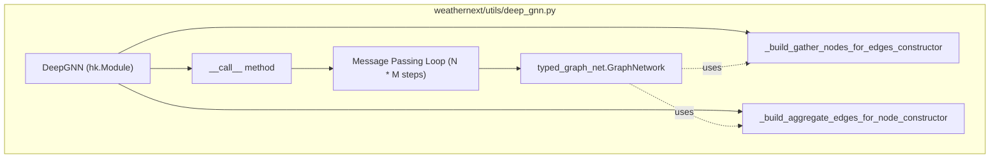
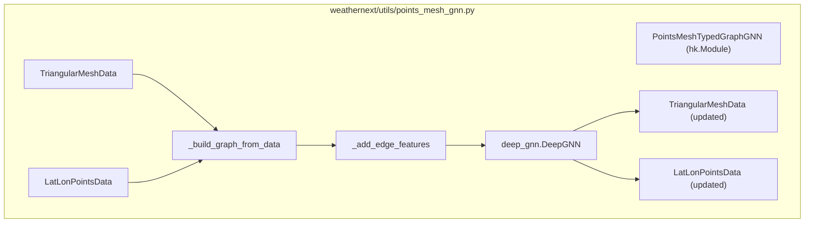
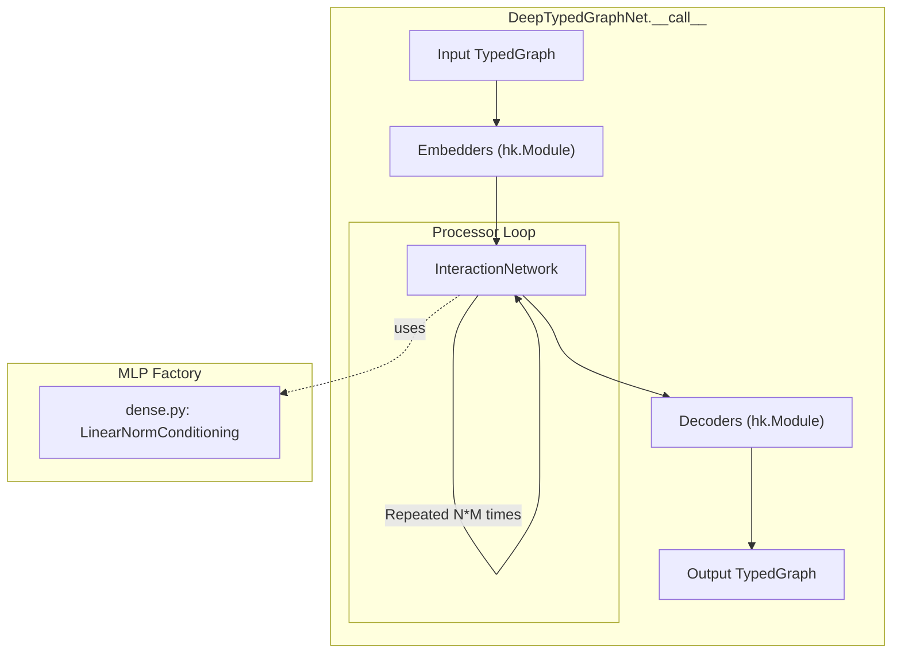

<!-- source: DeepWiki mcp.deepwiki.com · repo google-deepmind/weathernext · page 5.2 GNN Layers: TypedGraphNet, DeepGNN and Points–Mesh GNN · fetched 2026-10-26 -->

# GNN Layers: TypedGraphNet, DeepGNN and Points–Mesh GNN

Relevant source files

The following files were used as context for generating this wiki page:

- [weathernext/utils/deep_gnn.py](weathernext/utils/deep_gnn.py)
- [weathernext/utils/legacy/deep_typed_graph_net.py](weathernext/utils/legacy/deep_typed_graph_net.py)
- [weathernext/utils/points_mesh_gnn.py](weathernext/utils/points_mesh_gnn.py)
- [weathernext/utils/typed_graph_net.py](weathernext/utils/typed_graph_net.py)

This page documents the core Graph Neural Network (GNN) primitives used in WeatherNext, specifically the `TypedGraphNet` for flexible message-passing on heterogeneous graphs, `DeepGNN` which provides the multi-layer backbone for models like WeatherNext 2, and `PointsMeshTypedGraphGNN` for handling interactions between point clouds and meshes.

## Interaction Network and Typed Graph Net

The foundation of the GNN architecture is the `InteractionNetwork` and the broader `GraphNetwork` utility. These classes extend standard GNN operations to `TypedGraph` structures, allowing for multiple node types (e.g., mesh nodes, grid nodes) and multiple edge types (e.g., mesh-to-mesh, grid-to-mesh).

### InteractionNetwork
The `InteractionNetwork` [weathernext/utils/typed_graph_net.py:500-532]() is a specialized version of a Graph Network that performs updates on edge sets followed by node sets. Unlike the generic `GraphNetwork`, it does not update global context features, making it suitable for the local message-passing steps in weather forecasting.

### Data Flow in TypedGraphNet
The `GraphNetwork` function [weathernext/utils/typed_graph_net.py:197-200]() returns a method `_apply_graph_net` [weathernext/utils/typed_graph_net.py:202-244]() that executes the following sequence:
1.  **Edge Update**: For every edge set defined in `update_edge_fn`, the `_edge_update` helper [weathernext/utils/typed_graph_net.py:247-269]() gathers sender and receiver node features and applies the edge-specific MLP.
2.  **Node Update**: For every node set defined in `update_node_fn`, the `_node_update` helper [weathernext/utils/typed_graph_net.py:272-302]() aggregates features from all incoming (and optionally outgoing) edge sets using an aggregation function (typically `segment_sum`) and applies the node-specific MLP.

### Entity Mapping: Typed Graph Net Building Blocks
The following diagram maps the logical GNN operations to their implementation functions within `typed_graph_net.py`.

**Sources:** [weathernext/utils/typed_graph_net.py:197-532]()

---

## DeepGNN Architecture

`DeepGNN` [weathernext/utils/deep_gnn.py:45-110]() is a Haiku module that encapsulates the full GNN processor, designed to work with `TypedGraph` structures. It handles embedding raw features, executing multiple message-passing steps, and projecting outputs to the desired size. This module is a more recent and flexible implementation compared to `DeepTypedGraphNet`.

### Key Components
*   **Processor**: A sequence of message passing steps. The architecture supports both shared and unshared weights:
    *   **Unshared**: `num_message_passing_steps = N`, `num_processor_repetitions = 1`.
    *   **Shared**: `num_message_passing_steps = 1`, `num_processor_repetitions = M`.
    *   **Hybrid**: `[W_1, ... W_N] * M` repetitions [weathernext/utils/deep_gnn.py:54-61]().
*   **Gather/Scatter Operations**: Configurable gather and scatter functions for nodes and edges, allowing for explicit sharding and collective removal [weathernext/utils/deep_gnn.py:131-145]().
*   **Rematerialization**: Supports rematerialization for memory optimization during backpropagation, configurable via `edge_update_remat_block_size` and `remat_block_size` [weathernext/utils/deep_gnn.py:74-75]().

### Configuration Parameters
| Parameter | Role |
| :--- | :--- |
| `dense_kwargs` | Kwargs for dense layers used in MLPs [weathernext/utils/deep_gnn.py:68](). |
| `num_message_passing_steps` | Number of unshared message passing steps [weathernext/utils/deep_gnn.py:69-70](). |
| `num_processor_repetitions` | Number of times the processor is applied sequentially [weathernext/utils/deep_gnn.py:71](). |
| `use_edge_residuals` | Whether to use residual connections for edge updates [weathernext/utils/deep_gnn.py:72-73](). |
| `f32_aggregation` | Use float32 for edge aggregation [weathernext/utils/deep_gnn.py:99](). |
| `aggregate_normalization` | Optional constant to normalize aggregated messages [weathernext/utils/deep_gnn.py:101-105](). |
| `pre_gather_matmul` | Optimization to split the first matmul of the edge MLP before gathers [weathernext/utils/deep_gnn.py:106-108](). |

### Entity Mapping: DeepGNN Internal Structure
This diagram shows how `DeepGNN` coordinates the message passing steps.

**Sources:** [weathernext/utils/deep_gnn.py:45-145]()

---

## Points–Mesh GNN

The `PointsMeshTypedGraphGNN` [weathernext/utils/points_mesh_gnn.py:70-100]() is a specialized GNN designed to handle interactions between `TriangularMeshData` and `LatLonPointsData`. It uses a `TypedGraph` to represent the bipartite graph between points and mesh nodes.

### Connectivity Types
This GNN supports different ways to establish connectivity between points and mesh nodes [weathernext/utils/points_mesh_gnn.py:59-67]():
*   `CLOSEST`: Each point connects to the closest mesh point.
*   `IN_TRIANGLE`: Each point connects to the three vertices of the mesh triangle containing it.
*   `BALL_QUERY`: Each mesh point connects to all points within a specified radius.

### Key Components
*   **Directionality**: Configurable for `is_points_to_mesh` or `is_mesh_to_points` [weathernext/utils/points_mesh_gnn.py:88-89]().
*   **DeepGNN Backbone**: Internally uses a `deep_gnn.DeepGNN` instance for the actual message passing [weathernext/utils/points_mesh_gnn.py:171-175]().
*   **Spatial Edge Features**: Generates spatial features for edges based on `spatial_edge_features_kwargs` [weathernext/utils/points_mesh_gnn.py:95]().
*   **Padding**: Edges can be padded to a multiple of a given value, useful for sharding [weathernext/utils/points_mesh_gnn.py:99-100]().

### Data Flow
The `PointsMeshTypedGraphGNN` constructs a `TypedGraph` from the input `TriangularMeshData` and `LatLonPointsData`, adds spatial edge features, and then passes this graph to the internal `DeepGNN` for processing.

**Sources:** [weathernext/utils/points_mesh_gnn.py:70-175]()

---

## Legacy: DeepTypedGraphNet Architecture

`DeepTypedGraphNet` [weathernext/utils/legacy/deep_typed_graph_net.py:53-101]() is a Haiku module that encapsulates the full GNN processor. It handles embedding raw features, executing multiple message-passing steps, and projecting outputs to the desired size. This is a legacy implementation, largely superseded by `DeepGNN`.

### Key Components
*   **Embedders**: If `embed_nodes` or `embed_edges` is True, it applies an initial MLP to project input features into the latent space [weathernext/utils/legacy/deep_typed_graph_net.py:228-243]().
*   **Processor**: A sequence of `InteractionNetwork` layers. The architecture supports both shared and unshared weights:
    *   **Unshared**: `num_message_passing_steps = N`, `num_processor_repetitions = 1`.
    *   **Shared**: `num_message_passing_steps = 1`, `num_processor_repetitions = M`.
    *   **Hybrid**: `[W_1, ... W_N] * M` repetitions [weathernext/utils/legacy/deep_typed_graph_net.py:68-79]().
*   **Decoders**: Final projections for nodes and edges to map latent representations to output sizes [weathernext/utils/legacy/deep_typed_graph_net.py:255-270]().

### Configuration Parameters
| Parameter | Role |
| :--- | :--- |
| `node_latent_size` | Dictionary mapping node type to latent dimension [weathernext/utils/legacy/deep_typed_graph_net.py:105](). |
| `edge_latent_size` | Dictionary mapping edge type to latent dimension [weathernext/utils/legacy/deep_typed_graph_net.py:106](). |
| `num_message_passing_steps` | Number of distinct Interaction Networks in one repetition [weathernext/utils/legacy/deep_typed_graph_net.py:109](). |
| `use_norm_conditioning` | Enables conditioning (e.g., on diffusion time) for LayerNorm [weathernext/utils/legacy/deep_typed_graph_net.py:124](). |
| `aggregate_normalization` | Constant to scale aggregated messages, useful when changing resolutions [weathernext/utils/legacy/deep_typed_graph_net.py:140](). |

### Implementation Detail: The MLP Block
The `DeepTypedGraphNet` uses an internal `_make_mlp` factory [weathernext/utils/legacy/deep_typed_graph_net.py:279-307]() which constructs an MLP followed by an optional `LayerNorm` [weathernext/utils/legacy/deep_typed_graph_net.py:301](). If `use_norm_conditioning` is enabled, it uses `LinearNormConditioning` from `dense.py` [weathernext/utils/dense.py:24-46]() to scale and offset features based on a global conditioning signal.

### Entity Mapping: DeepTypedGraphNet Internal Structure
This diagram shows how `DeepTypedGraphNet` coordinates the embedding, processing, and decoding phases using `InteractionNetwork`.

**Sources:** [weathernext/utils/legacy/deep_typed_graph_net.py:221-277](), [weathernext/utils/dense.py:24-46]()

---

## MLP Building Blocks

The repository centralizes MLP construction to ensure consistency across node and edge updates.

### LinearNormConditioning
The `LinearNormConditioning` module [weathernext/utils/dense.py:24-46]() is a critical component for generative models like GenCast. It takes `norm_conditioning` (typically a noise level $\sigma$) and produces a per-channel scale and offset:
1.  **Linear Layer**: Projects `norm_conditioning` to `2 * feature_size` [weathernext/utils/dense.py:38-42]().
2.  **Split**: Divides the output into `scale_minus_one` and `offset` [weathernext/utils/dense.py:43]().
3.  **Apply**: `inputs * (scale_minus_one + 1.0) + offset` [weathernext/utils/dense.py:44-45]().

### Interaction Network MLPs
Inside `DeepTypedGraphNet`, MLPs are generated for:
*   **Edges**: Based on `edge_latent_size` [weathernext/utils/legacy/deep_typed_graph_net.py:293]().
*   **Nodes**: Based on `node_latent_size` [weathernext/utils/legacy/deep_typed_graph_net.py:293]().

**Sources:** [weathernext/utils/dense.py:24-46](), [weathernext/utils/legacy/deep_typed_graph_net.py:279-307]()

---

