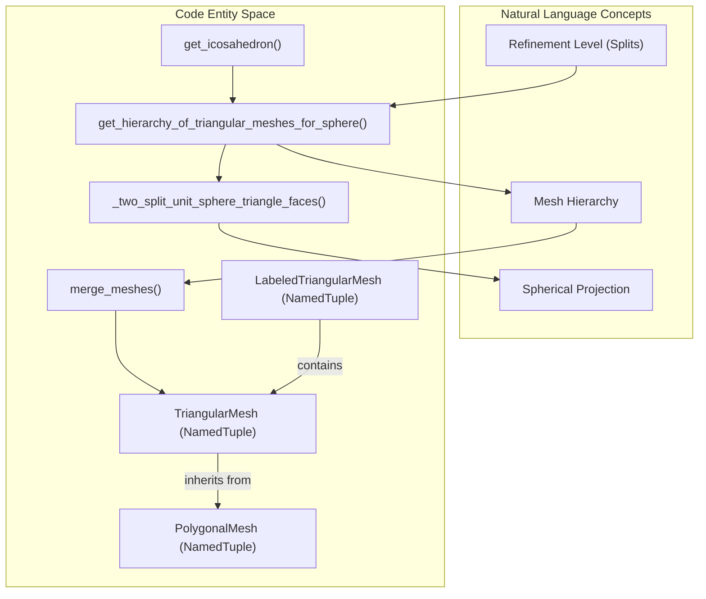
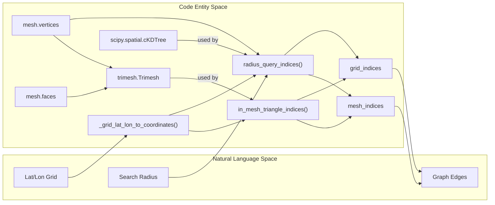

<!-- source: DeepWiki mcp.deepwiki.com · repo google-deepmind/weathernext · page 5.3 Icosahedral Multi-Mesh and Grid Connectivity · fetched 2026-10-26 -->

# Icosahedral Multi-Mesh and Grid Connectivity

Relevant source files

The following files were used as context for generating this wiki page:

- [weathernext/utils/icosahedral_mesh.py](weathernext/utils/icosahedral_mesh.py)
- [weathernext/utils/icosahedral_mesh_test.py](weathernext/utils/icosahedral_mesh_test.py)
- [weathernext/utils/legacy/grid_mesh_connectivity.py](weathernext/utils/legacy/grid_mesh_connectivity.py)
- [weathernext/utils/legacy/grid_mesh_connectivity_test.py](weathernext/utils/legacy/grid_mesh_connectivity_test.py)

This section describes the construction of the multi-resolution icosahedral mesh and the connectivity mechanisms used to map data between the regular latitude/longitude grid and the graph-based mesh.

## Icosahedral Mesh Construction

The GraphCast model operates on a multi-mesh structure to facilitate long-range communication across the globe with minimal message-passing steps. The mesh is built starting from a regular icosahedron and refined through iterative subdivision [weathernext/utils/icosahedral_mesh.py:98-133]().

### TriangularMesh Data Structure
The core data structure for the mesh is the `TriangularMesh` `NamedTuple`, which contains:
*   **`vertices`**: A `[num_vertices, 3]` array of 3D Cartesian coordinates (unit norm) [weathernext/utils/icosahedral_mesh.py:56]().
*   **`faces`**: A `[num_faces, 3]` array of integer indices into the vertices, representing triangular faces [weathernext/utils/icosahedral_mesh.py:57]().

A more general `PolygonalMesh` is also defined, allowing faces with varying numbers of vertices [weathernext/utils/icosahedral_mesh.py:30-43](). `TriangularMesh` inherits from `PolygonalMesh` [weathernext/utils/icosahedral_mesh.py:46](). Additionally, `LabeledTriangularMesh` associates a string label with a `TriangularMesh` [weathernext/utils/icosahedral_mesh.py:60-70]().

### Refinement Process
The hierarchy is generated by `get_hierarchy_of_triangular_meshes_for_sphere(splits)` [weathernext/utils/icosahedral_mesh.py:98-101]().
1.  **Base Icosahedron**: Starts with 12 vertices and 20 faces, obtained via `get_icosahedron()` [weathernext/utils/icosahedral_mesh.py:128-129](). The `pole_parallel_faces` argument controls the initial orientation to avoid vertices exactly at the poles [weathernext/utils/icosahedral_mesh.py:115-117]().
2.  **Subdivision**: Each triangular face is split into four smaller triangles by `_two_split_unit_sphere_triangle_faces()` [weathernext/utils/icosahedral_mesh.py:131]().
3.  **Projection**: New vertices created at edge centers are projected back onto the unit sphere to maintain spherical geometry [weathernext/utils/icosahedral_mesh.py:106-107]().
4.  **Merging**: The `merge_meshes` function combines the hierarchy into a single mesh where the vertices correspond to the finest level, and faces include all triangles from all levels [weathernext/utils/icosahedral_mesh.py:80-95](). The `assert_all_meshes_compatible` function ensures that coarser mesh vertices are a subset of finer mesh vertices [weathernext/utils/icosahedral_mesh.py:72-76]().

### Code Entity Relationship: Mesh Generation
The following diagram illustrates how the mesh generation functions relate to the resulting data structures.

Sources: [weathernext/utils/icosahedral_mesh.py:30-70](), [weathernext/utils/icosahedral_mesh.py:72-189]()

## Grid-to-Mesh Connectivity

Because meteorological data is typically provided on a regular latitude/longitude grid, the model must map these grid points to the icosahedral mesh. This is handled in `weathernext/utils/legacy/grid_mesh_connectivity.py`.

### Coordinate Transformation
Before establishing connectivity, grid points are converted from (lat, lon) to 3D Cartesian coordinates $(x, y, z)$ using `_grid_lat_lon_to_coordinates` [weathernext/utils/legacy/grid_mesh_connectivity.py:22-37](). This assumes a unit sphere where:
*   $x = \cos(\text{lon}) \cdot \sin(90 - \text{lat})$
*   $y = \sin(\text{lon}) \cdot \sin(90 - \text{lat})$
*   $z = \cos(90 - \text{lat})$

### Connectivity Methods
The repository provides two primary methods for connecting the grid to the mesh:

| Method | Function | Description |
| :--- | :--- | :--- |
| **Radius Query** | `radius_query_indices` | Connects each grid point to all mesh vertices within a specified Euclidean distance `radius` using a KD-Tree [weathernext/utils/legacy/grid_mesh_connectivity.py:40-86](). |
| **Triangle Inclusion** | `in_mesh_triangle_indices` | Connects each grid point to the three vertices of the mesh triangle that contains it [weathernext/utils/legacy/grid_mesh_connectivity.py:89-133](). This method uses `trimesh.Trimesh` to find which mesh face contains each grid point [weathernext/utils/legacy/grid_mesh_connectivity.py:114-119](). |

### Radius Query Implementation
The `radius_query_indices` function uses `scipy.spatial.cKDTree` for efficient neighbor lookups [weathernext/utils/legacy/grid_mesh_connectivity.py:69-74](). It returns a tuple of `grid_indices` and `mesh_indices` representing the edges of a bipartite graph between the grid and the mesh [weathernext/utils/legacy/grid_mesh_connectivity.py:54-61]().

### Code Entity Relationship: Connectivity Data Flow
This diagram shows the flow from raw grid coordinates to the bipartite graph indices used by the GNN.

Sources: [weathernext/utils/legacy/grid_mesh_connectivity.py:22-133]()

## Mesh and Connectivity Specifications

The following table summarizes the properties of the mesh at different refinement levels (splits). The `_get_mesh_spec` helper function in the test suite calculates these values [weathernext/utils/icosahedral_mesh_test.py:22-31]().

| Splits | Vertices | Faces | Description |
| :--- | :--- | :--- | :--- |
| 0 | 12 | 20 | Original Icosahedron |
| 1 | 42 | 80 | 1st refinement |
| 2 | 162 | 320 | 2nd refinement |
| 3 | 642 | 1,280 | 3rd refinement |
| 4 | 2,562 | 5,120 | 4th refinement |
| 5 | 10,242 | 20,480 | 5th refinement |
| 6 | 40,962 | 81,920 | 6th refinement (Commonly used) |

Sources: [weathernext/utils/icosahedral_mesh_test.py:22-31](), [weathernext/utils/icosahedral_mesh.py:136-159]()

---

