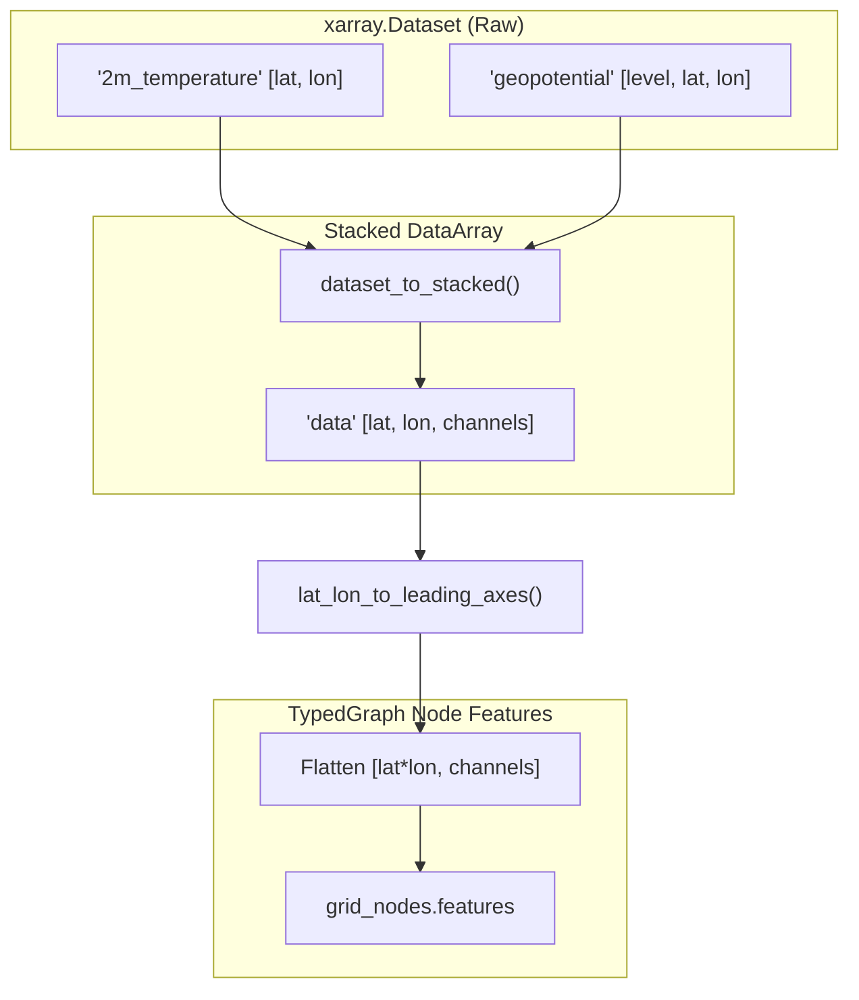
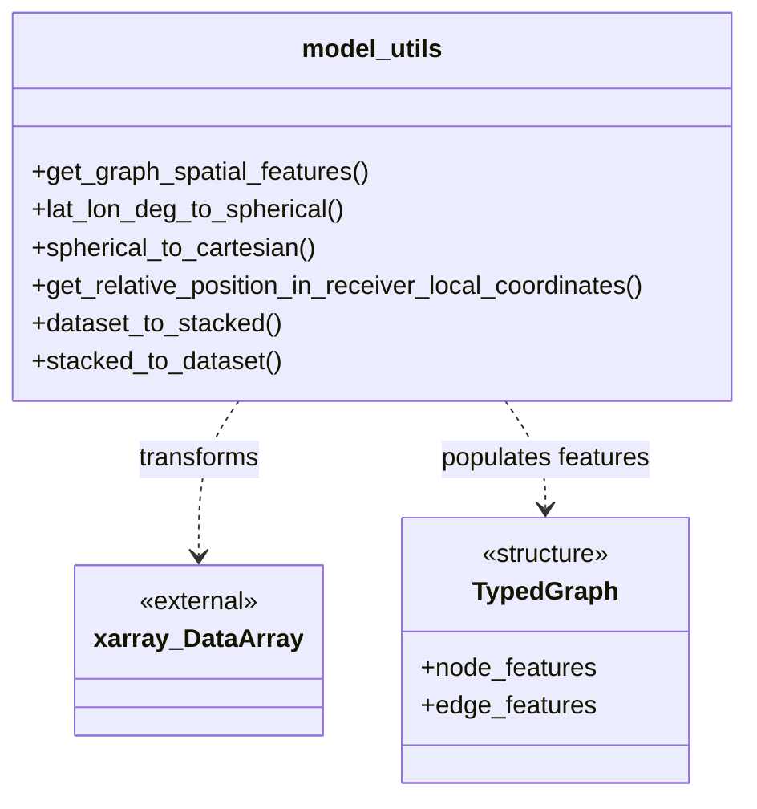

<!-- source: DeepWiki mcp.deepwiki.com · repo google-deepmind/weathernext · page 5.5 Update Blocks and Spatial Features · fetched 2026-10-26 -->

# Update Blocks and Spatial Features

Relevant source files

The following files were used as context for generating this wiki page:

- [weathernext/utils/model_utils.py](weathernext/utils/model_utils.py)
- [weathernext/utils/update_blocks.py](weathernext/utils/update_blocks.py)
- [weathernext/utils/update_blocks_utils.py](weathernext/utils/update_blocks_utils.py)

This page covers the composable update constructors defined in `weathernext/utils/update_blocks.py` and `weathernext/utils/update_blocks_utils.py`, which are fundamental building blocks for models like WN2. It also details the spatial feature engineering capabilities in `weathernext/utils/model_utils.py`, including transformations of latitude/longitude coordinates to Cartesian, local coordinate frames, and Fourier features, as well as utilities for stacking `xarray` datasets.

## Update Block Protocols

The `weathernext/utils/update_blocks.py` module defines a set of abstract base classes and `Protocol` definitions for neural network blocks that update data. These protocols ensure type consistency and provide a clear interface for constructing complex model architectures. The data modalities used are defined in `weathernext.utils.data_modalities`.

### Core Update Block Types

*   **`SingleBlockUpdate`**: An abstract base class for blocks that update a single `Data` object [weathernext/utils/update_blocks.py:57-66](). It takes a `DataSingleOrCombinedArraysVar` and optionally `GlobalDataSingleOrCombinedArrays`, returning an updated `DataSingleOrCombinedArraysVar`.
*   **`PairedBlockUpdate`**: An abstract base class for blocks that simultaneously update a pair of `Data` objects [weathernext/utils/update_blocks.py:69-80](). It takes two `Data` objects (`data_a`, `data_b`) and returns a tuple of updated `Data` objects.

### Specific Update Block Protocols for WN2

WN2's architecture frequently involves interactions between points and mesh data, or updates solely on mesh data. Dedicated protocols are defined for these patterns:

*   **`PointsMeshUpdate`**: A `Protocol` for functions that update both `TriangularMeshData` and `LatLonPointsData` simultaneously [weathernext/utils/update_blocks.py:83-97](). This is crucial for operations that transfer information between point-based observations and the mesh representation.
*   **`PointsMeshUpdateConstructor`**: A `Protocol` for functions that construct a `PointsMeshUpdate` instance [weathernext/utils/update_blocks.py:99-108](). This allows for flexible instantiation of points-mesh interaction blocks.
*   **`MeshUpdate`**: A `Protocol` for functions that update only `TriangularMeshData` [weathernext/utils/update_blocks.py:111-120](). This is used for message-passing steps within the mesh itself.
*   **`MeshUpdateConstructor`**: A `Protocol` for functions that construct a `MeshUpdate` instance [weathernext/utils/update_blocks.py:122-136]().

### Data Handling Helpers

The module also provides utility functions for handling `SingleArray` and `CombinedArrays` within `Data` objects:

*   **`separate_combined_arrays`**: Extracts the `main`, `norm_conditioning`, and `other_conditioning` arrays from a `Data` object, handling cases where the data is a `SingleArray` or `CombinedArrays` [weathernext/utils/update_blocks.py:138-149]().
*   **`update_main_data`**: Replaces the main data array within a `Data` object, preserving any `norm_conditioning` or `other_conditioning` if `CombinedArrays` are used [weathernext/utils/update_blocks.py:152-161]().

**Sources:**
* `weathernext/utils/update_blocks.py`
* [weathernext/utils/update_blocks.py:57-66]()
* [weathernext/utils/update_blocks.py:69-80]()
* [weathernext/utils/update_blocks.py:83-97]()
* [weathernext/utils/update_blocks.py:99-108]()
* [weathernext/utils/update_blocks.py:111-120]()
* [weathernext/utils/update_blocks.py:122-136]()
* [weathernext/utils/update_blocks.py:138-149]()
* [weathernext/utils/update_blocks.py:152-161]()

## Rematerialization for Data Modalities

The `weathernext/utils/update_blocks_utils.py` module provides a decorator, `modality_data_remat`, designed to apply `hk.remat` (JAX's rematerialization/gradient checkpointing) specifically to the data fields within `data_modalities.Data` objects [weathernext/utils/update_blocks_utils.py:39-41]().

### Purpose of `modality_data_remat`

Rematerialization is a technique to reduce memory consumption during backpropagation by recomputing intermediate activations instead of storing them. However, `hk.remat` typically operates on all inputs and outputs. `modality_data_remat` is specialized to:
*   Apply `hk.remat` only to the `.data` attribute of `data_modalities.Data` objects [weathernext/utils/update_blocks_utils.py:89-101]().
*   Pass other parts of the data modality (like coordinates or metadata) through a closure, effectively making them "static" to the rematerialized computation [weathernext/utils/update_blocks_utils.py:60-66](). This prevents coordinates from being treated as "tracer" objects, which can cause issues with JAX's tracing mechanism.

This selective rematerialization is crucial because model architectures often transform only the feature data, while coordinates remain constant or are transformed in a way that doesn't require gradient computation through them.

### Implementation Details

The `modality_data_remat` decorator works by:
1.  **Extracting Data**: Before calling the rematerialized function, it iterates through `args` and `kwargs`, extracting the `.data` attribute from any `data_modalities.Data` objects [weathernext/utils/update_blocks_utils.py:90-101]().
2.  **Rematerialized Function (`fn_to_remat`)**: An inner function is defined and decorated with `hk.remat` [weathernext/utils/update_blocks_utils.py:107](). This function receives only the extracted data arrays as explicit inputs.
3.  **Restoring Modalities**: Inside `fn_to_remat`, the original `data_modalities.Data` objects (without their `.data` field) are accessed via closure. The extracted data arrays are then re-inserted into these modality structures using `replace_data` [weathernext/utils/update_blocks_utils.py:112-120]().
4.  **Calling Original Function**: The original function `fn` is called with the restored, full data modalities [weathernext/utils/update_blocks_utils.py:123]().
5.  **Separating Outputs**: The outputs of `fn` are then processed: their `.data` attributes are extracted and returned by `fn_to_remat`, while the remaining structure of the output modalities is stored in a `nonlocal` variable `outputs_structures` [weathernext/utils/update_blocks_utils.py:134-146]().
6.  **Reconstructing Outputs**: After `fn_to_remat` returns the rematerialized data, the `outputs_structures` are used to reconstruct the full `data_modalities.Data` objects by re-inserting the rematerialized data [weathernext/utils/update_blocks_utils.py:162-164]().

**Sources:**
* `weathernext/utils/update_blocks_utils.py`
* [weathernext/utils/update_blocks_utils.py:39-41]()
* [weathernext/utils/update_blocks_utils.py:60-66]()
* [weathernext/utils/update_blocks_utils.py:89-101]()
* [weathernext/utils/update_blocks_utils.py:107]()
* [weathernext/utils/update_blocks_utils.py:112-120]()
* [weathernext/utils/update_blocks_utils.py:123]()
* [weathernext/utils/update_blocks_utils.py:134-146]()
* [weathernext/utils/update_blocks_utils.py:162-164]()

## Spatial Feature Engineering

The `weathernext/utils/model_utils.py` module provides utilities for building spatial features for models, particularly for graph neural networks. These features help the model understand the geographical context of the data.

### Coordinate Transformations

The library supports three primary coordinate representations:
1.  **Geographic (Lat/Lon):** Standard degrees.
2.  **Spherical (Phi/Theta):** Radians, where $\phi$ (azimuth) is derived from longitude and $\theta$ (colatitude) is derived from latitude. The `lat_lon_deg_to_spherical` function [weathernext/utils/model_utils.py:178-188]() performs this conversion.
3.  **Cartesian (X, Y, Z):** Unit-norm coordinates in $\mathbb{R}^3$. The `spherical_to_cartesian` function [weathernext/utils/model_utils.py:191-203]() maps spherical coordinates to 3D Cartesian space.

### Local Coordinate Frames

To provide relative spatial information, especially for edges in a graph, the module can compute positions in a local coordinate frame centered at the receiver node. The `get_relative_position_in_receiver_local_coordinates` function [weathernext/utils/model_utils.py:206-250]() handles this.
*   If `relative_longitude_local_coordinates` is `True`, the sender's position is rotated such that the receiver is at $0^\circ$ longitude [weathernext/utils/model_utils.py:228-232]().
*   If `relative_latitude_local_coordinates` is `True`, the system further rotates the coordinates so the receiver is at $0^\circ$ latitude [weathernext/utils/model_utils.py:234-239]().
This uses `scipy.spatial.transform.Rotation` for precise transformations [weathernext/utils/model_utils.py:241-247]().

### Graph Spatial Feature Extraction (`get_graph_spatial_features`)

The `get_graph_spatial_features` function [weathernext/utils/model_utils.py:29-152]() is the main entry point for generating node and edge features based on spatial information. It takes node latitudes and longitudes, along with sender/receiver indices for edges, and various flags to control feature generation.

**Node Features:**
*   **Absolute Positions**: Unit norm Cartesian coordinates (X, Y, Z) if `add_node_positions` is `True` [weathernext/utils/model_utils.py:88-89]().
*   **Latitude Feature**: `cos(node_theta)` (colatitude) if `add_node_latitude` is `True` [weathernext/utils/model_utils.py:91-94]().
*   **Longitude Features**: `cos(node_phi)` and `sin(node_phi)` if `add_node_longitude` is `True` [weathernext/utils/model_utils.py:96-99]().

**Edge Features:**
*   **Relative Positions**: If `add_relative_positions` is `True`, it computes the relative position vectors in the receiver's local coordinates and their L2 distances [weathernext/utils/model_utils.py:109-133](). These are typically normalized by the maximum edge length.

### Fourier Feature Encoding

The `sine_cosine_encoding` option within `get_graph_spatial_features` applies a Fourier feature transformation to both node and edge features [weathernext/utils/model_utils.py:140-150](). This technique, similar to positional encoding in NeRF, helps models capture high-frequency spatial variations.
1.  **Frequencies**: Calculated as `encoding_multiplicative_factor` raised to powers from `0` to `encoding_num_freqs - 1` [weathernext/utils/model_utils.py:142]().
2.  **Phases**: Input features are multiplied by these frequencies [weathernext/utils/model_utils.py:143]().
3.  **Encoding**: The final features are the concatenation of `sin(phases)` and `cos(phases)` [weathernext/utils/model_utils.py:144-145]().

**Sources:**
* `weathernext/utils/model_utils.py`
* [weathernext/utils/model_utils.py:29-152]()
* [weathernext/utils/model_utils.py:88-89]()
* [weathernext/utils/model_utils.py:91-94]()
* [weathernext/utils/model_utils.py:96-99]()
* [weathernext/utils/model_utils.py:109-133]()
* [weathernext/utils/model_utils.py:140-150]()
* [weathernext/utils/model_utils.py:142]()
* [weathernext/utils/model_utils.py:143]()
* [weathernext/utils/model_utils.py:144-145]()
* [weathernext/utils/model_utils.py:178-188]()
* [weathernext/utils/model_utils.py:191-203]()
* [weathernext/utils/model_utils.py:206-250]()
* [weathernext/utils/model_utils.py:228-232]()
* [weathernext/utils/model_utils.py:234-239]()
* [weathernext/utils/model_utils.py:241-247]()

## Data Transformation: Dataset to Stacked

Weather datasets often contain numerous variables (e.g., temperature, wind components) across multiple vertical pressure levels. The GNN processor requires these to be packed into a single feature dimension.

### Channel Packing and Unpacking
`model_utils.py` provides two primary functions for this lifecycle:
1.  **`dataset_to_stacked` [weathernext/utils/model_utils.py:277-310]():** Converts an `xarray.Dataset` into a single `xarray.DataArray`. It stacks all variables and their respective levels into a new `channels` dimension.
2.  **`stacked_to_dataset` [weathernext/utils/model_utils.py:313-345]():** Reverses the process, using a "template" dataset to restore the original variable names and coordinate structures (e.g., pressure levels).

### Dimension Management
The utilities `lat_lon_to_leading_axes` [weathernext/utils/model_utils.py:155-161]() and `restore_leading_axes` [weathernext/utils/model_utils.py:164-176]() ensure that the spatial dimensions (`lat`, `lon`) are correctly positioned for subsequent flattening into a node list.

### Logic Flow: Data to GNN Input
The following diagram illustrates how raw meteorological data is transformed into the flattened format expected by the `TypedGraph` architecture.

**Data Packing Flow**

**Sources:**
* [weathernext/utils/model_utils.py:155-161]()
* [weathernext/utils/model_utils.py:164-176]()
* [weathernext/utils/model_utils.py:277-310]()
* [weathernext/utils/model_utils.py:313-345]()

## Utility Mapping

The following table maps conceptual spatial requirements to the specific implementation functions in `weathernext/utils/model_utils.py`.

| Requirement | Function | Description |
| :--- | :--- | :--- |
| **Coordinate Conversion** | `lat_lon_deg_to_spherical` | Degrees to Radians ($\phi, \theta$). |
| **Spatial Projection** | `spherical_to_cartesian` | Radians to Unit Sphere $(x, y, z)$. |
| **Feature Generation** | `get_graph_spatial_features` | Computes node/edge attributes for GNNs. |
| **Local Frame** | `get_relative_position_in_receiver_local_coordinates` | Rotates sender relative to receiver. |
| **Data Packing** | `dataset_to_stacked` | Merges `xarray` variables into a `channels` dim. |
| **Data Unpacking** | `stacked_to_dataset` | Splits a `channels` dim back into variables. |

**Code Entity Association**

**Sources:**
* `weathernext/utils/model_utils.py`

---

