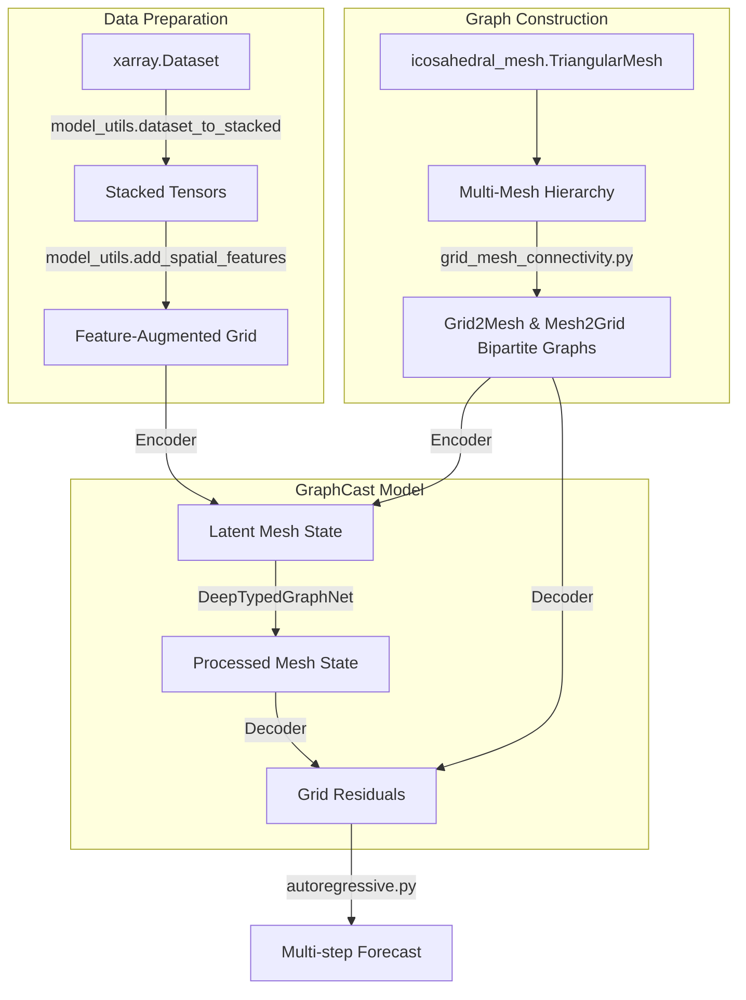
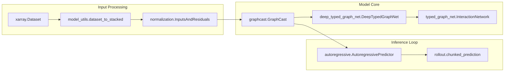

<!-- source: DeepWiki mcp.deepwiki.com · repo google-deepmind/weathernext · page 6 Legacy: WeatherNext 1 Graph (GraphCast) · fetched 2026-10-26 -->

# Legacy: WeatherNext 1 Graph (GraphCast)

Relevant source files

The following files were used as context for generating this wiki page:

- [docs/weathernext1_graph/README.md](docs/weathernext1_graph/README.md)
- [weathernext/weathernext1_graph/__init__.py](weathernext/weathernext1_graph/__init__.py)
- [weathernext/weathernext1_graph/graphcast.py](weathernext/weathernext1_graph/graphcast.py)

This page provides an overview of the deterministic GraphCast model, which is retained in the `weathernext/weathernext1_graph` package for backward compatibility [weathernext/weathernext1_graph/__init__.py:1-13](). GraphCast was originally published as "GraphCast: Learning skillful medium-range global weather forecasting" [docs/weathernext1_graph/README.md:3-4](). It is a high-resolution, deterministic weather forecasting model based on Graph Neural Networks (GNNs). It operates by mapping meteorological data from a regular latitude-longitude grid to a multi-resolution icosahedral mesh, performing message-passing in this latent space, and then mapping the results back to the grid for final predictions [weathernext/weathernext1_graph/graphcast.py:14-26]().

The model is designed to produce one-step-ahead predictions (e.g., a 6-hour step) that are then rolled out autoregressively to generate medium-range forecasts [weathernext/weathernext1_graph/graphcast.py:213-216]().

### High-Level Architecture: Encoder-Processor-Decoder
GraphCast follows an "Encoder-Processor-Decoder" pattern, where spatial relationships are captured through a series of bipartite and homogeneous graphs.

1.  **Encoder**: Maps the input grid data (atmospheric variables at multiple pressure levels, surface variables, and forcing data) onto the nodes of a multi-resolution icosahedral mesh [weathernext/weathernext1_graph/graphcast.py:236-241]().
2.  **Processor**: Performs multiple rounds of message-passing on the mesh using a deep GNN backbone, allowing information to propagate globally across the sphere [weathernext/weathernext1_graph/graphcast.py:243-247]().
3.  **Decoder**: Maps the processed latent features from the mesh nodes back to the original latitude-longitude grid to produce the predicted residuals [weathernext/weathernext1_graph/graphcast.py:249-253]().

For a deep dive into the GNN implementation, see [GraphCast Model Architecture](#6.1).

### Configuration and Task Definition
The model's behavior is governed by two primary configuration objects: `ModelConfig` and `TaskConfig`.

*   **`ModelConfig`**: Defines the architectural hyperparameters, such as the number of message-passing steps (`gnn_msg_steps`), the latent feature size (`latent_size`), and the refinement level of the icosahedral mesh (`mesh_size`) [weathernext/weathernext1_graph/graphcast.py:116-143]().
*   **`TaskConfig`**: Defines the operational scope, including the specific input and target variables (e.g., `2m_temperature`, `geopotential`), the set of pressure levels (e.g., `variables.PRESSURE_LEVELS_ERA5_37`), and the temporal duration of the input window [weathernext/weathernext1_graph/graphcast.py:83-112]().

### System Architecture Overview
The following diagram illustrates how the core components of the GraphCast pipeline interact, from raw data structures to the GNN execution.

**GraphCast Component Interaction**

**Sources:** [weathernext/weathernext1_graph/graphcast.py:213-255](), [weathernext/utils/model_utils.py:465-485](), [weathernext/utils/autoregressive.py:175-200]()

### Mesh and Connectivity
Unlike standard CNNs that operate on rectangular grids, GraphCast uses an icosahedral multi-mesh to represent the Earth's surface. This avoids the distortions and singularities at the poles common in lat/lon grids. The `icosahedral_mesh.TriangularMesh` class manages the recursive refinement of the icosahedron [weathernext/utils/icosahedral_mesh.py:44-55]().

The connection between the lat/lon grid and this mesh is established in `grid_mesh_connectivity.py`, which defines how nodes are linked based on spatial proximity [weathernext/utils/legacy/grid_mesh_connectivity.py:34-45]().

For details on the geometric construction, see [Icosahedral Multi-Mesh and Grid Connectivity](#5.3).

### Feature Engineering and Utilities
The raw meteorological data is transformed into a format suitable for GNNs using `model_utils.py`. This includes:
*   **Coordinate Transformations**: Converting lat/lon to 3D Cartesian coordinates [weathernext/utils/model_utils.py:125-140]().
*   **Channel Packing**: Using `dataset_to_stacked` to flatten variables and pressure levels into a single feature dimension [weathernext/utils/model_utils.py:465-480]().
*   **Spatial Features**: Adding Fourier features and local coordinate systems to edges to help the model understand relative positions [weathernext/utils/model_utils.py:260-280]().

For details on feature processing, see [Update Blocks and Spatial Features](#5.5).

### Prediction Pipeline and Wrappers
The core `GraphCast` class is typically wrapped in several layers to handle real-world data complexities:
*   **`InputsAndResiduals`**: Manages normalization and ensures the model predicts the *change* in state (residual) rather than the absolute state [weathernext/utils/normalization.py:80-100]().
*   **`NaNCleaner`**: Handles missing values in specific fields like sea surface temperature [weathernext/utils/nan_cleaning.py:25-40]().
*   **`Bfloat16Cast`**: Optimizes memory and performance by casting tensors to lower precision where appropriate [weathernext/utils/casting.py:25-40]().

For details on the wrapper pattern, see [Predictor Wrappers: Normalization, Casting, and NaN Cleaning](#4.4).

### Code Entity Mapping
This diagram maps the high-level prediction steps to the specific classes and functions in the codebase.

**Logic to Code Entity Mapping**

**Sources:** [weathernext/weathernext1_graph/graphcast.py:213-220](), [weathernext/utils/legacy/deep_typed_graph_net.py:40-60](), [weathernext/utils/autoregressive.py:175-185](), [weathernext/utils/rollout.py:200-220]()

### Summary of Child Pages
*   **[GraphCast Model Architecture](#6.1)**: Details the `ModelConfig` and `TaskConfig`, pressure level sets, variable groups, the `grid2mesh`/`mesh`/`mesh2grid` GNN stages, and the `DeepTypedGraphNet` backbone.
*   **[GraphCast Documentation and Demo](#6.2)**: Covers available checkpoints, normalization statistics, running one-step and autoregressive predictions, and computing gradients, as demonstrated in `docs/weathernext1_graph/README.md` and `graphcast_demo.ipynb`.

Sources: [docs/weathernext1_graph/README.md:1-134](), [weathernext/weathernext1_graph/__init__.py:1-13](), [weathernext/weathernext1_graph/graphcast.py:14-26](), [weathernext/weathernext1_graph/graphcast.py:213-216](), [weathernext/weathernext1_graph/graphcast.py:236-241](), [weathernext/weathernext1_graph/graphcast.py:243-247](), [weathernext/weathernext1_graph/graphcast.py:249-253](), [weathernext/weathernext1_graph/graphcast.py:116-143](), [weathernext/weathernext1_graph/graphcast.py:83-112](), [weathernext/weathernext1_graph/graphcast.py:213-255](), [weathernext/utils/model_utils.py:465-485](), [weathernext/utils/autoregressive.py:175-200](), [weathernext/utils/icosahedral_mesh.py:44-55](), [weathernext/utils/legacy/grid_mesh_connectivity.py:34-45](), [weathernext/utils/model_utils.py:125-140](), [weathernext/utils/model_utils.py:260-280](), [weathernext/utils/normalization.py:80-100](), [weathernext/utils/nan_cleaning.py:25-40](), [weathernext/utils/casting.py:25-40](), [weathernext/weathernext1_graph/graphcast.py:213-220](), [weathernext/utils/legacy/deep_typed_graph_net.py:40-60](), [weathernext/utils/autoregressive.py:175-185](), [weathernext/utils/rollout.py:200-220]()

---

