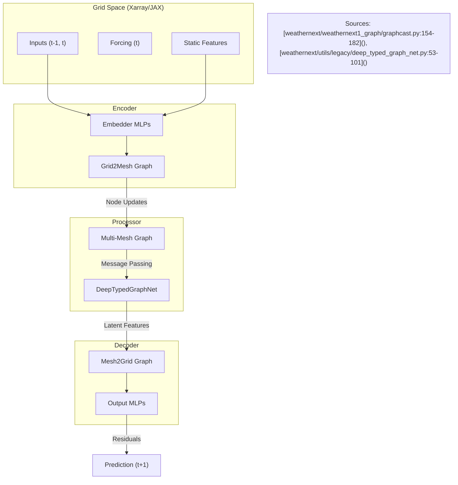
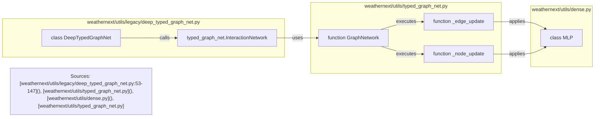

<!-- source: DeepWiki mcp.deepwiki.com · repo google-deepmind/weathernext · page 6.1 GraphCast Model Architecture · fetched 2026-10-26 -->

# GraphCast Model Architecture

Relevant source files

The following files were used as context for generating this wiki page:

- [weathernext/utils/legacy/deep_typed_graph_net.py](weathernext/utils/legacy/deep_typed_graph_net.py)
- [weathernext/weathernext1_graph/graphcast.py](weathernext/weathernext1_graph/graphcast.py)

GraphCast is a high-resolution, multi-scale Graph Neural Network (GNN) designed for deterministic medium-range weather forecasting. It operates by mapping meteorological data from a latitude-longitude grid onto a multi-scale icosahedral mesh, performing message passing in a latent space, and then mapping the results back to the grid to produce predictions.

## 1. Encoder-Processor-Decoder Pattern

The `GraphCast` predictor [weathernext/weathernext1_graph/graphcast.py:154-155]() follows the standard Encoder-Processor-Decoder architecture for mesh-based simulations. This design decouples the high-resolution grid data from the computationally intensive message-passing steps.

### System Data Flow
The following diagram illustrates how the `GraphCast` class coordinates the transition between physical grid space and latent graph space.

*   **Encoder**: Maps the input features from the grid (latitude/longitude) to the nodes of a multi-resolution icosahedral mesh using a bipartite `Grid2Mesh` graph [weathernext/weathernext1_graph/graphcast.py:383-404]().
*   **Processor**: Performs $N$ steps of message passing on the multi-mesh using `DeepTypedGraphNet`. This is where the core spatial reasoning occurs [weathernext/weathernext1_graph/graphcast.py:406-420]().
*   **Decoder**: Maps the processed latent mesh features back to the grid using a `Mesh2Grid` bipartite graph to produce the final predictions [weathernext/weathernext1_graph/graphcast.py:422-441]().

**Sources:** [weathernext/weathernext1_graph/graphcast.py:154-182](), [weathernext/utils/legacy/deep_typed_graph_net.py:53-101]()

---

## 2. Configuration and Variables

The model's behavior and data requirements are defined via two primary `chex.dataclass` structures.

### 2.1 TaskConfig
`TaskConfig` defines the meteorological context, including which variables are treated as inputs, targets, or forcings, and the vertical resolution (pressure levels) [weathernext/weathernext1_graph/graphcast.py:83]().

| Field | Description |
| :--- | :--- |
| `input_variables` | Variables available at $t$ and $t-1$. |
| `target_variables` | Variables the model predicts for $t+1$. |
| `forcing_variables` | Known future values (e.g., solar radiation). |
| `pressure_levels` | The vertical slices of the atmosphere (hPa). |

**Standard Level Sets:**
*   **ERA5-37**: 37 levels from 1hPa to 1000hPa [weathernext/weathernext1_graph/graphcast.py:93]().
*   **WeatherBench-13**: 13 levels used for benchmarking [weathernext/weathernext1_graph/graphcast.py:101]().

### 2.2 ModelConfig
`ModelConfig` defines the GNN hyperparameters [weathernext/weathernext1_graph/graphcast.py:116-143]().
*   **`mesh_size`**: The refinement level of the icosahedral mesh.
*   **`gnn_msg_steps`**: Number of message-passing iterations in the processor.
*   **`latent_size`**: The width of the hidden representations in MLPs.
*   **`radius_query_fraction_edge_length`**: Determines the connectivity density between the grid and the mesh nodes.
*   **`mesh2grid_edge_normalization_factor`**: Optional factor for normalizing mesh2grid edges [weathernext/weathernext1_graph/graphcast.py:142]().

**Sources:** [weathernext/weathernext1_graph/graphcast.py:116-143]()

---

## 3. DeepTypedGraphNet Backbone

The core of the Processor is the `DeepTypedGraphNet` [weathernext/utils/legacy/deep_typed_graph_net.py:53](). Unlike standard GNNs that operate on a single node/edge type, `DeepTypedGraphNet` operates on `TypedGraph` structures, allowing distinct MLPs for different interaction types (e.g., mesh-to-mesh vs. grid-to-mesh).

### Implementation Details
*   **Message Passing**: It uses `typed_graph_net.InteractionNetwork` to update node and edge features [weathernext/utils/legacy/deep_typed_graph_net.py:58-60]().
*   **Shared vs. Unshared Weights**: The class supports repeating the same processor weights (`num_processor_repetitions`) or using distinct weights for every step (`num_message_passing_steps`) [weathernext/utils/legacy/deep_typed_graph_net.py:68-79]().
*   **Normalization**: Employs `LayerNorm` by default, with support for `use_norm_conditioning` [weathernext/utils/legacy/deep_typed_graph_net.py:96]() which is critical for diffusion-based variants like GenCast.

### Code Entity Mapping
This diagram maps the high-level logic to the specific JAX/Haiku classes implemented in the repository.

**Sources:** [weathernext/utils/legacy/deep_typed_graph_net.py:53-147]()

---

## 4. Variable Definitions

GraphCast categorizes variables into four distinct groups to handle their temporal and spatial properties correctly [weathernext/weathernext1_graph/graphcast.py:51-80]():

1.  **Atmospheric Variables**: 3D variables defined across all pressure levels (e.g., `temperature`, `u_component_of_wind`, `geopotential`) [weathernext/weathernext1_graph/graphcast.py:66-72]().
2.  **Surface Variables**: 2D variables defined at the Earth's surface (e.g., `2m_temperature`, `mean_sea_level_pressure`, `total_precipitation_6hr`) [weathernext/weathernext1_graph/graphcast.py:51-57]().
3.  **Forcing Variables**: External factors known for the target time (e.g., `EXTERNAL_FORCING_VARS`, `TIME_FORCING_VARS`) [weathernext/weathernext1_graph/graphcast.py:80]().
4.  **Static Variables**: Time-invariant geographic features (e.g., `variables.STATIC_VARS`) [weathernext/weathernext1_graph/graphcast.py:89]().

**Sources:** [weathernext/weathernext1_graph/graphcast.py:51-80]()

---

