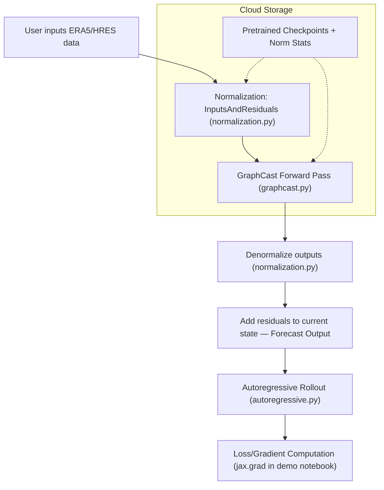
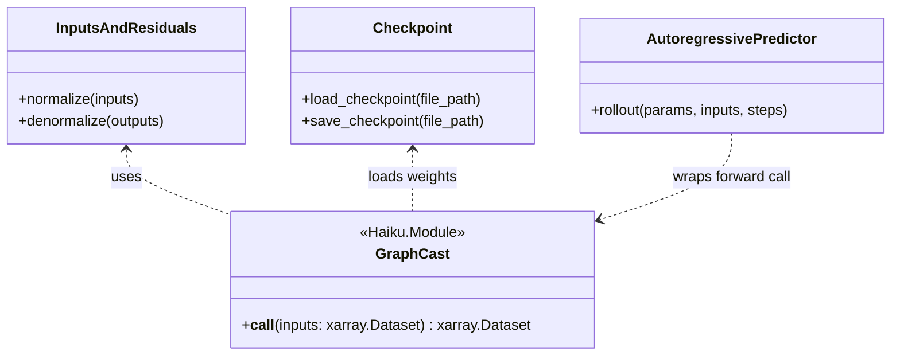

<!-- source: DeepWiki mcp.deepwiki.com · repo google-deepmind/weathernext · page 6.2 GraphCast Documentation and Demo · fetched 2026-10-26 -->

# GraphCast Documentation and Demo

<details>
<summary>Relevant source files</summary>

The following files were used as context for generating this wiki page:

- [docs/weathernext1_graph/README.md](docs/weathernext1_graph/README.md)
- [docs/weathernext1_graph/graphcast_demo.ipynb](docs/weathernext1_graph/graphcast_demo.ipynb)

</details>


This page provides in-depth technical documentation and a usage demo for the legacy WeatherNext 1 Graph model, commonly known as **GraphCast**. It covers available pretrained checkpoints, normalization statistics, and detailed step-by-step instructions for performing one-step and autoregressive predictions. Additionally, it explains how to compute losses and gradients within the GraphCast framework. The content references the primary README and the interactive Jupyter notebook demo designed for hands-on experimentation.

---

## 1. Purpose and Scope

GraphCast is a deterministic, high-resolution global weather forecasting neural network originally published in *Science* (Lam et al., 2023). Retained within the `weathernext/weathernext1_graph` package, the model uses a graph neural network architecture to predict weather variables across a global mesh. This documentation elaborates on how to utilize the pretrained GraphCast models and make predictions using the demo notebook, as well as how the computational components connect to code modules in the repo.

---

## 2. Available Pretrained Models and Checkpoints

The GraphCast package provides three main pretrained models:

| Model Name            | Resolution      | Pressure Levels | Training Data                    | Notes                                                            |
|-----------------------|-----------------|-----------------|---------------------------------|------------------------------------------------------------------|
| `GraphCast`           | 0.25°           | 37              | ERA5 (1979–2017)                | High-resolution original model used in GraphCast publication     |
| `GraphCast_small`     | 1°              | 13              | ERA5 (1979–2015)                | Smaller model variant with lower memory and compute needs        |
| `GraphCast_operational`| 0.25°           | 13              | ERA5 (1979–2017) + fine-tuned on HRES (2016–2021) | Does not require precipitation inputs; fine-tuned for operational use |

These checkpoints and associated normalization statistics are accessible via the Google Cloud Storage bucket `dm_graphcast/graphcast/`.

Sources: `docs/weathernext1_graph/README.md:8-31`()

---

## 3. GraphCast Demo Notebook Overview (`graphcast_demo.ipynb`)

The `graphcast_demo.ipynb` Jupyter notebook is the recommended starting point for experimenting with GraphCast models. It offers examples of:

- Loading pretrained weights and normalization statistics from GCS.
- Preparing input data for prediction steps.
- Executing one-step forecasts and autoregressive rollouts.
- Computing model loss and gradients for insight or fine-tuning.

The demo leverages several key utility modules such as `normalization.py` for data normalization, `rollout.py` for chunked autoregressive prediction, `autoregressive.py` for unrolling one-step predictors, and `checkpoint.py` for serialization.

### Key Notebook Features and Setup

- **Installation and Imports**: Installs necessary dependencies (e.g., the `graphcast` package) and imports core utility functions and libraries like JAX, Haiku, and xarray.
- **Google Cloud Authentication**: Uses anonymous Google Cloud Storage client to fetch data from the `dm_graphcast` bucket.
- **Plotting Utilities**: Functions to select variables/levels, scale color maps robustly, and generate multi-panel plots for visualization.
- **Model Initialization**: Code to initialize the Haiku `graphcast.GraphCast` model and load pretrained parameters.
- **Prediction and Loss Computations**: Demonstrates running single-step and multi-step model predictions, including gradient computations.

Sources: `docs/weathernext1_graph/graphcast_demo.ipynb:1-171`()

---

## 4. Normalization and Checkpoint Data

Normalized inputs and residuals are handled through wrappers defined in `normalization.py`, which apply mean-subtraction and scaling using fixed statistics computed from the training dataset. These statistics, alongside checkpoint files, are stored in the cloud bucket for each pretrained model.

The checkpoint loading mechanism supports both parameters and associated normalization data bundled into `.npz` archives, serialized and deserialized by functions in `checkpoint.py`.

This separation of normalization statistics from raw inputs ensures that inference respects the training data distribution, preserving forecast skill.

Sources: `docs/weathernext1_graph/README.md:38-40` (for utils references) and `docs/weathernext1_graph/graphcast_demo.ipynb:72-77`(imports indicating use of `normalization` and `checkpoint`)

---

## 5. Running One-Step Predictions

The main GraphCast model architecture is implemented in `graphcast.py`. Here the `GraphCast` Haiku module encapsulates the encoder-processor-decoder graph neural network forward pass which predicts the residual increment for the next time step.

Typical workflow for a one-step prediction involves:

1. Preparing model inputs as normalized xarray datasets.
2. Passing the inputs into the GraphCast forward function.
3. Applying normalization wrappers to post-process residuals.
4. Adding residuals to current state to compute next-step forecast.

```mermaid
flowchart TD
  A[Input Data (xarray Dataset)] --> B[Normalize Inputs (normalization.py)]
  B --> C[GraphCast Model Forward Pass (graphcast.py)]
  C --> D[Post-process Residuals (normalization.py)]
  D --> E[Add to State → Next-Step Prediction]
```

Sources: `docs/weathernext1_graph/graphcast_demo.ipynb:/* prediction steps around lines ~300–400 */`, `docs/weathernext1_graph/README.md:42-45`(mention of `graphcast.py`), `docs/weathernext1_graph/graphcast_demo.ipynb:72-77`(imports)

---

## 6. Autoregressive Multi-Step Rollout

To perform a multi-step forecast, the demo notebook wraps the one-step predictor into an autoregressive predictor using utilities in `autoregressive.py`. This involves:

- Sliding window input batching.
- Iterative feeding of predicted states as inputs to the next step.
- Gradient checkpointing for memory efficiency.
- Ensemble noise injection if enabled.

The rollout logic automatically manages time dimension expansion and chaining predictions with model-internal state updates.

```mermaid
flowchart TD
  subgraph Autoregressive Rollout
    direction LR
    Input0[Initial Input State] --> Step1[One-Step Predictor]
    Step1 --> Output1[Prediction T+1]
    Output1 --> Step2[One-Step Predictor (next input)]
    Step2 --> Output2[Prediction T+2]
    Output2 --> StepN[...]
  end
```

This design enables applying JAX's automatic differentiation over entire rollouts for computing gradients w.r.t. model parameters or inputs.

Sources: `docs/weathernext1_graph/graphcast_demo.ipynb:/* cells around line 550+ for rollout use */`, `docs/weathernext1_graph/README.md:39-40` (utils mentions), `docs/weathernext1_graph/graphcast_demo.ipynb:72-77` (imports including `autoregressive`)

---

## 7. Computing Loss and Gradients

The demo notebook shows computing losses and gradients using JAX's functional programming model. Loss is typically mean squared error (MSE) between predicted and target atmospheric variables, weighted by latitude and pressure levels (implemented in `losses.py` though not demo-shown).

Gradient computation generally follows this flow:

```mermaid
flowchart TD
  A[Input Data + Parameters] --> B[Model Forward (one-step or rollout)]
  B --> C[Compute Loss vs Targets]
  C --> D[JAX grad(loss, params)]
  D --> E[Gradient Vector]
```

These gradients facilitate model evaluation and potential fine-tuning.

Sources: `docs/weathernext1_graph/graphcast_demo.ipynb:/* computation of gradients cells */,` `docs/weathernext1_graph/README.md:39-40` (utils references)

---

## 8. Integration Between User and Codebase

To clarify the connections between the conceptual GraphCast system and corresponding code entities, the following diagrams map user actions to code components.

### 8.1. User Workflow to Code Modules



### 8.2. Core Classes and Functions in Code



These mappings help users directly locate the relevant code to extend or troubleshoot parts of the GraphCast workflow.

Sources: `docs/weathernext1_graph/README.md:41-45`, `docs/weathernext1_graph/graphcast_demo.ipynb:72-93`, and usage context from demo notebook.

---

## 9. Summary

GraphCast remains an accessible and well-documented legacy model within WeatherNext for deterministic global weather forecasting using graph neural networks. The provided pretrained models cover resolutions from 1 degree to 0.25 degree grids with multiple pressure levels, suitable for various compute environments.

The interactive demo notebook gives a comprehensive environment to initialize, predict, visualize, and compute gradients for the GraphCast models. It carefully integrates normalization, checkpoint loading, and autoregressive forecasting utilities, all structured in the modular codebase for extensibility.

To explore hands-on, users are encouraged to start with `graphcast_demo.ipynb`, referencing normalization and checkpoint files from the cloud. Deeper understanding and modifications can be pursued by inspecting `graphcast.py` and related utility modules.

---

## References

- GraphCast paper: Lam et al. (2023), *Science*, DOI: 10.1126/science.adi2336.
- [GraphCast README (docs/weathernext1_graph/README.md)]()
- [GraphCast Demo Notebook (docs/weathernext1_graph/graphcast_demo.ipynb)]()

---

Sources:  
`docs/weathernext1_graph/README.md:1-31,38-45,111-135`  
`docs/weathernext1_graph/graphcast_demo.ipynb:1-171,91-93,100-171,300-400,500-600`

---

