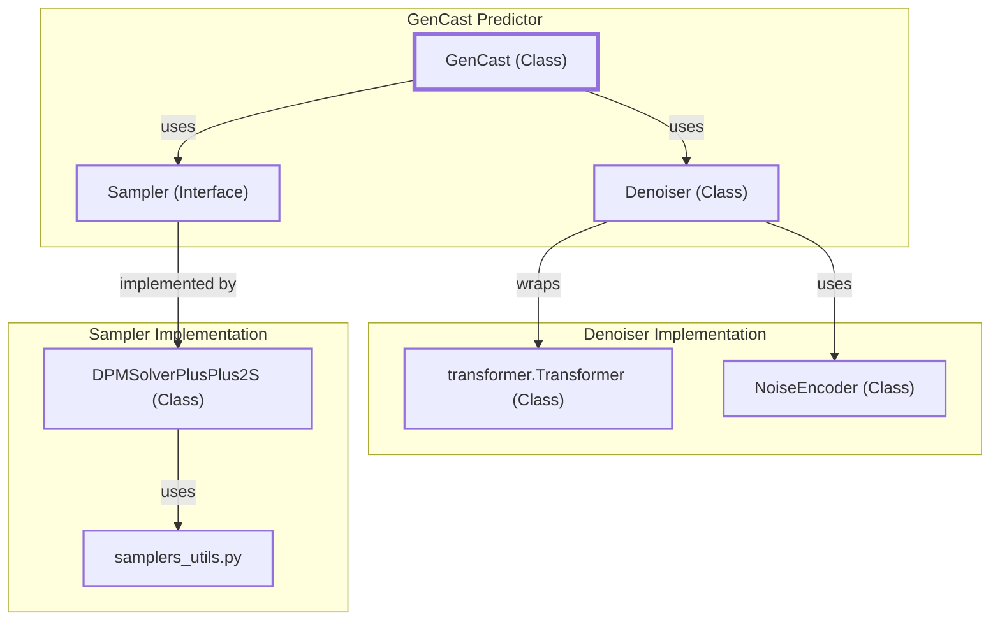
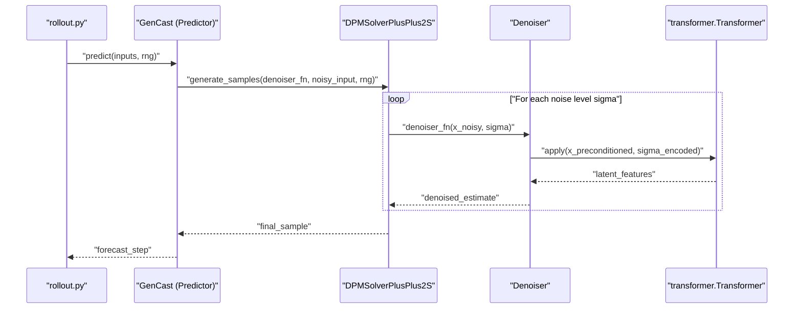

<!-- source: DeepWiki mcp.deepwiki.com · repo google-deepmind/weathernext · page 7 Legacy: WeatherNext 1 Gen (GenCast) · fetched 2026-10-26 -->

# Legacy: WeatherNext 1 Gen (GenCast)

Relevant source files

The following files were used as context for generating this wiki page:

- [docs/weathernext1_gen/README.md](docs/weathernext1_gen/README.md)
- [weathernext/weathernext1_gen/__init__.py](weathernext/weathernext1_gen/__init__.py)
- [weathernext/weathernext1_gen/gencast.py](weathernext/weathernext1_gen/gencast.py)

This page provides an overview of the GenCast model, a diffusion-based ensemble forecasting system implemented in `weathernext/weathernext1_gen` [weathernext/weathernext1_gen/__init__.py:1-13](). GenCast was published as "GenCast: Diffusion-based ensemble forecasting for medium-range weather" [docs/weathernext1_gen/README.md:5-6](). Unlike deterministic models, GenCast generates multiple ensemble members to capture forecast uncertainty.

The GenCast package includes several pretrained models at different resolutions and training configurations, such as `GenCast 0p25deg <2019` and `GenCast 1p0deg Mini <2019` [docs/weathernext1_gen/README.md:9-37](). Demonstrations are available in `gencast_mini_demo.ipynb` and `gencast_demo_cloud_vm.ipynb` [docs/weathernext1_gen/README.md:43-45,55-56]().

## System Architecture

The GenCast system is composed of a `Denoiser` and a `Sampler`. The `Denoiser` learns to remove noise from a given weather state, conditioned on past data and a noise level. The `Sampler` then iteratively applies this denoiser to transform an initial noisy state into a coherent weather forecast ensemble.

### GenCast Code Entity Map
This diagram illustrates the relationship between the high-level GenCast components and their corresponding classes and modules in the codebase.

**Sources:** [weathernext/weathernext1_gen/gencast.py:139-180](), [weathernext/weathernext1_gen/denoiser.py:63-109](), [weathernext/weathernext1_gen/dpm_solver_plus_plus_2s.py:28-40]()

## Denoiser Architecture
The `Denoiser` class [weathernext/weathernext1_gen/denoiser.py:63-63]() is central to GenCast. It implements the denoising function $D(x; \sigma)$, which takes a noisy input `x` and a noise level `sigma` to estimate the clean signal. The denoiser is configured via `DenoiserArchitectureConfig` [weathernext/weathernext1_gen/gencast.py:133-133]().

Key aspects of the denoiser include:
*   **Preconditioning:** The denoiser applies specific scaling factors to its inputs and outputs based on the noise level $\sigma$ to ensure stable training, as described in the Karras et al. (2022) framework [weathernext/weathernext1_gen/gencast.py:14-21]().
*   **Noise-Level Encoding:** The scalar noise level $\sigma$ is encoded into a high-dimensional vector using a `NoiseEncoder` (e.g., `FourierFeaturesMLP`) before being passed to the main architecture [weathernext/weathernext1_gen/denoiser.py:97-101]().
*   **Mesh Transformer Backbone:** The core of the denoiser's architecture is a `Transformer` [weathernext/weathernext1_gen/transformer.py:28-28]() that operates on the icosahedral mesh, processing spatial relationships.

For details, see [Denoiser Architecture](#7.1).

**Sources:** [weathernext/weathernext1_gen/denoiser.py:63-118](), [weathernext/weathernext1_gen/gencast.py:177-188]()

## Diffusion Sampler: DPM-Solver++ 2S
To generate an ensemble forecast, GenCast employs the `DPMSolverPlusPlus2S` sampler [weathernext/weathernext1_gen/dpm_solver_plus_plus_2s.py:28-28](). This sampler starts with Gaussian noise and iteratively refines it into a weather forecast by calling the denoiser. The sampling process is governed by `SamplerConfig` [weathernext/weathernext1_gen/gencast.py:83-118]().

The sampling process involves:
*   **Noise Schedule:** A sequence of noise levels is defined, ranging from `max_noise_level` down to `min_noise_level`, with spacing controlled by `rho` [weathernext/weathernext1_gen/gencast.py:109-111]().
*   **Stochastic Churn:** To enhance sample diversity, a controlled amount of noise can be re-injected during the reverse diffusion process, managed by `stochastic_churn_rate` [weathernext/weathernext1_gen/gencast.py:114-114]().
*   **Second-Order Solver Steps:** The DPM-Solver++ 2S algorithm uses second-order steps for efficient and accurate sampling.

For details, see [Diffusion Sampler: DPM-Solver++ 2S](#7.2).

**Sources:** [weathernext/weathernext1_gen/dpm_solver_plus_plus_2s.py:28-112](), [weathernext/weathernext1_gen/gencast.py:83-118]()

## GenCast Demos and Evaluation Scorecards
The `weathernext1_gen` package provides several resources for demonstrating and evaluating GenCast:
*   **`gencast_mini_demo.ipynb`**: A Colaboratory notebook that provides an example of loading data, initializing a `GenCast 1p0deg Mini <2019` model, generating predictions, and computing gradients [docs/weathernext1_gen/README.md:43-47]().
*   **`gencast_demo_cloud_vm.ipynb`**: A more comprehensive demo for running larger GenCast models (0.25deg resolution) on Google Cloud TPU VMs [docs/weathernext1_gen/README.md:55-56]().
*   **Evaluation Scorecards**: Performance comparisons, such as the `GenCast_1p0deg_Mini_ENS_scorecard.png`, are provided to illustrate GenCast's performance against other models like ENS [docs/weathernext1_gen/README.md:38-42](). These scorecards highlight aspects like CRPS (Continuous Ranked Probability Score) for ensemble forecasts.

For details, see [GenCast Demos and Evaluation Scorecards](#7.3).

**Sources:** [docs/weathernext1_gen/README.md:38-47,55-56]()

## Execution Flow
The following sequence diagram illustrates how a single forecast step is generated through the interaction of the `GenCast` predictor, `Sampler`, and `Denoiser`.

**Sources:** [weathernext/utils/rollout.py:56-65](), [weathernext/weathernext1_gen/gencast.py:227-252](), [weathernext/weathernext1_gen/dpm_solver_plus_plus_2s.py:53-112](), [weathernext/weathernext1_gen/denoiser.py:103-118]()

---

