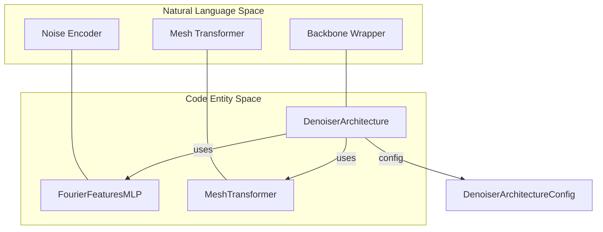
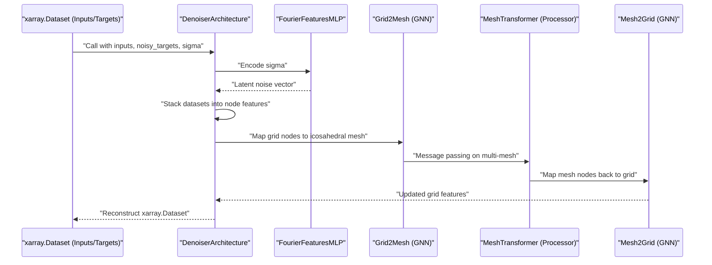

<!-- source: DeepWiki mcp.deepwiki.com · repo google-deepmind/weathernext · page 7.1 Denoiser Architecture · fetched 2026-10-26 -->

# Denoiser Architecture

Relevant source files

The following files were used as context for generating this wiki page:

- [weathernext/weathernext1_gen/denoiser.py](weathernext/weathernext1_gen/denoiser.py)
- [weathernext/weathernext1_gen/denoisers_base.py](weathernext/weathernext1_gen/denoisers_base.py)
- [weathernext/weathernext1_gen/transformer.py](weathernext/weathernext1_gen/transformer.py)

The Denoiser is the core component of the GenCast generative model. Unlike the deterministic GraphCast predictor, the Denoiser is designed to operate within a diffusion framework, mapping noisy target states back to clean states while conditioning on meteorological inputs and a specific noise level $\sigma$. It implements a GNN-based backbone that leverages a sparse transformer for message passing on an icosahedral multi-mesh.

### Denoiser Interface

The interface for all denoisers is defined by the `Denoiser` protocol in `weathernext/weathernext1_gen/denoisers_base.py`. This protocol specifies that a denoiser must accept the current state (inputs), the noisy version of the next state (noisy_targets), and a scalar noise level (noise_levels).

| Argument | Type | Description |
| :--- | :--- | :--- |
| `inputs` | `xarray.Dataset` | Historical meteorological states used for conditioning. |
| `noisy_targets` | `xarray.Dataset` | The target variables with added Gaussian noise. |
| `noise_levels` | `xarray.DataArray` | The $\sigma$ values used to corrupt the targets, typically with a `batch` dimension. |
| `forcings` | `xarray.Dataset` | Optional time-dependent variables like solar radiation. |

Sources: [weathernext/weathernext1_gen/denoisers_base.py:28-53]()

### Architecture Overview

The GenCast denoiser architecture wraps a GNN backbone and manages the transformation between grid-space `xarray` datasets and graph-space `TypedGraph` structures. It utilizes a `FourierFeaturesMLP` to encode the scalar noise level into a high-dimensional conditioning vector.

#### Entity Mapping: Denoiser Components
The following diagram illustrates how the logical components of the denoiser map to specific classes in the codebase.

Sources: [weathernext/weathernext1_gen/denoiser.py:41-43](), [weathernext/weathernext1_gen/denoiser.py:157-160](), [weathernext/weathernext1_gen/denoiser.py:230-232]()

### Noise Level Encoding

The denoiser must be aware of the current noise level $\sigma$ to effectively remove noise. This is achieved using the `FourierFeaturesMLP` class, which transforms the scalar $\sigma$ into a latent vector.

1.  **Log Transformation**: If `apply_log_first` is enabled, the model takes `jnp.log(sigma)` [weathernext/weathernext1_gen/denoiser.py:92-93]().
2.  **Fourier Features**: The value is expanded into a set of sine and cosine features using `model_utils.fourier_features` [weathernext/weathernext1_gen/denoiser.py:95-96]().
3.  **MLP Projection**: A multi-layer perceptron (MLP) processes these features into a final conditioning vector [weathernext/weathernext1_gen/denoiser.py:98-98]().

This conditioning vector is typically passed to the GNN backbone to modulate normalization layers (Feature-wise Linear Modulation or FiLM).

Sources: [weathernext/weathernext1_gen/denoiser.py:41-98](), [weathernext/weathernext1_gen/denoiser.py:102-124]()

### Denoiser Data Flow

The `DenoiserArchitecture` class handles the full data flow from `xarray` inputs to graph-based processing.

#### System Flow: Grid to Graph

Sources: [weathernext/weathernext1_gen/denoiser.py:230-310](), [weathernext/weathernext1_gen/denoiser.py:383-430]()

### Configuration: DenoiserArchitectureConfig

The architecture is parameterized by `DenoiserArchitectureConfig`, which defines the depth and width of the network, as well as the connectivity of the graph.

| Parameter | Type | Description |
| :--- | :--- | :--- |
| `sparse_transformer_config` | `SparseTransformerConfig` | Configuration for the internal transformer blocks. |
| `mesh_size` | `int` | Number of refinements for the icosahedral multi-mesh. |
| `latent_size` | `int` | Dimensionality of hidden representations in MLPs. |
| `radius_query_fraction_edge_length` | `float` | Controls the connectivity radius for the `Grid2Mesh` graph. |
| `norm_conditioning_features` | `list[str]` | Features (like encoded $\sigma$) used for global normalization conditioning. |

Sources: [weathernext/weathernext1_gen/denoiser.py:157-227]()

### Sparse Transformer Integration

The Denoiser uses a `MeshTransformer` as its processor, which wraps a `sparse_transformer.SparseTransformer` [weathernext/weathernext1_gen/transformer.py:60-61](). Unlike standard GraphCast which uses a `DeepTypedGraphNet` for the processor, GenCast's denoiser relies on attention mechanisms.

The `MeshTransformer` handles the conversion of the `TypedGraph` node features from `[nodes, batch, ...]` to `[batch, nodes, ...]` for the underlying `SparseTransformer` and then transposes them back [weathernext/weathernext1_gen/transformer.py:114-116](). It also initializes the `SparseTransformer` with an adjacency matrix derived from the `TypedGraph`'s 'mesh' edge set [weathernext/weathernext1_gen/transformer.py:86-90]().

*   **Attention Type**: Configurable via `attention_type` (e.g., `splash_mha` for TPUs or `triblockdiag_mha` for GPUs) [weathernext/weathernext1_gen/denoiser.py:137-137]().
*   **K-Hop Connectivity**: The transformer attends to neighbors within a specified number of hops on the mesh, defined by `attention_k_hop` [weathernext/weathernext1_gen/denoiser.py:129-129]().
*   **Global Conditioning**: The noise level vector is injected into the transformer blocks to modulate the latent representations based on the current diffusion step [weathernext/weathernext1_gen/transformer.py:96-96]().

Sources: [weathernext/weathernext1_gen/denoiser.py:126-154](), [weathernext/weathernext1_gen/transformer.py:60-124]()

---

