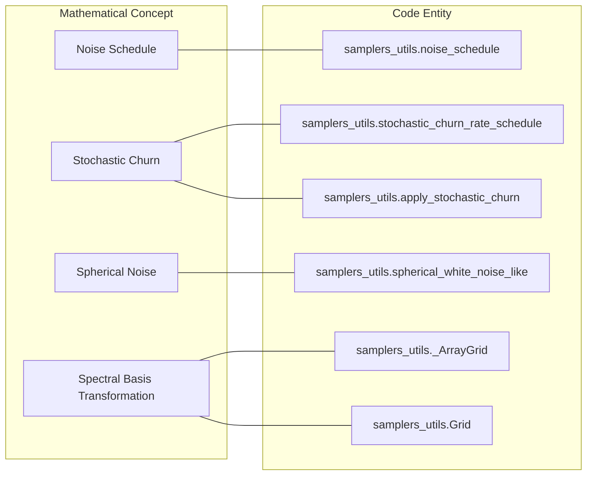

<!-- source: DeepWiki mcp.deepwiki.com · repo google-deepmind/weathernext · page 7.2 Diffusion Sampler: DPM-Solver++ 2S · fetched 2026-10-26 -->

# Diffusion Sampler: DPM-Solver++ 2S

<details>
<summary>Relevant source files</summary>

The following files were used as context for generating this wiki page:

- [weathernext/weathernext1_gen/dpm_solver_plus_plus_2s.py](weathernext/weathernext1_gen/dpm_solver_plus_plus_2s.py)
- [weathernext/weathernext1_gen/gencast.py](weathernext/weathernext1_gen/gencast.py)
- [weathernext/weathernext1_gen/samplers_base.py](weathernext/weathernext1_gen/samplers_base.py)
- [weathernext/weathernext1_gen/samplers_utils.py](weathernext/weathernext1_gen/samplers_utils.py)

</details>


This page describes the implementation of the **DPM-Solver++ 2S** algorithm in GenCast. This sampler is a second-order, single-step solver designed for fast guided sampling of diffusion probabilistic models. It is combined with optional stochastic churn to improve generative quality by re-injecting noise during the reverse diffusion process.

## Overview and Sampler Hierarchy

The sampling logic is built upon an abstract base class that ensures a consistent interface for different sampling algorithms. The sampler's primary role is to iteratively call a denoiser to transform pure noise into a structured weather forecast.

### The Sampler Base Class
The `Sampler` abstract base class [weathernext/weathernext1_gen/samplers_base.py:23-47]() defines the contract for all GenCast samplers. It is initialized with a `Denoiser` and implements a `__call__` method that matches the `Predictor` interface, allowing it to be used interchangeably in rollout pipelines.

### DPM-Solver++ 2S Implementation
The `Sampler` class in `weathernext/weathernext1_gen/dpm_solver_plus_plus_2s.py` implements the specific logic for the DPM-Solver++ 2S algorithm.
*   **Second-Order (2)**: It uses a midpoint-style update to improve accuracy over first-order Euler steps.
*   **Single-Step (S)**: Unlike multi-step solvers, it does not require cached function evaluations from previous iterations [weathernext/weathernext1_gen/dpm_solver_plus_plus_2s.py:33-37]().

**Sources:**
* [weathernext/weathernext1_gen/samplers_base.py:23-47]()
* [weathernext/weathernext1_gen/dpm_solver_plus_plus_2s.py:28-43]()

---

## Noise Schedule and Configuration

The behavior of the sampler is governed by a noise schedule that defines the sequence of $\sigma$ (noise levels) used during the reverse diffusion process.

### Sampler Configuration Parameters
The following parameters control the density and range of the diffusion steps [weathernext/weathernext1_gen/dpm_solver_plus_plus_2s.py:58-81]():

| Parameter | Description |
| :--- | :--- |
| `max_noise_level` | The highest noise level used at the start of the sequence of reverse diffusion steps. |
| `min_noise_level` | The lowest noise level used at the end of the sequence of reverse diffusion steps. |
| `num_noise_levels` | Determines the number of noise levels used and hence the number of reverse diffusion steps performed. |
| `rho` | Parameter affecting the spacing of noise steps. Higher values will concentrate noise steps more around zero. |
| `stochastic_churn_rate` | ($S_{churn}$) Controls the rate at which noise is re-injected/'churned' during the sampling algorithm. If this is set to zero then we are performing deterministic sampling. |
| `churn_min_noise_level` | Minimum noise level at which stochastic churn occurs. ($S_{min}$ from the paper). Only used if `stochastic_churn_rate > 0`. |
| `churn_max_noise_level` | Maximum noise level at which stochastic churn occurs. ($S_{max}$ from the paper). Only used if `stochastic_churn_rate > 0`. |
| `noise_level_inflation_factor` | ($S_{noise}$) This can be used to set the actual amount of noise injected higher than what the denoiser is told has been added. The motivation is to compensate for a tendency of L2-trained denoisers to remove slightly too much noise / blur too much. Only used if `stochastic_churn_rate > 0`. |

These parameters are encapsulated in the `SamplerConfig` dataclass [weathernext/weathernext1_gen/gencast.py:84-118]() within `gencast.py`, which provides default values for GenCast.

### Noise Schedule Generation
The schedule is generated using `utils.noise_schedule` [weathernext/weathernext1_gen/dpm_solver_plus_plus_2s.py:83-84](). This produces a sequence of noise levels that the sampler iterates through in descending order. The `stochastic_churn_rate_schedule` is also computed based on these noise levels [weathernext/weathernext1_gen/dpm_solver_plus_plus_2s.py:86-88]().

**Sources:**
* [weathernext/weathernext1_gen/dpm_solver_plus_plus_2s.py:45-90]()
* [weathernext/weathernext1_gen/gencast.py:84-118]()
* [weathernext/weathernext1_gen/samplers_utils.py:419-428]()

---

## Data Flow: Sampling Iteration

The sampling process is implemented as a loop (typically using `jax.lax.scan` in the broader pipeline) where each step moves from a higher noise level $\sigma_i$ to a lower level $\sigma_{i+1}$.

### System Data Flow Diagram
The following diagram illustrates how the `Sampler` interacts with the `Denoiser` and the `samplers_utils` to produce a sample.

"Sampler Data Flow"
```mermaid
graph TD
    subgraph "Initialization"
        A["SamplerConfig"] --> B["utils.noise_schedule"]
        B --> C["noise_levels (jnp.array)"]
        A --> D["utils.stochastic_churn_rate_schedule"]
        D --> E["per_step_churn_rates (jnp.array)"]
    end

    subgraph "Iteration Loop (body_fn)"
        F["i (Iteration Index)"]
        G["x (Noisy Target)"]
        
        F, G --> H{"i == 0?"}
        H -- "Yes" --> I["utils.spherical_white_noise_like(x)"]
        I --> J["Initial Noise Injection (x = x + noise)"]
        H -- "No" --> J
        
        J --> K["noise_level = noise_levels[i]"]
        
        K --> L{"_stochastic_churn?"}
        L -- "Yes" --> M["utils.apply_stochastic_churn(x, noise_level, per_step_churn_rates[i], _noise_level_inflation_factor)"]
        M --> N["x_churned, noise_level_churned"]
        L -- "No" --> N
        
        N --> O["denoiser(noise_level_churned, x_churned)"]
        O --> P["x0_estimate (Denoised Target)"]
        
        P, N, K --> Q["DPM-Solver++ 2S Update Logic"]
        Q --> R["x_next (Noisy Target for next iteration)"]
    end

    R --> S["Final xarray.Dataset"]
```
**Sources:**
* [weathernext/weathernext1_gen/dpm_solver_plus_plus_2s.py:102-153]()
* [weathernext/weathernext1_gen/samplers_utils.py:419-436]()

---

## Stochastic Churn and Noise Utilities

GenCast utilizes specific utilities to handle noise on a spherical geometry.

### Stochastic Churn
If `_stochastic_churn` is enabled (i.e., `stochastic_churn_rate > 0`), the sampler applies "churn" at each step. This involves:
1.  Increasing the noise level of the current state `x` slightly.
2.  Injecting new noise based on the `noise_level_inflation_factor`.
3.  Performing the denoising step from this higher-noise state.

This is implemented in `utils.apply_stochastic_churn` [weathernext/weathernext1_gen/dpm_solver_plus_plus_2s.py:141-144](). The churn rate for each step is determined by `_per_step_churn_rates` [weathernext/weathernext1_gen/dpm_solver_plus_plus_2s.py:86-88]().

### Spherical White Noise
Standard Gaussian noise does not account for the varying area of grid cells on a lat/lon grid. The sampler uses `utils.spherical_white_noise_like` [weathernext/weathernext1_gen/dpm_solver_plus_plus_2s.py:126-127]() to ensure that the injected noise is spatially consistent across the globe. This function leverages spectral transformations to generate noise with desired properties.

### Spectral Operations via `_ArrayGrid`
The `_ArrayGrid` class [weathernext/weathernext1_gen/samplers_utils.py:41-97]() provides the mathematical foundation for these operations, mapping between nodal (lat/lon) and modal (spectral) representations using `dinosaur.spherical_harmonic`. The `Grid` class [weathernext/weathernext1_gen/samplers_utils.py:149-179]() is an `xarray` wrapper around `_ArrayGrid`.

"Natural Language to Code Entity Mapping"


**Sources:**
* [weathernext/weathernext1_gen/samplers_utils.py:41-97]()
* [weathernext/weathernext1_gen/samplers_utils.py:149-179]()
* [weathernext/weathernext1_gen/samplers_utils.py:419-436]()
* [weathernext/weathernext1_gen/dpm_solver_plus_plus_2s.py:139-144]()

---

## Implementation Details: `body_fn`

The core logic resides in `body_fn` [weathernext/weathernext1_gen/dpm_solver_plus_plus_2s.py:114-153](), which performs a single iteration:

1.  **Initial Noise**: On the first iteration (`i == 0`), it initializes the targets `x` with spherical white noise scaled by the maximum noise level (`noise_levels[0]`) [weathernext/weathernext1_gen/dpm_solver_plus_plus_2s.py:125-135](). This ensures the starting point for the reverse diffusion is pure noise.
2.  **Churn**: If `_stochastic_churn` is enabled, it applies stochastic churn to the current state `x` and updates the `noise_level` accordingly [weathernext/weathernext1_gen/dpm_solver_plus_plus_2s.py:139-144]().
3.  **Denoiser Call**: The `denoiser` function (which wraps `self._denoiser`) is called with the current `noise_level` and `x` to estimate the noise-free target `x0` [weathernext/weathernext1_gen/dpm_solver_plus_plus_2s.py:102-112]().
4.  **DPM-Solver++ 2S Update**: The subsequent lines (not fully shown in the provided code snippet, but implied by the comment [weathernext/weathernext1_gen/dpm_solver_plus_plus_2s.py:150-153]()) would implement the second-order update rule of DPM-Solver++ 2S to transition `x` to the next lower noise level. This typically involves a second evaluation of the denoiser at an intermediate noise level to achieve higher accuracy.

**Sources:**
* [weathernext/weathernext1_gen/dpm_solver_plus_plus_2s.py:102-153]()

---

