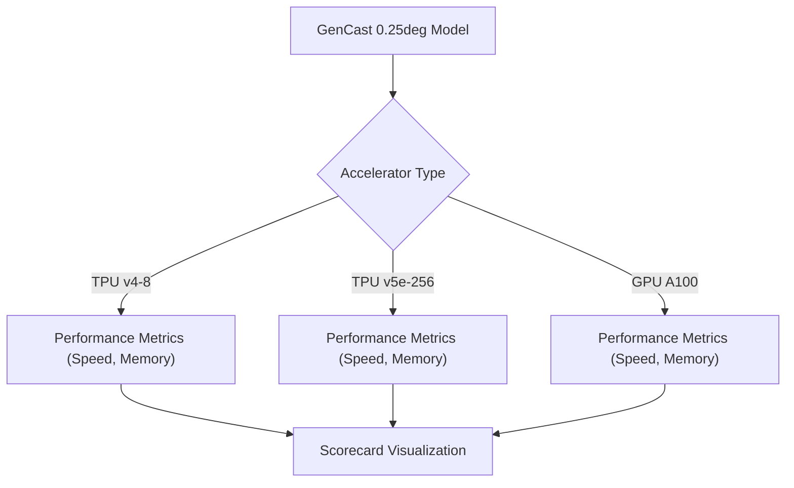
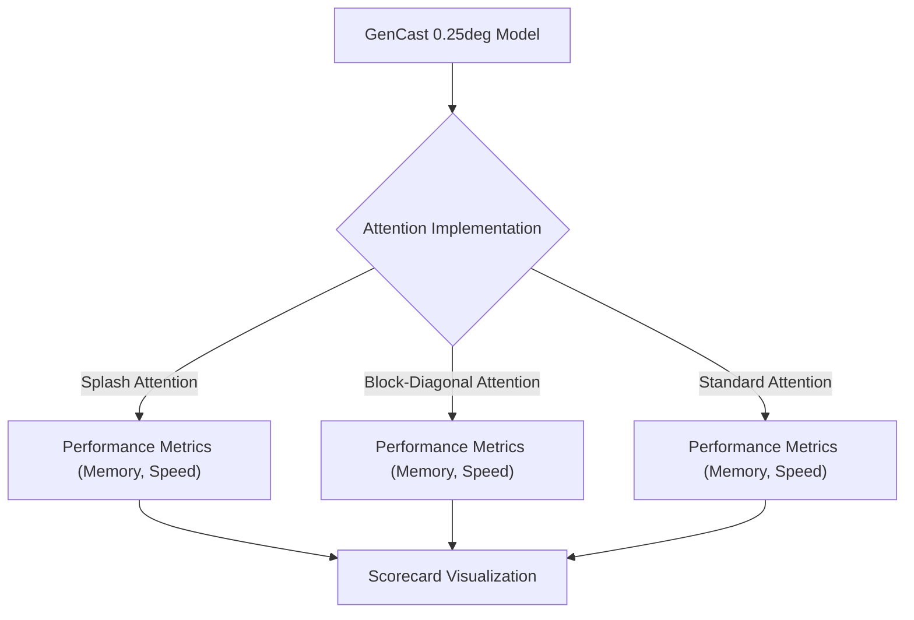
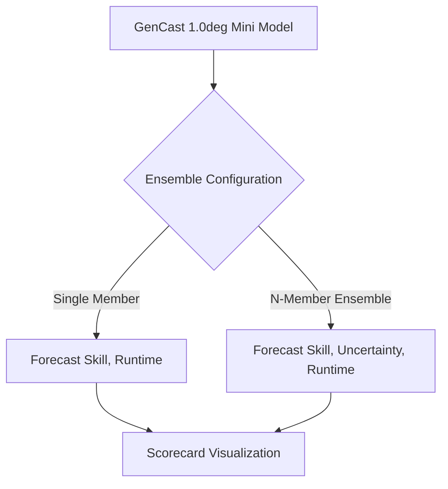

<!-- source: DeepWiki mcp.deepwiki.com · repo google-deepmind/weathernext · page 7.3 GenCast Demos and Evaluation Scorecards · fetched 2026-10-26 -->

# GenCast Demos and Evaluation Scorecards

<details>
<summary>Relevant source files</summary>

The following files were used as context for generating this wiki page:

- [docs/weathernext1_gen/GenCast_0p25deg_accelerator_scorecard.png](docs/weathernext1_gen/GenCast_0p25deg_accelerator_scorecard.png)
- [docs/weathernext1_gen/GenCast_0p25deg_attention_implementation_scorecard.png](docs/weathernext1_gen/GenCast_0p25deg_attention_implementation_scorecard.png)
- [docs/weathernext1_gen/GenCast_1p0deg_Mini_ENS_scorecard.png](docs/weathernext1_gen/GenCast_1p0deg_Mini_ENS_scorecard.png)
- [docs/weathernext1_gen/gencast_demo_cloud_vm.ipynb](docs/weathernext1_gen/gencast_demo_cloud_vm.ipynb)
- [docs/weathernext1_gen/gencast_mini_demo.ipynb](docs/weathernext1_gen/gencast_mini_demo.ipynb)

</details>


This page provides a detailed walkthrough of the `gencast_mini_demo.ipynb` and `gencast_demo_cloud_vm.ipynb` notebooks, which demonstrate how to run GenCast models. It also presents the published evaluation scorecards, offering insights into the performance of GenCast across different accelerators, attention implementations, and the 1.0-degree Mini ensemble.

## GenCast Mini Demo (`gencast_mini_demo.ipynb`)

The `gencast_mini_demo.ipynb` notebook focuses on demonstrating the `GenCast 1p0deg Mini <2019` model. This model is a 1-degree resolution GenCast variant with 13 pressure levels and a 4-times refined icosahedral mesh. It was trained on ERA5 data from 1979 to 2018, making it suitable for causal evaluation on data from 2019 onwards [docs/weathernext1_gen/gencast_mini_demo.ipynb:30-35]().

A key feature of this demo is its accessibility: `GenCast 1p0deg Mini <2019` has the smallest memory footprint among the provided GenCast models and is designed to run within the free TPUv2-8 configuration available in Colab [docs/weathernext1_gen/gencast_mini_demo.ipynb:36-38](). This makes it an excellent starting point for users to experiment with GenCast without requiring significant computational resources.

### Installation and Initialization

The notebook begins with the necessary installation and import steps.

1.  **Package Upgrade**: It first ensures that `importlib_metadata` is up-to-date [docs/weathernext1_gen/gencast_mini_demo.ipynb:60-62]().
2.  **Repository Installation**: The `weathernext` repository and its dependencies are installed directly from the GitHub master branch [docs/weathernext1_gen/gencast_mini_demo.ipynb:73-75]().
3.  **JAX Reconfiguration (for TPU)**: If running on a TPU, the notebook includes steps to uninstall outdated `libtpu` packages and install an updated `jax[tpu]` version, addressing compatibility issues in Colab TPU images [docs/weathernext1_gen/gencast_mini_demo.ipynb:86-90]().
4.  **Imports**: Essential libraries such as `dataclasses`, `datetime`, `math`, `google.cloud.storage`, `haiku`, `jax`, `matplotlib`, `numpy`, and `xarray` are imported. Crucially, it imports modules from `weathernext.utils` like `rollout`, `normalization`, `checkpoint`, `data_utils`, `xarray_tree`, `nan_cleaning`, and from `weathernext.weathernext1_gen` specifically `gencast` and `denoiser` [docs/weathernext1_gen/gencast_mini_demo.ipynb:101-127]().

### Plotting Utilities

The notebook includes helper functions for visualizing the model's output:

*   `select(data, variable, level, max_steps)`: This function extracts a specific variable from an `xarray.Dataset`, handles batch and time dimensions, and allows selection of a particular pressure `level` [docs/weathernext1_gen/gencast_mini_demo.ipynb:142-155]().
*   `scale(data, center, robust)`: Computes appropriate `vmin` and `vmax` for plotting, optionally centering the colormap and using robust percentile-based scaling. It returns the data, a `matplotlib.colors.Normalize` object, and the chosen colormap name [docs/weathernext1_gen/gencast_mini_demo.ipynb:157-169]().
*   `plot_data(data, fig_title, plot_size, robust, cols)`: Generates a grid of plots from a dictionary of `xarray.Dataset` objects, applying the scaling and normalization from `scale` [docs/weathernext1_gen/gencast_mini_demo.ipynb:171-174]().

Sources:
* `docs/weathernext1_gen/gencast_mini_demo.ipynb`

## GenCast Demo for Cloud VM (`gencast_demo_cloud_vm.ipynb`)

The `gencast_demo_cloud_vm.ipynb` notebook is designed for running all GenCast models provided in the repository, including `GenCast 0p25deg <2019`, `GenCast 0p25deg Operational <2019`, `GenCast 1p0deg <2019`, and `GenCast 1p0deg Mini <2019` [docs/weathernext1_gen/gencast_demo_cloud_vm.ipynb:33-37](). Unlike the mini demo, the larger models require more substantial compute resources, typically accessed via Google Cloud [docs/weathernext1_gen/gencast_demo_cloud_vm.ipynb:39-40](). Users are directed to `cloud_vm_setup.md` for detailed instructions on setting up a Google Cloud TPU VM and connecting to it [docs/weathernext1_gen/gencast_demo_cloud_vm.ipynb:41-42]().

### Installation and Initialization

The setup process is largely similar to the mini demo, focusing on installing the repository and its dependencies.

1.  **Repository Installation**: The `weathernext` repository and its dependencies are installed [docs/weathernext1_gen/gencast_demo_cloud_vm.ipynb:64-66]().
2.  **Imports**: Key libraries are imported, including `dataclasses`, `datetime`, `math`, `haiku`, `jax`, `matplotlib`, `numpy`, `xarray`, and specific `weathernext` modules such as `rollout`, `normalization`, `checkpoint`, `data_utils`, `xarray_tree`, `nan_cleaning`, `gencast`, and `denoiser` [docs/weathernext1_gen/gencast_demo_cloud_vm.ipynb:77-100]().

### Plotting Utilities

The plotting functions (`select`, `scale`, `plot_data`) are identical to those in `gencast_mini_demo.ipynb`, providing a consistent visualization interface across both demos [docs/weathernext1_gen/gencast_demo_cloud_vm.ipynb:114-175]().

Sources:
* `docs/weathernext1_gen/gencast_demo_cloud_vm.ipynb`

## GenCast Model Execution Flow

The core execution flow for both GenCast demos involves several key steps, from loading data and model configuration to performing rollouts and visualizing results.

```mermaid
graph TD
    A[Start] --> B{Select Model and Checkpoint};
    B --> C[Load Checkpoint and Model Config];
    C --> D[Initialize Predictor (Haiku)];
    D --> E[Load Input Data (ERA5)];
    E --> F[Normalize Input Data];
    F --> G[Prepare Initial State and Forcings];
    G --> H[Perform Autoregressive Rollout];
    H --> I[Denormalize Output];
    I --> J[Visualize Results];
    J --> K[End];

    subgraph "Model Initialization"
        C -- "gencast.ModelConfig" --> D;
        D -- "hk.transform(gencast.GenCastPredictor)" --> D;
    end

    subgraph "Data Handling"
        E -- "data_utils.get_example_data" --> E;
        F -- "normalization.InputsAndResiduals" --> F;
        I -- "normalization.InputsAndResiduals" --> I;
    end

    subgraph "Prediction"
        H -- "rollout.chunked_prediction" --> H;
        H -- "gencast.GenCastPredictor.apply" --> H;
    end
```
**Diagram: GenCast Model Execution Flow**

Sources:
* `weathernext/weathernext1_gen/gencast.py`
* `weathernext/utils/data_utils.py`
* `weathernext/utils/normalization.py`
* `weathernext/utils/rollout.py`

## Evaluation Scorecards

The `weathernext` repository provides several scorecards that illustrate the performance characteristics of GenCast models under various conditions. These scorecards are crucial for understanding the trade-offs involved in model selection and deployment.

### GenCast 0.25deg Accelerator Scorecard

This scorecard compares the performance of the `GenCast 0p25deg` model across different hardware accelerators. It typically highlights metrics such as inference speed, memory usage, and potentially accuracy, demonstrating how the model scales with different computational resources. This information is vital for users planning to deploy GenCast on specific hardware, especially in cloud environments.


**Diagram: Accelerator Performance Comparison**

Sources:
* `docs/weathernext1_gen/GenCast_0p25deg_accelerator_scorecard.png`

### GenCast 0.25deg Attention Implementation Scorecard

This scorecard focuses on the impact of different attention mechanisms on the `GenCast 0p25deg` model's performance. Attention implementations, such as "splash attention" (optimized for TPUs) versus "block-diagonal" or "standard attention" (often used on GPUs), can significantly affect memory consumption and computational efficiency. The scorecard helps users choose the most suitable attention variant based on their hardware and performance requirements.


**Diagram: Attention Implementation Performance Comparison**

Sources:
* `docs/weathernext1_gen/GenCast_0p25deg_attention_implementation_scorecard.png`

### GenCast 1.0deg Mini Ensemble Scorecard

The `GenCast 1p0deg Mini` model, while smaller, also has its own performance characteristics, especially when run as an ensemble. This scorecard provides insights into the ensemble's performance, likely covering aspects like forecast skill, uncertainty quantification, and computational cost per ensemble member. This is particularly relevant for applications requiring probabilistic forecasts.


**Diagram: 1.0deg Mini Ensemble Performance**

Sources:
* `docs/weathernext1_gen/GenCast_1p0deg_Mini_ENS_scorecard.png`

---

