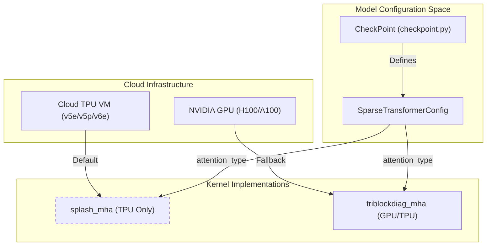

<!-- source: DeepWiki mcp.deepwiki.com · repo google-deepmind/weathernext · page 8 Deployment: Cloud TPU and GPU Infrastructure · fetched 2026-10-26 -->

# Deployment: Cloud TPU and GPU Infrastructure

<details>
<summary>Relevant source files</summary>

The following files were used as context for generating this wiki page:

- [docs/weathernext1_gen/cloud_vm_setup.md](docs/weathernext1_gen/cloud_vm_setup.md)
- [docs/weathernext2/wn2_demo_on_cloud_tpu.md](docs/weathernext2/wn2_demo_on_cloud_tpu.md)

</details>


This section provides an overview of the infrastructure requirements and deployment strategies for running WeatherNext models on cloud hardware. It covers both Cloud TPUs and GPUs, highlighting the differences in attention implementations and resource considerations.

## Hardware Support Overview

The codebase leverages JAX for high-performance numerical computing, allowing models to run on both TPUs and GPUs. However, due to the memory intensity of high-resolution (0.25°) global weather models, specific optimizations are applied depending on the hardware target.

| Feature | Cloud TPU (v5e/v5p/v6e) | NVIDIA GPU (e.g., H100) |
| :--- | :--- | :--- |
| **Primary Attention** | `splash_mha` (Memory efficient) | `triblockdiag_mha` |
| **Memory (0.25° GenCast)** | ~32GB HBM / ~250GB Host RAM | ~60GB vRAM / ~300GB System Memory |
| **Inference Speed** | Optimized (Baseline) | ~3x slower than TPU (estimated) |
| **Precision** | Standard JAX bfloat16 | ~0.3% RMSE discrepancy vs TPU |

Sources: [docs/weathernext1_gen/cloud_vm_setup.md:41-97]()

## System Architecture and Code Entities

The following diagram illustrates how the deployment infrastructure interacts with the model configurations and specific attention kernels.

### Infrastructure to Code Mapping

Sources: [docs/weathernext1_gen/cloud_vm_setup.md:59-76]()

## Cloud TPU Deployment

Running WeatherNext models, especially the higher-resolution variants like 0.25° GenCast, requires significant Host RAM for JAX compilation (approx. 250GB) and HBM for weights and activations. The recommended approach is using **Cloud TPU v5e, v5p, or v6e** VMs.

*   **Provisioning:** Resources can be requested as "Spot" (discounted, preemptible) or "On-Demand".
*   **Parallelism:** For ensemble generation, the code parallelizes across multiple TPU chips using `pmap(..., dim="sample")` [docs/weathernext2/wn2_demo_on_cloud_tpu.md:191](). This spreads ensemble members across chips, allowing for faster execution with more chips [docs/weathernext2/wn2_demo_on_cloud_tpu.md:192-194]().
*   **Cost Efficiency:** A 30-step rollout of 1° GenCast on a TPU v5e costs approximately $0.11 - $0.48 depending on spot pricing [docs/weathernext1_gen/cloud_vm_setup.md:28-31]().

For detailed provisioning commands, environment setup, and running the `wn2_demo.ipynb` remotely, see [Cloud TPU VM Setup and Provisioning](#8.1).

Sources: [docs/weathernext1_gen/cloud_vm_setup.md:3-37](), [docs/weathernext1_gen/cloud_vm_setup.md:41-55](), [docs/weathernext2/wn2_demo_on_cloud_tpu.md:191-194]()

## GPU Deployment and Trade-offs

While TPUs are the primary target, the models can run on GPUs. However, the memory-efficient `splash_attention` kernel is currently TPU-only [docs/weathernext1_gen/cloud_vm_setup.md:60](). Deployment on GPUs requires a configuration swap to `triblockdiag_mha` [docs/weathernext1_gen/cloud_vm_setup.md:62-65]().

### Hardware Precision and Performance
Running on GPU introduces a minor degradation in skill (approx. 0.3% on Ensemble Mean RMSE) compared to TPU [docs/weathernext1_gen/cloud_vm_setup.md:79](). This is attributed to differences in default matmul precision and numerical handling between the `splash` and `triblockdiag_mha` implementations [docs/weathernext1_gen/cloud_vm_setup.md:84](). Inference on H100 with `triblockdiag_mha` can be significantly slower than on TPUv5 with `splash_attention` [docs/weathernext1_gen/cloud_vm_setup.md:95]().

### Configuration Override for GPU
To run a pre-trained GenCast checkpoint on GPU, the `SparseTransformerConfig` must be modified manually after loading the checkpoint:
```python
# Conceptual override for GPU compatibility
with ... as f:
   ckpt = checkpoint.load(f, gencast.CheckPoint)
   ...
   denoiser_architecture_config = ckpt.denoiser_architecture_config
   denoiser_architecture_config.sparse_transformer_config.attention_type = "triblockdiag_mha"
   denoiser_architecture_config.sparse_transformer_config.mask_type = "full"
```
Sources: [docs/weathernext1_gen/cloud_vm_setup.md:67-76]()

For a deep dive into the memory requirements and precision discrepancies between these kernels, see [Attention Implementations and Ensemble Sharding](#8.2).

Sources: [docs/weathernext1_gen/cloud_vm_setup.md:57-84](), [docs/weathernext1_gen/cloud_vm_setup.md:88-97]()

## Resource Requirements Summary

The following table summarizes the hardware requirements for inference:

| Model Resolution | Accelerator | Host/System RAM | Accelerator Memory (vRAM/HBM) |
| :--- | :--- | :--- | :--- |
| **0.25° GenCast** | TPU | ~250 GB | ~32 GB |
| **0.25° GenCast** | GPU | ~300 GB | ~60 GB |
| **1.0° GenCast** | TPU | ~21 GB | ~8 GB |
| **1.0° GenCast** | GPU | ~24 GB | ~16 GB |

Sources: [docs/weathernext1_gen/cloud_vm_setup.md:44-45](), [docs/weathernext1_gen/cloud_vm_setup.md:90-91]()

---

