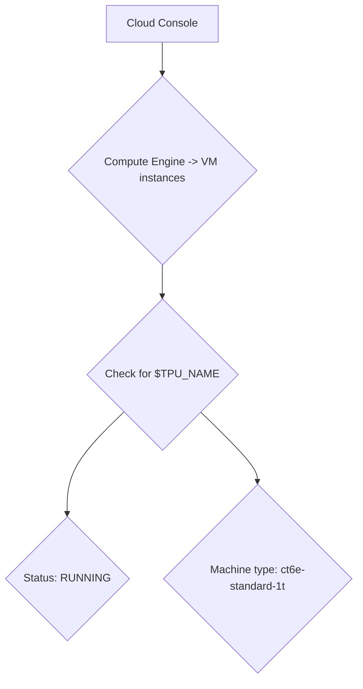
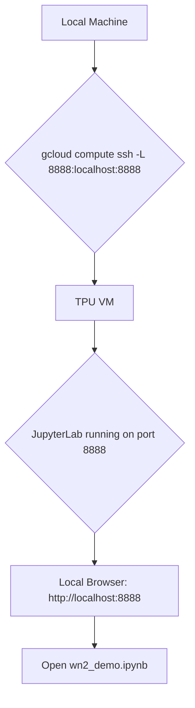
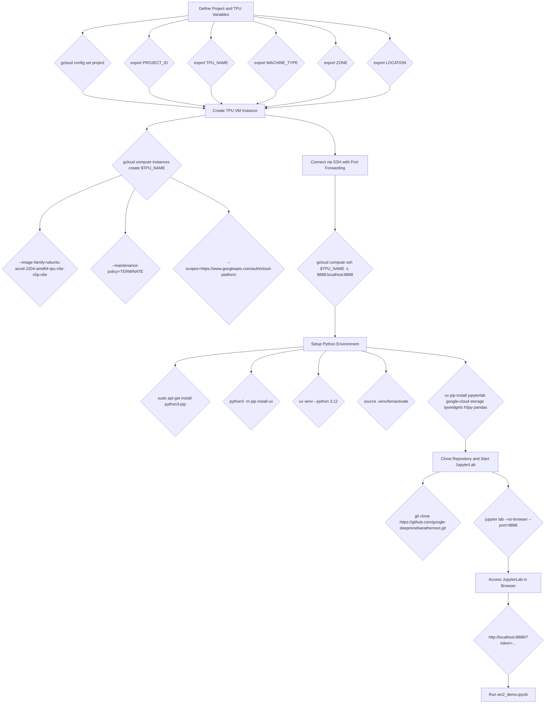
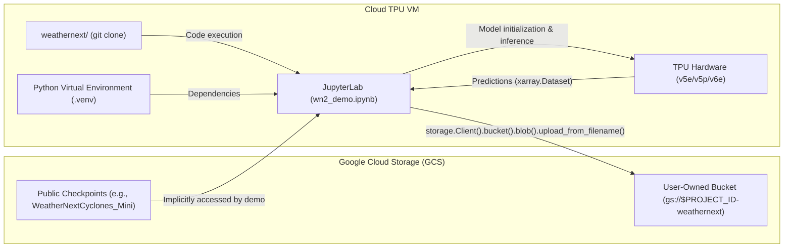

<!-- source: DeepWiki mcp.deepwiki.com · repo google-deepmind/weathernext · page 8.1 Cloud TPU VM Setup and Provisioning · fetched 2026-10-26 -->

# Cloud TPU VM Setup and Provisioning

<details>
<summary>Relevant source files</summary>

The following files were used as context for generating this wiki page:

- [docs/weathernext1_gen/cloud_vm_setup.md](docs/weathernext1_gen/cloud_vm_setup.md)
- [docs/weathernext1_gen/local_runtime_popup_1.png](docs/weathernext1_gen/local_runtime_popup_1.png)
- [docs/weathernext1_gen/local_runtime_popup_2.png](docs/weathernext1_gen/local_runtime_popup_2.png)
- [docs/weathernext1_gen/local_runtime_url.png](docs/weathernext1_gen/local_runtime_url.png)
- [docs/weathernext1_gen/project.png](docs/weathernext1_gen/project.png)
- [docs/weathernext1_gen/provision_tpu.png](docs/weathernext1_gen/provision_tpu.png)
- [docs/weathernext1_gen/tpu_types.png](docs/weathernext1_gen/tpu_types.png)
- [docs/weathernext2/images/console-instance-running.png](docs/weathernext2/images/console-instance-running.png)
- [docs/weathernext2/images/jupyter-demo-open.png](docs/weathernext2/images/jupyter-demo-open.png)
- [docs/weathernext2/wn2_demo_on_cloud_tpu.md](docs/weathernext2/wn2_demo_on_cloud_tpu.md)

</details>


This page provides a comprehensive technical guide for provisioning and configuring Google Cloud TPU VMs (specifically v5e/v5p/v6e architectures) to run inference for WeatherNext models. It covers resource selection, environment setup, and the workflow for executing the `wn2_demo.ipynb` notebook remotely.

## Overview of TPU Resources

Google Cloud offers two primary methods for accessing TPU capacity, each with distinct cost and availability profiles [docs/weathernext1_gen/cloud_vm_setup.md:3-25]():

| Access Type | Description | Cost Profile | Reliability |
| :--- | :--- | :--- | :--- |
| **Spot** | Unused capacity offered at significant discounts. | 60-91% discount | Can be preempted/shutdown at any time. Cannot be restarted. |
| **On-Demand** | Standard resource allocation. | Standard pricing (e.g., ~$1.20/chip hr for v5e) | Not preempted, but availability is not guaranteed. |

### Resource Benchmarks
The following table summarizes estimated costs and runtimes for GenCast rollouts (30 steps) based on TPU architecture [docs/weathernext1_gen/cloud_vm_setup.md:26-37]():

| Model Resolution | TPU Type | Config | Total Time (incl. trace) | Est. Cost (Spot) |
| :--- | :--- | :--- | :--- | :--- |
| **1.0° GenCast** | v5e | 4 chips | ~5 minutes | $0.11 - $0.48 |
| **0.25° GenCast** | v5p | 8 chips | ~30 minutes | $2.50 - $11.10 |

**Sources:**
* [docs/weathernext1_gen/cloud_vm_setup.md:3-37]()

## Hardware and Memory Requirements

WeatherNext inference is memory-intensive, particularly for high-resolution 0.25° forecasts. The requirements vary significantly between TPU and GPU runtimes.

### TPU Memory Profiles
To handle compilation and inference, the following memory is required [docs/weathernext1_gen/cloud_vm_setup.md:41-55]():

*   **0.25° GenCast**: ~250GB of Host RAM (System Memory) and ~32GB of HBM (vRAM).
*   **1.0° GenCast**: ~21GB of Host RAM (System Memory) and ~8GB of HBM (vRAM).

*Note: Host RAM is primarily consumed during JAX compilation. Requesting a multi-device host (e.g., a 2x2x1 TPU configuration) is the standard method for obtaining sufficient system memory.*

### GPU Compatibility and Memory
While WeatherNext models can run on GPUs (e.g., H100), it requires a configuration change because `splash_attention` is TPU-only. Users must switch to `triblockdiag_mha` [docs/weathernext1_gen/cloud_vm_setup.md:57-66]():

*   **0.25° GenCast (GPU)**: ~300GB System Memory and ~60GB vRAM.
*   **Performance Trade-off**: GPU inference via `triblockdiag_mha` is approximately 2x-3x slower than TPU inference and shows a minor precision degradation (~0.3% RMSE) due to differences in default matmul precision [docs/weathernext1_gen/cloud_vm_setup.md:79-97]().

**Sources:**
* [docs/weathernext1_gen/cloud_vm_setup.md:41-97]()

## Provisioning Workflow

### 1. Initial Setup
Before provisioning, ensure the Google Cloud project is configured and the `gcloud` CLI is installed on your local machine [docs/weathernext1_gen/cloud_vm_setup.md:100-119]().

```bash
gcloud auth login
gcloud config set project <YOUR_PROJECT_ID>
gcloud services enable compute.googleapis.com
```

Define environment variables for convenience:
```bash
export PROJECT_ID=<YOUR_PROJECT_ID>
export TPU_NAME=wn2-demo
export MACHINE_TYPE=ct6e-standard-1t
export ZONE=us-east5-a
export LOCATION=us-east5
```
Note that v6e is offered in [several zones](https://cloud.google.com/tpu/docs/regions-zones). If a `create` command fails due to capacity, try another zone.

### 2. TPU VM Creation
The following command template is used to provision a TPU v6e VM for the demo [docs/weathernext2/wn2_demo_on_cloud_tpu.md:49-58]():

```bash
gcloud compute instances create $TPU_NAME \
    --project=$PROJECT_ID \
    --zone=$ZONE \
    --machine-type=$MACHINE_TYPE \
    --image-family=ubuntu-accel-2204-amd64-tpu-v5e-v5p-v6e \
    --image-project=ubuntu-os-accelerator-images \
    --maintenance-policy=TERMINATE \
    --scopes=https://www.googleapis.com/auth/cloud-platform
```
The `--maintenance-policy=TERMINATE` flag is required because TPUs cannot be live-migrated. The `--image-family` must be a TPU image, and the one specified covers v5e, v5p, and v6e.

#### Confirm VM Status
Verify the VM is running either through the Cloud Console or via the `gcloud` CLI [docs/weathernext2/wn2_demo_on_cloud_tpu.md:65-78]():

```bash
gcloud compute instances describe $TPU_NAME --zone=$ZONE \
    --format='value(name,status,machineType.basename())'
```
You should see `RUNNING` and the specified machine type.

**Title: Cloud Console Instance Running**

**Sources:**
* [docs/weathernext2/wn2_demo_on_cloud_tpu.md:65-78]()
* [docs/weathernext2/images/console-instance-running.png]()

### 3. Environment Configuration and Jupyter Setup
Connect to the VM via SSH, forwarding port 8888 for JupyterLab [docs/weathernext2/wn2_demo_on_cloud_tpu.md:84-86]():

```bash
gcloud compute ssh $TPU_NAME --project=$PROJECT_ID --zone=$ZONE -- -L 8888:localhost:8888
```
Once connected, set up the Python environment using `uv` and install necessary packages [docs/weathernext2/wn2_demo_on_cloud_tpu.md:93-107]():

```bash
sudo apt-get update -qq && sudo apt-get install -y -qq python3-pip
python3 -m pip install -q uv
export PATH="$HOME/.local/bin:$PATH"

uv venv --python 3.12 --seed .venv
source .venv/bin/activate

uv pip install -q jupyterlab google-cloud-storage ipywidgets h5py "pandas<3"

git clone https://github.com/google-deepmind/weathernext.git
jupyter lab --no-browser --port=8888
```
Open the printed `http://localhost:8888/?token=…` URL in your local browser. Navigate to `weathernext/docs/weathernext2/wn2_demo.ipynb` and run it. If the SSH session drops, reconnect and reactivate the virtual environment with `source .venv/bin/activate` before restarting Jupyter.

**Title: JupyterLab Demo Open**

**Sources:**
* [docs/weathernext2/wn2_demo_on_cloud_tpu.md:84-114]()
* [docs/weathernext2/images/jupyter-demo-open.png]()

### 4. Saving Forecasts to GCS
To persist generated forecasts, create a GCS bucket and save the output from the notebook [docs/weathernext2/wn2_demo_on_cloud_tpu.md:118-124]():

```bash
gcloud storage buckets create gs://$PROJECT_ID-weathernext --location=$LOCATION
```
Within the Jupyter notebook, add a cell to save the `predictions` `xarray.Dataset` to your bucket [docs/weathernext2/wn2_demo_on_cloud_tpu.md:129-148]():

```python
from google.cloud import storage
import xarray

bucket_name = "YOUR_PROJECT_ID-weathernext"
blob_name = "forecasts/2024-10-07_mini.nc"

# Pick the variables you need
subset = predictions[[
    "2m_temperature",
    "10m_u_component_of_wind",
    "10m_v_component_of_wind",
]]

subset.to_netcdf("/tmp/forecast.nc", engine="h5netcdf")

storage.Client().bucket(bucket_name).blob(blob_name).upload_from_filename(
    "/tmp/forecast.nc")

print(f"wrote gs://{bucket_name}/{blob_name}")
```
To read the prediction back:
```python
with storage.Client().bucket(bucket_name).blob(blob_name).open("rb") as f:
    forecast = xarray.open_dataset(f, engine="h5netcdf").load()
```

**Sources:**
* [docs/weathernext2/wn2_demo_on_cloud_tpu.md:118-155]()

## Scaling Up Inference

WeatherNext models can be scaled up in two primary ways: running more ensemble members concurrently and utilizing larger models.

### More Ensemble Members
The demo uses `pmap(..., dim="sample")` to distribute ensemble members across TPU chips. This means that on a single chip, 8 members run sequentially, while on 8 chips, they run in a single pass. More chips lead to faster execution without altering the result [docs/weathernext2/wn2_demo_on_cloud_tpu.md:189-194]().

| Configuration | Machine Type | Members per Pass |
| :--- | :--- | :--- |
| Default 8 members, one at a time | `ct6e-standard-1t` | 1 |
| 8 members, 4x fewer passes | `ct6e-standard-4t` | 4 |
| All 8 members in a single pass | `ct6e-standard-8t` | 8 |

**Sources:**
* [docs/weathernext2/wn2_demo_on_cloud_tpu.md:189-201]()

### Larger Models
The demo defaults to `WeatherNextCyclones_Mini` (1° resolution, 216 MiB checkpoint). For higher resolution (0.25°) or larger models like `WeatherNextCyclones` / `WeatherNext2`, more powerful TPU configurations are required [docs/weathernext2/wn2_demo_on_cloud_tpu.md:13-20]().

| Model | Resolution | Checkpoint Size | Latent | Layers | Heads |
| :--- | :--- | :--- | :--- | :--- | :--- |
| `WeatherNextCyclones_Mini` | 1° | 216 MiB | 512 | 16 | 4 |
| `WeatherNextCyclones` / `WeatherNext2` | 0.25° | 701 MiB × 4 seeds | 768 | 24 | 6 |

**Sources:**
* [docs/weathernext2/wn2_demo_on_cloud_tpu.md:13-20]()

## Clean Up

To avoid incurring further costs, delete the TPU VM instance and any created GCS buckets [docs/weathernext2/wn2_demo_on_cloud_tpu.md:159-160]():

```bash
gcloud compute instances delete $TPU_NAME --project=$PROJECT_ID --zone=$ZONE --quiet
```
Verify the instance is gone [docs/weathernext2/wn2_demo_on_cloud_tpu.md:169-171]():
```bash
gcloud compute instances list --filter="name=$TPU_NAME"
```
If you saved forecasts to a GCS bucket, delete it as well [docs/weathernext2/wn2_demo_on_cloud_tpu.md:179-181]():
```bash
gcloud storage rm -r gs://$PROJECT_ID-weathernext
```

**Sources:**
* [docs/weathernext2/wn2_demo_on_cloud_tpu.md:159-181]()

## Troubleshooting and Limitations
*   **Preemption**: Spot VMs will lose all data in HBM and RAM upon preemption. Checkpoints must be saved to persistent disk or GCS [docs/weathernext1_gen/cloud_vm_setup.md:6-10]().
*   **Compilation Time**: The first inference call triggers XLA compilation, which can take 5-20 minutes depending on resolution and TPU type [docs/weathernext1_gen/cloud_vm_setup.md:26-37]().
*   **Precision**: GPU MatMul defaults to lower precision than TPU, leading to the ~0.3% skill discrepancy observed in benchmarks [docs/weathernext1_gen/cloud_vm_setup.md:84]().

**Sources:**
* [docs/weathernext1_gen/cloud_vm_setup.md:1-240]()

## Natural Language to Code Entity Mapping: Provisioning
This diagram maps the provisioning steps to the resulting infrastructure and code entities.


**Sources:**
* [docs/weathernext2/wn2_demo_on_cloud_tpu.md:28-107]()

## Data Flow: GCS to TPU Inference
This diagram illustrates how data and weights move from cloud storage into the JAX-accelerated inference pipeline on the VM, and how results can be saved back to GCS.


**Sources:**
* [docs/weathernext2/wn2_demo_on_cloud_tpu.md:13-20]()
* [docs/weathernext2/wn2_demo_on_cloud_tpu.md:105]()
* [docs/weathernext2/wn2_demo_on_cloud_tpu.md:129-148]()

---

