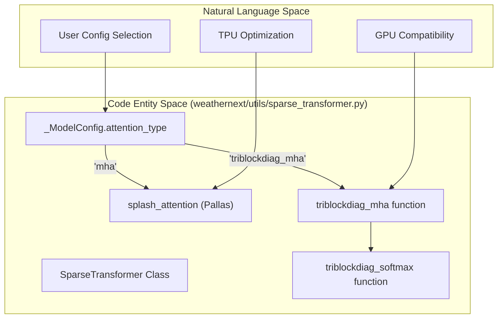
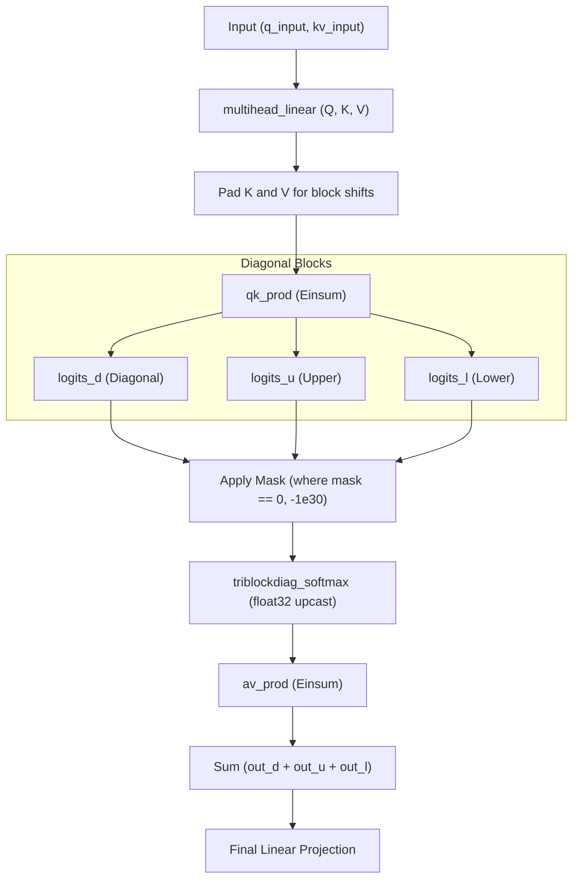
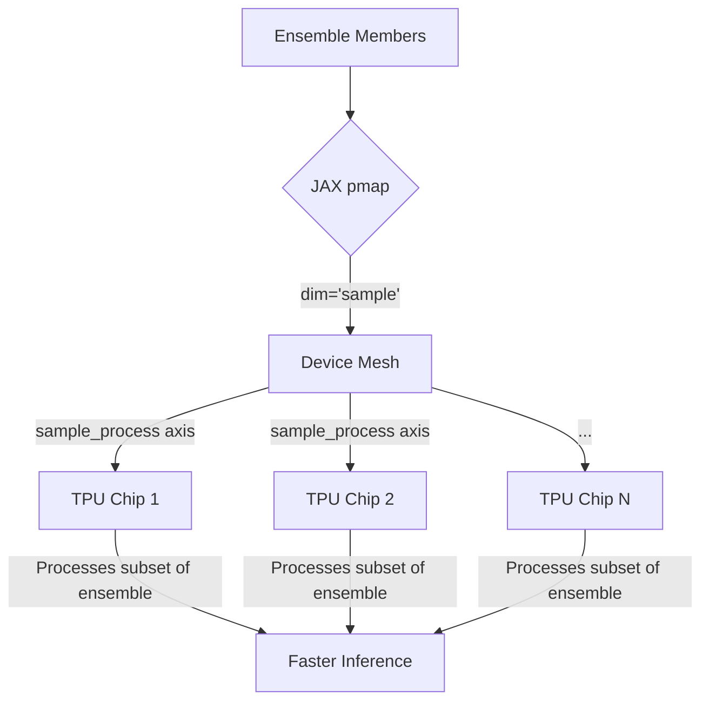

<!-- source: DeepWiki mcp.deepwiki.com · repo google-deepmind/weathernext · page 8.2 Attention Implementations and Ensemble Sharding · fetched 2026-10-26 -->

# Attention Implementations and Ensemble Sharding

Relevant source files

The following files were used as context for generating this wiki page:

- [docs/weathernext1_gen/GenCast_0p25deg_attention_implementation_scorecard.png](docs/weathernext1_gen/GenCast_0p25deg_attention_implementation_scorecard.png)
- [docs/weathernext2/wn2_demo_on_cloud_tpu.md](docs/weathernext2/wn2_demo_on_cloud_tpu.md)
- [weathernext/utils/sharding.py](weathernext/utils/sharding.py)
- [weathernext/utils/sparse_transformer.py](weathernext/utils/sparse_transformer.py)

This page details the two primary attention mechanisms available in GenCast's `SparseTransformer`: **Splash Attention** and **Tri-block-diagonal Attention**. It covers their technical implementation, hardware compatibility, memory footprints, and the minor precision discrepancies observed when switching between TPU and GPU environments. Additionally, it explains how ensemble members are sharded across devices using `pmap`.

## Overview

GenCast utilizes a `SparseTransformer` [weathernext/utils/sparse_transformer.py:14-24]() to handle long-range dependencies in meteorological data. Because standard Multi-Head Attention (MHA) scales quadratically with the number of nodes, GenCast implements sparse attention where nodes only attend to themselves and their immediate neighbors on the graph [weathernext/utils/sparse_transformer.py:16-17]().

There are two distinct implementations of this sparse logic:
1.  **`splash_mha`**: The default implementation optimized for Google Cloud TPUs using Pallas.
2.  **`triblockdiag_mha`**: A fallback implementation designed for GPU compatibility, using standard JAX dense operations on block-diagonal matrices.

### Data Flow and Implementation Selection

The choice of implementation is governed by the `_ModelConfig` dataclass [weathernext/utils/sparse_transformer.py:41-52]().

| Feature | `splash_mha` | `triblockdiag_mha` |
| :--- | :--- | :--- |
| **Primary Device** | TPU (v4, v5e, v5p, v6e) | GPU (e.g., NVIDIA H100) / TPU |
| **Implementation** | `jax.experimental.pallas.ops.tpu.splash_attention` | Custom block-diagonal logic |
| **Memory (0.25° GenCast)** | ~32GB vRAM | ~60GB vRAM |
| **Relative Speed** | 1.0x (Baseline) | ~2.0x Slower |
| **Config Setting** | `attention_type = "mha"` | `attention_type = "triblockdiag_mha"` |

**Sources:** [docs/weathernext2/wn2_demo_on_cloud_tpu.md:41-44](), [weathernext/utils/sparse_transformer.py:34](), [weathernext/utils/sparse_transformer.py:51-52]()

---

## Implementation Details

### 1. Splash Attention (`splash_mha`)
Splash attention is the default for pre-trained GenCast models. It leverages the `pallas` kernel for TPU-efficient sparse operations [weathernext/utils/sparse_transformer.py:34]().

*   **Logic**: It treats the attention mask as a sparse structure, significantly reducing memory usage by avoiding the instantiation of large intermediate attention matrices.
*   **Hardware Requirement**: Currently, `splash_attention` is primarily optimized for TPUs.

### 2. Tri-block-diagonal Attention (`triblockdiag_mha`)
This implementation assumes the adjacency matrix has a banded structure. It is implemented using dense operations that compute only the diagonal, super-diagonal, and sub-diagonal blocks of the attention matrix [weathernext/utils/sparse_transformer.py:17-20]().

*   **`triblockdiag_softmax`**: Computes softmax across the three diagonal blocks (`logits_d`, `logits_u`, `logits_l`) while maintaining numerical stability via a shared maximum value [weathernext/utils/sparse_transformer.py:118-142]().
*   **Masking**: The implementation applies a block-based mask to the three diagonals [weathernext/utils/sparse_transformer.py:169-171]().
*   **Precision Management**: The `_ModelConfig` includes `upcast_attn_to_fp32` [weathernext/utils/sparse_transformer.py:78]() which, when true, upcasts attention Q, K, V to float32 before splash attention for numerical stability.

### Code Entity Association

The following diagram maps the high-level configuration to the specific functions within `weathernext/utils/sparse_transformer.py`.

**Attention Implementation Routing**

**Sources:** [weathernext/utils/sparse_transformer.py:41-52](), [weathernext/utils/sparse_transformer.py:118-122](), [weathernext/utils/sparse_transformer.py:144-147]()

---

## Swapping Implementations for GPU Inference

To run a pre-trained GenCast model (originally trained with Splash attention) on a GPU, the `_ModelConfig` must be overridden during the checkpoint loading process.

**Required Configuration Overrides:**
*   `attention_type = "triblockdiag_mha"`
*   `mask_type = "full"`

These overrides are typically applied to the `denoiser_architecture_config.sparse_transformer_config` after loading a checkpoint.

**Sources:** [weathernext/utils/sparse_transformer.py:51-52](), [weathernext/utils/sparse_transformer.py:59-60]()

---

## Memory and Performance Trade-offs

The transition from TPU/Splash to GPU/Triblockdiag involves significant increases in resource requirements.

### Memory Requirements
| Model Scale | Device | Host RAM | vRAM (HBM) |
| :--- | :--- | :--- | :--- |
| **0.25° GenCast** | TPU (Splash) | ~250GB | ~32GB |
| **0.25° GenCast** | GPU (Triblockdiag) | ~300GB | ~60GB |
| **1.0° GenCast** | TPU (Splash) | ~21GB | ~8GB |
| **1.0° GenCast** | GPU (Triblockdiag) | ~24GB | ~16GB |

**Sources:** [docs/weathernext1_gen/GenCast_0p25deg_attention_implementation_scorecard.png]()

### Precision Discrepancy (~0.3%)
When running on an H100 GPU with `triblockdiag_mha`, a small degradation in skill is observed compared to TPU with `splash_attention`:
*   **Ensemble Mean RMSE**: ~0.3% degradation.
*   **CRPS**: ~0.4% degradation.

Investigation by the DeepMind team suggests that this is **not** caused by the algebraic difference between `splash` and `triblockdiag` (which are numerically equivalent when tested on the same hardware). Instead, the discrepancy stems from the **default precision of matmul operations** on GPU versus TPU.

**Sources:** [docs/weathernext1_gen/GenCast_0p25deg_attention_implementation_scorecard.png]()

### Execution Flow: `triblockdiag_mha`

The following diagram describes the data flow within the `triblockdiag_mha` function.

**Tri-block-diagonal Calculation Flow**

**Sources:** [weathernext/utils/sparse_transformer.py:144-172](), [weathernext/utils/sparse_transformer.py:118-142]()

---

## Ensemble Sharding with `pmap`

The `weathernext` codebase utilizes JAX's `pmap` for sharding ensemble members across multiple accelerator chips, particularly on TPUs. This allows for parallel execution of different ensemble members, speeding up inference.

The `pmap` operation typically uses the `sample` dimension for sharding ensemble members. This is managed by the `weathernext.utils.sharding` module.

### Sharding Axes

The `sharding.py` module defines several axis names for managing sharding:
*   `BATCH_AXIS = 'batch'` [weathernext/utils/sharding.py:26]()
*   `LOCAL_ENSEMBLE_AXIS = 'sample_local'` [weathernext/utils/sharding.py:38]()
*   `ENSEMBLE_PROCESS_AXIS = 'sample_process'` [weathernext/utils/sharding.py:39]()
*   `ENSEMBLE_AXES = (ENSEMBLE_PROCESS_AXIS, LOCAL_ENSEMBLE_AXIS)` [weathernext/utils/sharding.py:42]()

When `pmap` is used with `dim="sample"`, it spreads ensemble members across available chips. For example, on a `ct6e-standard-8t` TPU VM, all 8 ensemble members can run in a single pass, whereas on a `ct6e-standard-1t`, they would run sequentially [docs/weathernext2/wn2_demo_on_cloud_tpu.md:190-201]().

### `get_num_shards`

The `get_num_shards` function [weathernext/utils/sharding.py:72-78]() determines the number of shards for a given axis name. If a global mesh is defined (i.e., `is_global_mesh_defined()` returns true [weathernext/utils/sharding.py:69]()), it computes the product of the mesh shapes for the specified axis. Otherwise, it returns 1, indicating no sharding.

**Ensemble Sharding Process**

**Sources:** [weathernext/utils/sharding.py:38-42](), [weathernext/utils/sharding.py:72-78](), [docs/weathernext2/wn2_demo_on_cloud_tpu.md:190-201]()

---

