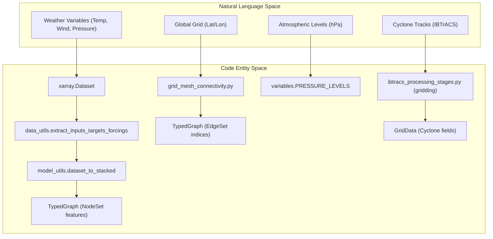
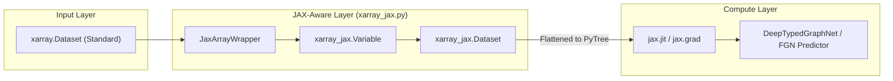

<!-- source: DeepWiki mcp.deepwiki.com · repo google-deepmind/weathernext · page 9 Glossary · fetched 2026-10-26 -->

# Glossary

Relevant source files

The following files were used as context for generating this wiki page:

- [README.md](README.md)
- [docs/weathernext1_gen/README.md](docs/weathernext1_gen/README.md)
- [setup.py](setup.py)
- [weathernext/cyclones/constants.py](weathernext/cyclones/constants.py)
- [weathernext/utils/data_modalities.py](weathernext/utils/data_modalities.py)

This page provides definitions for codebase-specific terms, abbreviations, and domain concepts used throughout the WeatherNext repository. It serves as a technical reference for engineers to understand how meteorological concepts map to JAX, Haiku, and Xarray implementations.

## Core Concepts & Data Structures

### FGN (Functional Generative Network)
The core predictive model for WeatherNext 2 (WN2) and WeatherNext Cyclones. It's a generative model that can produce ensemble forecasts by injecting noise into inputs and forcings.
*   **Implementation**: The `construct_predictor` function in `weathernext2/fgn.py` builds the FGN predictor [weathernext2/fgn.py:100-102]().
*   **Generative Noise**: Noise is injected via `gaussian_noise_generator` into the model's inputs and forcings to generate ensemble members [weathernext2/fgn.py:100-102]().

### WN2 (WeatherNext 2)
The latest generation global, medium-range atmospheric and cyclone forecasting model developed by Google DeepMind and Google Research. It is a specific instantiation of the FGN architecture.
*   **Models**: Includes `WeatherNext2_<2025` which predicts 100m wind and forecasts cyclones [README.md:49-62]().
*   **Resolution**: Typically 0.25° resolution (~30km) [README.md:58]().

### TypedGraph
A specialized graph representation used as the primary data structure for the GNN backbones. Unlike standard `jraph.GraphsTuple`, a `TypedGraph` supports multiple distinct sets of nodes and edges, each with its own feature dimensions.
*   **Implementation**: Defined as a `NamedTuple` containing `NodeSet`, `EdgeSet`, and `Context` [weathernext/graph/typed_graph.py:25-45]().
*   **NodeSet**: A collection of nodes of a specific type (e.g., "mesh" nodes or "grid" nodes) containing a flat feature array [weathernext/graph/typed_graph.py:48-52]().
*   **EdgeSet**: Defines connectivity between nodes (senders/receivers) and associated edge features [weathernext/graph/typed_graph.py:65-72]().

### InteractionNetwork
The fundamental building block of the message-passing processor. It updates edge features based on connected nodes and then updates node features based on aggregated incoming edge messages [weathernext/graph/typed_graph_net.py:118-132]().

### DeepTypedGraphNet
A high-level wrapper that implements the **Encoder-Processor-Decoder** pattern. It manages the embedding of raw features into a latent space, multiple steps of message passing (interaction networks), and the final decoding into output dimensions [weathernext/graph/deep_typed_graph_net.py:35-50]().

### Icosahedral Mesh
A multi-resolution graph structure used to represent the Earth's surface. It starts from a regular icosahedron and is iteratively refined by splitting triangular faces into four smaller triangles [weathernext/utils/icosahedral_mesh.py:59-88]().
*   **TriangularMesh**: A container for `vertices` (Cartesian coordinates) and `faces` (indices) [weathernext/utils/icosahedral_mesh.py:23-34]().
*   **Grid-Mesh Connectivity**: The process of mapping a regular Lat/Lon grid to the icosahedral mesh using K-Nearest Neighbors (KNN) for the Encoder and Decoder stages [weathernext/graph/grid_mesh_connectivity.py:28-45]().

### Update Blocks
Composable neural network modules used in WN2's architecture to perform points-to-mesh, mesh, and mesh-to-grid updates. These blocks are constructed by `architecture.py` and `architecture_utils.py`.
*   **Implementation**: Defined in `weathernext2/architecture.py` and `weathernext2/architecture_utils.py`.
*   **Types**: Includes `PointsToMeshUpdateBlock`, `MeshUpdateBlock`, and `MeshToGridUpdateBlock` [weathernext2/architecture.py:100-102]().

### Data Modalities
Containers for different types of data representations within the model, such as grid data, point data, mesh data, and global data. These are defined in `weathernext/utils/data_modalities.py`.
*   **Implementation**: Base class `Data` and its subclasses like `GridData`, `PointsData`, `MeshData`, `GlobalData` [weathernext/utils/data_modalities.py:79-104]().
*   **`CombinedArrays`**: A `NamedTuple` used to pack arrays for inputs to dense layers and norm conditioning layers [weathernext/utils/data_modalities.py:37-43]().

Sources: [weathernext2/fgn.py:100-102](), [README.md:49-62](), [README.md:58](), [weathernext/graph/typed_graph.py:25-72](), [weathernext/graph/typed_graph_net.py:118-132](), [weathernext/graph/deep_typed_graph_net.py:35-50](), [weathernext/utils/icosahedral_mesh.py:23-88](), [weathernext/graph/grid_mesh_connectivity.py:28-45](), [weathernext2/architecture.py:100-102](), [weathernext/utils/data_modalities.py:37-104]()

---

## Data Space Mapping: Meteorological to Code Entities

The following diagram illustrates how natural weather concepts are transformed into the internal representations used by WeatherNext models.

**Natural Language to Code Entity Mapping**

Sources: [weathernext/utils/data_utils.py:215-230](), [weathernext/utils/model_utils.py:27-40](), [weathernext/graph/grid_mesh_connectivity.py:28-45](), [weathernext/utils/variables.py:82](), [weathernext/cyclones/ibtracs_processing_stages.py:100-102](), [weathernext/utils/data_modalities.py:79-104]()

---

## Meteorological & Training Terms

| Term | Definition | Code Pointer |
| :--- | :--- | :--- |
| **IBTrACS** | International Best Track Archive for Climate Stewardship. A dataset of historical tropical cyclone best-track data, used for training and evaluation of cyclone models. | [weathernext/cyclones/ibtracs_netcdf_to_csv.py:100-102]() |
| **TISR** | Top-of-Atmosphere Incident Solar Radiation. Used as a forcing variable. | [weathernext/utils/solar_radiation.py:24-40]() |
| **Forcing** | External variables known for the future (e.g., solar radiation, day/year progress). | [weathernext/utils/data_utils.py:255-270]() |
| **Autoregressive Rollout** | Feeding model predictions back as inputs for the next time step to generate long-range forecasts. | [weathernext/utils/autoregressive.py:24-45]() |
| **Cosine Lat-Weighting** | Scaling the loss function by the cosine of the latitude to account for the varying area of grid cells on a sphere. | [weathernext/utils/losses.py:35-50]() |
| **DPM-Solver++ 2S** | The specific diffusion sampling algorithm used by GenCast for ensemble generation. | [weathernext/weathernext1_gen/dpm_solver_plus_plus_2s.py:28-43]() |
| **Splash Attention** | A memory-efficient TPU-optimized attention implementation for sparse transformers, used in WN2 and GenCast. | [weathernext/graph/sparse_transformer.py:34-35]() |
| **HRES** | High-Resolution Ensemble Forecast. Refers to data from the ECMWF's operational high-resolution forecast system, used for fine-tuning WN2 models. | [README.md:59]() |
| **ERA5** | ECMWF Reanalysis 5. A global atmospheric reanalysis dataset, often used for training earlier models like GraphCast and GenCast. | [docs/weathernext1_gen/README.md:13]() |
| **Direct Tracker** | An algorithm used to extract cyclone tracks from gridded model output, identifying cyclogenesis, tracking storms, and handling dissipation. | [README.md:120]() |
| **Update Blocks** | Modular components in the WN2 architecture that perform specific types of spatial updates (e.g., points-to-mesh, mesh-to-grid). | [weathernext2/architecture.py:100-102]() |

Sources: [weathernext/cyclones/ibtracs_netcdf_to_csv.py:100-102](), [weathernext/utils/solar_radiation.py:24-40](), [weathernext/utils/data_utils.py:255-270](), [weathernext/utils/autoregressive.py:24-45](), [weathernext/utils/losses.py:35-50](), [weathernext/weathernext1_gen/dpm_solver_plus_plus_2s.py:28-43](), [weathernext/graph/sparse_transformer.py:34-35](), [README.md:59](), [docs/weathernext1_gen/README.md:13](), [README.md:120](), [weathernext2/architecture.py:100-102]()

---

## System Integration: Xarray and JAX

A core innovation in the codebase is the seamless integration of `xarray` (metadata-aware arrays) with `JAX` (differentiable compute).

**Xarray-JAX Integration Flow**

Sources: [gdm-xarray-jax/xarray_jax.py:14-30](), [gdm-xarray-jax/xarray_jax.py:60-78]()

### Key Integration Functions
*   **`xarray_jax.wrap`**: Wraps a JAX array in a `JaxArrayWrapper` so it can be stored inside an `xarray.Dataset` without being converted to a NumPy array [gdm-xarray-jax/xarray_jax.py:28-31]().
*   **`xarray_jax.jax_data`**: Extracts the underlying JAX array from a wrapped `xarray` object [gdm-xarray-jax/xarray_jax.py:32-36]().
*   **`xarray_tree.map_structure`**: An implementation of `jax.tree_util.tree_map` that works directly on `xarray.Dataset` objects [weathernext/utils/xarray_tree.py:20-35]().

Sources: [gdm-xarray-jax/xarray_jax.py:14-78](), [weathernext/utils/xarray_tree.py:20-35]()

---

## GenCast Specific Terms

### Denoiser
The neural network in a diffusion model that learns to predict the clean signal from a noisy input.
*   **Implementation**: `denoiser.Denoiser` wraps a GNN or Transformer and is conditioned on a noise level $\sigma$ [weathernext/weathernext1_gen/denoiser.py:25-40]().

### Sampler
The algorithm that iteratively applies the denoiser to transform pure noise into a valid weather forecast.
*   **Implementation**: `dpm_solver_plus_plus_2s.Sampler` [weathernext/weathernext1_gen/dpm_solver_plus_plus_2s.py:28-35]().

### Stochastic Churn
A technique in diffusion sampling where a small amount of noise is re-injected at each step to improve sample diversity.
*   **Configuration**: Controlled by `stochastic_churn_rate` and `noise_level_inflation_factor` in `SamplerConfig` [weathernext/weathernext1_gen/gencast.py:75-109]().

Sources: [weathernext/weathernext1_gen/denoiser.py:25-40](), [weathernext/weathernext1_gen/dpm_solver_plus_plus_2s.py:28-35](), [weathernext/weathernext1_gen/gencast.py:75-109]()