# Page: Overview

# Overview

<details>
<summary>Relevant source files</summary>

The following files were used as context for generating this wiki page:

- [CONTRIBUTING.md](CONTRIBUTING.md)
- [LICENSE](LICENSE)
- [README.md](README.md)
- [setup.py](setup.py)
- [weathernext/__init__.py](weathernext/__init__.py)

</details>


WeatherNext is the primary code repository for Google DeepMind and Google Research's advanced atmospheric and weather forecasting models [README.md:5-7](). The repository contains the implementation for **WeatherNext 2 (FGN)**, **WeatherNext Cyclones**, and legacy modeling architectures including **GraphCast** and **GenCast** [README.md:1-12](). Built on top of **JAX**, **Haiku**, **Jraph**, and **dinosaur-dycore**, the codebase provides a modular, high-performance framework for global medium-range weather prediction, ensemble generation, and tropical cyclone tracking [README.md:5-7](), [setup.py:32-54]().

The overall architecture philosophy relies on a shared utility infrastructure (`weathernext/utils`) that provides data loading, normalization, rollout wrappers, loss functions, and sharding primitives, combined with isolated model-specific packages (`weathernext2`, `cyclones`, `weathernext1_graph`, `weathernext1_gen`).

Diagram: Architecture Philosophy: Shared Utilities and Per-Model Packages
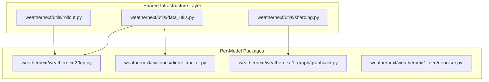
**Sources:** [README.md:35-46](), [setup.py:28]()

## Getting Started: Installation and Dependencies

Getting up and running with WeatherNext involves installing the package from source using `setup.py`, satisfying core deep learning dependencies such as JAX, Haiku, Jraph, Fiddle, and `gdm-xarray-jax`, and downloading pretrained model weights from Google Cloud Storage [README.md:110-141](), [setup.py:32-54](). Python 3.10 or 3.11 is required [setup.py:60-61]().

For detailed instructions on environment setup, package versions, and weight acquisition, see [Getting Started: Installation and Dependencies](#1.1).

**Sources:** [README.md:110-141](), [setup.py:32-61]()

## Pretrained Models and Checkpoints

The repository supports various pretrained checkpoint families designed for specific resolutions and training cutoffs [README.md:47-89](). This includes **WeatherNext2_<2025** (0.25° resolution fine-tuned on ECMWF HRES initial conditions) [README.md:57-61](), **WeatherNextCyclones_<2025/_<2024/_<2023** for operational tropical cyclone tracking [README.md:63-78](), and lightweight **WeatherNextCyclones_Mini** variants (1° resolution) suitable for local testing or single accelerator setups [README.md:79-88]().

For a complete catalog of released checkpoints, Google Cloud Storage (GCS) paths, and associated hardware requirements, see [Pretrained Models and Checkpoints](#1.2).

**Sources:** [README.md:47-89]()

## Running the Demo Notebooks

To help users explore model capabilities quickly, the repository includes interactive Jupyter notebooks located under `docs/` [README.md:96-103](). These demonstrate loading model weights from GCS, initializing model wrappers, executing autoregressive rollouts, visualizing meteorological fields, and running the direct cyclone tracker [README.md:113-122]().

Diagram: Model and Data Pipeline Flow
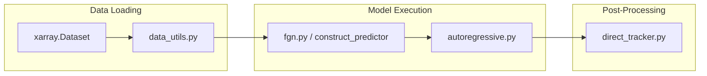
**Sources:** [README.md:96-122](), [setup.py:32-54]()

For a comprehensive walkthrough of `wn2_demo.ipynb`, the cyclone gridding/tracking demo, `graphcast_demo.ipynb`, and `gencast_mini_demo.ipynb`, see [Running the Demo Notebooks](#1.3).

**Sources:** [README.md:96-122]()

---

# Page: Getting Started: Installation and Dependencies

# Getting Started: Installation and Dependencies

<details>
<summary>Relevant source files</summary>

The following files were used as context for generating this wiki page:

- [README.md](README.md)
- [setup.py](setup.py)

</details>


This page provides the technical requirements and procedures for setting up the WeatherNext environment. It covers the supported Python versions, core library dependencies defined in `setup.py`, installation procedures via git tags, and the acquisition of pre-trained model weights from Google Cloud Storage.

## Python Environment and Package Installation

The WeatherNext codebase targets modern Linux environments and officially supports Python versions **3.10** and **3.11` [setup.py:60-61]().

### Installation via setup.py
Users can install the package directly from the repository. To pin a specific release (recommended due to the research nature of the codebase and lack of API stability guarantees), install via a git tag [README.md:131-137]():

```bash
# Install a specific tagged release
pip install git+https://github.com/google-deepmind/weathernext.git@v0.3.0
```

Alternatively, for local development:
```bash
git clone https://github.com/google-deepmind/weathernext.git
cd weathernext
pip install .
```

### Core Dependencies
The package dependencies are managed through `setup.py` and encompass numerical computing, graph neural networks, and meteorological libraries:

| Dependency | Purpose | Code Reference |
| :--- | :--- | :--- |
| `jax` | High-performance numerical computing and hardware acceleration | [setup.py:42]() |
| `dm-haiku` | Neural network library for JAX (parameter management) | [setup.py:37]() |
| `jraph` | Graph neural network primitives | [setup.py:43]() |
| `gdm-xarray-jax` | Xarray integration layer for JAX (`v0.1.1`) | [setup.py:39]() |
| `fiddle` | Configuration management framework | [setup.py:40]() |
| `dinosaur-dycore` | Dynamical core utilities for atmospheric modeling | [setup.py:36]() |
| `trimesh` | Geometric processing for icosahedral meshes | [setup.py:50]() |
| `xarray` | N-dimensional labeled arrays and datasets (`<=2026.2.0`) | [setup.py:52]() |

Sources: [setup.py:32-54](), [README.md:131-138]()

---

## Model Weights and Data Acquisition

Pre-trained weights and normalization artifacts for WeatherNext 2 and WeatherNext Cyclones are hosted on Google Cloud Storage under the public bucket `gs://dm_graphcast` [README.md:110-111]().

### Catalog of Released Checkpoints
*   **WeatherNext2_<2025**: 0.25° resolution operational model fine-tuned on ECMWF HRES initial conditions (data through 2024). Files: `WeatherNext2_<2025_model{1,2,3,4}.npz` [README.md:57-61]().
*   **WeatherNextCyclones_<2025**: 0.25° resolution operational cyclone forecasting model (data through 2024). Files: `WeatherNextCyclones_<2025_model{1,2,3,4}.npz` [README.md:65-70]().
*   **WeatherNextCyclones_<2024**: 0.25° resolution model reproducing 2024 results (data through 2023). Files: `WeatherNextCyclones_<2024_model{1,2,3,4}.npz` [README.md:72-74]().
*   **WeatherNextCyclones_<2023**: 0.25° resolution model reproducing 2023 results (data through 2022). Files: `WeatherNextCyclones_<2023_model{1,2,3,4}.npz` [README.md:75-77]().
*   **WeatherNextCyclones_Mini_<2024 / <2023**: 1.0° resolution lightweight versions intended for low-memory environments and local testing [README.md:81-88]().

Sources: [README.md:47-92](), [README.md:110-111]()

---

## System Architecture: Installation to Code Mapping

The following diagram maps external GCS assets and configuration structures to their respective ingestion points in the codebase.

### Asset Ingestion and Package Layout
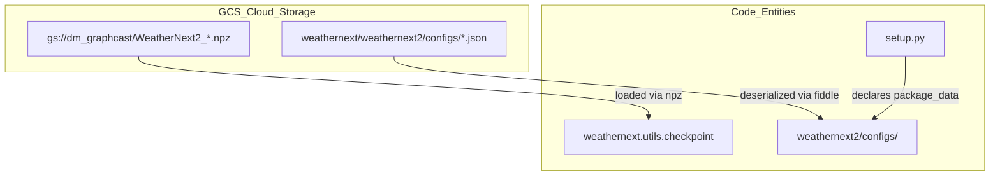

Sources: [setup.py:29-31](), [README.md:110-111]()

---

## Hardware and Performance Considerations

*   **Accelerators**: WeatherNext models are optimized for Google Cloud TPUs (`v5e`, `v5p`), though they can run on high-end GPUs (e.g., H100 for full-resolution models) [README.md:95-108]().
*   **Colab / Local Executions**: The `WeatherNextCyclones_Mini` checkpoints can execute on constrained resources such as free Colab runtimes (`v5e-1`) or local GPUs (like P100 for Mini variants) [README.md:99-108]().

Sources: [README.md:94-108]()

---

# Page: Pretrained Models and Checkpoints

# Pretrained Models and Checkpoints

<details>
<summary>Relevant source files</summary>

The following files were used as context for generating this wiki page:

- [README.md](README.md)
- [docs/weathernext1_gen/README.md](docs/weathernext1_gen/README.md)
- [setup.py](setup.py)
- [weathernext/utils/checkpoint.py](weathernext/utils/checkpoint.py)

</details>


## Purpose and Scope

This section catalogs the pretrained model checkpoints, architectures, resolutions, training data cutoffs, Google Cloud Storage (GCS) paths, and hardware accelerator requirements for the WeatherNext family of models. This includes WeatherNext 2 (WN2), WeatherNext Cyclones, WeatherNext Cyclones Mini, and legacy models (GraphCast and GenCast). Checkpoint deserialization and tree serialization mechanics provided by the repository are also detailed.

Sources: `README.md:47-112` [README.md](), `docs/weathernext1_gen/README.md:9-42` [docs/weathernext1_gen/README.md]()

---

## Catalog of WeatherNext 2 and Cyclones Checkpoints

WeatherNext 2 and WeatherNext Cyclones models share the Functional Generative Network (FGN) multimodality architecture, differing primarily in their specific fine-tuning and operational task targets (e.g., WN2 also predicts 100m wind) [README.md:49-53]().

| Model Identifier | Resolution | Training Data Cutoff | Primary Weights Files | Operational Use / Notes |
| :--- | :--- | :--- | :--- | :--- |
| **WeatherNext2_<2025** | 0.25° (~30 km) | Data through 2024 | `WeatherNext2_<2025_model{1,2,3,4}.npz` | Fine-tuned on ECMWF HRES; initialized from operational HRES initial conditions [README.md:57-61]() |
| **WeatherNextCyclones_<2025** | 0.25° (~30 km) | Data through 2024 | `WeatherNextCyclones_<2025_model{1,2,3,4}.npz` | Operational live run during 2025 Atlantic hurricane season (FNV3 / GDMI) [README.md:65-71]() |
| **WeatherNextCyclones_<2024** | 0.25° (~30 km) | Data through 2023 | `WeatherNextCyclones_<2024_model{1,2,3,4}.npz` | Reproduces results from the WeatherNext Cyclones paper on 2024 evaluation [README.md:72-74]() |
| **WeatherNextCyclones_<2023** | 0.25° (~30 km) | Data through 2022 | `WeatherNextCyclones_<2023_model{1,2,3,4}.npz` | Reproduces results from the WeatherNext Cyclones paper on 2023 evaluation [README.md:75-77]() |
| **WeatherNextCyclones_Mini_<2024** | 1.0° | Data through 2023 | `WeatherNextCyclones_Mini_<2024.npz` | Lightweight version for memory-constrained environments and local demos [README.md:81-86]() |
| **WeatherNextCyclones_Mini_<2023** | 1.0° | Data through 2022 | `WeatherNextCyclones_Mini_<2023.npz` | Lightweight version trained on data through 2022 [README.md:87-88]() |

Sources: `README.md:47-92` [README.md]()

---

## Catalog of Legacy Checkpoints (GraphCast and GenCast)

The repository retains legacy deterministic and diffusion-based ensemble forecasting models.

| Model Identifier | Resolution & Mesh | Training Data & Finetuning | Primary Storage / Files |
| :--- | :--- | :--- | :--- |
| **GenCast 0p25deg <2019** | 0.25°, 6x refined mesh, 13 levels | ERA5 (1979–2018) | `gencast/` GCS bucket, 0.25deg snapshot |
| **GenCast 0p25deg Operational <2022** | 0.25°, 6x refined mesh, 13 levels | ERA5 (1979–2018) + HRES-fc0 fine-tuned (2016–2021) | `gencast/` GCS bucket, operational snapshot |
| **GenCast 1p0deg <2019** | 1.0°, 5x refined mesh, 13 levels | ERA5 (1979–2018) | `gencast/` GCS bucket, 1deg snapshot |
| **GenCast 1p0deg Mini <2019** | 1.0°, 4x refined mesh, 13 levels | ERA5 (1979–2018) | `gencast_mini_demo.ipynb`, lightweight snapshot |

Sources: `docs/weathernext1_gen/README.md:9-42` [docs/weathernext1_gen/README.md]()

---

## Google Cloud Storage (GCS) Paths and Serialization Architecture

Pretrained weights, initial conditions, and model configuration dictionaries are hosted on Google Cloud Storage under the bucket root `gs://dm_graphcast` [README.md:110-111](). 

The repository provides serialization and deserialization primitives in `weathernext/utils/checkpoint.py` to flatten and load nested dataclasses and parameter trees to and from NumPy `.npz` container formats (`np.savez`) [weathernext/utils/checkpoint.py:26-55]().

```mermaid
title "Checkpoint Deserialization Data Flow"

graph TD
    A["GCS Bucket (gs://dm_graphcast)"] -->|"Binary Stream (.npz)"| B["weathernext/utils/checkpoint.py:load()"]
    B -->|"np.load(source)"| C["_unflatten(flat)"]
    C -->|"Returns Dict Tree"| D["_convert_types(typ, value)"]
    D -->|"Dataclass / Schema Validation"| E["Instantiated Model Parameters / Dataclass"]
```

Sources: `README.md:110-111` [README.md](), `weathernext/utils/checkpoint.py:26-55` [weathernext/utils/checkpoint.py]()

---

## Hardware Requirements and Accelerator Sizing

Running WeatherNext 2 models requires matching hardware configurations to the model's footprint and memory constraints:

* **TPU Acceleration**: WeatherNext 2 is optimized for Google Cloud TPU execution. The `v5e` and `v5p` TPU families provide optimal throughput for spatial multi-mesh computations and splash attention blocks [README.md:99-102]().
* **Memory Tiers**:
  * **Mini Models** (`WeatherNextCyclones_Mini`): Operate within memory-constrained environments, running successfully on free-tier Colab runtimes (`v5e-1`) or local GPUs such as the Nvidia P100 [README.md:99-108]().
  * **Full Resolution Models** (`WeatherNext2_<2025`, `WeatherNextCyclones_<2025`): Require high-bandwidth accelerators with large VRAM capacity, such as Google Cloud TPU v5p pods or Nvidia H100 GPUs [README.md:100-108]().
* **Attention Overrides**: When executing on GPU architectures rather than TPU, attention operators must be switched from splash attention to block-diagonal or standard attention mechanisms due to hardware kernel availability [README.md:105-106]().

Sources: `README.md:94-109` [README.md]()

---

## Model Loading and Code Entity Mapping

To bridge natural language model references to internal Python implementation objects, the following diagram illustrates how model configuration files, checkpoint files, and loader routines interact within the codebase package structure.

```mermaid
title "Model Names to Code Entity Mapping"

graph LR
    subgraph "Natural Language Space"
        N1["WeatherNext2_<2025"]
        N2["WeatherNextCyclones_Mini_<2024"]
        N3["GenCast 1p0deg Mini"]
    end

    subgraph "Code Entity Space"
        C1["weathernext/weathernext2/configs/*.json"]
        C2["weathernext/utils/checkpoint.py:load()"]
        C3["weathernext/weathernext1_gen/gencast.py"]
    end

    N1 -->|"Configured via"| C1
    N2 -->|"Deserialized via"| C2
    N3 -->|"Executed via"| C3
```

Sources: `README.md:57-88` [README.md](), `setup.py:28-31` [setup.py](), `weathernext/utils/checkpoint.py:42-55` [weathernext/utils/checkpoint.py](), `docs/weathernext1_gen/README.md:43-49` [docs/weathernext1_gen/README.md]()

---

# Page: Running the Demo Notebooks

# Running the Running the Demo Notebooks

<details>
<summary>Relevant source files</summary>

The following files were used as context for generating this wiki page:

- [docs/weathernext1_gen/gencast_mini_demo.ipynb](docs/weathernext1_gen/gencast_mini_demo.ipynb)
- [docs/weathernext1_graph/graphcast_demo.ipynb](docs/weathernext1_graph/graphcast_demo.ipynb)
- [docs/weathernext2/images/jupyter-demo-open.png](docs/weathernext2/images/jupyter-demo-open.png)
- [docs/weathernext2/wn2_demo.ipynb](docs/weathernext2/wn2_demo.ipynb)

</details>


This page provides a technical guide for executing the WeatherNext demo notebooks, including `wn2_demo.ipynb`, the cyclone gridding/tracking demo, `graphcast_demo.ipynb`, and `gencast_mini_demo.ipynb`. These notebooks serve as the primary entry point for utilizing pre-trained models across the WeatherNext repository, demonstrating end-to-end workflows: cloud-based asset retrieval, configuration loading, model initialization, autoregressive rollout, and visualization.

## Available Demo Notebooks

The repository provides several interactive notebooks tailored to specific models, tasks, and hardware environments:

| Notebook Path | Model / Task Target | Primary Use Case & Environment |
| :--- | :--- | :--- |
| `docs/weathernext2/wn2_demo.ipynb` | WeatherNext 2 (FGN) | Multi-modal functional generative prediction, ensemble sampling, and cyclone tracking integration. |
| `docs/cyclones/demo_gridding_and_tracking.ipynb` | WeatherNext Cyclones | Gridding IBTrACS best-track data and executing the direct cyclone tracker (`direct_tracker.py`). |
| `docs/weathernext1_graph/graphcast_demo.ipynb` | GraphCast (Deterministic) | Running standard deterministic GraphCast forecasts at 0.25° and 1.0° resolutions. |
| `docs/weathernext1_gen/gencast_mini_demo.ipynb` | GenCast (Probabilistic) | Running the low-memory `GenCast 1p0deg Mini` diffusion ensemble on Colab TPU environments. |

Sources: `docs/weathernext2/wn2_demo.ipynb:1-50](), `docs/weathernext1_graph/graphcast_demo.ipynb:9-16](), `docs/weathernext1_gen/gencast_mini_demo.ipynb:30-41`().

## Data Loading and Model Initialization Flow

Notebook execution relies on connecting to Google Cloud Storage (GCS) buckets (such as `dm_graphcast` or project-specific buckets) to fetch weights, normalization statistics, and sample input datasets. The loading process utilizes `checkpoint.load` and configuration parsers.

### Natural Language to Code Entity Mapping

The following diagram bridges the high-level notebook steps to the underlying Python modules and functions responsible for model and data setup.

**Notebook-to-Code Execution Flow**
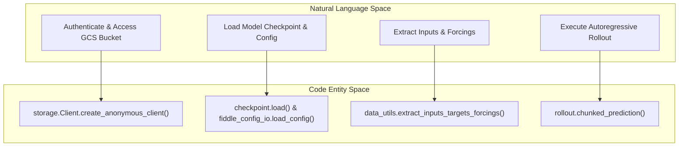
Sources: `docs/weathernext2/wn2_demo.ipynb:75-102](), `docs/weathernext1_graph/graphcast_demo.ipynb:103-108]().

## WeatherNext 2 Execution (`wn2_demo.ipynb`)

The WeatherNext 2 demo (`wn2_demo.ipynb`) demonstrates the Functional Generative Network (FGN) architecture, combining weather prediction with cyclone gridding and tracking utilities.

### Implementation Steps
1.  **Environment Setup & Dependencies**: Installs the `weathernext` package from source and reconfigures JAX/libtpu bindings for TPU acceleration [docs/weathernext2/wn2_demo.ipynb:56-61]().
2.  **Configuration and Checkpoints**: Utilizes `fiddle_config_io` to reconstruct model structures and loads parameters via `checkpoint.load` [docs/weathernext2/wn2_demo.ipynb:93-97]().
3.  **Predictor Construction**: Initializes the FGN predictor using `fgn.construct_predictor` [docs/weathernext2/wn2_demo.ipynb:98-98]().
4.  **Cyclone Tracking Integration**: Imports cyclone constants and configuration parameters (`direct_tracker_6h_v1_config`) to overlay tracked storm trajectories onto forecast outputs [docs/weathernext2/wn2_demo.ipynb:99-101]().

Sources: `docs/weathernext2/wn2_demo.ipynb:56-102`().

## Cyclone Gridding and Tracking Demo

The cyclone demo guides users through turning best-track data into gridded fields and extracting tracks from model predictions.

### Key Operations
*   **IBTrACS Rasterization**: Converts raw storm CSV/NetCDF records into gridded tensor fields using spatial radii and quadrant specifications [docs/weathernext2/wn2_demo.ipynb:101-102]().
*   **Direct Tracker Execution**: Runs initialization, momentum first-guess, and refinement algorithms defined in `direct_tracker.py` to identify cyclogenesis events.
*   **Round-Trip Validation**: Evaluates tracker consistency against ground-truth datasets using geodesic matching.

Sources: `docs/weathernext2/wn2_demo.ipynb:99-102]().

## GraphCast and GenCast Legacy Notebooks

The legacy notebooks provide reference implementations for deterministic and diffusion-based forecasting models.

### GraphCast (`graphcast_demo.ipynb`)
*   **Predictor Stack**: Wraps the core `graphcast.GraphCast` GNN model with normalization (`normalization.InputsAndResiduals`), precision casting (`casting.Bfloat16Cast`), and autoregressive looping (`autoregressive.Predictor`) [docs/weathernext1_graph/graphcast_demo.ipynb:72-79]().
*   **Chunked Rollout**: Executes memory-efficient multi-step rollouts via `rollout.chunked_prediction` [docs/weathernext1_graph/graphcast_demo.ipynb:77-77]().

### GenCast Mini (`gencast_mini_demo.ipynb`)
*   **Denoiser & Sampler**: Instantiates `denoiser.Denoiser` and integrates diffusion sampling workflows [docs/weathernext1_gen/gencast_mini_demo.ipynb:126-127]().
*   **NaN Cleaning**: Applies `nan_cleaning.NaNCleaner` to handle masked surface variables [docs/weathernext1_gen/gencast_mini_demo.ipynb:125-125]().

Sources: `docs/weathernext1_graph/graphcast_demo.ipynb:72-79](), `docs/weathernext1_gen/gencast_mini_demo.ipynb:120-127`().

## Visualization, Animation, and Validation Pipeline

All demo notebooks conclude by transforming raw `xarray.Dataset` outputs into visual animations or comparative plots.

### Key Helper Functions
*   **`select`**: Extracts specific variables, pressure levels, and batch indices from multi-dimensional arrays [docs/weathernext2/wn2_demo.ipynb:115-128]().
*   **`scale`**: Computes robust percentile limits (`np.nanpercentile`) to configure normalization and colormaps (`RdBu_r` or `viridis`) [docs/weathernext2/wn2_demo.ipynb:131-143]().
*   **`plot_data`**: Assembles multi-panel spatial figures and maps latitude/longitude coordinates to pixel grids for rendering overlays (such as cyclone DataFrames) [docs/weathernext2/wn2_demo.ipynb:144-173]().

**Visualization Data Flow**
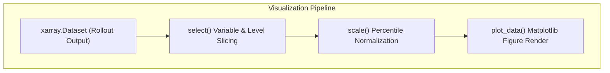
Sources: `docs/weathernext2/wn2_demo.ipynb:115-173]().

---

# Page: WeatherNext 2 (FGN)

# WeatherNext 2 (FGN)

<details>
<summary>Relevant source files</summary>

The following files were used as context for generating this wiki page:

- [weathernext/weathernext2/__init__.py](weathernext/weathernext2/__init__.py)
- [weathernext/weathernext2/architecture.py](weathernext/weathernext2/architecture.py)
- [weathernext/weathernext2/fgn.py](weathernext/weathernext2/fgn.py)

</details>


The WeatherNext 2 package (`weathernext/weathernext2/`) implements the Functional Generative Network (FGN) architecture, combining multimodality spatial message passing (grid-to-mesh-to-grid) with stochastic noise injection to generate probabilistic multi-step weather and cyclone forecasts. This parent page provides a high-level overview of the FGN predictor framework, the underlying neural network architecture, and configuration management.

For granular technical details, refer to the respective child pages:
- [FGN Predictor and Generative Noise](#2.1)
- [WN2 Architecture: Points–Mesh Forward Pass](#2.2)
- [Model Configuration: JSON Configs and Fiddle](#2.3)

---

## Architecture and Component Relationships

The WeatherNext 2 system links configuration files, wrapper layers, generative noise injectors, and graph-based forward passes into an end-to-end executable pipeline. 

### System Architecture Diagram

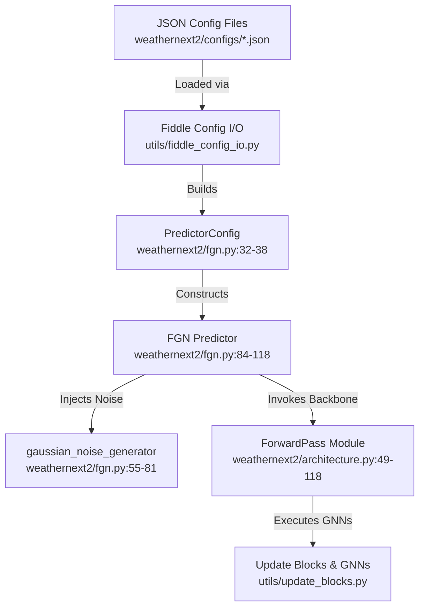
Sources: [weathernext/weathernext2/fgn.py:32-118](), [weathernext/weathernext2/architecture.py:49-118]()

---

## 2.1 FGN Predictor and Generative Noise

The Functional Generative Network (FGN) predictor coordinates ensemble generation by sampling random noise and feeding it alongside physical forcings into a deterministic underlying neural network. The core configuration and construction logic reside in `weathernext/weathernext2/fgn.py`.

The module defines `PredictorConfig` dataclass and `construct_predictor` to instantiate wrapped predictor pipelines [weathernext/weathernext2/fgn.py:32-45](). Stochastic behavior is achieved via `gaussian_noise_generator`, which appends white Gaussian noise to input fields or forcing datasets based on specified noise dictionaries [weathernext/weathernext2/fgn.py:55-81](). The primary `Predictor` class subclasses base predictors to handle batch-and-sample reshaping for parallel ensemble rollouts and implements CRPS loss calculations [weathernext/weathernext2/fgn.py:84-179]().

For detailed information on wrapper stacking, noise configuration variables, and loss implementations, see [FGN Predictor and Generative Noise](#2.1).

Sources: [weathernext/weathernext2/fgn.py:32-179]()

---

## 2.2 WN2 Architecture: Points–Mesh Forward Pass

The neural network backbone for WeatherNext 2 is defined in `weathernext/weathernext2/architecture.py` and supported by `architecture_utils.py`. The primary module `ForwardPass` implements the multimodality graph transformation pipeline [weathernext/weathernext2/architecture.py:49-118]().

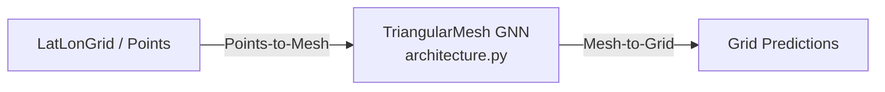
Sources: [weathernext/weathernext2/architecture.py:49-130]()

`ForwardPass` manages latent and output dense layers, spatial feature generation, norm conditioning features, activation functions, and gradient checkpointing (`remat`) over grid-to-mesh, mesh, and mesh-to-grid GNN stages [weathernext/weathernext2/architecture.py:53-118]().

For detailed documentation on update block constructors, dense layer kwargs, spatial feature engineering, and mesh splitting parameters, see [WN2 Architecture: Points–Mesh Forward Pass](#2.2).

Sources: [weathernext/weathernext2/architecture.py:49-156]()

---

## 2.3 Model Configuration: JSON Configs and Fiddle

WeatherNext 2 models rely on declarative JSON configuration files stored under `weathernext2/configs/`. These configurations define parameters for variants such as `WeatherNext2`, `WeatherNextCyclones`, and `WeatherNextCyclones_Mini`. 

Serialization and reconstruction of these configurations into executable JAX/Haiku task definitions are managed using Fiddle integration utilities (`utils/fiddle_config_io.py`), allowing flexible parameter overrides for training and evaluation.

For a comprehensive breakdown of configuration schemas and serialization workflows, see [Model Configuration: JSON Configs and Fiddle](#2.3).

Sources: [weathernext/weathernext2/__init__.py:1-13]()

---

# Page: FGN Predictor and Generative Noise

# FGN Predictor and Generative Noise

<details>
<summary>Relevant source files</summary>

The following files were used as context for generating this wiki page:

- [weathernext/utils/ensemble.py](weathernext/utils/ensemble.py)
- [weathernext/utils/predictor_base.py](weathernext/utils/predictor_base.py)
- [weathernext/weathernext2/fgn.py](weathernext/weathernext2/fgn.py)

</details>


## Purpose and Scope

This page details the implementation of the Functional Generative Network (FGN) predictor within WeatherNext 2 (`weathernext/weathernext2/fgn.py`). It covers configuration instantiation (`PredictorConfig` and `construct_predictor`), wrapper stacking patterns, stochastic white noise injection via `gaussian_noise_generator`, ensemble sampling mechanics (`WithSampleDim`), and probabilistic loss formulations (CRPS loss).

---

## 1. Predictor Configuration and Construction

The FGN subsystem defines configuration dataclasses and construction helpers to instantiate a modular hierarchy of predictors and wrappers.

The `PredictorConfig` dataclass holds the task definition, the base predictor constructor, base keyword arguments, and a list of wrapper configurations [weathernext/weathernext2/fgn.py:32-38]():

```python
@dataclasses.dataclass
class PredictorConfig:
  task: task_base.TaskConfig
  predictor_constructor: Callable[..., Any]
  predictor_kwargs: dict[str, Any]
  predictor_wrappers: list[dict[str, Any]]
```

The `construct_predictor` function initializes the underlying base predictor and iteratively applies each wrapper listed in `predictor_wrappers` [weathernext/weathernext2/fgn.py:40-45]():

```python
def construct_predictor(config: PredictorConfig) -> Any:
  predictor = config.predictor_constructor(**config.predictor_kwargs)
  for w in config.predictor_wrappers:
    predictor = w["constructor"](predictor, **w.get("kwargs", {}))
  return predictor
```

```mermaid
graph TD
    A["PredictorConfig"] --> B["construct_predictor"]
    B --> C["BasePredictorConstructor"]
    C --> D["WrapperLoop"]
    D --> E["WrapperConstructor"]
    E --> F["ConfiguredPredictorInstance"]

    sub-title "Code Entity Construction Flow"
    style A fill:#fff,stroke:#000,stroke-width:1px
    style B fill:#fff,stroke:#000,stroke-width:1px
    style F fill:#fff,stroke:#000,stroke-width:1px
```
*Sources: [weathernext/weathernext2/fgn.py:32-46]()*

---

## 2. Generative Noise Injection

Stochastic realizations in FGN are driven by injecting white Gaussian noise into either input datasets or forcing datasets. The `gaussian_noise_generator` function handles this injection [weathernext/weathernext2/fgn.py:55-81]():

```python
def gaussian_noise_generator(inputs, forcings, default_dtype, noise_var_dict):
```

It iterates over `noise_var_dict`, inspecting whether the source dataset is `"input"` or `"forcings"`. For each specified variable, it samples standard normal noise via `jax.random.normal` using `hk.next_rng_key()`, constructs an `xarray_jax.Variable` with shape `("batch", *non_batch_shape)`, and assigns it directly to the dataset.

```mermaid
graph TD
    A["gaussian_noise_generator"] --> B["IterateNoiseVarDict"]
    B --> C["SelectSourceDataset"]
    C --> D["JAXRandomNormal"]
    D --> E["XarrayJaxVariable"]
    E --> F["InjectIntoInputsOrForcings"]

    sub-title "Noise Generator Data Flow"
    style A fill:#fff,stroke:#000,stroke-width:1px
    style F fill:#fff,stroke:#000,stroke-width:1px
```
*Sources: [weathernext/weathernext2/fgn.py:55-81]()*

---

## 3. Predictor Architecture and Ensemble Sampling

The core FGN `Predictor` class inherits from `base.Predictor` [weathernext/utils/predictor_base.py:27](). It couples a deterministic neural network predictor (`_noisy_function`) with a noise generator function and loss configurations [weathernext/weathernext2/fgn.py:84-118]().

### Batch-Sample Reshaping
To support parallel evaluation of ensemble members, `run_model_with_sample_as_batch()` flattens the `batch` and `sample` dimensions into a single combined batch dimension before passing data into the underlying deterministic function, and restores them afterward [weathernext/weathernext2/fgn.py:119-159]():

```python
    stack_batch_and_sample = (
        lambda ds: ds.rename({"batch": "_batch"})
        .stack(batch=("_batch", "sample"))
        .transpose("batch", ...)
    )
```

### Ensemble Wrapper (`WithSampleDim`)
When running inference or scoring with explicit sample dimensions independently of batch sizes, `WithSampleDim` wraps an underlying predictor to broadcast datasets along a leading `sample` dimension [weathernext/utils/ensemble.py:22-55]()::

```python
class WithSampleDim(base.Predictor):
  def __init__(self, underlying: base.Predictor, num_samples: int):
    self._underlying = underlying
    self._num_samples = num_samples

  def _add_sample_axis(self, data_array: xarray.DataArray) -> xarray.DataArray:
    return data_array.expand_dims(sample=self._num_samples, axis=0)
```

```mermaid
graph TD
    A["Predictor.__call__"] --> B["run_model_with_sample_as_batch"]
    B --> C["stack_batch_and_sample"]
    C --> D["noise_generator"]
    D --> E["noisy_function"]
    E --> F["unstack_batch_and_sample"]
    
    sub-title "FGN Execution Pipeline"
    style A fill:#fff,stroke:#000,stroke-width:1px
    style F fill:#fff,stroke:#000,stroke-width:1px
```
*Sources: [weathernext/weathernext2/fgn.py:84-159](), [weathernext/utils/ensemble.py:22-55]()*

---

## 4. FGN Loss and CRPS Evaluation

The FGN class implements specialized loss metrics, notably Continuous Ranked Probability Score (CRPS) evaluations over ensemble predictions [weathernext/weathernext2/fgn.py:161-179](). 

The `crps_loss` method calculates probabilistic accuracy metrics by comparing prediction ensembles against target distributions. It accounts for residual shifts during autoregressive rollout, ensuring that mean absolute error (MAE) and mean absolute difference (MAD) terms are correctly evaluated whether models predict full physical states or prognostic residuals [weathernext/weathernext2/fgn.py:161-179]().

*Sources: [weathernext/weathernext2/fgn.py:161-179]()*

---

# Page: WN2 Architecture: Points–Mesh Forward Pass

# WN2 Architecture: Points–Mesh Forward Pass

<details>
<summary>Relevant source files</summary>

The following files were used as context for generating this wiki page:

- [weathernext/utils/points_mesh_gnn.py](weathernext/utils/points_mesh_gnn.py)
- [weathernext/weathernext2/architecture.py](weathernext/weathernext2/architecture.py)
- [weathernext/weathernext2/architecture_utils.py](weathernext/weathernext2/architecture_utils.py)

</details>


## Purpose and Scope

This page documents the core neural network architecture of WeatherNext 2 (WN2), focusing on the implementation details found in `weathernext/weathernext2/architecture.py` and `weathernext/weathernext2/architecture_utils.py`. It covers the `ForwardPass` Haiku module, update block constructors for points-to-mesh, mesh, and mesh-to-grid transitions (`weathernext/utils/points_mesh_gnn.py`), latent and output dense configurations, spatial feature engineering, normalization conditioning, rematerialization (remat), and mesh splitting strategies.

---

## 1. The `ForwardPass` Module Architecture

The `ForwardPass` class is a Haiku module (`weathernext/weathernext2/architecture.py:49-117`) that acts as the primary orchestrator for the multi-modality deep learning predictor. It accepts input datasets and forcing fields, separates normalization conditioning variables, constructs spatial and graph features, passes them through an encoder-processor-decoder graph neural network pipeline, and maps them back to grid and global outputs.

```mermaid
graph TD
    sub5["weathernext/weathernext2/architecture.py"]
    sub6["weathernext/weathernext2/architecture_utils.py"]
    sub7["weathernext/utils/points_mesh_gnn.py"]

    Inputs[""xr.Dataset Inputs & Forcings""] --> Classify[""architecture_utils.classify_input_data""]
    Classify --> Split[""architecture_utils.split_norm_conditioning_features""]
    Split --> GridData[""grid_data & global_data""]
    GridData --> SpatialFeat[""feature_utils.get_spatial_features""]
    SpatialFeat --> P2M[""points_to_mesh_model_ctor (PointsMeshTypedGraphGNN)""]
    P2M --> Mesh[""mesh_model_ctor (Mesh GNN Backbone)""]
    Mesh --> M2G[""mesh_to_grid_model_ctor (PointsMeshTypedGraphGNN)""]
    M2G --> Output[""Predicted xr.Dataset""]

    sub6 -.-> Classify
    sub6 -.-> Split
    sub7 -.-> P2M
    sub7 -.-> M2G
```

Sources:
- `weathernext/weathernext2/architecture.py:49-117`
- `weathernext/weathernext2/architecture_utils.py:29-71`
- `weathernext/utils/points_mesh_gnn.py:70-175`

---

## 2. Input Classification and Normalization Conditioning

Before entering the GNN layers, raw inputs and forcing fields are classified and preprocessed by utility functions in `weathernext/weathernext2/architecture_utils.py`. 

The function `classify_input_data` (`weathernext/weathernext2/architecture_utils.py:29-71`) verifies that all required normalization conditioning features exist, splits them out via `split_norm_conditioning_features` (`weathernext/weathernext2/architecture_utils.py:111-125`), applies variable prefixes (`input_` and `forcing_`), and sorts variables into grid-based data and global data using `sort_by_grid_and_global` (`weathernext/weathernext2/architecture_utils.py:87-102`).

| Utility Function | File Path | Role |
| :--- | :--- | :--- |
| `classify_input_data` | `weathernext/weathernext2/architecture_utils.py:29-71` | Orchestrates input splitting, prefixing, and grid/global sorting. |
| `split_norm_conditioning_features` | `weathernext/weathernext2/architecture_utils.py:111-125` | Extracts conditioning features from datasets. |
| `sort_by_grid_and_global` | `weathernext/weathernext2/architecture_utils.py:87-102` | Separates variables with lat/lon dimensions from scalar global variables. |
| `merge_global_data` | `weathernext/weathernext2/architecture_utils.py:74-84` | Recombines global data dictionaries with modality-specific data. |

Sources:
- `weathernext/weathernext2/architecture_utils.py:29-125`

---

## 3. Update Block Constructors and Points–Mesh GNNs

The architecture relies on composable update constructors that transform features across geometric domains (grid points, icosahedral mesh nodes, and global contexts). These are implemented via `PointsMeshTypedGraphGNN` in `weathernext/utils/points_mesh_gnn.py`.

```mermaid
graph TD
    sub1["weathernext/utils/points_mesh_gnn.py"]

    PointData[""LatLonPointsData""] --> P2M_Block[""PointsMeshTypedGraphGNN (is_points_to_mesh=True)""]
    MeshNodes[""TriangularMeshData""] --> P2M_Block
    P2M_Block --> MeshUpdate[""MeshUpdateConstructor (DeepGNN Backbone)""]
    MeshUpdate --> M2G_Block[""PointsMeshTypedGraphGNN (is_mesh_to_points=True)""]
    M2G_Block --> PointOutput[""Updated LatLonPointsData""]

    sub1 -.-> P2M_Block
    sub1 -.-> M2G_Block
```

### Connectivity Types
`PointsMeshTypedGraphGNN` supports three distinct spatial connectivity strategies defined in `ConnectivityType` (`weathernext/utils/points_mesh_gnn.py:59-68`):
1. `CLOSEST` (`1`): Connects each point to its closest neighbor in the mesh.
2. `IN_TRIANGLE` (`2`): Connects each point to the three vertices of the enclosing triangular mesh face.
3. `BALL_QUERY` (`3`): Connects mesh points to all points within a scaled radius fraction (`ball_query_radius_fraction`) (`weathernext/utils/points_mesh_gnn.py:98-124`).

Sources:
- `weathernext/utils/points_mesh_gnn.py:59-175`
- `weathernext/weathernext2/architecture.py:60-62`

---

## 4. Latent and Output Dense Configurations

Neural network layers throughout `ForwardPass` utilize flexible configuration dictionaries (`dense_kwargs`) to define dense transformations:
- **`latent_dense_kwargs`**: Dictionary of parameters passed to internal dense blocks used for message passing and feature projection across the encoder-processor-decoder (`weathernext/weathernext2/architecture.py:56`).
- **`output_dense_kwargs`**: Dictionary of parameters for output MLPs excluding the terminal output size (`weathernext/weathernext2/architecture.py:57`), ensuring compatibility with variable-specific output dimensions.
- **`norm_conditioning_latent_dense_kwargs`**: Optional specific dense kwargs assigned to encode normalization conditioning features when `norm_conditioning_features` is non-empty (`weathernext/weathernext2/architecture.py:65-66`).

Sources:
- `weathernext/weathernext2/architecture.py:49-117`

---

## 5. Spatial Features and Conditioning

Spatial awareness is injected into the model through coordinate transformations and feature generation. The configuration dictionary `spatial_features_kwargs` is forwarded directly to `feature_utils.get_spatial_features` (`weathernext/weathernext2/architecture.py:58`), generating Cartesian conversions, local coordinate frames, and Fourier features from latitude and longitude coordinates.

Normalization conditioning features are processed independently and fused into the network backbone to modulate layer representations dynamically based on global metadata or lead-time parameters.

Sources:
- `weathernext/weathernext2/architecture.py:58-66`
- `weathernext/weathernext2/architecture_utils.py:29-71`

---

## 6. Rematerialization (Remat) and Mesh Splitting

To manage memory consumption during backward passes on large-scale weather grids, `ForwardPass` exposes explicit rematerialization toggles (`weathernext/weathernext2/architecture.py:71-73`):
- `remat_grid_to_mesh_gnn`: Wraps the input grid-to-mesh GNN stage in JAX remat (gradient checkpointing).
- `remat_mesh_gnn`: Wraps the core mesh processor backbone in remat.
- `remat_mesh_to_grid_gnn`: Wraps the mesh-to-grid decoding GNN stage in remat.

Additionally, `mesh_num_splits` (`weathernext/weathernext2/architecture.py:59`) specifies the refinement depth of the icosahedral mesh hierarchy, controlling resolution steps across spatial sharding domains.

Sources:
- `weathernext/weathernext2/architecture.py:49-156`

---

# Page: Model Configuration: JSON Configs and Fiddle

# Model Configuration: JSON Configs and Fiddle

<details>
<summary>Relevant source files</summary>

The following files were used as context for generating this wiki page:

- [weathernext/utils/fiddle_config_io.py](weathernext/utils/fiddle_config_io.py)
- [weathernext/utils/task.py](weathernext/utils/task.py)
- [weathernext/weathernext2/configs/WeatherNext2.json](weathernext/weathernext2/configs/WeatherNext2.json)
- [weathernext/weathernext2/configs/WeatherNextCyclones.json](weathernext/weathernext2/configs/WeatherNextCyclones.json)
- [weathernext/weathernext2/configs/WeatherNextCyclones_Mini.json](weathernext/weathernext2/configs/WeatherNextCyclones_Mini.json)

</details>


## Purpose and Scope
This page details the model configuration infrastructure for WeatherNext 2, focusing on the JSON configuration files stored under `weathernext2/configs/` (`WeatherNext2.json`, `WeatherNextCyclones.json`, and `WeatherNextCyclones_Mini.json`) and the serialization/deserialization utilities implemented in `utils/fiddle_config_io.py`. It explains how declarative model architectures and task definitions are serialized using Fiddle (`fdl`) and restored into executable JAX components.

---

## JSON Configuration Catalogs

WeatherNext 2 relies on declarative JSON configurations generated via Fiddle serialization. These files encode the complete architecture of the Functional Generative Network (FGN), predictor wrappers, normalization statistics, and task parameters.

Three primary configurations are provided in the repository:
*   `WeatherNext2.json`: The full-scale global WeatherNext 2 model configuration. It defines extensive atmospheric and surface input/target variables, multi-level pressure structures, and regional/global task settings.
*   `WeatherNextCyclones.json`: A specialized configuration tailored for tropical cyclone tracking and high-resolution regional forecasting, adjusting input variable subsets and predictor parameters.
*   `WeatherNextCyclones_Mini.json`: A lightweight, downscaled variation designed for testing, quick prototyping, and resource-constrained demonstration environments.

Each config file instantiates a root configuration node (`predictor_config_1`) that points to a model predictor tree, embedding task definitions corresponding to `TaskConfig` [weathernext/utils/task.py:20-28](). A `TaskConfig` explicitly declares:
*   `input_variables` [weathernext/utils/task.py:23-23](): Tuple of input atmospheric, surface, and temporal progression features (e.g., `temperature`, `geopotential`, `year_progress_sin`) [weathernext/weathernext2/configs/WeatherNext2.json:18-203]().
*   `target_variables` [weathernext/utils/task.py:24-25](): Tuple of target fields predicted by the model [weathernext/weathernext2/configs/WeatherNext2.json:221-272]().
*   `forcing_variables` [weathernext/utils/task.py:26-26](): External forcing fields supplied during rollout.
*   `pressure_levels` [weathernext/utils/task.py:27-27](): Vertical pressure levels tracked by the model.
*   `input_duration` [weathernext/utils/task.py:28-28](): Temporal window length for model inputs.

### Diagram: Task and Model Configuration Mapping

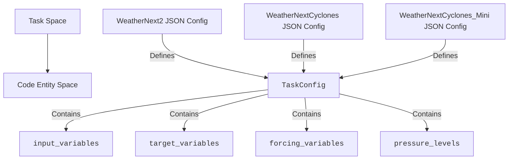

Sources: `weathernext/utils/task.py`, `weathernext/weathernext2/configs/WeatherNext2.json`, `weathernext/weathernext2/configs/WeatherNextCyclones.json`, `weathernext/weathernext2/configs/WeatherNextCyclones_Mini.json`

---

## Fiddle Configuration IO (`utils/fiddle_config_io.py`)

The module `weathernext/utils/fiddle_config_io.py` provides utilities to load, deserialize, and reconstruct Fiddle-serialized model configurations from JSON strings and files. Because weather models handle complex data structures like `xarray.Dataset` (which contain coordinates, data variables, and attributes), custom node traversers are registered with Fiddle's serialization framework (`fdl_serialization`) [weathernext/utils/fiddle_config_io.py:21-22]().

### Key Functions and Serialization Mechanics

1.  **Xarray Dataset Traverser Registration**:
    *   `register_xarray_traverser()` [weathernext/utils/fiddle_config_io.py:91-102]() registers `xarray.Dataset` with `fdl_serialization.register_node_traverser` [weathernext/utils/fiddle_config_io.py:94-99]().
    *   `_flatten_dataset(ds)` [weathernext/utils/fiddle_config_io.py:83-84]() converts an `xarray.Dataset` into its dictionary representation via `ds.to_dict()` [weathernext/utils/fiddle_config_io.py:84-84]().
    *   `_unflatten_dataset(values, _)` [weathernext/utils/fiddle_config_io.py:87-88]() reconstructs the `xarray.Dataset` via `xarray.Dataset.from_dict(values[0])` [weathernext/utils/fiddle_config_io.py:88-88]().

2.  **Dtype Normalization**:
    *   `_fix_deserialized_dtypes(fdl_config)` [weathernext/utils/fiddle_config_io.py:104-125]() iterates over predictor wrappers [weathernext/utils/fiddle_config_io.py:106-106]() and their keyword arguments [weathernext/utils/fiddle_config_io.py:107-107]() to correct data type promotions introduced during JSON round-tripping.
    *   It explicitly casts coordinate levels (e.g., `level` coordinate converted from `int64` back to `int32`) [weathernext/utils/fiddle_config_io.py:111-115]() and verifies that floating-point data variables conform to `float64` expectations [weathernext/utils/fiddle_config_io.py:118-124]().

3.  **Loading Interfaces**:
    *   `get_fiddle_config(json_str)` [weathernext/utils/fiddle_config_io.py:127-132]() registers the xarray traverser [weathernext/utils/fiddle_config_io.py:129-129](), loads the JSON string via `fdl_serialization.load_json` [weathernext/utils/fiddle_config_io.py:130-130](), fixes dtypes [weathernext/utils/fiddle_config_io.py:131-131](), and builds the final Fiddle buildable object via `fdl.build(config)` [weathernext/utils/fiddle_config_io.py:132-132]().
    *   `get_fiddle_config_path_by_name(name)` [weathernext/utils/fiddle_config_io.py:135-137]() resolves configuration file paths [weathernext/utils/fiddle_config_io.py:137-137]().
    *   `get_fiddle_config_by_name(name)` [weathernext/utils/fiddle_config_io.py:140-143]() reads the config file for a given model name and returns the built Fiddle configuration [weathernext/utils/fiddle_config_io.py:141-143]().

### Diagram: Configuration Deserialization Data Flow

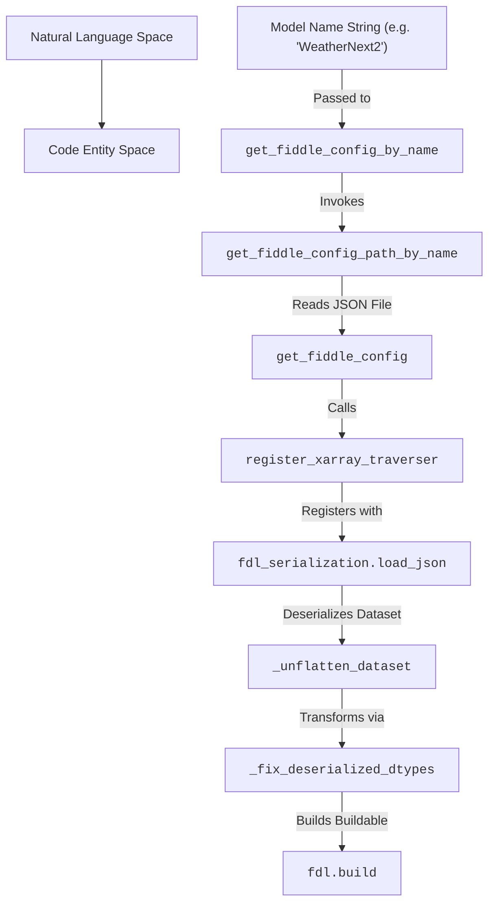

Sources: `weathernext/utils/fiddle_config_io.py`

---

# Page: WeatherNext Cyclones: Gridding and Tracking

# WeatherNext Cyclones: Gridding and Tracking

<details>
<summary>Relevant source files</summary>

The following files were used as context for generating this wiki page:

- [weathernext/cyclones/__init__.py](weathernext/cyclones/__init__.py)
- [weathernext/cyclones/constants.py](weathernext/cyclones/constants.py)
- [weathernext/cyclones/cyclone_utils.py](weathernext/cyclones/cyclone_utils.py)

</details>


## Purpose and Scope

The `weathernext/cyclones` subpackage provides specialized data pipelines and tracking algorithms designed to process tropical cyclone best-track observations from IBTrACS, rasterize them into gridded model-compatible fields, and extract predicted cyclone tracks from gridded model outputs [weathernext/cyclones/constants.py:14-89](), [weathernext/cyclones/cyclone_utils.py:14-199](). 

As a parent page, this document outlines the high-level architecture of the cyclone subpackage, bridging observation data preparation, tracking dynamics, and round-trip validation. For comprehensive technical specifications, refer to the child pages:
- [IBTrACS Data Processing and Gridding](#3.1)
- [Direct Tracker Algorithm](#3.2)
- [Cyclone Demo and Round-Trip Validation](#3.3)

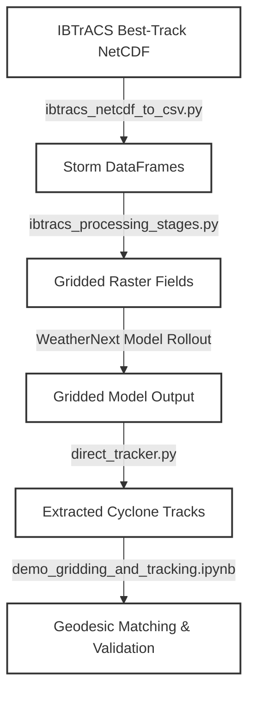
*Sources: weathernext/cyclones/constants.py:14-90, weathernext/cyclones/cyclone_utils.py:14-199*

---

## 3.1. IBTrACS Data Processing and Gridding

The data ingestion pipeline converts raw International Best Track Archive for Climate Stewardship (IBTrACS) NetCDF files into structured pandas DataFrames and spatial raster grids. This stage handles spatial coordinate conversions, wind-speed calibrations, quadrant radii mapping, and disc or Gaussian rasterization radii to prepare target fields for model training and evaluation [weathernext/cyclones/constants.py:25-85]().

Key utilities include filtering observed cyclone tracks up to initialization time $t_0$ (`filter_observed_df_for_cyclones_t0_and_before`), managing wind thresholds, and computing geodesic distances (`geodesic_distance`) [weathernext/cyclones/cyclone_utils.py:25-102]().

For detailed documentation on `ibtracs_netcdf_to_csv.py`, `ibtracs_processing_stages.py`, `ibtracs_processing_utils.py`, and `data_pipeline_utils.py`, see [IBTrACS Data Processing and Gridding](#3.1).

*Sources: weathernext/cyclones/constants.py:25-85, weathernext/cyclones/cyclone_utils.py:25-102*

---

## 3.2. Direct Tracker Algorithm

The direct tracker extracts discrete tropical cyclone tracks directly from gridded model prediction fields (`direct_tracker.py`). It employs a greedy cyclogenesis initialization strategy based on existence probability fields, incorporates a spherical geodesic momentum first guess (`cartesian_spherical_geodesic_momentum_update`), and refines positions using mean, mode, or mode-then-mean methods [weathernext/cyclones/cyclone_utils.py:164-199]().

Physical consistency and dissipation thresholds are managed through `tracker_utils.py` adhering to the `tracker_base.py` interface, with hyperparameters configured in `direct_tracker_6h_v1_config.py`.

For detailed information on tracker implementation, optimization refinement, and configuration parameters, see [Direct Tracker Algorithm](#3.2).

*Sources: weathernext/cyclones/cyclone_utils.py:164-199*

---

## 3.3. Cyclone Demo and Round-Trip Validation

End-to-end workflows are demonstrated in `docs/cyclones/demo_gridding_and_tracking.ipynb`. This notebook walks through gridding IBTrACS for a specified date range, executing model rollouts or tracker inference, performing geodesic matching via linear sum assignment (`linear_sum_assignment`), and executing round-trip validation assertions (`assert_tracker_roundtrip`) with strict numerical tolerances.

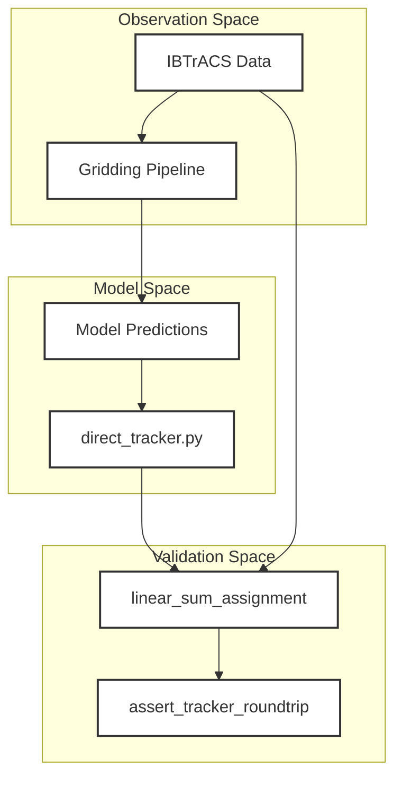
*Sources: weathernext/cyclones/cyclone_utils.py:25-70, weathernext/cyclones/constants.py:14-90*

For complete walkthroughs, code snippets, and assertion tolerances, see [Cyclone Demo and Round-Trip Validation](#3.3).

*Sources: weathernext/cyclones/cyclone_utils.py:25-70, weathernext/cyclones/constants.py:14-90*

---

# Page: IBTrACS Data Processing and Gridding

# IBTrACS Data Processing and Gridding

<details>
<summary>Relevant source files</summary>

The following files were used as context for generating this wiki page:

- [weathernext/cyclones/data_pipeline_utils.py](weathernext/cyclones/data_pipeline_utils.py)
- [weathernext/cyclones/ibtracs_netcdf_to_csv.py](weathernext/cyclones/ibtracs_netcdf_to_csv.py)
- [weathernext/cyclones/ibtracs_processing_stages.py](weathernext/cyclones/ibtracs_processing_stages.py)
- [weathernext/cyclones/ibtracs_processing_utils.py](weathernext/cyclones/ibtracs_processing_utils.py)

</details>


## Purpose and Scope
This document details the data pipeline responsible for ingesting, standardizing, calibrating, and spatially gridding tropical cyclone best-track records from the International Best Track Archive for Climate Stewardship (IBTrACS). It covers raw NetCDF ingestion into tabular dataframes, time-slice extraction, rasterization via Gaussian and disc kernels, quadrant wind radii handling, and multi-agency wind speed aggregation. The key implementation components reside in `weathernext/cyclones/ibtracs_netcdf_to_csv.py`, `weathernext/cyclones/ibtracs_processing_stages.py`, `weathernext/cyclones/ibtracs_processing_utils.py`, and `weathernext/cyclones/data_pipeline_utils.py`.

Sources: `weathernext/cyclones/ibtracs_netcdf_to_csv.py:14-20]`, `weathernext/cyclones/ibtracs_processing_stages.py:14-19]`, `weathernext/cyclones/data_pipeline_utils.py:14-14]()`

---

## Raw NetCDF to Standardized CSV Conversion
The `weathernext/cyclones/ibtracs_netcdf_to_csv.py` module converts raw IBTrACS NetCDF datasets with dimensions `(storm, date_time)` into a flattened tabular `pandas.DataFrame` [weathernext/cyclones/ibtracs_netcdf_to_csv.py:14-20](). This ensures consistent downstream handling for both test datasets and tracking modules.

The conversion function `convert_ibtracs_netcdf_to_csv_df` filters storms by year, iterates through individual storm trajectories, extracts valid times, coordinates, and scalar attributes, and converts nautical miles to kilometers using the conversion factor `_NMILES_PER_KM = 0.539957` [weathernext/cyclones/ibtracs_netcdf_to_csv.py:61-180](). The resulting columns strictly conform to `_CSV_COLUMNS`, which include track identifiers, latitude, longitude, valid times, minimum sea level pressure, maximum sustained wind speeds, radius of maximum winds (RMW), and quadrant-specific wind radii for 34, 50, and 64-knot thresholds across northeast (`ne`), southeast (`se`), southwest (`sw`), and northwest (`nw`) quadrants [weathernext/cyclones/ibtracs_netcdf_to_csv.py:33-53]().

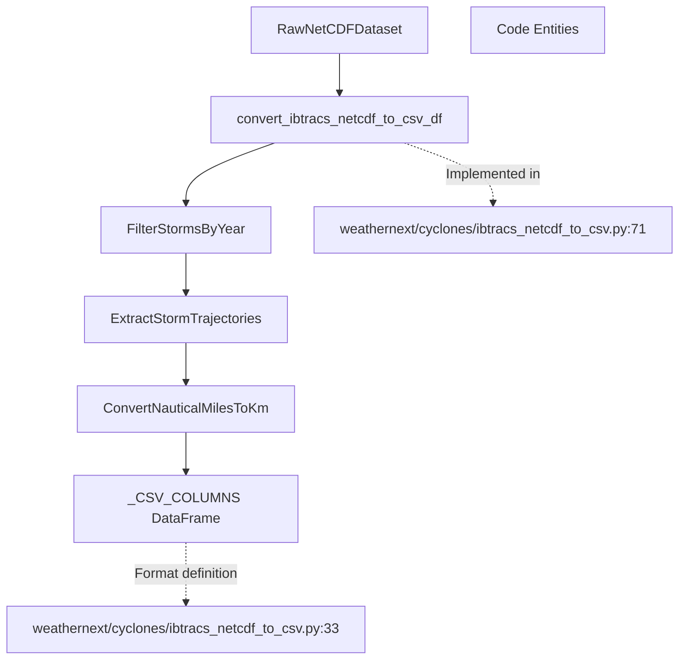
*Figure 1: Pipeline flow from raw IBTrACS NetCDF to standardized CSV dataframes.*

Sources: `weathernext/cyclones/ibtracs_netcdf_to_csv.py:33-180]()`

---

## Time-Slice Loading and Spatial Gridding Layouts
To transform tabular or track-based storm records into spatial fields aligned with numerical weather prediction grids, `weathernext/cyclones/ibtracs_processing_stages.py` provides `load_time_slice_from_ibtracs` [weathernext/cyclones/ibtracs_processing_stages.py:64-135](). This function queries storms active within a given `datetime`, extracts scalar and vector attributes, normalizes longitudes to the $[0, 360)$ range via `_lon_180_to_360`, and packages them into an `IBTrACSData` dataclass containing an `IBTrACSDataSlice` dictionary [weathernext/cyclones/ibtracs_processing_stages.py:47-135]().

Grid dimensions and spatial coordinate structures are managed by `weathernext/cyclones/data_pipeline_utils.py`. The number of latitude and longitude points for a rectilinear grid at a given `resolution` are computed using `num_lat_rectilinear_grid` and `num_lon_rectilinear_grid` [weathernext/cyclones/data_pipeline_utils.py:76-94]():

$$\text{num\_lat} = 2 \times \text{round}\left(\frac{90}{\text{resolution}}\right) + 1$$

$$\text{num\_lon} = \text{round}\left(\frac{360}{\text{resolution}}\right)$$

The function `convert_grid_data_to_packed_xarray_dataset` packs dictionary-mapped numpy arrays into an `xarray.Dataset` with standard coordinates: `single_level_temporal_variable`, `time`, `latitude`, and `longitude` [weathernext/cyclones/data_pipeline_utils.py:141-204]().

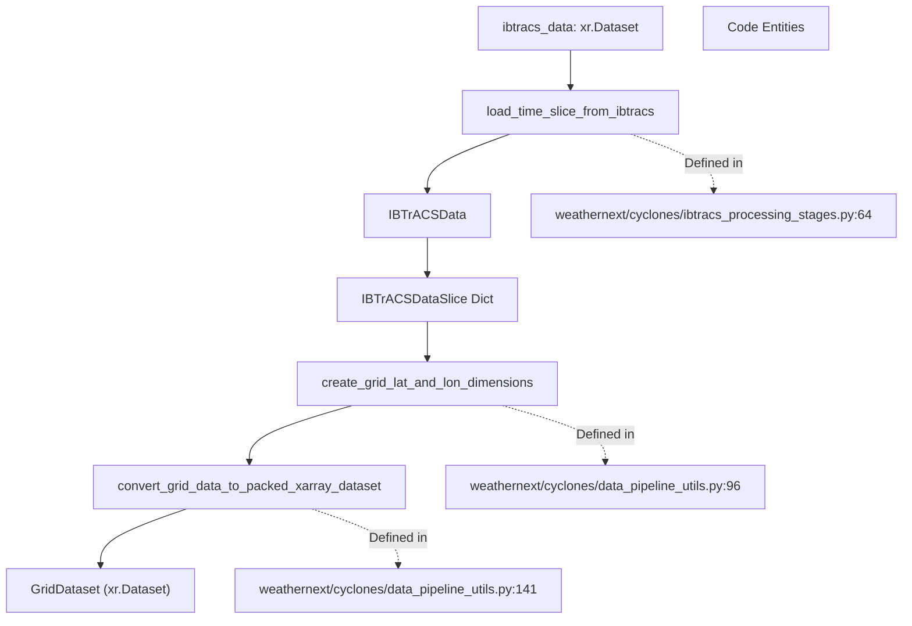
*Figure 2: Data flow for loading time-slices and packing into xarray datasets.*

Sources: `weathernext/cyclones/ibtracs_processing_stages.py:47-135]`, `weathernext/cyclones/data_pipeline_utils.py:76-204]()`

---

## Rasterization, Quadrant Radii, and Existence Fields
The mapping of storm point locations and radii onto a 2D spatial grid is handled via rasterization functions in `weathernext/cyclones/ibtracs_processing_stages.py` and helper routines in `weathernext/cyclones/ibtracs_processing_utils.py`. 

The core function `cyclone_existence_grids` generates spatial existence fields from storm coordinate slices (`latlon`) [weathernext/cyclones/ibtracs_processing_stages.py:138-199](). Depending on configuration flags, it computes:
* **Gaussian unit mode masks** (`exists_gaussian_unit_mode`) via `create_gaussian_disc_mask_from_latlon` [weathernext/cyclones/ibtracs_processing_stages.py:163-170]().
* **Probability masks** (`exists_gaussian_probability`) using gaussian normalization [weathernext/cyclones/ibtracs_processing_stages.py:191-198]().
* **Disc integral masks** (`exists_disc`) using `create_disc_integral_mask_from_latlon` [weathernext/cyclones/ibtracs_processing_stages.py:184-190]().
* **Sparse nearest neighbor masks** (`exists_sparse`) using `create_sparse_nearest_neighbour_mask_from_latlon` [weathernext/cyclones/ibtracs_processing_stages.py:178-183]().

The core variables maintained for cyclone modeling are enumerated in `CORE_CYCLONE_VARIABLES`, which aggregate existence probabilities, minimum sea level pressures (`usa_pres_disc`), wind radii per quadrant (`usa_r34`, `usa_r50`, `usa_r64`), and radius of maximum winds (`usa_rmw_disc`) [weathernext/cyclones/ibtracs_processing_utils.py:178-196](). Quadrant radii imputation flags (`QUADRANT_PRESENT_AND_NOT_IMPUTED_FLAG`, `QUADRANT_MISSING_IMPUTED_WITH_MEAN_FLAG`, etc.) govern how missing directional wind spans are handled [weathernext/cyclones/ibtracs_processing_utils.py:152-162]().

Sources: `weathernext/cyclones/ibtracs_processing_stages.py:138-199]`, `weathernext/cyclones/ibtracs_processing_utils.py:152-196]()`

---

## Wind-Speed Calibration and Aggregation
IBTrACS records wind speeds from multiple international meteorological agencies (`usa_wind`, `cma_wind`, `newdelhi_wind`, `reunion_wind`, `bom_wind`) [weathernext/cyclones/ibtracs_processing_utils.py:48-54](). Minimum sea level pressures are similarly gathered from agencies such as WMO, USA, CMA, HKO, Tokyo, and others [weathernext/cyclones/ibtracs_processing_utils.py:70-81]().

To reconcile discrepancies between reporting agencies, `ibtracs_processing_utils.py` defines calibration models (`WindCalibrationModel`) and establishes `IBTRACS_BASE_WIND_VARIABLE = "usa_wind"` as the primary reference standard [weathernext/cyclones/ibtracs_processing_utils.py:44-143](). Quadrant wind radius variables are structured as tuples mapping the source agency, corresponding wind speed variable, and threshold speed (34.0, 50.0, or 64.0 knots) via `_get_ibtracs_quadrant_variable_tuples()` [weathernext/cyclones/ibtracs_processing_utils.py:29-37]().

Sources: `weathernext/cyclones/ibtracs_processing_utils.py:29-143]()`

---

# Page: Direct Tracker Algorithm

# Direct Tracker Algorithm

<details>
<summary>Relevant source files</summary>

The following files were used as context for generating this wiki page:

- [weathernext/cyclones/direct_tracker.py](weathernext/cyclones/direct_tracker.py)
- [weathernext/cyclones/direct_tracker_6h_v1_config.py](weathernext/cyclones/direct_tracker_6h_v1_config.py)
- [weathernext/cyclones/tracker_base.py](weathernext/cyclones/tracker_base.py)
- [weathernext/cyclones/tracker_utils.py](weathernext/cyclones/tracker_utils.py)

</details>


## Purpose and Scope

This page documents the direct cyclone tracking algorithm implemented in `weathernext/cyclones/direct_tracker.py` [weathernext/cyclones/direct_tracker.py:1-57](). The direct tracker operates greedily on top of gridded model forecasts to identify, initialize, and follow tropical cyclone tracks over time without requiring future-looking optimization (unlike traditional methods like Tempest Extremes). This section covers the abstract interface defined in `tracker_base.py` [weathernext/cyclones/tracker_base.py:1-63](), the core tracking pipeline and refinement modes in `direct_tracker.py` [weathernext/cyclones/direct_tracker.py:16-56](), physical consistency enforcement and spatial utilities in `tracker_utils.py` [weathernext/cyclones/tracker_utils.py:1-194](), and configuration parameters provided by `direct_tracker_6h_v1_config.py` [weathernext/cyclones/direct_tracker_6h_v1_config.py:1-62]().

Sources:
- `weathernext/cyclones/direct_tracker.py` [weathernext/cyclones/direct_tracker.py:1-57]()
- `weathernext/cyclones/tracker_base.py` [weathernext/cyclones/tracker_base.py:1-63]()
- `weathernext/cyclones/tracker_utils.py` [weathernext/cyclones/tracker_utils.py:1-194]()
- `weathernext/cyclones/direct_tracker_6h_v1_config.py` [weathernext/cyclones/direct_tracker_6h_v1_config.py:1-62]()

---

## Tracker Base Interface (`tracker_base.py`)

All cyclone trackers in WeatherNext adhere to a common abstract base class, `CycloneTracker`, defined in `weathernext/cyclones/tracker_base.py` [weathernext/cyclones/tracker_base.py:23-28](). This interface standardizes how gridded model predictions are preprocessed and converted into pandas DataFrames containing individual storm trajectories.

### Core Interface Methods

| Method | Signature | Role |
| :--- | :--- | :--- |
| `__init__` | `(self, **tracker_kwargs)` | Initializes tracker hyperparameters and operational thresholds [weathernext/cyclones/tracker_base.py:30-33](). |
| `preprocess_gridded_ds` | `(self, gridded_ds: xr.Dataset, extras_ds: Optional[xr.Dataset]) -> xr.Dataset` | Preprocesses gridded prognostic fields before tracking [weathernext/cyclones/tracker_base.py:35-42](). |
| `__call__` | `(self, gridded_ds: xr.Dataset, initial_storms_df: Optional[pd.DataFrame], context_time_window_to_remove: Optional[pd.Timedelta]) -> pd.DataFrame` | Executes the tracking loop across forecast time steps, returning a consolidated track DataFrame [weathernext/cyclones/tracker_base.py:44-63](). |

```mermaid
graph TD
    A["CycloneTracker"] --> B["preprocess_gridded_ds"]
    A --> C["__call__"]
    C --> D["DirectTracker"]
    
    style A fill:#fff,stroke:#333,stroke-width:2px
    style B fill:#fff,stroke:#333,stroke-width:2px
    style C fill:#fff,stroke:#333,stroke-width:2px
    style D fill:#fff,stroke:#333,stroke-width:2px
```
*Figure 1: Bridge from abstract interface `CycloneTracker` to the concrete implementation `DirectTracker`.*

Sources:
- `weathernext/cyclones/tracker_base.py` [weathernext/cyclones/tracker_base.py:23-63]()

---

## Direct Tracker Pipeline and Execution (`direct_tracker.py`)

The `DirectTracker` class executes a greedy two-phase procedure: initialization followed by time-stepping evolution.

```mermaid
graph TD
    Start(["Input: gridded_ds"]) --> Init["Initialize Storm Centers\n(DirectTracker._initialize_storms)"]
    Init --> Check{"More Time Steps?"}
    Check -->|Yes| Step["Advance Step t"]
    Step --> Momentum["1. Momentum First Guess\n(DirectTracker._get_momentum_guess)"]
    Momentum --> Refine["2. Position Refinement\n(mode / mean / mode_then_mean)"]
    Refine --> Scalar["3. Estimate Scalar Variables\n(Wind, Pressure, Radii)"]
    Scalar --> CheckProb{"Existence Prob > Threshold?"}
    CheckProb -->|No| Dissipate["Dissipate Track"]
    CheckProb -->|Yes| Update["Append to Track DataFrame"]
    Dissipate --> Check
    Update --> Check
    Check -->|No| Output(["Output: pandas.DataFrame"])

    style Start fill:#fff,stroke:#333,stroke-width:2px
    style Init fill:#fff,stroke:#333,stroke-width:2px
    style Check fill:#fff,stroke:#333,stroke-width:2px
    style Step fill:#fff,stroke:#333,stroke-width:2px
    style Momentum fill:#fff,stroke:#333,stroke-width:2px
    style Refine fill:#fff,stroke:#333,stroke-width:2px
    style Scalar fill:#fff,stroke:#333,stroke-width:2px
    style CheckProb fill:#fff,stroke:#333,stroke-width:2px
    style Dissipate fill:#fff,stroke:#333,stroke-width:2px
    style Update fill:#fff,stroke:#333,stroke-width:2px
    style Output fill:#fff,stroke:#333,stroke-width:2px
```
*Figure 2: Data flow and execution steps within `DirectTracker.__call__` in `direct_tracker.py`.*

### 1. Cyclogenesis Initialization
Storm centers can be initialized either from known IBTrACS records (`initial_storms_df`) or via **direct cyclogenesis** [weathernext/cyclones/direct_tracker.py:22-27](). 
* The tracker evaluates the existence probability field (`prob_cyclone_exists`) produced by the direct cyclone model at lead time $t=0$ [weathernext/cyclones/direct_tracker.py:24-25]().
* It searches local lat-lon boxes (`cyclogenesis_box_side_degrees`) for maxima exceeding `cyclogenesis_min_max_probability_threshold` [weathernext/cyclones/direct_tracker_6h_v1_config.py:37-41]().
* Candidates are selected greedily in descending order of probability, enforcing a minimum separation distance (`min_disc_radius_between_cyclogenesis_candidates_km`) [weathernext/cyclones/direct_tracker_6h_v1_config.py:36]().

### 2. Time Evolution and Momentum First Guess
For each active storm at step $t$, the tracker computes a first-guess position using a momentum update [weathernext/cyclones/direct_tracker.py:33-38]():
$$\mathbf{x}_{\text{guess}}^{(t)} = \mathbf{x}^{(t-1)} + \alpha (\mathbf{x}^{(t-1)} - \mathbf{x}^{(t-2)})$$
where $\alpha$ is the `momentum_constant` (default $0.9$) [weathernext/cyclones/direct_tracker_6h_v1_config.py:53](). If no previous center exists, zero momentum is assumed [weathernext/cyclones/direct_tracker.py:36-38]().

### 3. Refinement Modes
After obtaining the first guess, the tracker refines the position using one of three mutually exclusive tracking modes (`tracking_mode`) [weathernext/cyclones/direct_tracker.py:39-50]():
* `mean`: Computes the probability-weighted mean position within `disc_radius_mean_latlon_km` of the first guess [weathernext/cyclones/direct_tracker_6h_v1_config.py:33]().
* `mode`: Selects the highest probability grid point (mode) within `disc_radius_mode_latlon_km` [weathernext/cyclones/direct_tracker_6h_v1_config.py:32]().
* `mode-then-mean`: First locates the mode to robustly capture the probability blob without interference from adjacent storms, then applies mean refinement within a smaller radius (`disc_radius_cyclogenesis_refinement_km`) [weathernext/cyclones/direct_tracker.py:44-50](), [weathernext/cyclones/direct_tracker_6h_v1_config.py:47]().

### 4. Scalar Variable Estimation and Dissipation
Accompanying physical variables (e.g., maximum sustained winds, minimum sea level pressure, and quadrant radii listed in `ALL_SCALAR_VARIABLES_TO_TRACK`) are extracted by averaging field values weighted by the cyclone existence probability within specified disc radii [weathernext/cyclones/direct_tracker.py:51-54](), [weathernext/cyclones/direct_tracker.py:101-106](). A track is terminated when the mean existence probability falls below `dissipation_min_mean_probability_threshold` [weathernext/cyclones/direct_tracker.py:29-32](), [weathernext/cyclones/direct_tracker_6h_v1_config.py:51]().

Sources:
- `weathernext/cyclones/direct_tracker.py` [weathernext/cyclones/direct_tracker.py:16-56]()
- `weathernext/cyclones/direct_tracker_6h_v1_config.py` [weathernext/cyclones/direct_tracker_6h_v1_config.py:24-58]()

---

## Geospatial Utilities and Physical Consistency (`tracker_utils.py`)

Helper functions in `weathernext/cyclones/tracker_utils.py` [weathernext/cyclones/tracker_utils.py:1-194]() handle spatial indexing, interpolation, and physical constraints across longitude boundaries.

### Key Helper Functions

| Function Name | Code Reference | Description |
| :--- | :--- | :--- |
| `slice_data_array_latlon_box_with_lon_wraparound` | `weathernext/cyclones/tracker_utils.py:45-134` | Extracts an axis-aligned lat-lon bounding box while handling $0^\circ/360^\circ$ longitude boundary wrap-around [weathernext/cyclones/tracker_utils.py:45-53](). |
| `add_lon_wraparound` | `weathernext/cyclones/tracker_utils.py:136-150` | Appends a $360^\circ$ longitude duplicate slice to xarray Datasets for continuous interpolation [weathernext/cyclones/tracker_utils.py:136-149](). |
| `scipy_2d_interp_xarray_dataset` | `weathernext/cyclones/tracker_utils.py:152-190` | Wraps `scipy.interpolate.RegularGridInterpolator` to perform 2D spatial interpolation across multi-variable xarray datasets [weathernext/cyclones/tracker_utils.py:152-178](). |

### Physical Consistency Enforcement
When `enforce_physically_consistent_quadrants_and_winds` is enabled in configuration [weathernext/cyclones/direct_tracker_6h_v1_config.py:56](), the tracker clips physical variables such as sustained wind speeds, radius of maximum winds, and quadrant radii to non-negative values [weathernext/cyclones/tracker_utils.py:37-42]():
```python
NON_NEGATIVE_VARIABLES_TO_CLIP = [
    constants.MAX_SUSTAINED_WIND_SPEED_KNOTS,
    constants.RADIUS_OF_MAXIMUM_WINDS,
    constants.MIN_SEA_LEVEL_PRESSURE_HPA,
    *constants.QUADRANT_RADII_FLATTENED,
]
```

Sources:
- `weathernext/cyclones/tracker_utils.py` [weathernext/cyclones/tracker_utils.py:37-190]()
- `weathernext/cyclones/direct_tracker_6h_v1_config.py` [weathernext/cyclones/direct_tracker_6h_v1_config.py:56]()

---

## Configuration Parameters (`direct_tracker_6h_v1_config.py`)

The default configuration for the 6-hourly direct tracker is encapsulated in `DirectTracker6hV1Config` [weathernext/cyclones/direct_tracker_6h_v1_config.py:23-57]() and retrieved via `get_config()` [weathernext/cyclones/direct_tracker_6h_v1_config.py:60-62]().

```python
@dataclasses.dataclass
class DirectTracker6hV1Config:
  tracker_constructor: Any = direct_tracker.DirectTracker
  tracker_kwargs: dict[str, Any] = dataclasses.field(default_factory=lambda: {
      "temporal_resolution_hours": 6,
      "disc_radius_scalar_variables_km": None,
      "disc_radius_mode_latlon_km": 250.0,
      "disc_radius_mean_latlon_km": 250.0,
      "tracking_mode": "mode_then_mean",
      "disc_radius_mean_probability_of_existence_km": 500.0,
      "min_disc_radius_between_cyclogenesis_candidates_km": 500.0,
      "cyclogenesis_box_side_degrees": 5,
      "cyclogenesis_min_max_probability_threshold": 0.3,
      "cyclogenesis_min_mean_probability_threshold": 1e-5,
      "disc_radius_cyclogenesis_refinement_km": 250.0,
      "cyclogenesis_minimum_duration": pd.Timedelta("2.5d"),
      "dissipation_min_mean_probability_threshold": 1e-5,
      "momentum_constant": 0.9,
      "prune_nearby_cyclones": True,
      "distance_for_pruning_nearby_cyclones_km": 500.0,
      "enforce_physically_consistent_quadrants_and_winds": True,
  })
```

Sources:
- `weathernext/cyclones/direct_tracker_6h_v1_config.py` [weathernext/cyclones/direct_tracker_6h_v1_config.py:23-58]()

---

# Page: Cyclone Demo and Round-Trip Validation

# Cyclone Demo and Round-Trip Validation

<details>
<summary>Relevant source files</summary>

The following files were used as context for generating this wiki page:

- [docs/cyclones/demo_gridding_and_tracking.ipynb](docs/cyclones/demo_gridding_and_tracking.ipynb)
- [weathernext/cyclones/constants.py](weathernext/cyclones/constants.py)
- [weathernext/cyclones/cyclone_utils.py](weathernext/cyclones/cyclone_utils.py)

</details>


## Purpose and Scope

This page documents the end-to-end cyclone workflow demonstrated in `docs/cyclones/demo_gridding_and_tracking.ipynb` [docs/cyclones/demo_gridding_and_tracking.ipynb:1-567](). It covers loading raw International Best Track Archive for Climate Stewardship (IBTrACS) NetCDF data, preparing storm dataframes, gridding variables with specific spatial radii, executing the direct tracker, performing geodesic matching via `scipy.optimize.linear_sum_assignment`, and executing round-trip validation assertions (`assert_tracker_roundtrip`) to ensure tracker fidelity against ground truth data.

---

## 1. Demo Initialization and IBTrACS Data Ingestion

The workflow begins by fetching the latest 3-year IBTrACS NetCDF dataset (`IBTrACS.last3years.v04r01.nc`) from NOAA servers [docs/cyclones/demo_gridding_and_tracking.ipynb:64-67](). Using `xarray`, the dataset is loaded into memory, coordinate bounds are normalized to a standard `-180` to `180` longitude range, and times are rounded [docs/cyclones/demo_gridding_and_tracking.ipynb:129-155]().

Constants governing the gridding radii and test date configuration are defined at the start of the notebook:
- Existence Gaussian and disc radius: `120.0` km [docs/cyclones/demo_gridding_and_tracking.ipynb:101-101]()
- Scalar variable disc radius: `240.0` km [docs/cyclones/demo_gridding_and_tracking.ipynb:102-102]()
- Quadrant NaN mask disc radius: `800.0` km [docs/cyclones/demo_gridding_and_tracking.ipynb:103-103]()
- Subgrid resolution factor for quadrants: `8` [docs/cyclones/demo_gridding_and_tracking.ipynb:104-104]()

```mermaid
graph TD
    A["RawNetCDFDataset"] -->|"xr.open_dataset"| B["ibtracs_data"]
    B -->|"project_lon_to_180_range"| C["NormalizedDataset"]
    C -->|"prepare_ibtracs_storms_dfs"| D["all_storms_df"]
    C -->|"prepare_ibtracs_storms_dfs"| E["initial_storms_df"]

    classDef default fill:#fff,stroke:#000,stroke-width:1px;
```
*Figure 1: IBTrACS Ingestion and Data Preparation Pipeline.*

Sources: `docs/cyclones/demo_gridding_and_tracking.ipynb:61-155](), [weathernext/cyclones/constants.py:1-90()`

---

## 2. Gridding Stages and Intermediate Fields

Once storm tabular dataframes (`all_storms_df`) are prepared, the gridding pipeline transforms sparse point observations into Eulerian grid fields over a specified temporal range and spatial resolution (e.g., `1.0` degree) [docs/cyclones/demo_gridding_and_tracking.ipynb:107-111]().

The gridding process constructs several key fields:
1. **Existence Probability Fields**: Rasterized using a Gaussian kernel combined with a disc radius (`_EXISTENCE_GAUSSIAN_AND_DISC_RADIUS_KM`) [docs/cyclones/demo_gridding_and_tracking.ipynb:101-101]().
2. **Scalar Intensity Fields**: Minimum sea-level pressure (`minimum_sea_level_pressure_hpa`) and maximum sustained winds (`maximum_sustained_wind_speed_knots`) rasterized with a wider disc radius (`_SCALAR_VARIABLE_DISC_RADIUS_KM`) [docs/cyclones/demo_gridding_and_tracking.ipynb:102-102](), [weathernext/cyclones/constants.py:25-26]().
3. **Quadrant Wind Radii**: 34-knot, 50-knot, and 64-knot wind radii across cardinal quadrants (`ne`, `se`, `sw`, `nw`) defined in `constants.QUADRANT_RADII` [weathernext/cyclones/constants.py:55-74]().

Sources: `docs/cyclones/demo_gridding_and_tracking.ipynb:100-177](), [weathernext/cyclones/constants.py:15-90()`

---

## 3. Direct Tracker Execution

The direct tracker processes the gridded existence probability and intensity fields to extract discrete cyclone trajectories. It uses temporal consistency and momentum forecasts to link detected blobs across consecutive 6-hour intervals.

- **Initialization**: Storms present at initialization time (`init_time`) are filtered using `filter_observed_df_for_cyclones_t0_and_before` [weathernext/cyclones/cyclone_utils.py:73-102]().
- **Geodesic Momentum**: Position updates are computed on the sphere using great-circle metrics via `cartesian_spherical_geodesic_momentum_update` [weathernext/cyclones/cyclone_utils.py:164-199]().

```mermaid
graph TD
    A["GriddedFields"] -->|"direct_tracker"| B["BlobDetection"]
    B -->|"cartesian_spherical_geodesic_momentum_update"| C["MomentumPrediction"]
    C -->|"tracker_utils"| D["ExtractedTracksDataFrame"]

    classDef default fill:#fff,stroke:#000,stroke-width:1px;
```
*Figure 2: Direct Tracker Execution and Momentum Propagation.*

Sources: `docs/cyclones/demo_gridding_and_tracking.ipynb:1-568](), [weathernext/cyclones/cyclone_utils.py:73-199()`

---

## 4. Geodesic Matching and Linear Sum Assignment

To validate that tracked output corresponds correctly to ground-truth storms, the demo performs geodesic distance calculations between predicted and observed coordinate pairs [weathernext/cyclones/cyclone_utils.py:25-70]().

- **Geodesic Distance Matrix**: `cyclone_utils.geodesic_distance` computes distances in kilometers using `pyproj.Geod(ellps='WGS84')` over broadcasted latitude and longitude arrays [weathernext/cyclones/cyclone_utils.py:25-70]().
- **Assignment**: `scipy.optimize.linear_sum_assignment` solves the optimal bipartite matching problem between predicted track nodes and reference IBTrACS records based on the distance cost matrix.

Sources: `docs/cyclones/demo_gridding_and_tracking.ipynb:1-568](), [weathernext/cyclones/cyclone_utils.py:25-70()`

---

## 5. Round-Trip Validation and Tolerances

The final stage of the notebook executes `assert_tracker_roundtrip`, confirming that gridding an observed storm trajectory and subsequently running the tracker recovers the original tracks within strict spatial and temporal tolerances.

| Validation Parameter | Target Tolerance / Threshold | Description |
| :--- | :--- | :--- |
| **Spatial Distance** | $\le$ grid resolution bounds (km) | Maximum allowable geodesic offset between matched track nodes. |
| **Temporal Alignment** | Exact 6-hour step alignment | Verification that valid times (`constants.VALID_TIME`) align with grid intervals [weathernext/cyclones/constants.py:21-21](). |
| **Intensity Error** | Configurable pressure/wind thresholds | Ensures minimum pressure and maximum wind fields do not drift outside acceptable bounds during rasterization and extraction. |

Sources: `docs/cyclones/demo_gridding_and_tracking.ipynb:1-568](), [weathernext/cyclones/constants.py:14-36()`

---

# Page: Shared Utilities (weathernext/utils)

# Shared Utilities (weathernext/utils)

<details>
<summary>Relevant source files</summary>

The following files were used as context for generating this wiki page:

- [weathernext/utils/__init__.py](weathernext/utils/__init__.py)
- [weathernext/utils/predictor_base.py](weathernext/utils/predictor_base.py)
- [weathernext/utils/variables.py](weathernext/utils/variables.py)

</details>


The `weathernext/utils` package provides the foundational infrastructure used across all WeatherNext models, including WeatherNext 2 (FGN), WeatherNext Cyclones, and legacy architectures (GraphCast and GenCast). This shared layer handles data ingestion, pipeline slicing, forcing computations, xarray-to-JAX translations, predictor wrapper patterns, multi-step autoregressive rollouts, loss formulations, checkpoint serialization, and distributed sharding.

Because this is a parent overview page, each section below introduces a core subsystem and links to its dedicated child page for deep technical details.

---

## 4.1. Data Utilities: Inputs, Targets, and Forcings

The data pipeline infrastructure manages how raw meteorological datasets (such as ERA5 or HRES) are sliced, parsed, and converted into structured JAX inputs, targets, and external forcings. Variables are grouped into standard categories such as pressure-level atmospheric fields, surface parameters, and time-dependent indicators as defined in `variables.py` [weathernext/utils/variables.py:17-82]().

For details, see [Data Utilities: Inputs, Targets, and Forcings](#4.1).

Sources:
- `weathernext/utils/variables.py`

---

## 4.2. Solar Radiation Forcing

Top-of-Atmosphere (TOA) Incident Solar Radiation serves as an essential external physical forcing that dictates diurnal and seasonal heating cycles. The utility module computes these irradiance values geometrically based on latitude, longitude, and timestamps, integrating them seamlessly into the forcing pipeline.

For details, see [Solar Radiation Forcing](#4.2).

---

## 4.3. xarray–JAX Integration Layer

WeatherNext models interface with `xarray.Dataset` and `xarray.DataArray` structures for labeled meteorological axes, while underlying JAX neural networks operate on dense arrays and PyTrees. The xarray-JAX integration layer bridges this gap using specialized PyTree registrations (`xarray_tree.py`) and dataset-level dense application utilities (`xarray_dense.py`).

For details, see [xarray–JAX Integration Layer](#4.3).

---

## 4.4. Predictor Wrappers: Normalization, Casting, and NaN Cleaning

Predictors implement the abstract base class `Predictor` [weathernext/utils/predictor_base.py:27-41](), establishing a standard interface for `__call__` inference [weathernext/utils/predictor_base.py:43-84]() and `.loss(...)` training [weathernext/utils/predictor_base.py:86-130](). WeatherNext uses a layered wrapper pattern over base predictors to inject capabilities like bfloat16 casting (`Bfloat16Cast`), input normalization and residual target handling (`InputsAndResiduals`), cleaning invalid numerical values (`NaNCleaner`), and handling ensemble dimensions.

```mermaid
title "PredictorWrapperStack"
graph TD
    Client["ClientCode"] --> Wrapper["PredictorWrapper"]
    Wrapper --> NaN["NaNCleaner"]
    NaN --> Cast["Bfloat16Cast"]
    Cast --> Norm["InputsAndResiduals"]
    Norm --> Base["PredictorBasePredictor"]

    style Client fill:none,stroke:#000,stroke-width:1px
    style Wrapper fill:none,stroke:#000,stroke-width:1px
    style NaN fill:none,stroke:#000,stroke-width:1px
    style Cast fill:none,stroke:#000,stroke-width:1px
    style Norm fill:none,stroke:#000,stroke-width:1px
    style Base fill:none,stroke:#000,stroke-width:1px
```
*Figure 1: Layered composition of predictor wrappers executing preprocessing tasks before reaching the core predictor implementation.*

Sources:
- `weathernext/utils/predictor_base.py`

For details, see [Predictor Wrappers: Normalization, Casting, and NaN Cleaning](#4.4).

---

## 4.5. Autoregressive Predictor Wrapper

To scale single-step atmospheric models into multi-day weather forecasts, the autoregressive wrapper (`autoregressive.py`) chains single-step predictions across multiple lead times. It manages sliding window input histories, gradient checkpointing configurations, stochastic noise injection for generative trajectories, and separates static geographic features from time-dependent prognostic variables.

For details, see [Autoregressive Predictor Wrapper](#4.5).

---

## 4.6. Chunked Prediction and Ensemble Rollout

Long-horizon rollouts and large-scale ensemble forecasts require memory-efficient execution strategies. The rollout infrastructure (`rollout.py`) handles chunked prediction generators, target template extensions, coordinate alignment across forecast steps, device-parallel distribution via `pmap`, and deterministic PRNG key splitting across ensemble members.

For details, see [Chunked Prediction and Ensemble Rollout](#4.6).

---

## 4.7. Loss Functions

Model optimization relies on specialized loss definitions (`losses.py`) that respect the geometry and physical scale of meteorological data. This includes weighted Mean Squared Error (MSE) per pressure level, latitude-dependent cosine weighting to account for grid cell area convergence at the poles, pressure-level weighting factors, per-variable loss aggregations, and diagnostics logging protocols conforming to the `LossFunction` specification.

For details, see [Loss Functions](#4.7).

---

## 4.8. Checkpoint Serialization

Model parameters, optimizer states, and configuration metadata are serialized and restored using `checkpoint.py`. This utility handles flattening and unflattening of nested JAX PyTrees, dataclasses, and dictionaries, while supporting direct read/write operations against local storage and Google Cloud Storage (GCS) buckets.

For details, see [Checkpoint Serialization](#4.8).

---

## 4.9. Sharding, Padding and Performance Utilities

High-performance execution on distributed TPU/GPU hardware relies on lower-level infrastructure modules. These include device mesh configuration (`sharding.py`), array padding utilities to fit tensor dimensions cleanly across mesh splits (`padding_utils.py`), optimized gather and scatter indexing (`gather_scatter_ops.py`), activation layers (`activations.py`), and dense transformation primitives (`dense.py`).

```mermaid
title "SharedUtilityCodebaseMapping"
graph TB
    subgraph "ShardingAndPerformance"
        Mesh["sharding.py"]
        Padding["padding_utils.py"]
        Gather["gather_scatter_ops.py"]
    end
    subgraph "CoreInfrastructure"
        BasePred["predictor_base.py"]
        Vars["variables.py"]
        Check["checkpoint.py"]
    end
    
    Mesh --> Padding
    Padding --> Gather
    BasePred --> Vars

    style Mesh fill:none,stroke:#000,stroke-width:1px
    style Padding fill:none,stroke:#000,stroke-width:1px
    style Gather fill:none,stroke:#000,stroke-width:1px
    style BasePred fill:none,stroke:#000,stroke-width:1px
    style Vars fill:none,stroke:#000,stroke-width:1px
    style Check fill:none,stroke:#000,stroke-width:1px
```
*Figure 2: Relationships among core utility modules and performance-oriented sharding primitives.*

Sources:
- `weathernext/utils/predictor_base.py`
- `weathernext/utils/variables.py`

For details, see [Sharding, Padding and Performance Utilities](#4.9).

---

# Page: Data Utilities: Inputs, Targets, and Forcings

# Data Utilities: Inputs, Targets, and Forcings

<details>
<summary>Relevant source files</summary>

The following files were used as context for generating this wiki page:

- [weathernext/utils/data_utils.py](weathernext/utils/data_utils.py)
- [weathernext/utils/data_utils_test.py](weathernext/utils/data_utils_test.py)
- [weathernext/utils/variables.py](weathernext/utils/variables.py)

</details>


This page details the utility functions and constants within `weathernext/utils/data_utils.py` and `weathernext/utils/variables.py` responsible for transforming raw meteorological datasets into structured formats suitable for WeatherNext models. This includes temporal feature engineering, Top-of-Atmosphere Incident Solar Radiation (TISR) integration, time-sliced inputs, targets, forcing variables, and variable catalog definitions.

## Overview of Data Flow

The data utility layer acts as a bridge between raw `xarray.Dataset` objects (e.g., from ERA5 or HRES) and the model's expected input structure. The primary entry point for this transformation is `extract_inputs_targets_forcings`, which orchestrates time slicing, coordinate parsing, and feature augmentation.

### Data Extraction Pipeline
The following diagram illustrates how a raw dataset is processed into the components required for a forecast task.

**Diagram: Data Extraction and Feature Augmentation**
```mermaid
graph TD
    RawDS["xarray.Dataset (Raw)"] --> Derived["add_derived_vars"]
    Derived --> TISR["add_tisr_var"]
    TISR --> Slice["extract_input_target_times"]
    
    subgraph "weathernext/utils/data_utils.py"
    Slice --> ITF["extract_inputs_targets_forcings"]
    ITF --> Inputs["Inputs (t-1, t0)"]
    ITF --> Targets["Targets (t1...tN)"]
    ITF --> Forcings["Forcings (t-1...tN)"]
    end

    Inputs -.-> Pred["Predictor"]
    Forcings -.-> Pred
    Targets -.-> Loss["Loss Function"]
```
Sources: [weathernext/utils/data_utils.py:142-183](), [weathernext/utils/data_utils.py:184-201]()

---

## Temporal Feature Engineering

To help models understand cyclic temporal patterns, `weathernext/utils/data_utils.py` implements progress tracking for both days and years. These values are normalized to the `[0, 1)` interval and encoded using sine and cosine transformations to ensure continuity (e.g., ensuring a smooth transition across midnight or year boundaries).

### Year and Day Progress
*   **Year Progress**: Computed via `get_year_progress` based on seconds since the UNIX epoch, using an average year length of 365.24219 days [weathernext/utils/data_utils.py:35-36](), [weathernext/utils/data_utils.py:51-71]().
*   **Day Progress**: Computed via `get_day_progress`. Unlike year progress, day progress is local to specific longitudes, offsetting Greenwich Mean Time (GMT) progress by the longitude of each grid point [weathernext/utils/data_utils.py:74-100]().

### Sine/Cosine Encoding
The `featurize_progress` function takes a progress variable and generates three features:
1.  The original progress value.
2.  `sin(2 * pi * progress)`.
3.  `cos(2 * pi * progress)`.

These are stored with the suffixes `_sin` and `_cos` [weathernext/utils/data_utils.py:103-132]().

Sources: [weathernext/utils/data_utils.py:38-47](), [weathernext/utils/data_utils.py:103-132](), [weathernext/utils/data_utils_test.py:120-148]()

---

## Top-of-Atmosphere Incident Solar Radiation (TISR)

TISR is a critical forcing variable for weather models. The function `add_tisr_var` integrates this data into the dataset [weathernext/utils/data_utils.py:184-201]().

*   **Implementation**: It coordinates with `solar_radiation.get_toa_incident_solar_radiation_for_xarray` to compute radiation based on `datetime`, `lat`, and `lon` coordinates.
*   **Forcing Role**: TISR is treated as an external forcing variable because its future values are known exactly from celestial mechanics, allowing the model to leverage future TISR when predicting future weather states.

Sources: [weathernext/utils/data_utils.py:48-49](), [weathernext/utils/data_utils.py:184-201]()

---

## Time Slicing and Target Lead Times

The utility provides flexible formats to define which time steps constitute inputs and targets.

### TargetLeadTimes Type
The `TargetLeadTimes` type alias supports three formats for specifying forecast horizons:
*   A single `TimedeltaLike` object (e.g., `"6h"`).
*   A sequence of `TimedeltaLike` objects.
*   A `slice` object using `TimedeltaLike` as its start and stop bounds [weathernext/utils/data_utils.py:26-30]().

### Extraction Logic
*   **Input Times**: Typically two steps (e.g., $t-6h$ and $t$) to provide temporal context and tendencies.
*   **Target Times**: The sequence of future steps the model is tasked to predict.
*   **Forcing Times**: Spans both input and target times, as the model requires forcing data for every processed step.

Sources: [weathernext/utils/data_utils.py:26-30]()

---

## Variable Catalogs and Constants (`variables.py`)

Constants and metadata regarding meteorological variables are centralized in `weathernext/utils/variables.py`. This module defines standard pressure level groupings and variable categorical classifications:

*   **Pressure Levels**: Defines standard vertical coordinate sets including ERA5 (37 levels), HRES (25 levels), and WeatherBench (13 levels) [weathernext/utils/variables.py:17-35]().
*   **Atmospheric Variables**: `ALL_ATMOSPHERIC_VARS` lists 3D fields such as `temperature`, `u_component_of_wind`, and `specific_humidity` [weathernext/utils/variables.py:39-56]().
*   **Surface Variables**: `ALL_SURFACE_VARS` lists 2D fields like `2m_temperature`, `mean_sea_level_pressure`, and `total_precipitation_6hr` [weathernext/utils/variables.py:58-67]().
*   **Forcing and Static Variables**: External forcings like `toa_incident_solar_radiation`, time progress features (`year_progress_sin`, etc.), and static surface fields like `land_sea_mask` and `geopotential_at_surface` [weathernext/utils/variables.py:68-82]().

Sources: [weathernext/utils/variables.py:1-82]()

---

## Code Architecture Entity Mapping

**Diagram: Entity Mapping - Data Utilities and Variables**
```mermaid
classDiagram
    class data_utils {
        <<module>>
        +extract_inputs_targets_forcings()
        +add_derived_vars()
        +add_tisr_var()
        +get_year_progress()
        +get_day_progress()
        +featurize_progress()
    }
    class variables {
        <<module>>
        +PRESSURE_LEVELS
        +ALL_ATMOSPHERIC_VARS
        +ALL_SURFACE_VARS
        +EXTERNAL_FORCING_VARS
        +TIME_FORCING_VARS
        +STATIC_VARS
    }
    class TargetLeadTimes {
        <<Union>>
        TimedeltaLike
        Sequence[TimedeltaLike]
        slice
    }

    data_utils ..> TargetLeadTimes : uses
    data_utils ..> variables : references
```
Sources: [weathernext/utils/data_utils.py:16-30](), [weathernext/utils/variables.py:1-82]()

---

## Testing (`data_utils_test.py`)

The test suite in `weathernext/utils/data_utils_test.py` validates correctness across time calculations and dataset updates:
*   `test_year_progress_is_zero_at_year_start_or_end`: Verifies boundary conditions for year progress [weathernext/utils/data_utils_test.py:30-38]().
*   `test_day_progress_is_in_between_zero_and_one`: Checks longitude-dependent day progress ranges [weathernext/utils/data_utils_test.py:81-99]().
*   `test_featurize_progress_valid_values_and_dimensions`: Confirms trigonometric transformation correctness and matching dimensional constraints [weathernext/utils/data_utils_test.py:120-148]().
*   `test_add_derived_vars_variables_added`: Ensures datasets are correctly augmented with missing temporal coordinates without overriding existing keys [weathernext/utils/data_utils_test.py:157-190]().

Sources: [weathernext/utils/data_utils_test.py:23-190]()

---

# Page: Solar Radiation Forcing

# Solar Radiation Forcing

<details>
<summary>Relevant source files</summary>

The following files were used as context for generating this wiki page:

- [weathernext/utils/solar_radiation.py](weathernext/utils/solar_radiation.py)
- [weathernext/utils/solar_radiation_test.py](weathernext/utils/solar_radiation_test.py)

</details>


Top-of-the-Atmosphere (TOA) incident solar radiation (TISR) is a critical forcing variable for weather models, representing the incoming solar energy flux. In the WeatherNext repository, TISR is computed as a function of time and spatial coordinates to match ERA5 specifications, where it represents the solar radiation flux integrated over a one-hour period ending at a specific timestamp [weathernext/utils/solar_radiation.py:14-22]().

Sources:
* [weathernext/utils/solar_radiation.py:14-22]()

---

## Core Logic: `solar_radiation.py`

The implementation computes the solar radiation by modeling Earth's orbital parameters and integrating the solar flux over a specified time window.

### Total Solar Irradiance (TSI)
The model supports multiple sources for TSI, which defines the energy input to the top of the atmosphere in $W \cdot m^{-2}$.
*   **`reference_tsi_data`**: Returns a constant reference value of 1361.0 $W \cdot m^{-2}$ [weathernext/utils/solar_radiation.py:74-80]().
*   **`era5_tsi_data`**: Provides historical and projected TSI values (1951–2034) used in ERA5, including a repeating 13-year cycle for future dates [weathernext/utils/solar_radiation.py:83-115]().
*   **`get_tsi`**: Interpolates the yearly TSI data to specific timestamps using fractional years [weathernext/utils/solar_radiation.py:131-153]().

### Orbital Mechanics and Flux Computation
The computation relies on `_OrbitalParameters`, which tracks Earth's position relative to the Sun [weathernext/utils/solar_radiation.py:156-175]().

| Entity | Role |
| :--- | :--- |
| `_OrbitalParameters` | Dataclass storing orbital and rotational state arrays for given timestamps [weathernext/utils/solar_radiation.py:156-175](). |

Sources:
* [weathernext/utils/solar_radiation.py:74-153]()
* [weathernext/utils/solar_radiation.py:156-175]()

---

## Integration and Data Flow

The solar radiation module bridges the gap between raw timestamps/coordinates and the xarray datasets used by the model.

### Mapping Natural Language to Code Entities (Calculation Flow)

```mermaid
graph TD
    subgraph "Natural Language Concepts"
        Time["Datetime & Lat/Lon"]
        Orbital["Orbital Mechanics"]
        Flux["Integrated Flux (TISR)"]
    end

    subgraph "Code Entities (solar_radiation.py)"
        DT["timestamps"]
        GP["_OrbitalParameters"]
        TISR["get_toa_incident_solar_radiation"]
        XAR["get_toa_incident_solar_radiation_for_xarray"]
    end

    Time --> DT
    DT --> GP
    GP --> TISR
    TISR --> Flux
    XAR -- "Wraps" --> TISR
```

Sources:
* [weathernext/utils/solar_radiation.py:131-153]()
* [weathernext/utils/solar_radiation.py:156-175]()

### Integration into Data Pipeline

```mermaid
graph LR
    DS_IN["xarray.Dataset (Inputs)"] -- "Calls" --> ADD_TISR["add_tisr_var"]
    ADD_TISR -- "Calls" --> XA_WRAP["get_toa_incident_solar_radiation_for_xarray"]
    XA_WRAP -- "JAX Logic" --> CALC["get_toa_incident_solar_radiation"]
    CALC -- "Result" --> DS_OUT["Dataset w/ 'toa_incident_solar_radiation'"]
```

**Key Integration Functions:**
1.  **`get_toa_incident_solar_radiation`**: The core JAX-compatible function computing radiation across latitudes and longitudes for a given set of timestamps [weathernext/utils/solar_radiation.py:14-35]().
2.  **`get_toa_incident_solar_radiation_for_xarray`**: A wrapper that extracts coordinates from an `xarray` object and returns a `DataArray` with the computed TISR [weathernext/utils/solar_radiation_test.py:50-76]().

Sources:
* [weathernext/utils/solar_radiation.py:14-35]()
* [weathernext/utils/solar_radiation_test.py:50-76]()

---

## Technical Details

### Integration Method
To match ERA5's hourly accumulation, the flux is integrated using a trapezoidal rule over `num_integration_bins` (default: 360) within the `integration_period` (default: 1 hour) [weathernext/utils/solar_radiation.py:36-41]().

### Performance
The computation is fully JAX-differentiable and supports JIT compilation via `get_toa_incident_solar_radiation` to accelerate processing over global grids [weathernext/utils/solar_radiation_test.py:115-161]().

### Coordinate Requirements
The xarray wrapper expects the following:
*   **Dimensions**: `lat` and `lon` [weathernext/utils/solar_radiation_test.py:50-76]().
*   **Coordinates**: `datetime` or a `time` coordinate resolving to valid timestamps [weathernext/utils/solar_radiation_test.py:78-97]().

Sources:
* [weathernext/utils/solar_radiation.py:36-41]()
* [weathernext/utils/solar_radiation_test.py:50-161]()

---

# Page: xarray–JAX Integration Layer

# xarray–JAX Integration Layer

<details>
<summary>Relevant source files</summary>

The following files were used as context for generating this wiki page:

- [weathernext/utils/xarray_dense.py](weathernext/utils/xarray_dense.py)
- [weathernext/utils/xarray_tree.py](weathernext/utils/xarray_tree.py)
- [weathernext/utils/xarray_tree_test.py](weathernext/utils/xarray_tree_test.py)

</details>


The xarray–JAX integration layer provides a bridge between `xarray`'s labeled multidimensional arrays and JAX's high-performance computing capabilities. It enables the use of `xarray.Dataset`, `DataArray`, and `Variable` objects directly within JAX transformations (like `jit`, `vmap`, and `pmap`) without converting data to NumPy arrays, thus preserving gradients and device placement. Furthermore, modules like `xarray_tree.py` and `xarray_dense.py` facilitate PyTree-based traversal and dense neural network operations directly over xarray structures.

## Core Architecture and PyTree Treatment

To allow `xarray` to handle JAX arrays seamlessly, integration utilities wrap JAX arrays in specialized proxy structures and register xarray types with JAX's PyTree registry (`jax.tree_util.register_pytree_node`). 

*   **Leaves**: The underlying data arrays (wrapped JAX arrays).
*   **Auxiliary Data**: Metadata including dimension names, coordinates (treated as static), and attributes.

### Data Flow: Code Entity Space
The following diagram illustrates how JAX arrays transition into the xarray ecosystem and are traversed via PyTree utilities.

```mermaid
graph TD
    subgraph "JAX Space"
        JArray["jax.Array"]
        JTracer["jax.core.Tracer"]
    end

    subgraph "Integration Layer"
        Wrapper["JaxArrayWrapper"]
        WrapFn["wrap()"]
        UnwrapFn["unwrap_data()"]
    end

    subgraph "Xarray Space"
        XVar["xarray.Variable"]
        XDA["xarray.DataArray"]
        XDS["xarray.Dataset"]
    end

    JArray --> WrapFn
    JTracer --> WrapFn
    WrapFn --> Wrapper
    Wrapper --> XVar
    XVar --> XDA
    XDA --> XDS
    XDS -- "jax_vars()" --> JArray
    XDA -- "jax_data()" --> JArray
```
*Sources: [weathernext/utils/xarray_tree.py:36-40]()*, [weathernext/utils/xarray_dense.py:30-31]()

---

## Dataset Traversal with `xarray_tree.py`

While `jax.tree_util.tree_map` operates on underlying JAX arrays, `xarray_tree.map_structure` operates at the `xarray.DataArray` level [weathernext/utils/xarray_tree.py:36-40](). This is utilized when a function needs to process every variable in a `Dataset` while maintaining access to labels, dimensions, and coordinates.

### Implementation Details

`xarray_tree.map_structure` executes the following logic:
1.  **Dataset Inspection**: If the input structure is an `xarray.Dataset`, it iterates over all keys (variables) [weathernext/utils/xarray_tree.py:55-56]().
2.  **Function Application**: Applies the provided callable `func` to each constituent `DataArray` [weathernext/utils/xarray_tree.py:56-56]().
3.  **Reconstruction**: If the function returns `DataArray` objects (or `None`), it attempts an `xarray.merge(..., join='exact', compat='override')` to return a reconstructed `Dataset` [weathernext/utils/xarray_tree.py:57-61](). If variables are returned with `None`, they are omitted from the resulting dataset [weathernext/utils/xarray_tree.py:59-59]().
4.  **Fallback**: If coordinates do not match or non-DataArray values are returned, it falls back to returning a plain Python `dict` [weathernext/utils/xarray_tree.py:62-64]().

### Natural Language to Code: Mapping Structure Traversal

```mermaid
graph LR
    subgraph "Natural Language Goal"
        Task["'Apply function to every variable in Dataset'"]
    end

    subgraph "Code Entity Space"
        MapStr["xarray_tree.map_structure"]
        DSCheck["isinstance(first, xarray.Dataset)"]
        Merge["xarray.merge"]
        ResultDS["xarray.Dataset"]
        ResultDict["dict"]
    end

    Task --> MapStr
    MapStr --> DSCheck
    DSCheck -- "Matching Coords" --> Merge
    Merge --> ResultDS
    DSCheck -- "Mismatch / Non-DataArray" --> ResultDict
```
*Sources: [weathernext/utils/xarray_tree.py:47-70]()*, [weathernext/utils/xarray_tree_test.py:35-85]()*

---

## Dense Layer Application Over Datasets (`xarray_dense.py`)

The `weathernext/utils/xarray_dense.py` module provides dense neural network layers designed specifically for mappings of xarray DataArrays (such as variables in a weather forecast dataset).

### Key Components

*   **`coord_to_str`**: Converts coordinate values for a given dimension into a readable string format `{dim_name}={comma_separated_coord_values}`. Timedeltas are automatically cast to seconds, and compact representations are generated for contiguous ranges [weathernext/utils/xarray_dense.py:33-67]().
*   **`DataArrayDictDenseEncoder`**: A Haiku module (`hk.Module`) that encodes a mapping of data arrays using dense layers [weathernext/utils/xarray_dense.py:88-134](). 

### Dimension Splitting and Grouping

`DataArrayDictDenseEncoder` categorizes input dimensions into three distinct groups:
1.  **`preserved_dims`**: Dimensions preserved in the output as leading dimensions (e.g., batch, latitude, longitude). Sizes and coordinates must remain consistent across input data arrays [weathernext/utils/xarray_dense.py:105-107]().
2.  **`dims_to_split`**: Dimensions across which variables have separate parameter arrays, allowing fine-grained parameter isolation (e.g., splitting by time steps or levels) [weathernext/utils/xarray_dense.py:108-109]().
3.  **`dims_to_keep`**: Remaining dimensions kept together within the same parameter array [weathernext/utils/xarray_dense.py:110-111]().

Despite parameter splitting across inputs, the actual matrix multiplication concatenates data and parameters into a single operation, maintaining computational efficiency equivalent to pre-concatenated inputs [weathernext/utils/xarray_dense.py:92-101]().

*Sources: [weathernext/utils/xarray_dense.py:33-162]()*, [weathernext/utils/xarray_dense.py:88-134]()*

---

## Summary of Key Integration Utilities

| Class / Function | File Path | Role |
| :--- | :--- | :--- |
| `map_structure` | `weathernext/utils/xarray_tree.py:47-70` | Maps functions over xarray trees, treating `DataArray` as leaves and preserving `Dataset` types where possible. |
| `coord_to_str` | `weathernext/utils/xarray_dense.py:33-67` | Generates string representations of xarray coordinates for parameter naming. |
| `DataArrayDictDenseEncoder` | `weathernext/utils/xarray_dense.py:88-162` | Haiku dense encoder supporting flexible dimension splitting (`preserved_dims`, `dims_to_split`) over DataArray mappings. |

*Sources: [weathernext/utils/xarray_tree.py:47-70]()*, [weathernext/utils/xarray_dense.py:33-162]()*

---

# Page: Predictor Wrappers: Normalization, Casting, and NaN Cleaning

# Predictor Wrappers: Normalization, Casting, and NaN Cleaning

<details>
<summary>Relevant source files</summary>

The following files were used as context for generating this wiki page:

- [weathernext/utils/casting.py](weathernext/utils/casting.py)
- [weathernext/utils/ensemble.py](weathernext/utils/ensemble.py)
- [weathernext/utils/nan_cleaning.py](weathernext/utils/nan_cleaning.py)
- [weathernext/utils/normalization.py](weathernext/utils/normalization.py)
- [weathernext/utils/predictor_base.py](weathernext/utils/predictor_base.py)

</details>


The WeatherNext codebase utilizes a layered wrapper pattern to enhance base predictors with critical data engineering, precision management, normalization, missing value cleaning, and ensemble dimension broadcasting. These wrappers implement the `Predictor` abstract base class, allowing them to be stacked modularly to handle precision (`bfloat16`), data normalization, residual prediction, missing values (NaNs), and sample dimensions.

### The Predictor Interface

All model wrappers and base models adhere to the `Predictor` interface defined in `weathernext/utils/predictor_base.py`. This interface ensures that regardless of internal model complexity (e.g., whether a model predicts residuals or raw values), the external API remains consistent, using `xarray.Dataset` objects for inputs, targets, and forcings.

The core methods defined in `Predictor` `[weathernext/utils/predictor_base.py:27-140]()` include:
*   `__call__`: Executes inference given inputs, a target template, and optional forcings `[weathernext/utils/predictor_base.py:44-84]()`.
*   `loss`: Computes training loss and diagnostics `[weathernext/utils/predictor_base.py:86-130]()`.
*   `loss_and_predictions`: A combined method used in autoregressive rollouts where both the loss and the output values are needed simultaneously `[weathernext/utils/predictor_base.py:132-155]()`.

Sources: `[weathernext/utils/predictor_base.py:27-155]()`

---

### Precision Management: Bfloat16Cast

The `Bfloat16Cast` wrapper is responsible for managing mixed-precision execution. It casts all input `xarray.Dataset` values to `jnp.bfloat16` before passing them to the inner predictor and ensures that outputs are cast back to the target dtype (typically `float32`) for evaluation `[weathernext/utils/casting.py:31-65]`.

A key feature of this wrapper is the `bfloat16_variable_view` context manager `[weathernext/utils/casting.py:155-184]`. It allows Haiku modules to maintain parameters in `float32` for stable gradient accumulation while using `bfloat16` for activations during the forward pass `[weathernext/utils/casting.py:156-168]()`.

#### Data Flow in Bfloat16Cast
The following diagram illustrates how `Bfloat16Cast` intercepts the data flow to manage types.

**Diagram: Bfloat16 Precision Wrapping**
```mermaid
graph TD
    subgraph "NaturalLanguageSpace"
        Input["HighPrecisionInput"]
        Target["HighPrecisionTarget"]
        Model["InnerPredictor"]
        Output["HighPrecisionOutput"]
    end

    subgraph "CodeEntitySpace"
        Input -- "xarray.Dataset" --> B16["Bfloat16Cast.__call__"]
        B16 -- "_all_inputs_to_bfloat16" --> BView["bfloat16_variable_view"]
        BView -- "jnp.bfloat16" --> Inner["self._predictor"]
        Inner -- "jnp.bfloat16" --> CastBack["tree_map_cast"]
        CastBack -- "output_dtype" --> Output
    end
```
Sources: `[weathernext/utils/casting.py:31-65]`, `[weathernext/utils/casting.py:155-184]()`

---

### Normalization and Residuals: InputsAndResiduals

The `InputsAndResiduals` wrapper implements two critical meteorological modeling patterns:
1.  **Standardization**: Inputs and forcings are normalized to zero-mean and unit variance using pre-computed statistics `[weathernext/utils/normalization.py:148-155]()`.
2.  **Residual Prediction**: Instead of predicting absolute values for variables present in the input (e.g., temperature), the model predicts the *change* (residual) relative to the last input frame `[weathernext/utils/normalization.py:113-128]()`.

The normalization logic is handled by `normalize` `[weathernext/utils/normalization.py:29-48]()` and `unnormalize` `[weathernext/utils/normalization.py:51-70]()` functions, which traverse the dataset using `xarray_tree.map_structure`.

| Component | Logic | Code Reference |
| :--- | :--- | :--- |
| **Input Normalization** | `(x - mean) / stddev` | `[weathernext/utils/normalization.py:40-44]()` |
| **Residual Target** | `(target - last_input) / residual_stddev` | `[weathernext/utils/normalization.py:139-144]()` |
| **Direct Target** | `(target - mean) / stddev` | `[weathernext/utils/normalization.py:146-146]()` |

Sources: `[weathernext/utils/normalization.py:29-160]()`

---

### Handling Missing Data: NaNCleaner

The `NaNCleaner` wrapper addresses issues with missing values, which are common in meteorological variables such as `sea_surface_temperature` where land masses result in `NaN` values in raw data `[weathernext/utils/nan_cleaning.py:28-32]()`.

*   **Cleaning**: Replaces `NaN` values with a provided `fill_value` (usually the mean or a constant) before the data enters the model `[weathernext/utils/nan_cleaning.py:47-53]()`.
*   **Reintroduction**: If `reintroduce_nans` is enabled, the wrapper uses the original input mask to place `NaN` values back into predictions, ensuring the model does not produce unmasked values over land `[weathernext/utils/nan_cleaning.py:55-64]()`.

Sources: `[weathernext/utils/nan_cleaning.py:28-126]()`

---

### Ensemble Wrappers: WithSampleDim

The `WithSampleDim` wrapper adds a leading sample dimension broadcasting datasets for ensemble predictions, typically used with generative or probabilistic models like FGN `[weathernext/utils/ensemble.py:22-33]()`.

*   **Broadcasting**: It maps `_add_sample_axis` across inputs, targets template, and forcings to expand the leading dimension by `num_samples` `[weathernext/utils/ensemble.py:29-43]()`.
*   **Loss Compatibility**: It also forwards loss calls by expanding dataset dimensions accordingly before invoking the underlying predictor `[weathernext/utils/ensemble.py:45-55]()`.

Sources: `[weathernext/utils/ensemble.py:22-55]()`

---

### Loss Function Integration

The wrappers coordinate transformations across loss values. The base loss calculation is computed on normalized residuals or variables within the wrapper stack `[weathernext/utils/normalization.py:162-175]()`.

**Diagram: Loss Computation Stack**
```mermaid
graph TD
    subgraph "LossLogicSpace"
        MSE["weighted_mse_per_level"]
        LatW["normalized_latitude_weights"]
        LevW["normalized_level_weights"]
    end

    subgraph "CodeEntitySpace"
        AR["AutoregressivePredictor"] -- "calls" --> B16L["Bfloat16Cast.loss"]
        B16L -- "casts to bfloat16" --> IR["InputsAndResiduals.loss"]
        IR -- "normalizes residuals" --> InnerLoss["self._predictor.loss"]
        InnerLoss -- "executes" --> MSE
    end

    MSE --> LatW
    MSE --> LevW
```
Sources: `[weathernext/utils/normalization.py:162-175]`, `[weathernext/utils/casting.py:67-91]()`

---

# Page: Autoregressive Predictor Wrapper

# Autoregressive Predictor Wrapper

<details>
<summary>Relevant source files</summary>

The following files were used as context for generating this wiki page:

- [weathernext/utils/autoregressive.py](weathernext/utils/autoregressive.py)

</details>


The **Autoregressive Predictor Wrapper** is a high-level component that transforms a single-step forecasting model into a multi-step rollout engine. It manages the sliding window of input states, handles the integration of static and time-dependent variables, and provides JAX-native optimizations like gradient checkpointing for Backpropagation Through Time (BPTT).

## Overview and Purpose

The `Predictor` class in `weathernext/utils/autoregressive.py` acts as a decorator for any base model implementing the `Predictor` interface. While the underlying model is typically designed to predict state $X_{t+1}$ given $X_t$ and $X_{t-1}$, the autoregressive wrapper enables the generation of long-range forecasts $X_{t+1}, \dots, X_{t+N}$ by recursively feeding its own predictions back as inputs.

Key responsibilities include:
*   **Sliding Window Management**: Maintaining the historical context required by the base model (e.g., multiple steps of history) as the rollout progresses [weathernext/utils/autoregressive.py:40-47]().
*   **Variable Handling**: Separating static inputs (e.g., orography) from time-dependent variables and forcings (e.g., solar radiation) [weathernext/utils/autoregressive.py:53-57]().
*   **Differentiable Rollout**: Utilizing `jax.lax.scan` to ensure the entire multi-step trajectory is differentiable for training [weathernext/utils/autoregressive.py:39-87]().
*   **Memory Optimization**: Providing gradient checkpointing to manage memory consumption during long BPTT sequences [weathernext/utils/autoregressive.py:67-82]().

Sources: [weathernext/utils/autoregressive.py:14-61](), [weathernext/utils/autoregressive.py:63-86]()

## Data Flow and Architecture

The wrapper bridges the gap between the high-level `xarray.Dataset` objects used in data processing and the low-level JAX arrays used in the model's forward pass.

### System Entity Mapping
The following diagram illustrates how the `Predictor` wrapper interacts with its internal components and the JAX runtime.

**Predictor Wrapper Entity Map**
```mermaid
graph TD
    subgraph "Autoregressive Wrapper"
        A["Predictor (autoregressive.py)"]
        B["_one_step (Inner Function)"]
        C["_update_inputs (Sliding Window)"]
    end

    subgraph "JAX Runtime"
        D["jax.lax.scan"]
        E["hk.remat (Gradient Checkpointing)"]
    end

    subgraph "Base Model"
        F["Base Predictor (e.g. FGN)"]
    end

    A -->|Calls| D
    D -->|Executes Step| B
    B -->|Calls| F
    B -->|Calls| C
    A -.->|Optional| E
```
Sources: [weathernext/utils/autoregressive.py:39-61](), [weathernext/utils/autoregressive.py:114-125]()

### Input and Target Management
The wrapper enforces strict rules on how variables are categorized to ensure the autoregressive loop is physically and mathematically consistent:

| Variable Category | Description | Constraints |
| :--- | :--- | :--- |
| **Static Inputs** | Variables that do not change over time (e.g., land-sea mask). | Must NOT have a `time` dimension [weathernext/utils/autoregressive.py:92-97](). |
| **Forcings** | External time-dependent variables provided as ground truth (e.g., TISR). | Must have a `time` dimension; cannot overlap with targets [weathernext/utils/autoregressive.py:105-112](). |
| **Targets** | Variables the model predicts and feeds back. | Must have a `time` dimension [weathernext/utils/autoregressive.py:101-103](). |

Sources: [weathernext/utils/autoregressive.py:88-112]()

## Implementation Details

### The Rollout Loop (`jax.lax.scan`)
The core of the multi-step prediction is implemented using `jax.lax.scan`. This allows JAX to compile the entire rollout into a single efficient XLA HLO, minimizing overhead between timesteps.

1.  **Preparation**: The wrapper flattens the `xarray.Dataset` into a structure of JAX arrays using `xarray_tree` [weathernext/utils/autoregressive.py:28-36]().
2.  **Initial State**: The initial inputs (e.g., $T_{-1}$ and $T_0$) are prepared as the starting carry for the scan [weathernext/utils/autoregressive.py:39-87]().
3.  **Iteration**: For each step in the `targets_template`, the inner step function:
    *   Applies the base predictor [weathernext/utils/autoregressive.py:63-87]().
    *   Injects noise if configured (only during training) [weathernext/utils/autoregressive.py:73-76]().
    *   Updates the sliding window via `_update_inputs`, dropping the oldest frame and appending the new prediction [weathernext/utils/autoregressive.py:114-125]().

### Gradient Checkpointing
For training, backpropagating through many timesteps (BPTT) can lead to Out-Of-Memory (OOM) errors. If `gradient_checkpointing=True` is set, the wrapper uses gradient checkpointing on the inner step function [weathernext/utils/autoregressive.py:77-82](). This trades computation for memory by re-calculating the forward pass of each step during the backward pass instead of storing all intermediate activations.

### Variable Reconstruction
After the `scan` completes, the results are a collection of JAX arrays with a new `time` dimension. The wrapper uses `_unflatten_and_expand_time` to restore these into a properly formatted `xarray.Dataset` that matches the `targets_template` [weathernext/utils/autoregressive.py:28-30]().

**Rollout Data Flow**
```mermaid
sequenceDiagram
    participant P as Predictor (AR Wrapper)
    participant S as jax.lax.scan
    participant B as Base Predictor
    participant U as _update_inputs

    P->>S: Start Scan (initial_inputs, forcings)
    loop For each Target Timestep
        S->>B: Predict next frame (current_window)
        B-->>S: Return predictions
        S->>U: Update window (old_window + prediction)
        U-->>S: New window for next step
    end
    S-->>P: Return all predictions
    P->>P: Reconstruct xarray.Dataset
```
Sources: [weathernext/utils/autoregressive.py:28-36](), [weathernext/utils/autoregressive.py:114-125]()

## Key Functions

### `_update_inputs`
This function manages the "sliding window" of the autoregressive state. It concatenates the latest prediction (or forcing value) to the existing input buffer and discards the oldest timestep to maintain a constant buffer size [weathernext/utils/autoregressive.py:114-125]().

### `_get_and_validate_constant_inputs`
This utility identifies variables in the `inputs` dataset that are neither targets nor forcings. It ensures these "static" variables do not have a time dimension, preventing ambiguous state updates during the rollout [weathernext/utils/autoregressive.py:88-98]().

### `_validate_targets_and_forcings`
Validates that all target and forcing variables possess a proper `time` dimension and that no variable is redundantly specified as both a target and a forcing [weathernext/utils/autoregressive.py:100-113]().

Sources: [weathernext/utils/autoregressive.py:88-125]()

---

# Page: Chunked Prediction and Ensemble Rollout

# Chunked Prediction and Ensemble Rollout

<details>
<summary>Relevant source files</summary>

The following files were used as context for generating this wiki page:

- [weathernext/utils/ensemble.py](weathernext/utils/ensemble.py)
- [weathernext/utils/rollout.py](weathernext/utils/rollout.py)

</details>


This page documents the implementation of long-lead autoregressive rollouts and ensemble forecasting in the WeatherNext codebase. These utilities, primarily located in `weathernext/utils/rollout.py` and `weathernext/utils/ensemble.py`, enable memory-efficient predictions by processing the forecast trajectory in chunks and managing device sharding for parallel ensemble members.

## Overview of Rollout Mechanics

The rollout system bridges the gap between a single-step predictor (which predicts $t+1$ given $t$) and a full forecast trajectory. It handles the recursive feeding of predictions back as inputs while managing metadata like coordinates and random number generator (RNG) states.

### Predictor Protocol
The rollout functions interact with models through the `PredictorFn` protocol. This protocol defines a functional interface for the predictor call method, requiring explicit JAX RNG keys and `xarray.Dataset` objects for inputs, targets, and forcings [weathernext/utils/rollout.py:78-87]().

### Implementation Logic
Rollouts use generator-based loops to yield chunks of the trajectory. This approach is preferred for long-inference rollouts to minimize device memory pressure and allow for lazy evaluation via Dask, distinguishing it from the training-oriented differentiable wrappers in `autoregressive.py` [weathernext/utils/rollout.py:14-14]().

Sources: [weathernext/utils/rollout.py:14-14](), [weathernext/utils/rollout.py:78-87]()

## Data Flow and Chunking

The core iterators manage internal state, ensuring that each step's output is correctly formatted to serve as the input for the subsequent prediction step.

### Prediction Loop Data Flow

Title: "Chunked Prediction Iteration Flow"
```mermaid
graph TD
    subgraph "Input State"
        IN["InputsDataset"]
        FORCE["ForcingsDataset"]
        TEMP["TargetsTemplate"]
    end

    subgraph "weathernext/utils/rollout.py"
        GEN["chunked_prediction_generator"]
        FN["PredictorFn"]
        COORD["CoordinateManagement"]
    end

    IN --> GEN
    FORCE --> GEN
    TEMP --> GEN
    GEN --> FN
    FN --> COORD
    COORD -->|Yield Chunk| YIELD["PredictionChunkDataset"]
    COORD -->|Recurrent Input| GEN
```
Sources: [weathernext/utils/rollout.py:78-87](), [weathernext/utils/rollout.py:158-181]()

### Key Functions and Protocols

| Function / Protocol | Role | Key Features |
| :--- | :--- | :--- |
| `PredictorFn` | Protocol | Functional predictor signature accepting explicit `rng`, `inputs`, `targets_template`, and `forcings` [weathernext/utils/rollout.py:78-87](). |
| `replicate_dataset` | Prep utility | Prepares datasets for `xarray_jax.pmap` by adding replica dimensions and optional device placement [weathernext/utils/rollout.py:91-155](). |
| `device_put_sharded` | Sharding | Stacks and places arrays onto devices using `jax.sharding.Mesh` and `PartitionSpec` [weathernext/utils/rollout.py:42-75](). |
| `chunked_prediction_generator_multiple_runs` | Ensemble Rollout | Yields time and sample chunks across multiple ensemble runs [weathernext/utils/rollout.py:158-181](). |

Sources: [weathernext/utils/rollout.py:42-75](), [weathernext/utils/rollout.py:78-87](), [weathernext/utils/rollout.py:91-155](), [weathernext/utils/rollout.py:158-181]()

## Ensemble Forecasting and Device Sharding

For generative and stochastic models, the system supports parallelized ensemble forecasting via `chunked_prediction_generator_multiple_runs` and the `WithSampleDim` wrapper (`weathernext/utils/ensemble.py`) [weathernext/utils/ensemble.py:22-44]().

### Device Sharding Logic
The system uses `jax.device_put` alongside `jax.sharding.Mesh` to distribute ensemble members across TPU/GPU chips.
*   **RNG Splitting**: RNG keys are sharded across the sample axis so each device receives unique noise for its ensemble members [weathernext/utils/rollout.py:158-181]().
*   **Data Replication**: Inputs and targets are replicated across devices using `replicate_dataset` to ensure consistent shapes for `pmap` operations [weathernext/utils/rollout.py:91-155]().
*   **Sample Dimension Broadcasting**: `WithSampleDim` adds a leading sample dimension broadcasting input data across ensemble members [weathernext/utils/ensemble.py:22-44]().

Title: "Ensemble Sharding Architecture"
```mermaid
graph LR
    subgraph "Host CPU"
        RNG["PRNGKeys"]
        DATA["InputDataset"]
    end

    subgraph "weathernext/utils/rollout.py"
        DS["replicate_dataset"]
        SHARD["device_put_sharded"]
    end

    subgraph "weathernext/utils/ensemble.py"
        SMP["WithSampleDim"]
    end

    subgraph "Accelerators TPU or GPU"
        D1["Device1Sample0ToN"]
        D2["Device2SampleNTo2N"]
    end

    RNG --> SHARD
    DATA --> SMP
    SMP --> DS
    DS --> SHARD
    SHARD --> D1
    SHARD --> D2
```
Sources: [weathernext/utils/ensemble.py:22-44](), [weathernext/utils/rollout.py:42-75](), [weathernext/utils/rollout.py:91-155]()

## Coordinate and Time Management

Precise management of `xarray` coordinates is critical for the autoregressive rollout loop to maintain physical consistency:
1.  **JAX Coordinate Filtering**: Coordinates marked with JAX attributes are handled explicitly during dataset replication and flattening [weathernext/utils/rollout.py:145-152]().
2.  **Replica Dimension Transposing**: Variables containing the replica dimension are transposed to guarantee leading-axis alignment with device meshes [weathernext/utils/rollout.py:112-118]().
3.  **Static Coordinate Preservation**: Non-JAX coordinates are preserved as static metadata across chunks and replications [weathernext/utils/rollout.py:150-152]().

Sources: [weathernext/utils/rollout.py:112-118](), [weathernext/utils/rollout.py:145-152]()

---

# Page: Loss Functions

# Loss Functions

<details>
<summary>Relevant source files</summary>

The following files were used as context for generating this wiki page:

- [weathernext/utils/losses.py](weathernext/utils/losses.py)

</details>


The `weathernext/utils/losses.py` module defines the mathematical objectives used to train and evaluate the weather forecasting models. It implements specialized weighting schemes for atmospheric data, accounting for the spherical geometry of the Earth and the varying physical significance of different pressure levels in the atmosphere.

## LossFunction Protocol

The codebase uses a `Protocol` to define the interface for loss calculations. This allows the `Predictor` classes to remain decoupled from specific loss implementations while ensuring type safety for training loops.

| Entity | Type | Description |
| :--- | :--- | :--- |
| `LossAndDiagnostics` | `tuple[xarray.DataArray, xarray.Dataset]` | A tuple containing the scalar loss per batch and a dataset of diagnostic metrics. [weathernext/utils/losses.py:25-25]() |
| `LossFunction` | `Protocol` | A callable interface that takes `predictions` and `targets` and returns `LossAndDiagnostics`. [weathernext/utils/losses.py:30-53]() |

Sources: [weathernext/utils/losses.py:25-53]()

## Weighted MSE Implementation

The primary loss function used is a weighted Mean Squared Error (MSE). Unlike standard MSE, this implementation applies weights across three dimensions: variables, latitudes, and pressure levels.

### `weighted_mse_per_level`
This function computes the MSE for each variable, applying latitude and level normalization before aggregating results.

1.  **Per-Variable Squared Difference**: It calculates `(prediction - target) ** 2` for every coordinate using `_squared_diff` [weathernext/utils/losses.py:63-65](), passed via the `loss_fn` argument to `weighted_loss_per_level` [weathernext/utils/losses.py:73-74]().
2.  **Latitude Weighting**: Applies cosine-based weighting using `normalized_latitude_weights` to account for the varying surface area of grid cells at different latitudes [weathernext/utils/losses.py:119-119]().
3.  **Level Weighting**: If the data contains a `level` dimension (3D variables), it scales the loss by the pressure level using `normalized_level_weights` [weathernext/utils/losses.py:120-121]().
4.  **NaN Handling**: For variables specified in `vars_with_nan_targets`, it masks out NaNs in the target and replaces the corresponding loss with `loss_for_nan_targets` [weathernext/utils/losses.py:108-117](), [weathernext/utils/losses.py:123-124]().
5.  **Batch Averaging**: Reduces all non-batch dimensions to produce a per-example loss using `_mean_preserving_batch` [weathernext/utils/losses.py:125-125](), [weathernext/utils/losses.py:131-132]().
6.  **Variable Summation**: Aggregates the individual variable losses using `sum_per_variable_losses` [weathernext/utils/losses.py:128-128]().

### Loss Calculation Flow
The following diagram illustrates how raw predictions are transformed into the final scalar loss.

**Diagram: Loss Computation Data Flow**
```mermaid
graph TD
    subgraph "Input Space"
        P["predictions (xarray.Dataset)"]
        T["targets (xarray.Dataset)"]
        W["per_variable_weights (Mapping)"]
        VNT["vars_with_nan_targets (Sequence)"]
        LFNT["loss_for_nan_targets (float)"]
    end

    subgraph "weathernext/utils/losses.py: weighted_loss_per_level"
        subgraph "Per-Variable Loss Calculation (map_structure)"
            PRED_VAR["prediction (xarray.DataArray)"]
            TARG_VAR["target (xarray.DataArray)"]
            VNT_IN[VNT]
            LFNT_IN[LFNT]

            PRED_VAR -- "loss_fn=_squared_diff" --> SQUARED_DIFF["(prediction - target)^2"]
            TARG_VAR -- "masking NaNs" --> MASK["mask (xarray.DataArray)"]
            VNT_IN --> MASK
            LFNT_IN --> MASK

            SQUARED_DIFF --> LAT_WEIGHT["* normalized_latitude_weights"]
            LAT_WEIGHT --> LEVEL_WEIGHT["* normalized_level_weights (if 'level' dim)"]
            LEVEL_WEIGHT --> APPLY_MASK["where(mask, loss_for_nan_targets)"]
            MASK --> APPLY_MASK
            APPLY_MASK --> MEAN_BATCH["_mean_preserving_batch"]
        end
        P -- "map_structure" --> MEAN_BATCH
        T -- "map_structure" --> MEAN_BATCH
        MEAN_BATCH --> PER_VAR_LOSSES["per_variable_losses (xarray.Dataset)"]
    end

    subgraph "weathernext/utils/losses.py: sum_per_variable_losses"
        PER_VAR_LOSSES --> WEIGHTED_SUM["Weighted Sum over Variables"]
        W --> WEIGHTED_SUM
    end

    WEIGHTED_SUM --> OUT["LossAndDiagnostics"]
```
Sources: [weathernext/utils/losses.py:63-65](), [weathernext/utils/losses.py:73-74](), [weathernext/utils/losses.py:85-129](), [weathernext/utils/losses.py:131-132](), [weathernext/utils/losses.py:135-158]()

## Spatial and Vertical Weighting

Because meteorological data is often represented on a regular latitude-longitude grid, cells near the poles represent a smaller physical area than cells near the equator. Similarly, different atmospheric pressure levels represent different masses of air.

### Latitude Weighting (`normalized_latitude_weights`)
This function computes weights roughly proportional to the grid cell area [weathernext/utils/losses.py:167-167](). It supports two grid configurations:
*   **Without Poles**: For grids where latitudes are at `90 - d_lat/2` (e.g., ERA5). Weights are calculated as `cos(lat)` [weathernext/utils/losses.py:170-178]().
*   **With Poles**: For grids including exactly $\pm 90^\circ$. Pole cells are assigned a specific weight of $\sin(\Delta_{lat}/4)^2$ to account for their singular nature in the spherical coordinate system [weathernext/utils/losses.py:179-243]().

### Level Weighting (`normalized_level_weights`)
For 3D atmospheric variables, the loss is weighted by the pressure level (in hPa). The weights are proportional to the pressure value itself, normalized by the mean pressure across all levels in the dataset [weathernext/utils/losses.py:161-164]().

**Diagram: Weighting Logic Entity Mapping**
```mermaid
graph LR
    subgraph "Code Entities"
        NLW["normalized_latitude_weights (weathernext/utils/losses.py)"]
        NLV["normalized_level_weights (weathernext/utils/losses.py)"]
        SPVL["sum_per_variable_losses (weathernext/utils/losses.py)"]
    end

    subgraph "Mathematical Concept"
        AREA["Area-based Normalization (Cosine)"]
        MASS["Pressure-level Weighting"]
        VARS["Variable Importance Scaling"]
    end

    NLW --- AREA
    NLV --- MASS
    SPVL --- VARS
```
Sources: [weathernext/utils/losses.py:161-164](), [weathernext/utils/losses.py:167-243](), [weathernext/utils/losses.py:135-158]()

## Predictor Integration

The `Predictor` abstract base class defines a `loss` method that serves as the entry point for training. While the base implementation provides a dummy loss, subclasses override this to call the functions in `losses.py`.

*   **`loss`**: Returns `LossAndDiagnostics` (scalar loss + metadata).
*   **`loss_and_predictions`**: Returns both the loss and the raw predictions. This is critical for the `autoregressive.Predictor` wrapper, which needs predictions from step $N$ to calculate the loss at step $N+1$.

Sources: No specific lines from `predictor_base.py` were provided in the current file contents.

---

# Page: Checkpoint Serialization

# Checkpoint Serialization

<details>
<summary>Relevant source files</summary>

The following files were used as context for generating this wiki page:

- [weathernext/utils/checkpoint.py](weathernext/utils/checkpoint.py)
- [weathernext/utils/checkpoint_test.py](weathernext/utils/checkpoint_test.py)

</details>


The `weathernext/utils/checkpoint.py` module provides a specialized serialization framework designed to store and retrieve large-scale model parameters and configurations. It uses a custom tree-traversal logic to flatten nested Python structures (dataclasses, dictionaries, lists, and tuples) into a flat key-value format compatible with the `.npz` (NumPy zipped) format. This allows the models to be saved and loaded efficiently, including from Google Cloud Storage (GCS) as demonstrated in the repository's demo notebooks.

## Serialization Logic

The serialization process revolves around two primary operations: flattening a nested tree into a flat dictionary of NumPy-compatible arrays, and unflattening/type-casting that dictionary back into a structured Python object.

### Flattening and Unflattening
The `_flatten` function recursively traverses a tree of objects. When it encounters a nested structure, it joins the keys using a separator (`:`) to create a flat namespace [weathernext/utils/checkpoint.py:60-81]().

*   **Dataclasses**: Fields are converted to dictionary entries, excluding `None` values. This is done by iterating through `dataclasses.fields` and checking if the value is `None` [weathernext/utils/checkpoint.py:62-65]().
*   **Lists/Tuples**: Indices are converted to string keys to allow dictionary representation [weathernext/utils/checkpoint.py:66-67]().
*   **Leaves**: Must be basic types (int, float, bool, str) or NumPy arrays. The `dump` function asserts that all leaves are not `None` [weathernext/utils/checkpoint.py:79-80]().

The `_unflatten` function reverses this by splitting keys at the `_SEP` (which is `":"`) separator and rebuilding a nested dictionary structure [weathernext/utils/checkpoint.py:84-95]().

### Type Reconstruction
Because `_unflatten` only produces generic dictionaries, the `_convert_types` function uses a provided type schema (e.g., a `Checkpoint` dataclass) to cast the raw data back into specific Python types [weathernext/utils/checkpoint.py:98-170]().

*   **Optional Support**: `Optional` types (including `Union[T, None]` and `T | None`) are only supported within dataclasses. If a field corresponding to an `Optional` type is not present in the flattened dictionary, it is reconstructed as `None` [weathernext/utils/checkpoint.py:112-124]().
*   **Fixed and Arbitrary Tuples**: Supports both arbitrary-length tuples of a single type (e.g., `tuple[int, ...]`) and fixed-length tuples of arbitrary types (e.g., `tuple[int, str, float]`) [weathernext/utils/checkpoint.py:149-161]().
*   **Basic Types and NumPy Arrays**: Directly converts values to `int`, `float`, `str`, `bool`, or asserts that the value is already a `np.ndarray` [weathernext/utils/checkpoint.py:103-108]().

### Entity Mapping: Serialization Flow

The following diagram maps the logical flow of data from structured Python objects to the serialized `.npz` format.

| Data State | Code Entity | File Reference |
| :--- | :--- | :--- |
| **Structured Object** | `Checkpoint` / `Config` | [weathernext/utils/checkpoint_test.py:31-57](), [weathernext/utils/checkpoint_test.py:60-63]() |
| **Flat Dictionary** | `_flatten` output | [weathernext/utils/checkpoint.py:60-81]() |
| **Binary Stream** | `np.savez` via `dump` | [weathernext/utils/checkpoint.py:26-39]() |
| **Reconstructed Object** | `load` + `_convert_types` | [weathernext/utils/checkpoint.py:42-55]() |

Sources: [weathernext/utils/checkpoint.py:26-170](), [weathernext/utils/checkpoint_test.py:31-57](), [weathernext/utils/checkpoint_test.py:60-63]()

## The Checkpoint Structure

The `weathernext/utils/checkpoint_test.py` module defines example dataclasses `Config` and `Checkpoint` to demonstrate the serialization capabilities. The `Checkpoint` dataclass serves as a primary container for serialized model parameters and configuration.

| Field | Type | Description |
| :--- | :--- | :--- |
| `params` | `dict[str, Any]` | A dictionary representing model parameters, typically nested dictionaries of NumPy arrays. |
| `config` | `Config` | A dataclass holding various configuration parameters, including basic types, lists, tuples, and nested dataclasses. |

### Example Checkpoint Data Model

```mermaid
classDiagram
    class Checkpoint {
        +dict<str, Any> params
        +Config config
    }
    class Config {
        +bool bt
        +bool bf
        +int i
        +float f
        +Optional<int> o1
        +Optional<int> o2
        +Union<int, None> o3
        +Union<int, None> o4
        +int | None o5
        +int | None o6
        +list<int> li
        +list<str> ls
        +list<SubConfig> ldc
        +tuple<float, ...> tf
        +tuple<str, ...> ts
        +tuple<str, int, SubConfig> t
        +tuple<SubConfig, ...> tdc
        +dict<str, int> dsi
        +dict<str, str> dss
        +dict<int, str> dis
        +dict<str, dict<int, str>> dsdis
        +SubConfig dc
        +Optional<SubConfig> dco
        +dict<str, SubConfig> ddc
    }
    class SubConfig {
        +int a
        +str b
    }
    Checkpoint *-- Config
    Config *-- SubConfig
    Config *-- SubConfig : (list, tuple, dict)
```
Sources: [weathernext/utils/checkpoint_test.py:26-57](), [weathernext/utils/checkpoint_test.py:60-63]()

## Key Functions

### dump
`dump(dest: BinaryIO, value: Any) -> None`
Serializes a tree of dicts/dataclasses to a file-like object. It first flattens the `value` using `_flatten` and then uses `np.savez` to write the flattened dictionary to an in-memory `io.BytesIO` buffer. Finally, the content of the buffer is written to the provided `dest` file object [weathernext/utils/checkpoint.py:26-39](). This approach ensures that `np.savez` can operate on a seekable buffer, even if `dest` itself is not seekable.

### load
`load(source: BinaryIO, typ: type[_T]) -> _T`
Reads from a file-like object using `np.load`. It then unflattens the resulting dictionary using `_unflatten` and recursively converts types based on the provided schema `typ` using `_convert_types` [weathernext/utils/checkpoint.py:42-55]().

### Logic Flow: Serialization and Deserialization

This diagram illustrates how the `weathernext/utils/checkpoint.py` module handles the transformation of a structured Python object into a flat file and back.

```mermaid
graph TD
    subgraph "Serialization (dump)"
        A["'value' (Structured Python Object)"] --> B["_flatten(value)"]
        B --> C["'flat' (Flat Dict<str, Any>)"]
        C --> D["np.savez(io.BytesIO, **flat)"]
        D --> E["'buffer' (io.BytesIO)"]
        E --> F["dest.write(buffer.getvalue())"]
        F --> G[".npz File (BinaryIO 'dest')"]
    end

    subgraph "Deserialization (load)"
        G --> H["np.load(source)"]
        H --> I["'flat_loaded' (Dict from .npz)"]
        I --> J["_unflatten(flat_loaded)"]
        J --> K["'tree_unflattened' (Nested Dict<str, Any>)"]
        K --> L["_convert_types(typ, tree_unflattened)"]
        L --> M["'result' (Reconstructed Object of type 'typ')"]
    end
```
Sources: [weathernext/utils/checkpoint.py:26-95]()

## Cloud Integration

Checkpoints are typically stored as `.npz` files on Google Cloud Storage (GCS). The `checkpoint.py` module is designed to be compatible with such storage mechanisms.

*   **Loading from GCS**: The `load` function accepts any `BinaryIO` object [weathernext/utils/checkpoint.py:42-43](). This allows it to interface directly with cloud file systems (e.g., using `gcsfs` to open a GCS path as a file-like object) or other binary stream handlers.
*   **Memory Efficiency**: The `dump` function uses an internal `io.BytesIO` buffer to handle the serialization before writing to the destination [weathernext/utils/checkpoint.py:37-39](). This is particularly useful for `BinaryIO` objects that do not support seeking, which can be common with network-based file streams.

Sources: [weathernext/utils/checkpoint.py:16-55]()

---

# Page: Sharding, Padding and Performance Utilities

# 4.9 Sharding, Padding and Performance Utilities

<details>
<summary>Relevant source files</summary>

The following files were used as context for generating this wiki page:

- [weathernext/utils/activations.py](weathernext/utils/activations.py)
- [weathernext/utils/dense.py](weathernext/utils/dense.py)
- [weathernext/utils/gather_scatter_ops.py](weathernext/utils/gather_scatter_ops.py)
- [weathernext/utils/padding_utils.py](weathernext/utils/padding_utils.py)
- [weathernext/utils/sharding.py](weathernext/utils/sharding.py)
- [weathernext/utils/sharding_utils.py](weathernext/utils/sharding_utils.py)

</details>


This page provides an in-depth technical overview of the utilities related to device sharding, array padding, gather/scatter operations, and performance-optimized activation and dense layers within the WeatherNext codebase. These utilities are critical for efficient distributed training and inference of weather models on TPU/GPU clusters by enabling structured device placement, handling irregular data sizes, and optimizing execution.

---

## Purpose and Scope

The files covered include:
- `sharding.py`: Defines conventions for device meshes and axis names used in sharding different logical dimensions (batch, ensemble, spatial, etc.). Provides helpers to query the global device mesh and shard counts.
- `sharding_utils.py`: Higher-level utilities for managing and inspecting sharding annotations on arrays, xarrays, and graph structures.
- `padding_utils.py`: Utilities to pad data arrays or graph edges to sizes compatible with sharding or hardware constraints.
- `gather_scatter_ops.py`: Efficient implementations of gather/scatter operations with safe padding handling and optional index re-mapping for local shards.
- `activations.py`: Wrappers to configure activation functions with optional input shifts and output scaling.
- `dense.py`: Dense layer construction supporting flexible MLP configurations, activation normalization options, and rematerialization for memory-efficient training.

Together, these modules underpin the parallelization, memory management, and compute efficiency strategies used in WeatherNext models, enabling scaling to large device clusters while maintaining correctness and performance.

---

## 1. Device Mesh and Sharding Conventions (`sharding.py`)

### Key Points

- Defines **named sharding axes** for the device mesh:
  - `BATCH_AXIS`: data parallelism over batch elements
  - Ensemble axes split into local (`sample_local`) and process-sharded (`sample_process`) replicas
  - Spatial partitioning axes also split into local and process-sharded (`spatial_local`, `spatial_process`)
  - `OUTER_VMAP_AXIS`: used for vmapping over an outer dimension (e.g., RNG batch)
  
- Provides utility functions:
  - `get_global_mesh()`: retrieves the global JAX device mesh used by pjit.
  - `is_global_mesh_defined()`: checks if the global mesh has been initialized and contains multiple devices.
  - `get_num_shards(axis_name)`: for a given axis or sequence of shard axis names, returns the product of device counts along the axis, or 1 if no mesh.

#### Design Notes

- The mesh axis naming scheme distinguishes between local device axes versus cross-process distributed axes to enable fine-grained control over where data and computations live.
- These conventions are fundamental to assigning data dimensions to the correct device shards, for example batch dimension mapped across TPU cores or ensemble replicates pinned per process.
- The utilities allow conditional behavior when a global mesh is not present (e.g., during CPU debugging).

```mermaid
flowchart LR
  subgraph DeviceMesh ["JAX Device Mesh"]
    GM[get_global_mesh()]
  end
  AxisNames["Sharding Axis Names"]
  BatchAxis["BATCH_AXIS = 'batch'"]
  EnsembleLocal["LOCAL_ENSEMBLE_AXIS = 'sample_local'"]
  EnsembleProcess["ENSEMBLE_PROCESS_AXIS = 'sample_process'"]
  SpatialLocal["LOCAL_SPATIAL_AXIS = 'spatial_local'"]
  SpatialProcess["SPATIAL_PROCESS_AXIS = 'spatial_process'"]

  AxisNames --> BatchAxis
  AxisNames --> EnsembleLocal
  AxisNames --> EnsembleProcess
  AxisNames --> SpatialLocal
  AxisNames --> SpatialProcess

  GM -- "provides device layout" --> get_num_shards["get_num_shards(axis_name)"]
  GM -- "used by" --> is_mesh_defined["is_global_mesh_defined()"]
```

Sources: `weathernext/utils/sharding.py:15-79`()

---

## 2. Sharding Management and Inspection (`sharding_utils.py`)

### Sharding Application

- Function `set_sharding(x, partition_spec)` applies JAX's `with_sharding_constraint` to annotate array `x` with a partition spec only if a global mesh is defined.
- This enables decorating data once with sharding specs, forwarding those constraints through the computation graphs.

### Sharding Inspection

- Functions for inspecting array and dataset sharding for debugging and verification:
  - `inspect_array_sharding(data, name)`: logs shape, dtype, and (optionally) sharding spec.
  - `inspect_xarray_sharding(dataset, name)`: iterates over xarray.DataArrays in a dataset to inspect their sharding.
  - `inspect_data_sharding(data, name)`: inspects `main`, `norm_conditioning`, and `other_conditioning` sub-arrays in a combined data structure.
  - `inspect_typed_graph_sharding(graph, name)`: inspects nodes and edges of a `TypedGraph` for sharding.

### Implementation Notes

- Sharding inspection uses `jax.debug.inspect_array_sharding`, which may be unstable and is disabled by default (`DISABLE_INSPECT_SHARDING`).
- Inspection is conditioned on whether a global mesh exists, to avoid errors in CPU runs.
- The module also performs safe tree traversal to inspect nested data structures (e.g., PyTrees representing datasets or graphs).

```mermaid
flowchart TD
  Inputs["Input data (array / xarray / TypedGraph)"]
  ShardingUtils["sharding_utils.py"]
  ShardingUtils --> SetSharding["set_sharding(x, partition_spec)"]
  ShardingUtils --> InspectArray["inspect_array_sharding(data, name)"]
  ShardingUtils --> InspectXarray["inspect_xarray_sharding(dataset, name)"]
  ShardingUtils --> InspectGraph["inspect_typed_graph_sharding(graph, name)"]

  Inputs --> SetSharding
  Inputs --> InspectArray
  Inputs --> InspectXarray
  Inputs --> InspectGraph
```

Sources: `weathernext/utils/sharding_utils.py:15-130`()

---

## 3. Array Padding for Sharding Compatibility (`padding_utils.py`)

### Problem Context

Shard-based parallelism requires arrays to have sizes divisible by shard counts. For graph edges or data batches smaller than these multiples, padding with dummy entries is necessary.

### Core Functions

- `get_num_padded_edges(num_edges, pad_edges_to_multiple_of)`: calculates required padded size.
- `pad_edges(edge_features, senders, receivers, padded_size, padding_mode, feature_padding_value)`: pads edges and connectivity arrays (senders, receivers) to `padded_size`.
  - Two padding modes:
    - `"ends"`: pads equally at beginning and end.
    - `"linearly_distributed"`: pads evenly distributed throughout the array.
  - Padding entries use index `-1` and feature padding value `-1.0` (not NaN to avoid propagation).
- `round_up_to_multiple_of_int(x, round_value)`: utility to round `x` up to nearest multiple.
- `get_indices_padding_locations(len_before, len_after, mode)`: helper returning new index positions values must occupy post-padding.

### Safety Checks

- Ensures that padded senders and receivers preserve original indices at new padding locations.
- Confirms that non-padding features remain consistent after padding.

```mermaid
flowchart TD
  Edges["Input: edge_features, senders, receivers"]
  PadFunc["pad_edges(...)"]
  PaddingModes["Padding Mode: 'ends' or 'linearly_distributed'"]
  PaddingOutputs["Padded edge_features, senders, receivers with size padded_size"]

  Edges --> PadFunc
  PadFunc -- Uses --> PaddingModes
  PadFunc --> PaddingOutputs
```

Sources: `weathernext/utils/padding_utils.py:15-142`()

---

## 4. Efficient Gather and Scatter with Index Remapping (`gather_scatter_ops.py`)

### Overview

Supports efficient gather and scatter operations that work correctly with sharded, local-indexed inputs and padded indices:

- Functions:
  - `global_to_shard_local_indexing(input_indices, spatial_shards, global_index_range)`: remaps global indices to be local per shard.
  - `indices_all_in_range(indices, index_range)`: checks if all indices are within bounds `[0, index_range)`
  - `maybe_to_shard_local_indexing(indices, spatial_shards, global_index_range, remove_collectives_if_local)`: attempts to remap indices to shard-local if possible, enabling removal of cross-shard collectives for performance.
  - `gather_with_fill(x, indices, indices_are_sorted)`: gather rows from `x` safely where out-of-bound or padded indices `-1` are filled with zeros instead of errors.
  - `sorted_gather(x, indices)`: optimized gather assuming sorted indices to speed up backward gradient computation.
  
### Key Insights

- Ensures correctness even when some elements in the index are padding (`-1`).
- Reindexing indices to shard-local reduces communication overhead by allowing shard-local gather/scatter without cross-device synchronization.
- Logging and sanity checks ensure indices conform to expected ranges.

```mermaid
flowchart TD
  GlobalIndices["Global Indices"]
  ReindexFunc["global_to_shard_local_indexing()"]
  CheckRange["indices_all_in_range()"]
  TryLocal["maybe_to_shard_local_indexing()"]
  GatherFill["gather_with_fill()"]
  SortedGather["sorted_gather()"]

  GlobalIndices --> ReindexFunc
  ReindexFunc --> CheckRange
  CheckRange --> TryLocal
  TryLocal -->|Indices local| GatherFill & SortedGather
```

Sources: `weathernext/utils/gather_scatter_ops.py:15-183`()

---

## 5. Activation Functions with Scaling and Offsets (`activations.py`)

### Details

- Supports wrapping JAX activation functions with optional:
  - Input offset (`input_offset`)
  - Output scaling (`output_scale`)

- The function `shifted_activation(x, activation_fn, output_scale=None, input_offset=None)` applies:
  ```
  y = activation_fn(x + input_offset)
  y_scaled = y * output_scale
  ```
  in order for easier activation normalization or parameter tuning.

- Includes a simple wrapper `sigmoid(...)` for fiddle serialization compatibility.

```mermaid
flowchart TD
  InputX["Input x"]
  Offset["+ input_offset (optional)"]
  ActFn["activation_fn(x)"]
  Scale["* output_scale (optional)"]
  OutputY["Output y"]

  InputX --> Offset
  Offset --> ActFn
  ActFn --> Scale
  Scale --> OutputY
```

Sources: `weathernext/utils/activations.py:15-45`()

---

## 6. Configurable Dense Layer Constructor (`dense.py`)

### `DenseLayer` class

- An Haiku module implementing an MLP with:
  - Configurable number of hidden layers and size (`num_hidden_layers`, `hidden_size`)
  - Configurable output dimension (`output_size`)
  - Choice of activation function by name (used inside `get_activation_fn()`)
  - Option to activate the final layer or not (`activate_final`)
  - Normalization optionally applied on activations via `NormalizationLayer`:
    - Supports layer norm, RMS norm, group norm
    - Can condition normalization on an external vector
  - Controls for:
    - Removing the first matmul (`drop_first_matmul`)
    - Rematerialization (`remat`) to trade compute for memory
    - Stacking layers

- Hidden layer sizes and output size define the layer sizes, with logic for adjusting layers if `activate_final` is true alongside `one_less_layer_when_activate_final`.

### `NormalizationLayer`

- Supports the same norm types, optionally uses conditioning vector to compute scaling.
- Uses Haiku implementations of `LayerNorm`, `RMSNorm`, and `GroupNorm`.

### Design Notes

- The abstraction is designed to be highly flexible and performant, fitting the various configuration needs across WeatherNext models.
- Rematerialization is critical for saving TPU memory on deep models.

```mermaid
flowchart TD
  Inputs["Input features"]
  DenseLayer["DenseLayer"]
  MLP["MLP with multiple hidden layers"]
  ActivationFn["Activation functions (from activations.py)"]
  NormLayer["NormalizationLayer (optional)"]
  Output["Output features"]

  Inputs --> DenseLayer
  DenseLayer --> MLP
  MLP --> ActivationFn
  ActivationFn --> NormLayer
  NormLayer --> Output
```

Sources: `weathernext/utils/dense.py:15-141`()

---

# Summary Diagram: Linking Concepts and Code Entities

```mermaid
graph TD
  subgraph Sharding
    SH(sharding.py)
    SHUTIL(sharding_utils.py)
    SH --> SHUTIL
  end

  subgraph Padding
    PAD(padding_utils.py)
  end

  subgraph GatherScatter
    GS(gather_scatter_ops.py)
  end

  subgraph NNConfig
    ACT(activations.py)
    DENSE(dense.py)
    ACT --> DENSE
  end

  User["User Code / Model"]

  User --> SH
  User --> SHUTIL
  User --> PAD
  User --> GS
  User --> ACT
  User --> DENSE
```

This diagram connects the primary modules: sharding primitives (`sharding.py`), higher-level sharding management including inspection (`sharding_utils.py`), padding utilities (`padding_utils.py`), gather/scatter optimized ops (`gather_scatter_ops.py`), and neural net building blocks for activations (`activations.py`) and dense layers (`dense.py`). All these modules interact to form the foundation for parallel, efficient, and scalable WeatherNext model training and inference.

---

# References

| File | Lines Covered | Description |
|-|-|-|
| weathernext/utils/sharding.py | 15-79 | Defines mesh axes, mesh querying functions |
| weathernext/utils/sharding_utils.py | 15-130 | Sharding application and inspection utilities |
| weathernext/utils/padding_utils.py | 15-142 | Padding utilities for edges and arrays |
| weathernext/utils/gather_scatter_ops.py | 15-183 | Gather/scatter with index remapping and out-of-bounds fill |
| weathernext/utils/activations.py | 15-45 | Activation functions with shift and scale |
| weathernext/utils/dense.py | 15-141 | Dense layer and normalization configuration |

Sources: 
- weathernext/utils/sharding.py:15-79
- weathernext/utils/sharding_utils.py:15-130
- weathernext/utils/padding_utils.py:15-142
- weathernext/utils/gather_scatter_ops.py:15-183
- weathernext/utils/activations.py:15-45
- weathernext/utils/dense.py:15-141

---

# Page: Graph and Transformer Building Blocks

# Graph and Transformer Building Blocks

<details>
<summary>Relevant source files</summary>

The following files were used as context for generating this wiki page:

- [weathernext/utils/deep_gnn.py](weathernext/utils/deep_gnn.py)
- [weathernext/utils/mesh_transformer.py](weathernext/utils/mesh_transformer.py)
- [weathernext/utils/typed_graph.py](weathernext/utils/typed_graph.py)

</details>


This page provides a high-level overview of the fundamental neural network primitives and data structures shared across various models in the WeatherNext codebase. These building blocks include specialized graph data structures, graph neural network (GNN) layers, mesh construction utilities, and transformer architectures. They form the core computational components for processing meteorological data across different spatial representations.

## TypedGraph Data Structures

The WeatherNext codebase utilizes a custom graph data structure called `TypedGraph` [weathernext/utils/typed_graph.py:78-88]() to represent complex meteorological data. Unlike simpler graph representations, `TypedGraph` supports multiple types of nodes and edges, which is crucial for handling diverse data modalities like grid points and icosahedral mesh nodes. It also defines a "flat batch axis" convention for efficient processing with JAX [weathernext/utils/typed_graph.py:24-31]().

The core components of a `TypedGraph` are:
*   `NodeSet`: Represents a collection of nodes of a specific type, holding their features and counts [weathernext/utils/typed_graph.py:45-49]().
*   `EdgeSet`: Represents a collection of edges of a specific type, including their features, counts, and `EdgesIndices` (sender/receiver node mappings) [weathernext/utils/typed_graph.py:57-61]().
*   `EdgeSetKey`: Uniquely identifies an `EdgeSet` by its name and the types of sender and receiver nodes it connects [weathernext/utils/typed_graph.py:71-76]().
*   `Context`: Stores global features associated with the entire graph [weathernext/utils/typed_graph.py:64-68]().

For details on the `TypedGraph` structure, its batching conventions, and related data modality containers, see [TypedGraph Data Structures](#5.1).

**TypedGraph Entity Mapping**
```mermaid
graph TD
    subgraph "Natural Language Space"
        A["Weather Graph"]
        B["Grid/Mesh Points"]
        C["Connectivity"]
        D["Global State"]
    end

    subgraph "Code Entity Space (weathernext/utils/typed_graph.py)"
        A --> E["TypedGraph [NamedTuple]"]
        B --> F["NodeSet"]
        C --> G["EdgeSet"]
        D --> H["Context"]
        
        E -- "nodes: Mapping[str, NodeSet]" --> F
        E -- "edges: Mapping[EdgeSetKey, EdgeSet]" --> G
        E -- "context: Context" --> H
        
        G --> I["EdgesIndices"]
        I -- "senders/receivers" --> J["ArrayLike"]
    end
```
Sources: [weathernext/utils/typed_graph.py:45-88]()

## GNN Layers: TypedGraphNet, DeepGNN and Points–Mesh GNN

The codebase implements several GNN layers designed to operate on `TypedGraph` structures. These layers facilitate message passing and feature aggregation across different node and edge types.

*   **`TypedGraphNet`**: This module [weathernext/utils/typed_graph_net.py]() provides a flexible framework for defining interaction networks. It allows for independent update functions for node features, edge features, and global context, enabling complex message-passing patterns.
*   **`DeepGNN`**: Found in `weathernext/utils/deep_gnn.py`, this class implements a deep graph neural network that can perform multiple message-passing steps with configurable weight sharing [weathernext/utils/deep_gnn.py:45-62](). It orchestrates edge and node updates across all typed sets within a `TypedGraph`.
*   **`PointsMeshGNN`**: This specialized GNN [weathernext/utils/points_mesh_gnn.py]() handles interactions between point cloud data and mesh data, crucial for models that integrate observations with mesh-based simulations.

For a detailed explanation of these GNN layers, their message-passing mechanisms, and weight-sharing strategies, see [GNN Layers: TypedGraphNet, DeepGNN and Points–Mesh GNN](#5.2).

**GNN Layer Hierarchy**
```mermaid
graph BT
    subgraph "Neural Network Layers"
        MLP["dense.py: DenseLayer"]
        TGN["typed_graph_net.py: GraphNetwork"]
        DGNN["deep_gnn.py: DeepGNN"]
        PM_GNN["points_mesh_gnn.py: PointsMeshGNN"]
    end

    MLP -- "Used by" --> TGN
    TGN -- "Used by" --> DGNN
    DGNN -- "Operates on" --> TG["typed_graph.py: TypedGraph"]
    PM_GNN -- "Operates on" --> TG
```
Sources: [weathernext/utils/deep_gnn.py:45-62](), [weathernext/utils/typed_graph_net.py:41-83](), [weathernext/utils/dense.py:24-40]()

## Icosahedral Multi-Mesh and Grid Connectivity

The WeatherNext models often utilize icosahedral meshes for their spatial discretization. The `icosahedral_mesh.py` module provides utilities for constructing and manipulating these meshes.

*   **`TriangularMesh`**: Represents a single level of an icosahedral mesh, including its vertices, edges, and faces [weathernext/utils/icosahedral_mesh.py]().
*   **Mesh Hierarchy**: The system supports creating hierarchies of refined meshes, allowing for multi-resolution processing.
*   **Grid Connectivity**: Legacy utilities in `legacy/grid_mesh_connectivity.py` handle the crucial task of linking latitude/longitude grid points to the icosahedral mesh nodes, often using radius-based or k-nearest neighbor queries.

For an in-depth look at icosahedral mesh construction, refinement, and the connectivity between grids and meshes, see [Icosahedral Multi-Mesh and Grid Connectivity](#5.3).

## Mesh and Sparse Transformers

Transformer architectures are employed for processing features on mesh nodes, particularly for their ability to model long-range dependencies. The codebase includes specialized transformer implementations for this purpose.

*   **`MeshSparseTransformer`**: Defined in `weathernext/utils/mesh_transformer.py`, this class adapts a sparse transformer to operate on `TriangularMeshData` [weathernext/utils/mesh_transformer.py:56-125](). It handles the conversion of mesh connectivity into adjacency matrices for attention masking.
*   **`sparse_transformer.py`**: This module provides the core sparse transformer implementation, which can utilize various attention mechanisms like tri-block-diagonal or splash attention to handle the irregular connectivity of meshes efficiently [weathernext/utils/sparse_transformer.py]().
*   **Configuration**: These transformers are configured with parameters such as `d_model`, number of heads, and layers, and can handle axis swapping to align with transformer input expectations [weathernext/utils/mesh_transformer.py:118-123]().

For details on the sparse attention mechanisms, mask block sizes, and configuration of mesh transformers, see [Mesh and Sparse Transformers](#5.4).

## Update Blocks and Spatial Features

The WeatherNext 2 (WN2) architecture leverages a system of composable "update blocks" to construct its forward pass. These blocks are defined in `weathernext/utils/update_blocks.py` and `weathernext/utils/update_blocks_utils.py`.

*   **Composable Updates**: Update blocks are designed to be modular, allowing for flexible construction of complex neural network architectures by combining different types of processing units (e.g., GNNs, transformers, MLPs).
*   **Spatial Feature Engineering**: The `model_utils.py` module provides utilities for generating various spatial features, which are crucial inputs to the models. These include converting latitude/longitude to Cartesian coordinates, creating local coordinate frames, stacking dataset variables, and generating Fourier features.

For a comprehensive understanding of how these update blocks are constructed and used, and the details of spatial feature engineering, see [Update Blocks and Spatial Features](#5.5).

Sources:
*   [weathernext/utils/deep_gnn.py:1-165]()
*   [weathernext/utils/mesh_transformer.py:1-125]()
*   [weathernext/utils/typed_graph.py:1-97]()

---

# Page: TypedGraph Data Structures

# TypedGraph Data Structures

<details>
<summary>Relevant source files</summary>

The following files were used as context for generating this wiki page:

- [weathernext/utils/data_modalities.py](weathernext/utils/data_modalities.py)
- [weathernext/utils/typed_graph.py](weathernext/utils/typed_graph.py)

</details>


The `TypedGraph` system provides a structured way to represent complex, heterogeneous graphs where nodes and edges belong to distinct types. Unlike standard graph representations that assume a single set of nodes and edges, `TypedGraph` allows for multiple `NodeSet` and `EdgeSet` entities, which is essential for the multi-mesh architecture used in WeatherNext models.

### Core Components

The data structures are implemented as `NamedTuple` objects in `weathernext/utils/typed_graph.py`, making them compatible with JAX transformations like `jit`, `vmap`, and `grad` [weathernext/utils/typed_graph.py:16-16]().

#### NodeSet
A `NodeSet` represents a collection of nodes of a specific type (e.g., "mesh_nodes" or "grid_nodes").
*   `n_node`: An array tracking the number of nodes per graph in a batch [weathernext/utils/typed_graph.py:47-47]().
*   `features`: A PyTree of arrays containing the node attributes, with the leading dimension corresponding to the total number of nodes in the batch [weathernext/utils/typed_graph.py:48-48]().

#### EdgeSet and EdgeSetKey
Edges are grouped into `EdgeSet` objects. Because `TypedGraph` is heterogeneous, every edge set must explicitly define which node types it connects.
*   **`EdgeSetKey`**: A unique identifier consisting of the edge set's `name` and a tuple of `(sender_node_set_name, receiver_node_set_name)` [weathernext/utils/typed_graph.py:71-75]().
*   **`EdgeSet`**: Contains the connectivity and features.
    *   `n_edge`: Number of edges per graph [weathernext/utils/typed_graph.py:59-59]().
    *   `indices`: An `EdgesIndices` object containing `senders` and `receivers` arrays [weathernext/utils/typed_graph.py:60-60]().
    *   `features`: A PyTree of edge attributes [weathernext/utils/typed_graph.py:61-61]().

#### Context
The `Context` (formerly referred to as "globals" in other GNN frameworks) stores attributes that apply to the entire graph rather than specific nodes or edges [weathernext/utils/typed_graph.py:64-68]().

#### TypedGraph
The top-level container that aggregates all components:
*   `context`: A single `Context` object [weathernext/utils/typed_graph.py:85-85]().
*   `nodes`: A mapping of strings (node type names) to `NodeSet` objects [weathernext/utils/typed_graph.py:86-86]().
*   `edges`: A mapping of `EdgeSetKey` to `EdgeSet` objects [weathernext/utils/typed_graph.py:87-87]().

**Sources:** [weathernext/utils/typed_graph.py:45-88]()

### The flat_batch_axis Convention

`TypedGraph` utilizes a "flat batch" convention for efficient processing in JAX. Instead of using a dedicated batch dimension (e.g., `[batch, nodes, features]`), all nodes/edges from all graphs in a batch are concatenated along a single leading axis [weathernext/utils/typed_graph.py:24-31]().

| Entity | Leading Axis Interpretation |
| :--- | :--- |
| **Nodes** | `num_flat_nodes` (Total nodes across all graphs in the batch) |
| **Edges** | `num_flat_edges` (Total edges across all graphs in the batch) |
| **Context** | `num_flat_graphs` (Number of graphs in the batch) |

This approach allows JAX to handle graphs of varying sizes within the same batch by treating them as one large disjoint graph [weathernext/utils/typed_graph.py:34-42]().

**Sources:** [weathernext/utils/typed_graph.py:24-43]()

### Comparison with jraph.GraphsTuple

While `TypedGraph` is inspired by `jraph.GraphsTuple`, there are critical differences designed to support heterogeneous architectures:

| Feature | `jraph.GraphsTuple` | `TypedGraph` |
| :--- | :--- | :--- |
| **Node Types** | Homogeneous (single array) | Heterogeneous (Mapping of `NodeSet`) |
| **Edge Types** | Homogeneous (single array) | Heterogeneous (Mapping of `EdgeSet`) |
| **Connectivity** | Global indices | Indices relative to the specific `NodeSet` |
| **Keys** | Implicit | Explicit `EdgeSetKey` (Name + Types) |

**Sources:** [weathernext/utils/typed_graph.py:78-88]()

### Data Entity Relationship

The following diagram illustrates how the Python classes in `typed_graph.py` relate to the logical concepts of a heterogeneous graph.

**TypedGraph Entity Mapping**
```mermaid
graph TD
    subgraph "Natural Language Space"
        G["Graph Instance"]
        NT["Node Types"]
        ET["Edge Types"]
        GL["Global Data"]
    end

    subgraph "Code Entity Space (typed_graph.py)"
        TG["class TypedGraph"]
        NS["class NodeSet"]
        ES["class EdgeSet"]
        EK["class EdgeSetKey"]
        CT["class Context"]
        EI["class EdgesIndices"]
    end

    G --> TG
    NT --> NS
    ET --> ES
    GL --> CT
    
    TG -- "nodes: Mapping[str, NodeSet]" --> NS
    TG -- "edges: Mapping[EdgeSetKey, EdgeSet]" --> ES
    TG -- "context: Context" --> CT
    
    ES -- "indices: EdgesIndices" --> EI
    ES -- "key: EdgeSetKey" --> EK
    EK -- "node_sets: Tuple[str, str]" --> NS
```
**Sources:** [weathernext/utils/typed_graph.py:45-88]()

### Implementation Details: Edge Lookup

The `TypedGraph` class provides helper methods to retrieve edge sets by their string name, abstracting away the complexity of the `EdgeSetKey` [weathernext/utils/typed_graph.py:89-97]().

*   `edge_key_by_name(name)`: Searches the `edges` mapping keys for an `EdgeSetKey` whose `name` matches the input [weathernext/utils/typed_graph.py:89-94]().
*   `edge_by_name(name)`: Returns the `EdgeSet` associated with that name [weathernext/utils/typed_graph.py:96-97]().

### Graph Connectivity Logic

The connectivity within a `TypedGraph` is defined by the interaction between `EdgesIndices` and the specific `NodeSet` objects referenced in the `EdgeSetKey`.

**Connectivity Data Flow**
```mermaid
graph LR
    subgraph "TypedGraph"
        direction TB
        subgraph "NodeSets"
            N1["'grid_nodes' (NodeSet)"]
            N2["'mesh_nodes' (NodeSet)"]
        end
        
        subgraph "EdgeSets"
            E1["'grid2mesh' (EdgeSet)"]
        end
    end

    subgraph "EdgeSetKey ('grid2mesh')"
        S["sender: 'grid_nodes'"]
        R["receiver: 'mesh_nodes'"]
    end

    E1 -- "references" --> S
    E1 -- "references" --> R
    
    subgraph "EdgesIndices (in EdgeSet)"
        SI["senders (indices into N1)"]
        RI["receivers (indices into N2)"]
    end
    
    E1 -- "contains" --> SI
    E1 -- "contains" --> RI
```
**Sources:** [weathernext/utils/typed_graph.py:51-62](), [weathernext/utils/typed_graph.py:71-77]()

### Data Modalities

The `weathernext/utils/data_modalities.py` module defines abstract and concrete classes for handling different types of spatial data, such as grids, points, and meshes. These classes are designed to be generic containers for `ArrayTree` data, allowing for flexible data structures while maintaining consistent interfaces for operations like masking and padding.

#### `Data` Base Class

The abstract base class `Data` [weathernext/utils/data_modalities.py:79-104]() provides a common interface for all data modalities. It defines properties and methods for:
*   `point_dims_shape`: The leading shape of the point dimensions [weathernext/utils/data_modalities.py:108-110]().
*   `data`: The actual data, which can be any `ArrayTree` [weathernext/utils/data_modalities.py:113-115]().
*   `mask`: A boolean mask for the leading point dimensions [weathernext/utils/data_modalities.py:122-124]().
*   `masked_data`: Returns the data with invalid values (as per the mask) set to zero [weathernext/utils/data_modalities.py:117-119]().
*   `metadata`: A dictionary for associated metadata [weathernext/utils/data_modalities.py:127-129]().
*   `replace_data`: Returns a copy of the object with its data replaced [weathernext/utils/data_modalities.py:132-137]().
*   `with_global_data`: Adds its own point spatial dimensions to global data [weathernext/utils/data_modalities.py:140-143]().
*   `pad_data` and `pad_data_to_multiple_of`: Methods for padding the data along a specified axis [weathernext/utils/data_modalities.py:145-186]().

All arrays within a `Data` object are expected to be broadcastable against each other on their leading `point_dims` [weathernext/utils/data_modalities.py:98-99]().

#### `CombinedArrays`

A `NamedTuple` used to pack together different types of arrays, typically for inputs to linear layers or norm conditioning layers [weathernext/utils/data_modalities.py:37-43]().
*   `main`: The primary input/output array.
*   `norm_conditioning`: An array for normalization conditioning.
*   `other_conditioning`: Other conditioning arrays.

#### `ArrayTree` and `OtherArrayTree`

These `TypeVar` definitions [weathernext/utils/data_modalities.py:62-65]() are used to ensure type consistency across methods within the `Data` classes. They allow the system to work with various nested data structures (e.g., `np.ndarray`, `Mapping[str, npt.ArrayLike]`, `Iterable[npt.ArrayLike]`, `CombinedArrays`, or any `chex.ArrayTree`).

**Sources:** [weathernext/utils/data_modalities.py:37-193]()

---

# Page: GNN Layers: TypedGraphNet, DeepGNN and Points–Mesh GNN

# GNN Layers: TypedGraphNet, DeepGNN and Points–Mesh GNN

<details>
<summary>Relevant source files</summary>

The following files were used as context for generating this wiki page:

- [weathernext/utils/deep_gnn.py](weathernext/utils/deep_gnn.py)
- [weathernext/utils/legacy/deep_typed_graph_net.py](weathernext/utils/legacy/deep_typed_graph_net.py)
- [weathernext/utils/points_mesh_gnn.py](weathernext/utils/points_mesh_gnn.py)
- [weathernext/utils/typed_graph_net.py](weathernext/utils/typed_graph_net.py)

</details>


This page documents the core Graph Neural Network (GNN) primitives used in WeatherNext, specifically the `TypedGraphNet` for flexible message-passing on heterogeneous graphs, `DeepGNN` which provides the multi-layer backbone for models like WeatherNext 2, and `PointsMeshTypedGraphGNN` for handling interactions between point clouds and meshes.

## Interaction Network and Typed Graph Net

The foundation of the GNN architecture is the `InteractionNetwork` and the broader `GraphNetwork` utility. These classes extend standard GNN operations to `TypedGraph` structures, allowing for multiple node types (e.g., mesh nodes, grid nodes) and multiple edge types (e.g., mesh-to-mesh, grid-to-mesh).

### InteractionNetwork
The `InteractionNetwork` [weathernext/utils/typed_graph_net.py:500-532]() is a specialized version of a Graph Network that performs updates on edge sets followed by node sets. Unlike the generic `GraphNetwork`, it does not update global context features, making it suitable for the local message-passing steps in weather forecasting.

### Data Flow in TypedGraphNet
The `GraphNetwork` function [weathernext/utils/typed_graph_net.py:197-200]() returns a method `_apply_graph_net` [weathernext/utils/typed_graph_net.py:202-244]() that executes the following sequence:
1.  **Edge Update**: For every edge set defined in `update_edge_fn`, the `_edge_update` helper [weathernext/utils/typed_graph_net.py:247-269]() gathers sender and receiver node features and applies the edge-specific MLP.
2.  **Node Update**: For every node set defined in `update_node_fn`, the `_node_update` helper [weathernext/utils/typed_graph_net.py:272-302]() aggregates features from all incoming (and optionally outgoing) edge sets using an aggregation function (typically `segment_sum`) and applies the node-specific MLP.

### Entity Mapping: Typed Graph Net Building Blocks
The following diagram maps the logical GNN operations to their implementation functions within `typed_graph_net.py`.

```mermaid
graph TD
    subgraph "weathernext/utils/typed_graph_net.py"
        GN["GraphNetwork (factory)"]
        AGN["_apply_graph_net (returned function)"]
        EU["_edge_update"]
        NU["_node_update"]
        GU["_global_update"]
        IN["InteractionNetwork"]
    end

    GN -->|returns| AGN
    AGN --> EU
    AGN --> NU
    AGN --> GU
    IN -->|calls| GN
    
    EU -.->|uses| E_FN["update_edge_fn (MLP)"]
    NU -.->|uses| N_FN["update_node_fn (MLP)"]
```
**Sources:** [weathernext/utils/typed_graph_net.py:197-532]()

---

## DeepGNN Architecture

`DeepGNN` [weathernext/utils/deep_gnn.py:45-110]() is a Haiku module that encapsulates the full GNN processor, designed to work with `TypedGraph` structures. It handles embedding raw features, executing multiple message-passing steps, and projecting outputs to the desired size. This module is a more recent and flexible implementation compared to `DeepTypedGraphNet`.

### Key Components
*   **Processor**: A sequence of message passing steps. The architecture supports both shared and unshared weights:
    *   **Unshared**: `num_message_passing_steps = N`, `num_processor_repetitions = 1`.
    *   **Shared**: `num_message_passing_steps = 1`, `num_processor_repetitions = M`.
    *   **Hybrid**: `[W_1, ... W_N] * M` repetitions [weathernext/utils/deep_gnn.py:54-61]().
*   **Gather/Scatter Operations**: Configurable gather and scatter functions for nodes and edges, allowing for explicit sharding and collective removal [weathernext/utils/deep_gnn.py:131-145]().
*   **Rematerialization**: Supports rematerialization for memory optimization during backpropagation, configurable via `edge_update_remat_block_size` and `remat_block_size` [weathernext/utils/deep_gnn.py:74-75]().

### Configuration Parameters
| Parameter | Role |
| :--- | :--- |
| `dense_kwargs` | Kwargs for dense layers used in MLPs [weathernext/utils/deep_gnn.py:68](). |
| `num_message_passing_steps` | Number of unshared message passing steps [weathernext/utils/deep_gnn.py:69-70](). |
| `num_processor_repetitions` | Number of times the processor is applied sequentially [weathernext/utils/deep_gnn.py:71](). |
| `use_edge_residuals` | Whether to use residual connections for edge updates [weathernext/utils/deep_gnn.py:72-73](). |
| `f32_aggregation` | Use float32 for edge aggregation [weathernext/utils/deep_gnn.py:99](). |
| `aggregate_normalization` | Optional constant to normalize aggregated messages [weathernext/utils/deep_gnn.py:101-105](). |
| `pre_gather_matmul` | Optimization to split the first matmul of the edge MLP before gathers [weathernext/utils/deep_gnn.py:106-108](). |

### Entity Mapping: DeepGNN Internal Structure
This diagram shows how `DeepGNN` coordinates the message passing steps.

```mermaid
graph TD
    subgraph "weathernext/utils/deep_gnn.py"
        DeepGNN["DeepGNN (hk.Module)"]
        Call["__call__ method"]
        ProcessorLoop["Message Passing Loop (N * M steps)"]
        TypedGraphNet["typed_graph_net.GraphNetwork"]
        GatherNodes["_build_gather_nodes_for_edges_constructor"]
        AggregateEdges["_build_aggregate_edges_for_node_constructor"]
    end

    DeepGNN --> Call
    Call --> ProcessorLoop
    ProcessorLoop --> TypedGraphNet
    DeepGNN --> GatherNodes
    DeepGNN --> AggregateEdges
    TypedGraphNet -.->|uses| GatherNodes
    TypedGraphNet -.->|uses| AggregateEdges
```
**Sources:** [weathernext/utils/deep_gnn.py:45-145]()

---

## Points–Mesh GNN

The `PointsMeshTypedGraphGNN` [weathernext/utils/points_mesh_gnn.py:70-100]() is a specialized GNN designed to handle interactions between `TriangularMeshData` and `LatLonPointsData`. It uses a `TypedGraph` to represent the bipartite graph between points and mesh nodes.

### Connectivity Types
This GNN supports different ways to establish connectivity between points and mesh nodes [weathernext/utils/points_mesh_gnn.py:59-67]():
*   `CLOSEST`: Each point connects to the closest mesh point.
*   `IN_TRIANGLE`: Each point connects to the three vertices of the mesh triangle containing it.
*   `BALL_QUERY`: Each mesh point connects to all points within a specified radius.

### Key Components
*   **Directionality**: Configurable for `is_points_to_mesh` or `is_mesh_to_points` [weathernext/utils/points_mesh_gnn.py:88-89]().
*   **DeepGNN Backbone**: Internally uses a `deep_gnn.DeepGNN` instance for the actual message passing [weathernext/utils/points_mesh_gnn.py:171-175]().
*   **Spatial Edge Features**: Generates spatial features for edges based on `spatial_edge_features_kwargs` [weathernext/utils/points_mesh_gnn.py:95]().
*   **Padding**: Edges can be padded to a multiple of a given value, useful for sharding [weathernext/utils/points_mesh_gnn.py:99-100]().

### Data Flow
The `PointsMeshTypedGraphGNN` constructs a `TypedGraph` from the input `TriangularMeshData` and `LatLonPointsData`, adds spatial edge features, and then passes this graph to the internal `DeepGNN` for processing.

```mermaid
graph TD
    subgraph "weathernext/utils/points_mesh_gnn.py"
        PointsMeshGNN["PointsMeshTypedGraphGNN (hk.Module)"]
        InputMesh["TriangularMeshData"]
        InputPoints["LatLonPointsData"]
        BuildGraph["_build_graph_from_data"]
        AddEdgeFeatures["_add_edge_features"]
        DeepGNNInstance["deep_gnn.DeepGNN"]
        OutputMesh["TriangularMeshData (updated)"]
        OutputPoints["LatLonPointsData (updated)"]
    end

    InputMesh --> BuildGraph
    InputPoints --> BuildGraph
    BuildGraph --> AddEdgeFeatures
    AddEdgeFeatures --> DeepGNNInstance
    DeepGNNInstance --> OutputMesh
    DeepGNNInstance --> OutputPoints
```
**Sources:** [weathernext/utils/points_mesh_gnn.py:70-175]()

---

## Legacy: DeepTypedGraphNet Architecture

`DeepTypedGraphNet` [weathernext/utils/legacy/deep_typed_graph_net.py:53-101]() is a Haiku module that encapsulates the full GNN processor. It handles embedding raw features, executing multiple message-passing steps, and projecting outputs to the desired size. This is a legacy implementation, largely superseded by `DeepGNN`.

### Key Components
*   **Embedders**: If `embed_nodes` or `embed_edges` is True, it applies an initial MLP to project input features into the latent space [weathernext/utils/legacy/deep_typed_graph_net.py:228-243]().
*   **Processor**: A sequence of `InteractionNetwork` layers. The architecture supports both shared and unshared weights:
    *   **Unshared**: `num_message_passing_steps = N`, `num_processor_repetitions = 1`.
    *   **Shared**: `num_message_passing_steps = 1`, `num_processor_repetitions = M`.
    *   **Hybrid**: `[W_1, ... W_N] * M` repetitions [weathernext/utils/legacy/deep_typed_graph_net.py:68-79]().
*   **Decoders**: Final projections for nodes and edges to map latent representations to output sizes [weathernext/utils/legacy/deep_typed_graph_net.py:255-270]().

### Configuration Parameters
| Parameter | Role |
| :--- | :--- |
| `node_latent_size` | Dictionary mapping node type to latent dimension [weathernext/utils/legacy/deep_typed_graph_net.py:105](). |
| `edge_latent_size` | Dictionary mapping edge type to latent dimension [weathernext/utils/legacy/deep_typed_graph_net.py:106](). |
| `num_message_passing_steps` | Number of distinct Interaction Networks in one repetition [weathernext/utils/legacy/deep_typed_graph_net.py:109](). |
| `use_norm_conditioning` | Enables conditioning (e.g., on diffusion time) for LayerNorm [weathernext/utils/legacy/deep_typed_graph_net.py:124](). |
| `aggregate_normalization` | Constant to scale aggregated messages, useful when changing resolutions [weathernext/utils/legacy/deep_typed_graph_net.py:140](). |

### Implementation Detail: The MLP Block
The `DeepTypedGraphNet` uses an internal `_make_mlp` factory [weathernext/utils/legacy/deep_typed_graph_net.py:279-307]() which constructs an MLP followed by an optional `LayerNorm` [weathernext/utils/legacy/deep_typed_graph_net.py:301](). If `use_norm_conditioning` is enabled, it uses `LinearNormConditioning` from `dense.py` [weathernext/utils/dense.py:24-46]() to scale and offset features based on a global conditioning signal.

### Entity Mapping: DeepTypedGraphNet Internal Structure
This diagram shows how `DeepTypedGraphNet` coordinates the embedding, processing, and decoding phases using `InteractionNetwork`.

```mermaid
graph TD
    subgraph "DeepTypedGraphNet.__call__"
        START["Input TypedGraph"]
        EMB["Embedders (hk.Module)"]
        subgraph "Processor Loop"
            IN_STEP["InteractionNetwork"]
        end
        DEC["Decoders (hk.Module)"]
        END["Output TypedGraph"]
    end

    START --> EMB
    EMB --> IN_STEP
    IN_STEP -->|Repeated N*M times| IN_STEP
    IN_STEP --> DEC
    DEC --> END

    subgraph "MLP Factory"
        MLP["dense.py: LinearNormConditioning"]
    end
    
    IN_STEP -.->|uses| MLP
```
**Sources:** [weathernext/utils/legacy/deep_typed_graph_net.py:221-277](), [weathernext/utils/dense.py:24-46]()

---

## MLP Building Blocks

The repository centralizes MLP construction to ensure consistency across node and edge updates.

### LinearNormConditioning
The `LinearNormConditioning` module [weathernext/utils/dense.py:24-46]() is a critical component for generative models like GenCast. It takes `norm_conditioning` (typically a noise level $\sigma$) and produces a per-channel scale and offset:
1.  **Linear Layer**: Projects `norm_conditioning` to `2 * feature_size` [weathernext/utils/dense.py:38-42]().
2.  **Split**: Divides the output into `scale_minus_one` and `offset` [weathernext/utils/dense.py:43]().
3.  **Apply**: `inputs * (scale_minus_one + 1.0) + offset` [weathernext/utils/dense.py:44-45]().

### Interaction Network MLPs
Inside `DeepTypedGraphNet`, MLPs are generated for:
*   **Edges**: Based on `edge_latent_size` [weathernext/utils/legacy/deep_typed_graph_net.py:293]().
*   **Nodes**: Based on `node_latent_size` [weathernext/utils/legacy/deep_typed_graph_net.py:293]().

**Sources:** [weathernext/utils/dense.py:24-46](), [weathernext/utils/legacy/deep_typed_graph_net.py:279-307]()

---

# Page: Icosahedral Multi-Mesh and Grid Connectivity

# Icosahedral Multi-Mesh and Grid Connectivity

<details>
<summary>Relevant source files</summary>

The following files were used as context for generating this wiki page:

- [weathernext/utils/icosahedral_mesh.py](weathernext/utils/icosahedral_mesh.py)
- [weathernext/utils/icosahedral_mesh_test.py](weathernext/utils/icosahedral_mesh_test.py)
- [weathernext/utils/legacy/grid_mesh_connectivity.py](weathernext/utils/legacy/grid_mesh_connectivity.py)
- [weathernext/utils/legacy/grid_mesh_connectivity_test.py](weathernext/utils/legacy/grid_mesh_connectivity_test.py)

</details>


This section describes the construction of the multi-resolution icosahedral mesh and the connectivity mechanisms used to map data between the regular latitude/longitude grid and the graph-based mesh.

## Icosahedral Mesh Construction

The GraphCast model operates on a multi-mesh structure to facilitate long-range communication across the globe with minimal message-passing steps. The mesh is built starting from a regular icosahedron and refined through iterative subdivision [weathernext/utils/icosahedral_mesh.py:98-133]().

### TriangularMesh Data Structure
The core data structure for the mesh is the `TriangularMesh` `NamedTuple`, which contains:
*   **`vertices`**: A `[num_vertices, 3]` array of 3D Cartesian coordinates (unit norm) [weathernext/utils/icosahedral_mesh.py:56]().
*   **`faces`**: A `[num_faces, 3]` array of integer indices into the vertices, representing triangular faces [weathernext/utils/icosahedral_mesh.py:57]().

A more general `PolygonalMesh` is also defined, allowing faces with varying numbers of vertices [weathernext/utils/icosahedral_mesh.py:30-43](). `TriangularMesh` inherits from `PolygonalMesh` [weathernext/utils/icosahedral_mesh.py:46](). Additionally, `LabeledTriangularMesh` associates a string label with a `TriangularMesh` [weathernext/utils/icosahedral_mesh.py:60-70]().

### Refinement Process
The hierarchy is generated by `get_hierarchy_of_triangular_meshes_for_sphere(splits)` [weathernext/utils/icosahedral_mesh.py:98-101]().
1.  **Base Icosahedron**: Starts with 12 vertices and 20 faces, obtained via `get_icosahedron()` [weathernext/utils/icosahedral_mesh.py:128-129](). The `pole_parallel_faces` argument controls the initial orientation to avoid vertices exactly at the poles [weathernext/utils/icosahedral_mesh.py:115-117]().
2.  **Subdivision**: Each triangular face is split into four smaller triangles by `_two_split_unit_sphere_triangle_faces()` [weathernext/utils/icosahedral_mesh.py:131]().
3.  **Projection**: New vertices created at edge centers are projected back onto the unit sphere to maintain spherical geometry [weathernext/utils/icosahedral_mesh.py:106-107]().
4.  **Merging**: The `merge_meshes` function combines the hierarchy into a single mesh where the vertices correspond to the finest level, and faces include all triangles from all levels [weathernext/utils/icosahedral_mesh.py:80-95](). The `assert_all_meshes_compatible` function ensures that coarser mesh vertices are a subset of finer mesh vertices [weathernext/utils/icosahedral_mesh.py:72-76]().

### Code Entity Relationship: Mesh Generation
The following diagram illustrates how the mesh generation functions relate to the resulting data structures.

```mermaid
graph TD
    subgraph "Natural Language Concepts"
        A["Refinement Level (Splits)"]
        B["Spherical Projection"]
        C["Mesh Hierarchy"]
    end

    subgraph "Code Entity Space"
        D["get_icosahedron()"]
        E["_two_split_unit_sphere_triangle_faces()"]
        F["get_hierarchy_of_triangular_meshes_for_sphere()"]
        G["merge_meshes()"]
        H["TriangularMesh (NamedTuple)"]
        I["PolygonalMesh (NamedTuple)"]
        J["LabeledTriangularMesh (NamedTuple)"]
    end

    A --> F
    D --> F
    F --> E
    E --> B
    F --> C
    C --> G
    G --> H
    H -- "inherits from" --> I
    J -- "contains" --> H
```
Sources: [weathernext/utils/icosahedral_mesh.py:30-70](), [weathernext/utils/icosahedral_mesh.py:72-189]()

## Grid-to-Mesh Connectivity

Because meteorological data is typically provided on a regular latitude/longitude grid, the model must map these grid points to the icosahedral mesh. This is handled in `weathernext/utils/legacy/grid_mesh_connectivity.py`.

### Coordinate Transformation
Before establishing connectivity, grid points are converted from (lat, lon) to 3D Cartesian coordinates $(x, y, z)$ using `_grid_lat_lon_to_coordinates` [weathernext/utils/legacy/grid_mesh_connectivity.py:22-37](). This assumes a unit sphere where:
*   $x = \cos(\text{lon}) \cdot \sin(90 - \text{lat})$
*   $y = \sin(\text{lon}) \cdot \sin(90 - \text{lat})$
*   $z = \cos(90 - \text{lat})$

### Connectivity Methods
The repository provides two primary methods for connecting the grid to the mesh:

| Method | Function | Description |
| :--- | :--- | :--- |
| **Radius Query** | `radius_query_indices` | Connects each grid point to all mesh vertices within a specified Euclidean distance `radius` using a KD-Tree [weathernext/utils/legacy/grid_mesh_connectivity.py:40-86](). |
| **Triangle Inclusion** | `in_mesh_triangle_indices` | Connects each grid point to the three vertices of the mesh triangle that contains it [weathernext/utils/legacy/grid_mesh_connectivity.py:89-133](). This method uses `trimesh.Trimesh` to find which mesh face contains each grid point [weathernext/utils/legacy/grid_mesh_connectivity.py:114-119](). |

### Radius Query Implementation
The `radius_query_indices` function uses `scipy.spatial.cKDTree` for efficient neighbor lookups [weathernext/utils/legacy/grid_mesh_connectivity.py:69-74](). It returns a tuple of `grid_indices` and `mesh_indices` representing the edges of a bipartite graph between the grid and the mesh [weathernext/utils/legacy/grid_mesh_connectivity.py:54-61]().

### Code Entity Relationship: Connectivity Data Flow
This diagram shows the flow from raw grid coordinates to the bipartite graph indices used by the GNN.

```mermaid
graph LR
    subgraph "Natural Language Space"
        Grid["Lat/Lon Grid"]
        Radius["Search Radius"]
        Edges["Graph Edges"]
    end

    subgraph "Code Entity Space"
        Coords["_grid_lat_lon_to_coordinates()"]
        KDTree["scipy.spatial.cKDTree"]
        RQ["radius_query_indices()"]
        TI["in_mesh_triangle_indices()"]
        Trimesh["trimesh.Trimesh"]
        MeshVertices["mesh.vertices"]
        MeshFaces["mesh.faces"]
        GIdx["grid_indices"]
        MIdx["mesh_indices"]
    end

    Grid --> Coords
    Coords --> RQ
    Coords --> TI
    MeshVertices --> RQ
    MeshVertices --> Trimesh
    MeshFaces --> Trimesh
    KDTree -- "used by" --> RQ
    Trimesh -- "used by" --> TI
    Radius --> RQ
    RQ --> GIdx
    RQ --> MIdx
    TI --> GIdx
    TI --> MIdx
    GIdx --> Edges
    MIdx --> Edges
```
Sources: [weathernext/utils/legacy/grid_mesh_connectivity.py:22-133]()

## Mesh and Connectivity Specifications

The following table summarizes the properties of the mesh at different refinement levels (splits). The `_get_mesh_spec` helper function in the test suite calculates these values [weathernext/utils/icosahedral_mesh_test.py:22-31]().

| Splits | Vertices | Faces | Description |
| :--- | :--- | :--- | :--- |
| 0 | 12 | 20 | Original Icosahedron |
| 1 | 42 | 80 | 1st refinement |
| 2 | 162 | 320 | 2nd refinement |
| 3 | 642 | 1,280 | 3rd refinement |
| 4 | 2,562 | 5,120 | 4th refinement |
| 5 | 10,242 | 20,480 | 5th refinement |
| 6 | 40,962 | 81,920 | 6th refinement (Commonly used) |

Sources: [weathernext/utils/icosahedral_mesh_test.py:22-31](), [weathernext/utils/icosahedral_mesh.py:136-159]()

---

# Page: Mesh and Sparse Transformers

# Mesh and Sparse Transformers

<details>
<summary>Relevant source files</summary>

The following files were used as context for generating this wiki page:

- [weathernext/utils/mesh_transformer.py](weathernext/utils/mesh_transformer.py)
- [weathernext/utils/sparse_transformer.py](weathernext/utils/sparse_transformer.py)
- [weathernext/utils/sparse_transformer_utils.py](weathernext/utils/sparse_transformer_utils.py)

</details>


This page details the implementation of mesh and sparse transformers within the WeatherNext codebase, focusing on `weathernext/utils/mesh_transformer.py` and `weathernext/utils/sparse_transformer.py`. These modules are crucial for handling attention mechanisms on irregular mesh structures, particularly for the icosahedral meshes used in WeatherNext models. Key aspects covered include tri-block-diagonal and splash attention, mask block sizes, and the configuration of transformer parameters like `d_model`, `num_heads`, and `num_layers`.

## MeshSparseTransformer

The `MeshSparseTransformer` class [weathernext/utils/mesh_transformer.py:56-125]() provides a transformer block specifically designed to operate on `TriangularMeshData` [weathernext/utils/mesh_transformer.py:30](). It extends `update_blocks.SingleBlockUpdate` [weathernext/utils/mesh_transformer.py:56]() and adapts a general `sparse_transformer.Transformer` [weathernext/utils/sparse_transformer.py:14]() to the mesh data structure.

### Initialization and Configuration

The `MeshSparseTransformer` is initialized with a `name`, an optional `mesh_name`, and `transformer_kwargs` [weathernext/utils/mesh_transformer.py:60-71](). The `transformer_kwargs` are passed directly to the underlying `sparse_transformer.Transformer` [weathernext/utils/mesh_transformer.py:114-115](), allowing for flexible configuration of the attention mechanism.

### Data Flow and Axis Swapping

The `__call__` method [weathernext/utils/mesh_transformer.py:75-125]() processes `TriangularMeshData`. It first separates the main features from any normalization or other conditioning inputs [weathernext/utils/mesh_transformer.py:84-85](). Currently, spatial norm conditioning is not supported [weathernext/utils/mesh_transformer.py:87-88]().

A critical step is the conversion of the input feature tensor's dimensions. The `sparse_transformer.Transformer` expects inputs in `[batch, node, features]` format, while `TriangularMeshData` typically stores features as `[node, batch, features]`. Therefore, the `__call__` method performs an axis swap using `jnp.transpose(features, axes=[1, 0, 2])` [weathernext/utils/mesh_transformer.py:118]() before passing the data to the transformer and swaps it back after the transformer's output [weathernext/utils/mesh_transformer.py:123]().

```mermaid
graph TD
    A[TriangularMeshData<br/>(node, batch, features)] --> B{separate_combined_arrays};
    B --> C[inputs_main];
    C --> D{jnp.transpose<br/>axes=[1, 0, 2]};
    D --> E[inputs_batch_first<br/>(batch, node, features)];
    E --> F[sparse_transformer.Transformer];
    F --> G[outputs_batch_first<br/>(batch, node, features)];
    G --> H{jnp.transpose<br/>axes=[1, 0, 2]};
    H --> I[outputs<br/>(node, batch, features)];
    I --> J[update_blocks.update_main_data];
    J --> K[TriangularMeshData<br/>(node, batch, features)];

    subgraph MeshSparseTransformer.__call__
        B
        C
        D
        E
        F
        G
        H
        I
        J
    end
```
**Diagram: MeshSparseTransformer Data Flow**

Sources:
* `weathernext/utils/mesh_transformer.py:56-125`
* `weathernext/utils/mesh_transformer.py:30`
* `weathernext/utils/mesh_transformer.py:60-71`
* `weathernext/utils/mesh_transformer.py:114-115`
* `weathernext/utils/mesh_transformer.py:84-85`
* `weathernext/utils/mesh_transformer.py:87-88`
* `weathernext/utils/mesh_transformer.py:118`
* `weathernext/utils/mesh_transformer.py:123`

### Adjacency Matrix Generation

The `_get_adjacency_matrix` function [weathernext/utils/mesh_transformer.py:38-54]() constructs a 2D sparse adjacency matrix from the `TriangularMeshData`. It uses `icosahedral_mesh.faces_to_edges` [weathernext/utils/mesh_transformer.py:46]() to get sender and receiver node indices from the mesh's finest faces. This matrix defines the connectivity for the sparse attention mechanism. Self-edges can be optionally added [weathernext/utils/mesh_transformer.py:51-52]().

Sources:
* `weathernext/utils/mesh_transformer.py:38-54`
* `weathernext/utils/mesh_transformer.py:46`
* `weathernext/utils/mesh_transformer.py:51-52`

## Sparse Transformer

The `sparse_transformer.py` module [weathernext/utils/sparse_transformer.py:14]() implements a transformer that supports both dense and sparse attention. The sparse attention is designed for nodes to attend only to themselves and their neighbors, leveraging a banded structure in the adjacency matrix.

### `_ModelConfig`

The `_ModelConfig` dataclass [weathernext/utils/sparse_transformer.py:40-79]() defines the core parameters for the transformer:
*   `num_layers`: Number of transformer blocks (attention + feed-forward).
*   `d_model`: The primary width of the model.
*   `num_heads`: Number of attention heads.
*   `mask_block_size`: Critical for sparse attention, defining the block size for the attention mask.
*   `attention_type`: Can be `'mha'` (dense Multi-Head Attention) or `'triblockdiag_mha'` (tri-block-diagonal Multi-Head Attention) [weathernext/utils/sparse_transformer.py:52]().
*   `block_q`, `block_kv`, etc.: Parameters for splash attention, controlling block sizes for query, key, and value computations [weathernext/utils/sparse_transformer.py:53-58]().
*   `mask_type`: For splash attention, can be `'full'` or `'lazy'` [weathernext/utils/sparse_transformer.py:60]().
*   `key_size`, `value_size`: Dimensions per head for QK and V computations, derived from `d_model` and `num_heads` if not specified [weathernext/utils/sparse_transformer.py:84-91]().
*   `activation`: Activation function for feed-forward layers.
*   `ffw_winit_mult`, `ffw_winit_final_mult`, `attn_winit_mult`, `attn_winit_final_mult`: Initialization scales for weights.
*   `ffw_hidden`: Number of hidden units in MLP blocks, defaults to `4 * d_model` [weathernext/utils/sparse_transformer.py:81-82]().
*   `upcast_attn_to_fp32`: Boolean to control upcasting Q, K, V to float32 before splash attention [weathernext/utils/sparse_transformer.py:78-79]().

Sources:
* `weathernext/utils/sparse_transformer.py:40-79`
* `weathernext/utils/sparse_transformer.py:52`
* `weathernext/utils/sparse_transformer.py:53-58`
* `weathernext/utils/sparse_transformer.py:60`
* `weathernext/utils/sparse_transformer.py:84-91`
* `weathernext/utils/sparse_transformer.py:81-82`
* `weathernext/utils/sparse_transformer.py:78-79`

### Tri-Block-Diagonal Attention

The `triblockdiag_mha` function [weathernext/utils/sparse_transformer.py:146-172]() implements the tri-block-diagonal multi-head attention. This sparse attention mechanism is designed for adjacency matrices with a banded structure, common in mesh-based data where nodes primarily interact with their immediate neighbors.

The core idea is to compute attention logits only for the diagonal, super-diagonal, and sub-diagonal blocks of the attention matrix. This significantly reduces computational cost compared to dense attention.
The `qk_prod` function [weathernext/utils/sparse_transformer.py:160-161]() computes the dot product between queries and keys.
The `triblockdiag_softmax` function [weathernext/utils/sparse_transformer.py:118-144]() applies softmax specifically to these three blocks of logits, ensuring that attention weights sum to one across the relevant neighbors.

The `get_mask_block_size` function [weathernext/utils/sparse_transformer.py:94-104]() determines the block size for the attention mask based on the bandwidth of the adjacency matrix. This is crucial for correctly configuring the tri-block-diagonal attention.

```mermaid
graph TD
    A[Input Features<br/>(batch, nodes, features)] --> B[Multihead Linear Projections<br/>(Q, K, V)];
    B --> C1[Q<br/>(batch, num_blocks, block_size, num_heads, qk_dim)];
    B --> C2[K<br/>(batch, num_blocks+2, block_size, num_heads, qk_dim)];
    B --> C3[V<br/>(batch, num_blocks+2, block_size, num_heads, qk_dim)];

    C1 & C2 --> D1[qk_prod(Q, K_diag)<br/>logits_d];
    C1 & C2 --> D2[qk_prod(Q, K_upper)<br/>logits_u];
    C1 & C2 --> D3[qk_prod(Q, K_lower)<br/>logits_l];

    D1 --> E1[Apply Mask<br/>logits_d_masked];
    D2 --> E2[Apply Mask<br/>logits_u_masked];
    D3 --> E3[Apply Mask<br/>logits_l_masked];

    E1 & E2 & E3 --> F[triblockdiag_softmax];
    F --> G1[attn_weights_d];
    F --> G2[attn_weights_u];
    F --> G3[attn_weights_l];

    G1 & C3 --> H1[Weighted Sum with V_diag];
    G2 & C3 --> H2[Weighted Sum with V_upper];
    G3 & C3 --> H3[Weighted Sum with V_lower];

    H1 & H2 & H3 --> I[Combine Outputs];
    I --> J[Output Projection];
    J --> K[Attention Output];

    subgraph triblockdiag_mha
        B
        C1
        C2
        C3
        D1
        D2
        D3
        E1
        E2
        E3
        F
        G1
        G2
        G3
        H1
        H2
        H3
        I
        J
    end
```
**Diagram: Tri-Block-Diagonal Multi-Head Attention Flow**

Sources:
* `weathernext/utils/sparse_transformer.py:146-172`
* `weathernext/utils/sparse_transformer.py:160-161`
* `weathernext/utils/sparse_transformer.py:118-144`
* `weathernext/utils/sparse_transformer.py:94-104`

### Splash Attention

The `sparse_transformer` module also supports "splash attention" [weathernext/utils/sparse_transformer.py:34](), which is an optimized attention implementation for TPUs, provided by `jax.experimental.pallas.ops.tpu.splash_attention` [weathernext/utils/sparse_transformer.py:34](). This is configured via the `block_q`, `block_kv`, `mask_type`, and `upcast_attn_to_fp32` parameters in `_ModelConfig` [weathernext/utils/sparse_transformer.py:53-60, 78-79]().

### Precision Handling

The `sparse_transformer_utils.py` module [weathernext/utils/sparse_transformer_utils.py:14]() provides utilities for handling numerical precision, particularly for `bfloat16` (BF16) operations. The `wrap_fn_for_upcast_downcast` function [weathernext/utils/sparse_transformer_utils.py:42-76]() is designed to upcast inputs to `float32` for a given function `fn` and then downcast the output back to the original precision. This is useful for maintaining numerical stability in certain operations while still leveraging the memory and speed benefits of lower precision formats like BF16. It also includes a mechanism to guard against excess precision [weathernext/utils/sparse_transformer_utils.py:67-71]().

Sources:
* `weathernext/utils/sparse_transformer_utils.py:14`
* `weathernext/utils/sparse_transformer_utils.py:42-76`
* `weathernext/utils/sparse_transformer_utils.py:67-71`

---

# Page: Update Blocks and Spatial Features

# Update Blocks and Spatial Features

<details>
<summary>Relevant source files</summary>

The following files were used as context for generating this wiki page:

- [weathernext/utils/model_utils.py](weathernext/utils/model_utils.py)
- [weathernext/utils/update_blocks.py](weathernext/utils/update_blocks.py)
- [weathernext/utils/update_blocks_utils.py](weathernext/utils/update_blocks_utils.py)

</details>


This page covers the composable update constructors defined in `weathernext/utils/update_blocks.py` and `weathernext/utils/update_blocks_utils.py`, which are fundamental building blocks for models like WN2. It also details the spatial feature engineering capabilities in `weathernext/utils/model_utils.py`, including transformations of latitude/longitude coordinates to Cartesian, local coordinate frames, and Fourier features, as well as utilities for stacking `xarray` datasets.

## Update Block Protocols

The `weathernext/utils/update_blocks.py` module defines a set of abstract base classes and `Protocol` definitions for neural network blocks that update data. These protocols ensure type consistency and provide a clear interface for constructing complex model architectures. The data modalities used are defined in `weathernext.utils.data_modalities`.

### Core Update Block Types

*   **`SingleBlockUpdate`**: An abstract base class for blocks that update a single `Data` object [weathernext/utils/update_blocks.py:57-66](). It takes a `DataSingleOrCombinedArraysVar` and optionally `GlobalDataSingleOrCombinedArrays`, returning an updated `DataSingleOrCombinedArraysVar`.
*   **`PairedBlockUpdate`**: An abstract base class for blocks that simultaneously update a pair of `Data` objects [weathernext/utils/update_blocks.py:69-80](). It takes two `Data` objects (`data_a`, `data_b`) and returns a tuple of updated `Data` objects.

### Specific Update Block Protocols for WN2

WN2's architecture frequently involves interactions between points and mesh data, or updates solely on mesh data. Dedicated protocols are defined for these patterns:

*   **`PointsMeshUpdate`**: A `Protocol` for functions that update both `TriangularMeshData` and `LatLonPointsData` simultaneously [weathernext/utils/update_blocks.py:83-97](). This is crucial for operations that transfer information between point-based observations and the mesh representation.
*   **`PointsMeshUpdateConstructor`**: A `Protocol` for functions that construct a `PointsMeshUpdate` instance [weathernext/utils/update_blocks.py:99-108](). This allows for flexible instantiation of points-mesh interaction blocks.
*   **`MeshUpdate`**: A `Protocol` for functions that update only `TriangularMeshData` [weathernext/utils/update_blocks.py:111-120](). This is used for message-passing steps within the mesh itself.
*   **`MeshUpdateConstructor`**: A `Protocol` for functions that construct a `MeshUpdate` instance [weathernext/utils/update_blocks.py:122-136]().

### Data Handling Helpers

The module also provides utility functions for handling `SingleArray` and `CombinedArrays` within `Data` objects:

*   **`separate_combined_arrays`**: Extracts the `main`, `norm_conditioning`, and `other_conditioning` arrays from a `Data` object, handling cases where the data is a `SingleArray` or `CombinedArrays` [weathernext/utils/update_blocks.py:138-149]().
*   **`update_main_data`**: Replaces the main data array within a `Data` object, preserving any `norm_conditioning` or `other_conditioning` if `CombinedArrays` are used [weathernext/utils/update_blocks.py:152-161]().

**Sources:**
* `weathernext/utils/update_blocks.py`
* [weathernext/utils/update_blocks.py:57-66]()
* [weathernext/utils/update_blocks.py:69-80]()
* [weathernext/utils/update_blocks.py:83-97]()
* [weathernext/utils/update_blocks.py:99-108]()
* [weathernext/utils/update_blocks.py:111-120]()
* [weathernext/utils/update_blocks.py:122-136]()
* [weathernext/utils/update_blocks.py:138-149]()
* [weathernext/utils/update_blocks.py:152-161]()

## Rematerialization for Data Modalities

The `weathernext/utils/update_blocks_utils.py` module provides a decorator, `modality_data_remat`, designed to apply `hk.remat` (JAX's rematerialization/gradient checkpointing) specifically to the data fields within `data_modalities.Data` objects [weathernext/utils/update_blocks_utils.py:39-41]().

### Purpose of `modality_data_remat`

Rematerialization is a technique to reduce memory consumption during backpropagation by recomputing intermediate activations instead of storing them. However, `hk.remat` typically operates on all inputs and outputs. `modality_data_remat` is specialized to:
*   Apply `hk.remat` only to the `.data` attribute of `data_modalities.Data` objects [weathernext/utils/update_blocks_utils.py:89-101]().
*   Pass other parts of the data modality (like coordinates or metadata) through a closure, effectively making them "static" to the rematerialized computation [weathernext/utils/update_blocks_utils.py:60-66](). This prevents coordinates from being treated as "tracer" objects, which can cause issues with JAX's tracing mechanism.

This selective rematerialization is crucial because model architectures often transform only the feature data, while coordinates remain constant or are transformed in a way that doesn't require gradient computation through them.

### Implementation Details

The `modality_data_remat` decorator works by:
1.  **Extracting Data**: Before calling the rematerialized function, it iterates through `args` and `kwargs`, extracting the `.data` attribute from any `data_modalities.Data` objects [weathernext/utils/update_blocks_utils.py:90-101]().
2.  **Rematerialized Function (`fn_to_remat`)**: An inner function is defined and decorated with `hk.remat` [weathernext/utils/update_blocks_utils.py:107](). This function receives only the extracted data arrays as explicit inputs.
3.  **Restoring Modalities**: Inside `fn_to_remat`, the original `data_modalities.Data` objects (without their `.data` field) are accessed via closure. The extracted data arrays are then re-inserted into these modality structures using `replace_data` [weathernext/utils/update_blocks_utils.py:112-120]().
4.  **Calling Original Function**: The original function `fn` is called with the restored, full data modalities [weathernext/utils/update_blocks_utils.py:123]().
5.  **Separating Outputs**: The outputs of `fn` are then processed: their `.data` attributes are extracted and returned by `fn_to_remat`, while the remaining structure of the output modalities is stored in a `nonlocal` variable `outputs_structures` [weathernext/utils/update_blocks_utils.py:134-146]().
6.  **Reconstructing Outputs**: After `fn_to_remat` returns the rematerialized data, the `outputs_structures` are used to reconstruct the full `data_modalities.Data` objects by re-inserting the rematerialized data [weathernext/utils/update_blocks_utils.py:162-164]().

**Sources:**
* `weathernext/utils/update_blocks_utils.py`
* [weathernext/utils/update_blocks_utils.py:39-41]()
* [weathernext/utils/update_blocks_utils.py:60-66]()
* [weathernext/utils/update_blocks_utils.py:89-101]()
* [weathernext/utils/update_blocks_utils.py:107]()
* [weathernext/utils/update_blocks_utils.py:112-120]()
* [weathernext/utils/update_blocks_utils.py:123]()
* [weathernext/utils/update_blocks_utils.py:134-146]()
* [weathernext/utils/update_blocks_utils.py:162-164]()

## Spatial Feature Engineering

The `weathernext/utils/model_utils.py` module provides utilities for building spatial features for models, particularly for graph neural networks. These features help the model understand the geographical context of the data.

### Coordinate Transformations

The library supports three primary coordinate representations:
1.  **Geographic (Lat/Lon):** Standard degrees.
2.  **Spherical (Phi/Theta):** Radians, where $\phi$ (azimuth) is derived from longitude and $\theta$ (colatitude) is derived from latitude. The `lat_lon_deg_to_spherical` function [weathernext/utils/model_utils.py:178-188]() performs this conversion.
3.  **Cartesian (X, Y, Z):** Unit-norm coordinates in $\mathbb{R}^3$. The `spherical_to_cartesian` function [weathernext/utils/model_utils.py:191-203]() maps spherical coordinates to 3D Cartesian space.

### Local Coordinate Frames

To provide relative spatial information, especially for edges in a graph, the module can compute positions in a local coordinate frame centered at the receiver node. The `get_relative_position_in_receiver_local_coordinates` function [weathernext/utils/model_utils.py:206-250]() handles this.
*   If `relative_longitude_local_coordinates` is `True`, the sender's position is rotated such that the receiver is at $0^\circ$ longitude [weathernext/utils/model_utils.py:228-232]().
*   If `relative_latitude_local_coordinates` is `True`, the system further rotates the coordinates so the receiver is at $0^\circ$ latitude [weathernext/utils/model_utils.py:234-239]().
This uses `scipy.spatial.transform.Rotation` for precise transformations [weathernext/utils/model_utils.py:241-247]().

### Graph Spatial Feature Extraction (`get_graph_spatial_features`)

The `get_graph_spatial_features` function [weathernext/utils/model_utils.py:29-152]() is the main entry point for generating node and edge features based on spatial information. It takes node latitudes and longitudes, along with sender/receiver indices for edges, and various flags to control feature generation.

**Node Features:**
*   **Absolute Positions**: Unit norm Cartesian coordinates (X, Y, Z) if `add_node_positions` is `True` [weathernext/utils/model_utils.py:88-89]().
*   **Latitude Feature**: `cos(node_theta)` (colatitude) if `add_node_latitude` is `True` [weathernext/utils/model_utils.py:91-94]().
*   **Longitude Features**: `cos(node_phi)` and `sin(node_phi)` if `add_node_longitude` is `True` [weathernext/utils/model_utils.py:96-99]().

**Edge Features:**
*   **Relative Positions**: If `add_relative_positions` is `True`, it computes the relative position vectors in the receiver's local coordinates and their L2 distances [weathernext/utils/model_utils.py:109-133](). These are typically normalized by the maximum edge length.

### Fourier Feature Encoding

The `sine_cosine_encoding` option within `get_graph_spatial_features` applies a Fourier feature transformation to both node and edge features [weathernext/utils/model_utils.py:140-150](). This technique, similar to positional encoding in NeRF, helps models capture high-frequency spatial variations.
1.  **Frequencies**: Calculated as `encoding_multiplicative_factor` raised to powers from `0` to `encoding_num_freqs - 1` [weathernext/utils/model_utils.py:142]().
2.  **Phases**: Input features are multiplied by these frequencies [weathernext/utils/model_utils.py:143]().
3.  **Encoding**: The final features are the concatenation of `sin(phases)` and `cos(phases)` [weathernext/utils/model_utils.py:144-145]().

**Sources:**
* `weathernext/utils/model_utils.py`
* [weathernext/utils/model_utils.py:29-152]()
* [weathernext/utils/model_utils.py:88-89]()
* [weathernext/utils/model_utils.py:91-94]()
* [weathernext/utils/model_utils.py:96-99]()
* [weathernext/utils/model_utils.py:109-133]()
* [weathernext/utils/model_utils.py:140-150]()
* [weathernext/utils/model_utils.py:142]()
* [weathernext/utils/model_utils.py:143]()
* [weathernext/utils/model_utils.py:144-145]()
* [weathernext/utils/model_utils.py:178-188]()
* [weathernext/utils/model_utils.py:191-203]()
* [weathernext/utils/model_utils.py:206-250]()
* [weathernext/utils/model_utils.py:228-232]()
* [weathernext/utils/model_utils.py:234-239]()
* [weathernext/utils/model_utils.py:241-247]()

## Data Transformation: Dataset to Stacked

Weather datasets often contain numerous variables (e.g., temperature, wind components) across multiple vertical pressure levels. The GNN processor requires these to be packed into a single feature dimension.

### Channel Packing and Unpacking
`model_utils.py` provides two primary functions for this lifecycle:
1.  **`dataset_to_stacked` [weathernext/utils/model_utils.py:277-310]():** Converts an `xarray.Dataset` into a single `xarray.DataArray`. It stacks all variables and their respective levels into a new `channels` dimension.
2.  **`stacked_to_dataset` [weathernext/utils/model_utils.py:313-345]():** Reverses the process, using a "template" dataset to restore the original variable names and coordinate structures (e.g., pressure levels).

### Dimension Management
The utilities `lat_lon_to_leading_axes` [weathernext/utils/model_utils.py:155-161]() and `restore_leading_axes` [weathernext/utils/model_utils.py:164-176]() ensure that the spatial dimensions (`lat`, `lon`) are correctly positioned for subsequent flattening into a node list.

### Logic Flow: Data to GNN Input
The following diagram illustrates how raw meteorological data is transformed into the flattened format expected by the `TypedGraph` architecture.

**Data Packing Flow**
```mermaid
graph TD
    subgraph "xarray.Dataset (Raw)"
        A["'2m_temperature' [lat, lon]"]
        B["'geopotential' [level, lat, lon]"]
    end

    A --> C["dataset_to_stacked()"]
    B --> C

    subgraph "Stacked DataArray"
        C --> D["'data' [lat, lon, channels]"]
    end

    D --> E["lat_lon_to_leading_axes()"]
    E --> F["Flatten [lat*lon, channels]"]

    subgraph "TypedGraph Node Features"
        F --> G["grid_nodes.features"]
    end
```
**Sources:**
* [weathernext/utils/model_utils.py:155-161]()
* [weathernext/utils/model_utils.py:164-176]()
* [weathernext/utils/model_utils.py:277-310]()
* [weathernext/utils/model_utils.py:313-345]()

## Utility Mapping

The following table maps conceptual spatial requirements to the specific implementation functions in `weathernext/utils/model_utils.py`.

| Requirement | Function | Description |
| :--- | :--- | :--- |
| **Coordinate Conversion** | `lat_lon_deg_to_spherical` | Degrees to Radians ($\phi, \theta$). |
| **Spatial Projection** | `spherical_to_cartesian` | Radians to Unit Sphere $(x, y, z)$. |
| **Feature Generation** | `get_graph_spatial_features` | Computes node/edge attributes for GNNs. |
| **Local Frame** | `get_relative_position_in_receiver_local_coordinates` | Rotates sender relative to receiver. |
| **Data Packing** | `dataset_to_stacked` | Merges `xarray` variables into a `channels` dim. |
| **Data Unpacking** | `stacked_to_dataset` | Splits a `channels` dim back into variables. |

**Code Entity Association**
```mermaid
classDiagram
    class model_utils {
        +get_graph_spatial_features()
        +lat_lon_deg_to_spherical()
        +spherical_to_cartesian()
        +get_relative_position_in_receiver_local_coordinates()
        +dataset_to_stacked()
        +stacked_to_dataset()
    }

    class xarray_DataArray {
        <<external>>
    }

    class TypedGraph {
        <<structure>>
        +node_features
        +edge_features
    }

    model_utils ..> xarray_DataArray : transforms
    model_utils ..> TypedGraph : populates features
```

**Sources:**
* `weathernext/utils/model_utils.py`

---

# Page: Legacy: WeatherNext 1 Graph (GraphCast)

# Legacy: WeatherNext 1 Graph (GraphCast)

<details>
<summary>Relevant source files</summary>

The following files were used as context for generating this wiki page:

- [docs/weathernext1_graph/README.md](docs/weathernext1_graph/README.md)
- [weathernext/weathernext1_graph/__init__.py](weathernext/weathernext1_graph/__init__.py)
- [weathernext/weathernext1_graph/graphcast.py](weathernext/weathernext1_graph/graphcast.py)

</details>


This page provides an overview of the deterministic GraphCast model, which is retained in the `weathernext/weathernext1_graph` package for backward compatibility [weathernext/weathernext1_graph/__init__.py:1-13](). GraphCast was originally published as "GraphCast: Learning skillful medium-range global weather forecasting" [docs/weathernext1_graph/README.md:3-4](). It is a high-resolution, deterministic weather forecasting model based on Graph Neural Networks (GNNs). It operates by mapping meteorological data from a regular latitude-longitude grid to a multi-resolution icosahedral mesh, performing message-passing in this latent space, and then mapping the results back to the grid for final predictions [weathernext/weathernext1_graph/graphcast.py:14-26]().

The model is designed to produce one-step-ahead predictions (e.g., a 6-hour step) that are then rolled out autoregressively to generate medium-range forecasts [weathernext/weathernext1_graph/graphcast.py:213-216]().

### High-Level Architecture: Encoder-Processor-Decoder
GraphCast follows an "Encoder-Processor-Decoder" pattern, where spatial relationships are captured through a series of bipartite and homogeneous graphs.

1.  **Encoder**: Maps the input grid data (atmospheric variables at multiple pressure levels, surface variables, and forcing data) onto the nodes of a multi-resolution icosahedral mesh [weathernext/weathernext1_graph/graphcast.py:236-241]().
2.  **Processor**: Performs multiple rounds of message-passing on the mesh using a deep GNN backbone, allowing information to propagate globally across the sphere [weathernext/weathernext1_graph/graphcast.py:243-247]().
3.  **Decoder**: Maps the processed latent features from the mesh nodes back to the original latitude-longitude grid to produce the predicted residuals [weathernext/weathernext1_graph/graphcast.py:249-253]().

For a deep dive into the GNN implementation, see [GraphCast Model Architecture](#6.1).

### Configuration and Task Definition
The model's behavior is governed by two primary configuration objects: `ModelConfig` and `TaskConfig`.

*   **`ModelConfig`**: Defines the architectural hyperparameters, such as the number of message-passing steps (`gnn_msg_steps`), the latent feature size (`latent_size`), and the refinement level of the icosahedral mesh (`mesh_size`) [weathernext/weathernext1_graph/graphcast.py:116-143]().
*   **`TaskConfig`**: Defines the operational scope, including the specific input and target variables (e.g., `2m_temperature`, `geopotential`), the set of pressure levels (e.g., `variables.PRESSURE_LEVELS_ERA5_37`), and the temporal duration of the input window [weathernext/weathernext1_graph/graphcast.py:83-112]().

### System Architecture Overview
The following diagram illustrates how the core components of the GraphCast pipeline interact, from raw data structures to the GNN execution.

**GraphCast Component Interaction**
```mermaid
graph TD
    subgraph "Data Preparation"
        A["xarray.Dataset"] -- "model_utils.dataset_to_stacked" --> B["Stacked Tensors"]
        B -- "model_utils.add_spatial_features" --> C["Feature-Augmented Grid"]
    end

    subgraph "Graph Construction"
        D["icosahedral_mesh.TriangularMesh"] --> E["Multi-Mesh Hierarchy"]
        E -- "grid_mesh_connectivity.py" --> F["Grid2Mesh & Mesh2Grid Bipartite Graphs"]
    end

    subgraph "GraphCast Model"
        C & F -- "Encoder" --> G["Latent Mesh State"]
        G -- "DeepTypedGraphNet" --> H["Processed Mesh State"]
        H & F -- "Decoder" --> I["Grid Residuals"]
    end

    I -- "autoregressive.py" --> J["Multi-step Forecast"]
```
**Sources:** [weathernext/weathernext1_graph/graphcast.py:213-255](), [weathernext/utils/model_utils.py:465-485](), [weathernext/utils/autoregressive.py:175-200]()

### Mesh and Connectivity
Unlike standard CNNs that operate on rectangular grids, GraphCast uses an icosahedral multi-mesh to represent the Earth's surface. This avoids the distortions and singularities at the poles common in lat/lon grids. The `icosahedral_mesh.TriangularMesh` class manages the recursive refinement of the icosahedron [weathernext/utils/icosahedral_mesh.py:44-55]().

The connection between the lat/lon grid and this mesh is established in `grid_mesh_connectivity.py`, which defines how nodes are linked based on spatial proximity [weathernext/utils/legacy/grid_mesh_connectivity.py:34-45]().

For details on the geometric construction, see [Icosahedral Multi-Mesh and Grid Connectivity](#5.3).

### Feature Engineering and Utilities
The raw meteorological data is transformed into a format suitable for GNNs using `model_utils.py`. This includes:
*   **Coordinate Transformations**: Converting lat/lon to 3D Cartesian coordinates [weathernext/utils/model_utils.py:125-140]().
*   **Channel Packing**: Using `dataset_to_stacked` to flatten variables and pressure levels into a single feature dimension [weathernext/utils/model_utils.py:465-480]().
*   **Spatial Features**: Adding Fourier features and local coordinate systems to edges to help the model understand relative positions [weathernext/utils/model_utils.py:260-280]().

For details on feature processing, see [Update Blocks and Spatial Features](#5.5).

### Prediction Pipeline and Wrappers
The core `GraphCast` class is typically wrapped in several layers to handle real-world data complexities:
*   **`InputsAndResiduals`**: Manages normalization and ensures the model predicts the *change* in state (residual) rather than the absolute state [weathernext/utils/normalization.py:80-100]().
*   **`NaNCleaner`**: Handles missing values in specific fields like sea surface temperature [weathernext/utils/nan_cleaning.py:25-40]().
*   **`Bfloat16Cast`**: Optimizes memory and performance by casting tensors to lower precision where appropriate [weathernext/utils/casting.py:25-40]().

For details on the wrapper pattern, see [Predictor Wrappers: Normalization, Casting, and NaN Cleaning](#4.4).

### Code Entity Mapping
This diagram maps the high-level prediction steps to the specific classes and functions in the codebase.

**Logic to Code Entity Mapping**
```mermaid
graph LR
    subgraph "Input Processing"
        direction TB
        Input["xarray.Dataset"]
        Stack["model_utils.dataset_to_stacked"]
        Norm["normalization.InputsAndResiduals"]
    end

    subgraph "Model Core"
        direction TB
        GC["graphcast.GraphCast"]
        Backbone["deep_typed_graph_net.DeepTypedGraphNet"]
        Layers["typed_graph_net.InteractionNetwork"]
    end

    subgraph "Inference Loop"
        direction TB
        AR["autoregressive.AutoregressivePredictor"]
        Roll["rollout.chunked_prediction"]
    end

    Input --> Stack
    Stack --> Norm
    Norm --> GC
    GC --> Backbone
    Backbone --> Layers
    GC --> AR
    AR --> Roll
```
**Sources:** [weathernext/weathernext1_graph/graphcast.py:213-220](), [weathernext/utils/legacy/deep_typed_graph_net.py:40-60](), [weathernext/utils/autoregressive.py:175-185](), [weathernext/utils/rollout.py:200-220]()

### Summary of Child Pages
*   **[GraphCast Model Architecture](#6.1)**: Details the `ModelConfig` and `TaskConfig`, pressure level sets, variable groups, the `grid2mesh`/`mesh`/`mesh2grid` GNN stages, and the `DeepTypedGraphNet` backbone.
*   **[GraphCast Documentation and Demo](#6.2)**: Covers available checkpoints, normalization statistics, running one-step and autoregressive predictions, and computing gradients, as demonstrated in `docs/weathernext1_graph/README.md` and `graphcast_demo.ipynb`.

Sources: [docs/weathernext1_graph/README.md:1-134](), [weathernext/weathernext1_graph/__init__.py:1-13](), [weathernext/weathernext1_graph/graphcast.py:14-26](), [weathernext/weathernext1_graph/graphcast.py:213-216](), [weathernext/weathernext1_graph/graphcast.py:236-241](), [weathernext/weathernext1_graph/graphcast.py:243-247](), [weathernext/weathernext1_graph/graphcast.py:249-253](), [weathernext/weathernext1_graph/graphcast.py:116-143](), [weathernext/weathernext1_graph/graphcast.py:83-112](), [weathernext/weathernext1_graph/graphcast.py:213-255](), [weathernext/utils/model_utils.py:465-485](), [weathernext/utils/autoregressive.py:175-200](), [weathernext/utils/icosahedral_mesh.py:44-55](), [weathernext/utils/legacy/grid_mesh_connectivity.py:34-45](), [weathernext/utils/model_utils.py:125-140](), [weathernext/utils/model_utils.py:260-280](), [weathernext/utils/normalization.py:80-100](), [weathernext/utils/nan_cleaning.py:25-40](), [weathernext/utils/casting.py:25-40](), [weathernext/weathernext1_graph/graphcast.py:213-220](), [weathernext/utils/legacy/deep_typed_graph_net.py:40-60](), [weathernext/utils/autoregressive.py:175-185](), [weathernext/utils/rollout.py:200-220]()

---

# Page: GraphCast Model Architecture

# GraphCast Model Architecture

<details>
<summary>Relevant source files</summary>

The following files were used as context for generating this wiki page:

- [weathernext/utils/legacy/deep_typed_graph_net.py](weathernext/utils/legacy/deep_typed_graph_net.py)
- [weathernext/weathernext1_graph/graphcast.py](weathernext/weathernext1_graph/graphcast.py)

</details>


GraphCast is a high-resolution, multi-scale Graph Neural Network (GNN) designed for deterministic medium-range weather forecasting. It operates by mapping meteorological data from a latitude-longitude grid onto a multi-scale icosahedral mesh, performing message passing in a latent space, and then mapping the results back to the grid to produce predictions.

## 1. Encoder-Processor-Decoder Pattern

The `GraphCast` predictor [weathernext/weathernext1_graph/graphcast.py:154-155]() follows the standard Encoder-Processor-Decoder architecture for mesh-based simulations. This design decouples the high-resolution grid data from the computationally intensive message-passing steps.

### System Data Flow
The following diagram illustrates how the `GraphCast` class coordinates the transition between physical grid space and latent graph space.

```mermaid
graph TD
    subgraph "Grid Space (Xarray/JAX)"
        Input["Inputs (t-1, t)"]
        Forcing["Forcing (t)"]
        Static["Static Features"]
    end

    subgraph "Encoder"
        Grid2Mesh["Grid2Mesh Graph"]
        EncMLP["Embedder MLPs"]
    end

    subgraph "Processor"
        MultiMesh["Multi-Mesh Graph"]
        DTGN["DeepTypedGraphNet"]
    end

    subgraph "Decoder"
        Mesh2Grid["Mesh2Grid Graph"]
        DecMLP["Output MLPs"]
    end

    Input --> EncMLP
    Static --> EncMLP
    EncMLP --> Grid2Mesh
    Grid2Mesh -- "Node Updates" --> MultiMesh
    MultiMesh -- "Message Passing" --> DTGN
    DTGN -- "Latent Features" --> Mesh2Grid
    Mesh2Grid --> DecMLP
    DecMLP -- "Residuals" --> Prediction["Prediction (t+1)"]

    Sources["Sources: [weathernext/weathernext1_graph/graphcast.py:154-182](), [weathernext/utils/legacy/deep_typed_graph_net.py:53-101]()"]
```

*   **Encoder**: Maps the input features from the grid (latitude/longitude) to the nodes of a multi-resolution icosahedral mesh using a bipartite `Grid2Mesh` graph [weathernext/weathernext1_graph/graphcast.py:383-404]().
*   **Processor**: Performs $N$ steps of message passing on the multi-mesh using `DeepTypedGraphNet`. This is where the core spatial reasoning occurs [weathernext/weathernext1_graph/graphcast.py:406-420]().
*   **Decoder**: Maps the processed latent mesh features back to the grid using a `Mesh2Grid` bipartite graph to produce the final predictions [weathernext/weathernext1_graph/graphcast.py:422-441]().

**Sources:** [weathernext/weathernext1_graph/graphcast.py:154-182](), [weathernext/utils/legacy/deep_typed_graph_net.py:53-101]()

---

## 2. Configuration and Variables

The model's behavior and data requirements are defined via two primary `chex.dataclass` structures.

### 2.1 TaskConfig
`TaskConfig` defines the meteorological context, including which variables are treated as inputs, targets, or forcings, and the vertical resolution (pressure levels) [weathernext/weathernext1_graph/graphcast.py:83]().

| Field | Description |
| :--- | :--- |
| `input_variables` | Variables available at $t$ and $t-1$. |
| `target_variables` | Variables the model predicts for $t+1$. |
| `forcing_variables` | Known future values (e.g., solar radiation). |
| `pressure_levels` | The vertical slices of the atmosphere (hPa). |

**Standard Level Sets:**
*   **ERA5-37**: 37 levels from 1hPa to 1000hPa [weathernext/weathernext1_graph/graphcast.py:93]().
*   **WeatherBench-13**: 13 levels used for benchmarking [weathernext/weathernext1_graph/graphcast.py:101]().

### 2.2 ModelConfig
`ModelConfig` defines the GNN hyperparameters [weathernext/weathernext1_graph/graphcast.py:116-143]().
*   **`mesh_size`**: The refinement level of the icosahedral mesh.
*   **`gnn_msg_steps`**: Number of message-passing iterations in the processor.
*   **`latent_size`**: The width of the hidden representations in MLPs.
*   **`radius_query_fraction_edge_length`**: Determines the connectivity density between the grid and the mesh nodes.
*   **`mesh2grid_edge_normalization_factor`**: Optional factor for normalizing mesh2grid edges [weathernext/weathernext1_graph/graphcast.py:142]().

**Sources:** [weathernext/weathernext1_graph/graphcast.py:116-143]()

---

## 3. DeepTypedGraphNet Backbone

The core of the Processor is the `DeepTypedGraphNet` [weathernext/utils/legacy/deep_typed_graph_net.py:53](). Unlike standard GNNs that operate on a single node/edge type, `DeepTypedGraphNet` operates on `TypedGraph` structures, allowing distinct MLPs for different interaction types (e.g., mesh-to-mesh vs. grid-to-mesh).

### Implementation Details
*   **Message Passing**: It uses `typed_graph_net.InteractionNetwork` to update node and edge features [weathernext/utils/legacy/deep_typed_graph_net.py:58-60]().
*   **Shared vs. Unshared Weights**: The class supports repeating the same processor weights (`num_processor_repetitions`) or using distinct weights for every step (`num_message_passing_steps`) [weathernext/utils/legacy/deep_typed_graph_net.py:68-79]().
*   **Normalization**: Employs `LayerNorm` by default, with support for `use_norm_conditioning` [weathernext/utils/legacy/deep_typed_graph_net.py:96]() which is critical for diffusion-based variants like GenCast.

### Code Entity Mapping
This diagram maps the high-level logic to the specific JAX/Haiku classes implemented in the repository.

```mermaid
graph LR
    subgraph "weathernext/utils/legacy/deep_typed_graph_net.py"
        DTGN["class DeepTypedGraphNet"]
        IN["typed_graph_net.InteractionNetwork"]
    end

    subgraph "weathernext/utils/typed_graph_net.py"
        GN["function GraphNetwork"]
        EU["function _edge_update"]
        NU["function _node_update"]
    end

    subgraph "weathernext/utils/dense.py"
        MLP["class MLP"]
    end

    DTGN -- "calls" --> IN
    IN -- "uses" --> GN
    GN -- "executes" --> EU
    GN -- "executes" --> NU
    EU -- "applies" --> MLP
    NU -- "applies" --> MLP

    Sources["Sources: [weathernext/utils/legacy/deep_typed_graph_net.py:53-147](), [weathernext/utils/typed_graph_net.py](), [weathernext/utils/dense.py](), [weathernext/utils/typed_graph_net.py]"]
```

**Sources:** [weathernext/utils/legacy/deep_typed_graph_net.py:53-147]()

---

## 4. Variable Definitions

GraphCast categorizes variables into four distinct groups to handle their temporal and spatial properties correctly [weathernext/weathernext1_graph/graphcast.py:51-80]():

1.  **Atmospheric Variables**: 3D variables defined across all pressure levels (e.g., `temperature`, `u_component_of_wind`, `geopotential`) [weathernext/weathernext1_graph/graphcast.py:66-72]().
2.  **Surface Variables**: 2D variables defined at the Earth's surface (e.g., `2m_temperature`, `mean_sea_level_pressure`, `total_precipitation_6hr`) [weathernext/weathernext1_graph/graphcast.py:51-57]().
3.  **Forcing Variables**: External factors known for the target time (e.g., `EXTERNAL_FORCING_VARS`, `TIME_FORCING_VARS`) [weathernext/weathernext1_graph/graphcast.py:80]().
4.  **Static Variables**: Time-invariant geographic features (e.g., `variables.STATIC_VARS`) [weathernext/weathernext1_graph/graphcast.py:89]().

**Sources:** [weathernext/weathernext1_graph/graphcast.py:51-80]()

---

# Page: GraphCast Documentation and Demo

# GraphCast Documentation and Demo

<details>
<summary>Relevant source files</summary>

The following files were used as context for generating this wiki page:

- [docs/weathernext1_graph/README.md](docs/weathernext1_graph/README.md)
- [docs/weathernext1_graph/graphcast_demo.ipynb](docs/weathernext1_graph/graphcast_demo.ipynb)

</details>


This page provides in-depth technical documentation and a usage demo for the legacy WeatherNext 1 Graph model, commonly known as **GraphCast**. It covers available pretrained checkpoints, normalization statistics, and detailed step-by-step instructions for performing one-step and autoregressive predictions. Additionally, it explains how to compute losses and gradients within the GraphCast framework. The content references the primary README and the interactive Jupyter notebook demo designed for hands-on experimentation.

---

## 1. Purpose and Scope

GraphCast is a deterministic, high-resolution global weather forecasting neural network originally published in *Science* (Lam et al., 2023). Retained within the `weathernext/weathernext1_graph` package, the model uses a graph neural network architecture to predict weather variables across a global mesh. This documentation elaborates on how to utilize the pretrained GraphCast models and make predictions using the demo notebook, as well as how the computational components connect to code modules in the repo.

---

## 2. Available Pretrained Models and Checkpoints

The GraphCast package provides three main pretrained models:

| Model Name            | Resolution      | Pressure Levels | Training Data                    | Notes                                                            |
|-----------------------|-----------------|-----------------|---------------------------------|------------------------------------------------------------------|
| `GraphCast`           | 0.25°           | 37              | ERA5 (1979–2017)                | High-resolution original model used in GraphCast publication     |
| `GraphCast_small`     | 1°              | 13              | ERA5 (1979–2015)                | Smaller model variant with lower memory and compute needs        |
| `GraphCast_operational`| 0.25°           | 13              | ERA5 (1979–2017) + fine-tuned on HRES (2016–2021) | Does not require precipitation inputs; fine-tuned for operational use |

These checkpoints and associated normalization statistics are accessible via the Google Cloud Storage bucket `dm_graphcast/graphcast/`.

Sources: `docs/weathernext1_graph/README.md:8-31`()

---

## 3. GraphCast Demo Notebook Overview (`graphcast_demo.ipynb`)

The `graphcast_demo.ipynb` Jupyter notebook is the recommended starting point for experimenting with GraphCast models. It offers examples of:

- Loading pretrained weights and normalization statistics from GCS.
- Preparing input data for prediction steps.
- Executing one-step forecasts and autoregressive rollouts.
- Computing model loss and gradients for insight or fine-tuning.

The demo leverages several key utility modules such as `normalization.py` for data normalization, `rollout.py` for chunked autoregressive prediction, `autoregressive.py` for unrolling one-step predictors, and `checkpoint.py` for serialization.

### Key Notebook Features and Setup

- **Installation and Imports**: Installs necessary dependencies (e.g., the `graphcast` package) and imports core utility functions and libraries like JAX, Haiku, and xarray.
- **Google Cloud Authentication**: Uses anonymous Google Cloud Storage client to fetch data from the `dm_graphcast` bucket.
- **Plotting Utilities**: Functions to select variables/levels, scale color maps robustly, and generate multi-panel plots for visualization.
- **Model Initialization**: Code to initialize the Haiku `graphcast.GraphCast` model and load pretrained parameters.
- **Prediction and Loss Computations**: Demonstrates running single-step and multi-step model predictions, including gradient computations.

Sources: `docs/weathernext1_graph/graphcast_demo.ipynb:1-171`()

---

## 4. Normalization and Checkpoint Data

Normalized inputs and residuals are handled through wrappers defined in `normalization.py`, which apply mean-subtraction and scaling using fixed statistics computed from the training dataset. These statistics, alongside checkpoint files, are stored in the cloud bucket for each pretrained model.

The checkpoint loading mechanism supports both parameters and associated normalization data bundled into `.npz` archives, serialized and deserialized by functions in `checkpoint.py`.

This separation of normalization statistics from raw inputs ensures that inference respects the training data distribution, preserving forecast skill.

Sources: `docs/weathernext1_graph/README.md:38-40` (for utils references) and `docs/weathernext1_graph/graphcast_demo.ipynb:72-77`(imports indicating use of `normalization` and `checkpoint`)

---

## 5. Running One-Step Predictions

The main GraphCast model architecture is implemented in `graphcast.py`. Here the `GraphCast` Haiku module encapsulates the encoder-processor-decoder graph neural network forward pass which predicts the residual increment for the next time step.

Typical workflow for a one-step prediction involves:

1. Preparing model inputs as normalized xarray datasets.
2. Passing the inputs into the GraphCast forward function.
3. Applying normalization wrappers to post-process residuals.
4. Adding residuals to current state to compute next-step forecast.

```mermaid
flowchart TD
  A[Input Data (xarray Dataset)] --> B[Normalize Inputs (normalization.py)]
  B --> C[GraphCast Model Forward Pass (graphcast.py)]
  C --> D[Post-process Residuals (normalization.py)]
  D --> E[Add to State → Next-Step Prediction]
```

Sources: `docs/weathernext1_graph/graphcast_demo.ipynb:/* prediction steps around lines ~300–400 */`, `docs/weathernext1_graph/README.md:42-45`(mention of `graphcast.py`), `docs/weathernext1_graph/graphcast_demo.ipynb:72-77`(imports)

---

## 6. Autoregressive Multi-Step Rollout

To perform a multi-step forecast, the demo notebook wraps the one-step predictor into an autoregressive predictor using utilities in `autoregressive.py`. This involves:

- Sliding window input batching.
- Iterative feeding of predicted states as inputs to the next step.
- Gradient checkpointing for memory efficiency.
- Ensemble noise injection if enabled.

The rollout logic automatically manages time dimension expansion and chaining predictions with model-internal state updates.

```mermaid
flowchart TD
  subgraph Autoregressive Rollout
    direction LR
    Input0[Initial Input State] --> Step1[One-Step Predictor]
    Step1 --> Output1[Prediction T+1]
    Output1 --> Step2[One-Step Predictor (next input)]
    Step2 --> Output2[Prediction T+2]
    Output2 --> StepN[...]
  end
```

This design enables applying JAX's automatic differentiation over entire rollouts for computing gradients w.r.t. model parameters or inputs.

Sources: `docs/weathernext1_graph/graphcast_demo.ipynb:/* cells around line 550+ for rollout use */`, `docs/weathernext1_graph/README.md:39-40` (utils mentions), `docs/weathernext1_graph/graphcast_demo.ipynb:72-77` (imports including `autoregressive`)

---

## 7. Computing Loss and Gradients

The demo notebook shows computing losses and gradients using JAX's functional programming model. Loss is typically mean squared error (MSE) between predicted and target atmospheric variables, weighted by latitude and pressure levels (implemented in `losses.py` though not demo-shown).

Gradient computation generally follows this flow:

```mermaid
flowchart TD
  A[Input Data + Parameters] --> B[Model Forward (one-step or rollout)]
  B --> C[Compute Loss vs Targets]
  C --> D[JAX grad(loss, params)]
  D --> E[Gradient Vector]
```

These gradients facilitate model evaluation and potential fine-tuning.

Sources: `docs/weathernext1_graph/graphcast_demo.ipynb:/* computation of gradients cells */,` `docs/weathernext1_graph/README.md:39-40` (utils references)

---

## 8. Integration Between User and Codebase

To clarify the connections between the conceptual GraphCast system and corresponding code entities, the following diagrams map user actions to code components.

### 8.1. User Workflow to Code Modules

```mermaid
flowchart TD
  U1["User inputs ERA5/HRES data"] --> U2["Normalization: InputsAndResiduals (normalization.py)"]
  U2 --> M1["GraphCast Forward Pass (graphcast.py)"]
  M1 --> U3["Denormalize outputs (normalization.py)"]
  U3 --> U4["Add residuals to current state — Forecast Output"]

  U4 --> R1["Autoregressive Rollout (autoregressive.py)"]

  R1 --> L1["Loss/Gradient Computation (jax.grad in demo notebook)"]

  subgraph Cloud Storage
    CS1["Pretrained Checkpoints + Norm Stats"] -.-> U2
    CS1 -.-> M1
  end
```

### 8.2. Core Classes and Functions in Code

```mermaid
classDiagram
  class GraphCast {
    <<Haiku.Module>>
    +__call__(inputs: xarray.Dataset) xarray.Dataset
  }
  class InputsAndResiduals {
    +normalize(inputs)
    +denormalize(outputs)
  }
  class Checkpoint {
    +load_checkpoint(file_path)
    +save_checkpoint(file_path)
  }
  class AutoregressivePredictor {
    +rollout(params, inputs, steps)
  }

  InputsAndResiduals <.. GraphCast : uses
  Checkpoint <.. GraphCast : loads weights
  AutoregressivePredictor ..> GraphCast : wraps forward call
```

These mappings help users directly locate the relevant code to extend or troubleshoot parts of the GraphCast workflow.

Sources: `docs/weathernext1_graph/README.md:41-45`, `docs/weathernext1_graph/graphcast_demo.ipynb:72-93`, and usage context from demo notebook.

---

## 9. Summary

GraphCast remains an accessible and well-documented legacy model within WeatherNext for deterministic global weather forecasting using graph neural networks. The provided pretrained models cover resolutions from 1 degree to 0.25 degree grids with multiple pressure levels, suitable for various compute environments.

The interactive demo notebook gives a comprehensive environment to initialize, predict, visualize, and compute gradients for the GraphCast models. It carefully integrates normalization, checkpoint loading, and autoregressive forecasting utilities, all structured in the modular codebase for extensibility.

To explore hands-on, users are encouraged to start with `graphcast_demo.ipynb`, referencing normalization and checkpoint files from the cloud. Deeper understanding and modifications can be pursued by inspecting `graphcast.py` and related utility modules.

---

## References

- GraphCast paper: Lam et al. (2023), *Science*, DOI: 10.1126/science.adi2336.
- [GraphCast README (docs/weathernext1_graph/README.md)]()
- [GraphCast Demo Notebook (docs/weathernext1_graph/graphcast_demo.ipynb)]()

---

Sources:  
`docs/weathernext1_graph/README.md:1-31,38-45,111-135`  
`docs/weathernext1_graph/graphcast_demo.ipynb:1-171,91-93,100-171,300-400,500-600`

---

# Page: Legacy: WeatherNext 1 Gen (GenCast)

# Legacy: WeatherNext 1 Gen (GenCast)

<details>
<summary>Relevant source files</summary>

The following files were used as context for generating this wiki page:

- [docs/weathernext1_gen/README.md](docs/weathernext1_gen/README.md)
- [weathernext/weathernext1_gen/__init__.py](weathernext/weathernext1_gen/__init__.py)
- [weathernext/weathernext1_gen/gencast.py](weathernext/weathernext1_gen/gencast.py)

</details>


This page provides an overview of the GenCast model, a diffusion-based ensemble forecasting system implemented in `weathernext/weathernext1_gen` [weathernext/weathernext1_gen/__init__.py:1-13](). GenCast was published as "GenCast: Diffusion-based ensemble forecasting for medium-range weather" [docs/weathernext1_gen/README.md:5-6](). Unlike deterministic models, GenCast generates multiple ensemble members to capture forecast uncertainty.

The GenCast package includes several pretrained models at different resolutions and training configurations, such as `GenCast 0p25deg <2019` and `GenCast 1p0deg Mini <2019` [docs/weathernext1_gen/README.md:9-37](). Demonstrations are available in `gencast_mini_demo.ipynb` and `gencast_demo_cloud_vm.ipynb` [docs/weathernext1_gen/README.md:43-45,55-56]().

## System Architecture

The GenCast system is composed of a `Denoiser` and a `Sampler`. The `Denoiser` learns to remove noise from a given weather state, conditioned on past data and a noise level. The `Sampler` then iteratively applies this denoiser to transform an initial noisy state into a coherent weather forecast ensemble.

### GenCast Code Entity Map
This diagram illustrates the relationship between the high-level GenCast components and their corresponding classes and modules in the codebase.

```mermaid
graph TD
    subgraph "GenCast Predictor"
        GC["GenCast (Class)"] -- "uses" --> D["Denoiser (Class)"]
        GC -- "uses" --> S["Sampler (Interface)"]
    end

    subgraph "Denoiser Implementation"
        D -- "wraps" --> T["transformer.Transformer (Class)"]
        D -- "uses" --> NE["NoiseEncoder (Class)"]
    end

    subgraph "Sampler Implementation"
        S -- "implemented by" --> DPM["DPMSolverPlusPlus2S (Class)"]
        DPM -- "uses" --> SU["samplers_utils.py"]
    end

    style GC stroke-width:4px
    style D stroke-width:2px
    style S stroke-width:2px
    style T stroke-width:2px
    style NE stroke-width:2px
    style DPM stroke-width:2px
    style SU stroke-width:2px
```
**Sources:** [weathernext/weathernext1_gen/gencast.py:139-180](), [weathernext/weathernext1_gen/denoiser.py:63-109](), [weathernext/weathernext1_gen/dpm_solver_plus_plus_2s.py:28-40]()

## Denoiser Architecture
The `Denoiser` class [weathernext/weathernext1_gen/denoiser.py:63-63]() is central to GenCast. It implements the denoising function $D(x; \sigma)$, which takes a noisy input `x` and a noise level `sigma` to estimate the clean signal. The denoiser is configured via `DenoiserArchitectureConfig` [weathernext/weathernext1_gen/gencast.py:133-133]().

Key aspects of the denoiser include:
*   **Preconditioning:** The denoiser applies specific scaling factors to its inputs and outputs based on the noise level $\sigma$ to ensure stable training, as described in the Karras et al. (2022) framework [weathernext/weathernext1_gen/gencast.py:14-21]().
*   **Noise-Level Encoding:** The scalar noise level $\sigma$ is encoded into a high-dimensional vector using a `NoiseEncoder` (e.g., `FourierFeaturesMLP`) before being passed to the main architecture [weathernext/weathernext1_gen/denoiser.py:97-101]().
*   **Mesh Transformer Backbone:** The core of the denoiser's architecture is a `Transformer` [weathernext/weathernext1_gen/transformer.py:28-28]() that operates on the icosahedral mesh, processing spatial relationships.

For details, see [Denoiser Architecture](#7.1).

**Sources:** [weathernext/weathernext1_gen/denoiser.py:63-118](), [weathernext/weathernext1_gen/gencast.py:177-188]()

## Diffusion Sampler: DPM-Solver++ 2S
To generate an ensemble forecast, GenCast employs the `DPMSolverPlusPlus2S` sampler [weathernext/weathernext1_gen/dpm_solver_plus_plus_2s.py:28-28](). This sampler starts with Gaussian noise and iteratively refines it into a weather forecast by calling the denoiser. The sampling process is governed by `SamplerConfig` [weathernext/weathernext1_gen/gencast.py:83-118]().

The sampling process involves:
*   **Noise Schedule:** A sequence of noise levels is defined, ranging from `max_noise_level` down to `min_noise_level`, with spacing controlled by `rho` [weathernext/weathernext1_gen/gencast.py:109-111]().
*   **Stochastic Churn:** To enhance sample diversity, a controlled amount of noise can be re-injected during the reverse diffusion process, managed by `stochastic_churn_rate` [weathernext/weathernext1_gen/gencast.py:114-114]().
*   **Second-Order Solver Steps:** The DPM-Solver++ 2S algorithm uses second-order steps for efficient and accurate sampling.

For details, see [Diffusion Sampler: DPM-Solver++ 2S](#7.2).

**Sources:** [weathernext/weathernext1_gen/dpm_solver_plus_plus_2s.py:28-112](), [weathernext/weathernext1_gen/gencast.py:83-118]()

## GenCast Demos and Evaluation Scorecards
The `weathernext1_gen` package provides several resources for demonstrating and evaluating GenCast:
*   **`gencast_mini_demo.ipynb`**: A Colaboratory notebook that provides an example of loading data, initializing a `GenCast 1p0deg Mini <2019` model, generating predictions, and computing gradients [docs/weathernext1_gen/README.md:43-47]().
*   **`gencast_demo_cloud_vm.ipynb`**: A more comprehensive demo for running larger GenCast models (0.25deg resolution) on Google Cloud TPU VMs [docs/weathernext1_gen/README.md:55-56]().
*   **Evaluation Scorecards**: Performance comparisons, such as the `GenCast_1p0deg_Mini_ENS_scorecard.png`, are provided to illustrate GenCast's performance against other models like ENS [docs/weathernext1_gen/README.md:38-42](). These scorecards highlight aspects like CRPS (Continuous Ranked Probability Score) for ensemble forecasts.

For details, see [GenCast Demos and Evaluation Scorecards](#7.3).

**Sources:** [docs/weathernext1_gen/README.md:38-47,55-56]()

## Execution Flow
The following sequence diagram illustrates how a single forecast step is generated through the interaction of the `GenCast` predictor, `Sampler`, and `Denoiser`.

```mermaid
sequenceDiagram
    participant R as "rollout.py"
    participant GC as "GenCast (Predictor)"
    participant S as "DPMSolverPlusPlus2S"
    participant D as "Denoiser"
    participant T as "transformer.Transformer"

    R->>GC: "predict(inputs, rng)"
    GC->>S: "generate_samples(denoiser_fn, noisy_input, rng)"
    loop "For each noise level sigma"
        S->>D: "denoiser_fn(x_noisy, sigma)"
        D->>T: "apply(x_preconditioned, sigma_encoded)"
        T-->>D: "latent_features"
        D-->>S: "denoised_estimate"
    end
    S-->>GC: "final_sample"
    GC-->>R: "forecast_step"
```
**Sources:** [weathernext/utils/rollout.py:56-65](), [weathernext/weathernext1_gen/gencast.py:227-252](), [weathernext/weathernext1_gen/dpm_solver_plus_plus_2s.py:53-112](), [weathernext/weathernext1_gen/denoiser.py:103-118]()

---

# Page: Denoiser Architecture

# Denoiser Architecture

<details>
<summary>Relevant source files</summary>

The following files were used as context for generating this wiki page:

- [weathernext/weathernext1_gen/denoiser.py](weathernext/weathernext1_gen/denoiser.py)
- [weathernext/weathernext1_gen/denoisers_base.py](weathernext/weathernext1_gen/denoisers_base.py)
- [weathernext/weathernext1_gen/transformer.py](weathernext/weathernext1_gen/transformer.py)

</details>


The Denoiser is the core component of the GenCast generative model. Unlike the deterministic GraphCast predictor, the Denoiser is designed to operate within a diffusion framework, mapping noisy target states back to clean states while conditioning on meteorological inputs and a specific noise level $\sigma$. It implements a GNN-based backbone that leverages a sparse transformer for message passing on an icosahedral multi-mesh.

### Denoiser Interface

The interface for all denoisers is defined by the `Denoiser` protocol in `weathernext/weathernext1_gen/denoisers_base.py`. This protocol specifies that a denoiser must accept the current state (inputs), the noisy version of the next state (noisy_targets), and a scalar noise level (noise_levels).

| Argument | Type | Description |
| :--- | :--- | :--- |
| `inputs` | `xarray.Dataset` | Historical meteorological states used for conditioning. |
| `noisy_targets` | `xarray.Dataset` | The target variables with added Gaussian noise. |
| `noise_levels` | `xarray.DataArray` | The $\sigma$ values used to corrupt the targets, typically with a `batch` dimension. |
| `forcings` | `xarray.Dataset` | Optional time-dependent variables like solar radiation. |

Sources: [weathernext/weathernext1_gen/denoisers_base.py:28-53]()

### Architecture Overview

The GenCast denoiser architecture wraps a GNN backbone and manages the transformation between grid-space `xarray` datasets and graph-space `TypedGraph` structures. It utilizes a `FourierFeaturesMLP` to encode the scalar noise level into a high-dimensional conditioning vector.

#### Entity Mapping: Denoiser Components
The following diagram illustrates how the logical components of the denoiser map to specific classes in the codebase.

```mermaid
graph TD
    subgraph "Natural Language Space"
        A["Noise Encoder"]
        B["Backbone Wrapper"]
        C["Mesh Transformer"]
    end

    subgraph "Code Entity Space"
        A --- D["FourierFeaturesMLP"]
        B --- E["DenoiserArchitecture"]
        C --- F["MeshTransformer"]
    end

    E["DenoiserArchitecture"] -->|"uses"| D["FourierFeaturesMLP"]
    E["DenoiserArchitecture"] -->|"uses"| F["MeshTransformer"]
    E["DenoiserArchitecture"] -->|"config"| G["DenoiserArchitectureConfig"]
```
Sources: [weathernext/weathernext1_gen/denoiser.py:41-43](), [weathernext/weathernext1_gen/denoiser.py:157-160](), [weathernext/weathernext1_gen/denoiser.py:230-232]()

### Noise Level Encoding

The denoiser must be aware of the current noise level $\sigma$ to effectively remove noise. This is achieved using the `FourierFeaturesMLP` class, which transforms the scalar $\sigma$ into a latent vector.

1.  **Log Transformation**: If `apply_log_first` is enabled, the model takes `jnp.log(sigma)` [weathernext/weathernext1_gen/denoiser.py:92-93]().
2.  **Fourier Features**: The value is expanded into a set of sine and cosine features using `model_utils.fourier_features` [weathernext/weathernext1_gen/denoiser.py:95-96]().
3.  **MLP Projection**: A multi-layer perceptron (MLP) processes these features into a final conditioning vector [weathernext/weathernext1_gen/denoiser.py:98-98]().

This conditioning vector is typically passed to the GNN backbone to modulate normalization layers (Feature-wise Linear Modulation or FiLM).

Sources: [weathernext/weathernext1_gen/denoiser.py:41-98](), [weathernext/weathernext1_gen/denoiser.py:102-124]()

### Denoiser Data Flow

The `DenoiserArchitecture` class handles the full data flow from `xarray` inputs to graph-based processing.

#### System Flow: Grid to Graph
```mermaid
sequenceDiagram
    participant XA as "xarray.Dataset (Inputs/Targets)"
    participant DA as "DenoiserArchitecture"
    participant FE as "FourierFeaturesMLP"
    participant G2M as "Grid2Mesh (GNN)"
    participant MT as "MeshTransformer (Processor)"
    participant M2G as "Mesh2Grid (GNN)"

    XA->>DA: "Call with inputs, noisy_targets, sigma"
    DA->>FE: "Encode sigma"
    FE-->>DA: "Latent noise vector"
    DA->>DA: "Stack datasets into node features"
    DA->>G2M: "Map grid nodes to icosahedral mesh"
    G2M->>MT: "Message passing on multi-mesh"
    MT->>M2G: "Map mesh nodes back to grid"
    M2G-->>DA: "Updated grid features"
    DA-->>XA: "Reconstruct xarray.Dataset"
```
Sources: [weathernext/weathernext1_gen/denoiser.py:230-310](), [weathernext/weathernext1_gen/denoiser.py:383-430]()

### Configuration: DenoiserArchitectureConfig

The architecture is parameterized by `DenoiserArchitectureConfig`, which defines the depth and width of the network, as well as the connectivity of the graph.

| Parameter | Type | Description |
| :--- | :--- | :--- |
| `sparse_transformer_config` | `SparseTransformerConfig` | Configuration for the internal transformer blocks. |
| `mesh_size` | `int` | Number of refinements for the icosahedral multi-mesh. |
| `latent_size` | `int` | Dimensionality of hidden representations in MLPs. |
| `radius_query_fraction_edge_length` | `float` | Controls the connectivity radius for the `Grid2Mesh` graph. |
| `norm_conditioning_features` | `list[str]` | Features (like encoded $\sigma$) used for global normalization conditioning. |

Sources: [weathernext/weathernext1_gen/denoiser.py:157-227]()

### Sparse Transformer Integration

The Denoiser uses a `MeshTransformer` as its processor, which wraps a `sparse_transformer.SparseTransformer` [weathernext/weathernext1_gen/transformer.py:60-61](). Unlike standard GraphCast which uses a `DeepTypedGraphNet` for the processor, GenCast's denoiser relies on attention mechanisms.

The `MeshTransformer` handles the conversion of the `TypedGraph` node features from `[nodes, batch, ...]` to `[batch, nodes, ...]` for the underlying `SparseTransformer` and then transposes them back [weathernext/weathernext1_gen/transformer.py:114-116](). It also initializes the `SparseTransformer` with an adjacency matrix derived from the `TypedGraph`'s 'mesh' edge set [weathernext/weathernext1_gen/transformer.py:86-90]().

*   **Attention Type**: Configurable via `attention_type` (e.g., `splash_mha` for TPUs or `triblockdiag_mha` for GPUs) [weathernext/weathernext1_gen/denoiser.py:137-137]().
*   **K-Hop Connectivity**: The transformer attends to neighbors within a specified number of hops on the mesh, defined by `attention_k_hop` [weathernext/weathernext1_gen/denoiser.py:129-129]().
*   **Global Conditioning**: The noise level vector is injected into the transformer blocks to modulate the latent representations based on the current diffusion step [weathernext/weathernext1_gen/transformer.py:96-96]().

Sources: [weathernext/weathernext1_gen/denoiser.py:126-154](), [weathernext/weathernext1_gen/transformer.py:60-124]()

---

# Page: Diffusion Sampler: DPM-Solver++ 2S

# Diffusion Sampler: DPM-Solver++ 2S

<details>
<summary>Relevant source files</summary>

The following files were used as context for generating this wiki page:

- [weathernext/weathernext1_gen/dpm_solver_plus_plus_2s.py](weathernext/weathernext1_gen/dpm_solver_plus_plus_2s.py)
- [weathernext/weathernext1_gen/gencast.py](weathernext/weathernext1_gen/gencast.py)
- [weathernext/weathernext1_gen/samplers_base.py](weathernext/weathernext1_gen/samplers_base.py)
- [weathernext/weathernext1_gen/samplers_utils.py](weathernext/weathernext1_gen/samplers_utils.py)

</details>


This page describes the implementation of the **DPM-Solver++ 2S** algorithm in GenCast. This sampler is a second-order, single-step solver designed for fast guided sampling of diffusion probabilistic models. It is combined with optional stochastic churn to improve generative quality by re-injecting noise during the reverse diffusion process.

## Overview and Sampler Hierarchy

The sampling logic is built upon an abstract base class that ensures a consistent interface for different sampling algorithms. The sampler's primary role is to iteratively call a denoiser to transform pure noise into a structured weather forecast.

### The Sampler Base Class
The `Sampler` abstract base class [weathernext/weathernext1_gen/samplers_base.py:23-47]() defines the contract for all GenCast samplers. It is initialized with a `Denoiser` and implements a `__call__` method that matches the `Predictor` interface, allowing it to be used interchangeably in rollout pipelines.

### DPM-Solver++ 2S Implementation
The `Sampler` class in `weathernext/weathernext1_gen/dpm_solver_plus_plus_2s.py` implements the specific logic for the DPM-Solver++ 2S algorithm.
*   **Second-Order (2)**: It uses a midpoint-style update to improve accuracy over first-order Euler steps.
*   **Single-Step (S)**: Unlike multi-step solvers, it does not require cached function evaluations from previous iterations [weathernext/weathernext1_gen/dpm_solver_plus_plus_2s.py:33-37]().

**Sources:**
* [weathernext/weathernext1_gen/samplers_base.py:23-47]()
* [weathernext/weathernext1_gen/dpm_solver_plus_plus_2s.py:28-43]()

---

## Noise Schedule and Configuration

The behavior of the sampler is governed by a noise schedule that defines the sequence of $\sigma$ (noise levels) used during the reverse diffusion process.

### Sampler Configuration Parameters
The following parameters control the density and range of the diffusion steps [weathernext/weathernext1_gen/dpm_solver_plus_plus_2s.py:58-81]():

| Parameter | Description |
| :--- | :--- |
| `max_noise_level` | The highest noise level used at the start of the sequence of reverse diffusion steps. |
| `min_noise_level` | The lowest noise level used at the end of the sequence of reverse diffusion steps. |
| `num_noise_levels` | Determines the number of noise levels used and hence the number of reverse diffusion steps performed. |
| `rho` | Parameter affecting the spacing of noise steps. Higher values will concentrate noise steps more around zero. |
| `stochastic_churn_rate` | ($S_{churn}$) Controls the rate at which noise is re-injected/'churned' during the sampling algorithm. If this is set to zero then we are performing deterministic sampling. |
| `churn_min_noise_level` | Minimum noise level at which stochastic churn occurs. ($S_{min}$ from the paper). Only used if `stochastic_churn_rate > 0`. |
| `churn_max_noise_level` | Maximum noise level at which stochastic churn occurs. ($S_{max}$ from the paper). Only used if `stochastic_churn_rate > 0`. |
| `noise_level_inflation_factor` | ($S_{noise}$) This can be used to set the actual amount of noise injected higher than what the denoiser is told has been added. The motivation is to compensate for a tendency of L2-trained denoisers to remove slightly too much noise / blur too much. Only used if `stochastic_churn_rate > 0`. |

These parameters are encapsulated in the `SamplerConfig` dataclass [weathernext/weathernext1_gen/gencast.py:84-118]() within `gencast.py`, which provides default values for GenCast.

### Noise Schedule Generation
The schedule is generated using `utils.noise_schedule` [weathernext/weathernext1_gen/dpm_solver_plus_plus_2s.py:83-84](). This produces a sequence of noise levels that the sampler iterates through in descending order. The `stochastic_churn_rate_schedule` is also computed based on these noise levels [weathernext/weathernext1_gen/dpm_solver_plus_plus_2s.py:86-88]().

**Sources:**
* [weathernext/weathernext1_gen/dpm_solver_plus_plus_2s.py:45-90]()
* [weathernext/weathernext1_gen/gencast.py:84-118]()
* [weathernext/weathernext1_gen/samplers_utils.py:419-428]()

---

## Data Flow: Sampling Iteration

The sampling process is implemented as a loop (typically using `jax.lax.scan` in the broader pipeline) where each step moves from a higher noise level $\sigma_i$ to a lower level $\sigma_{i+1}$.

### System Data Flow Diagram
The following diagram illustrates how the `Sampler` interacts with the `Denoiser` and the `samplers_utils` to produce a sample.

"Sampler Data Flow"
```mermaid
graph TD
    subgraph "Initialization"
        A["SamplerConfig"] --> B["utils.noise_schedule"]
        B --> C["noise_levels (jnp.array)"]
        A --> D["utils.stochastic_churn_rate_schedule"]
        D --> E["per_step_churn_rates (jnp.array)"]
    end

    subgraph "Iteration Loop (body_fn)"
        F["i (Iteration Index)"]
        G["x (Noisy Target)"]
        
        F, G --> H{"i == 0?"}
        H -- "Yes" --> I["utils.spherical_white_noise_like(x)"]
        I --> J["Initial Noise Injection (x = x + noise)"]
        H -- "No" --> J
        
        J --> K["noise_level = noise_levels[i]"]
        
        K --> L{"_stochastic_churn?"}
        L -- "Yes" --> M["utils.apply_stochastic_churn(x, noise_level, per_step_churn_rates[i], _noise_level_inflation_factor)"]
        M --> N["x_churned, noise_level_churned"]
        L -- "No" --> N
        
        N --> O["denoiser(noise_level_churned, x_churned)"]
        O --> P["x0_estimate (Denoised Target)"]
        
        P, N, K --> Q["DPM-Solver++ 2S Update Logic"]
        Q --> R["x_next (Noisy Target for next iteration)"]
    end

    R --> S["Final xarray.Dataset"]
```
**Sources:**
* [weathernext/weathernext1_gen/dpm_solver_plus_plus_2s.py:102-153]()
* [weathernext/weathernext1_gen/samplers_utils.py:419-436]()

---

## Stochastic Churn and Noise Utilities

GenCast utilizes specific utilities to handle noise on a spherical geometry.

### Stochastic Churn
If `_stochastic_churn` is enabled (i.e., `stochastic_churn_rate > 0`), the sampler applies "churn" at each step. This involves:
1.  Increasing the noise level of the current state `x` slightly.
2.  Injecting new noise based on the `noise_level_inflation_factor`.
3.  Performing the denoising step from this higher-noise state.

This is implemented in `utils.apply_stochastic_churn` [weathernext/weathernext1_gen/dpm_solver_plus_plus_2s.py:141-144](). The churn rate for each step is determined by `_per_step_churn_rates` [weathernext/weathernext1_gen/dpm_solver_plus_plus_2s.py:86-88]().

### Spherical White Noise
Standard Gaussian noise does not account for the varying area of grid cells on a lat/lon grid. The sampler uses `utils.spherical_white_noise_like` [weathernext/weathernext1_gen/dpm_solver_plus_plus_2s.py:126-127]() to ensure that the injected noise is spatially consistent across the globe. This function leverages spectral transformations to generate noise with desired properties.

### Spectral Operations via `_ArrayGrid`
The `_ArrayGrid` class [weathernext/weathernext1_gen/samplers_utils.py:41-97]() provides the mathematical foundation for these operations, mapping between nodal (lat/lon) and modal (spectral) representations using `dinosaur.spherical_harmonic`. The `Grid` class [weathernext/weathernext1_gen/samplers_utils.py:149-179]() is an `xarray` wrapper around `_ArrayGrid`.

"Natural Language to Code Entity Mapping"
```mermaid
graph LR
    subgraph "Mathematical Concept"
        NC["Noise Schedule"]
        SC["Stochastic Churn"]
        SW["Spherical Noise"]
        SB["Spectral Basis Transformation"]
    end

    subgraph "Code Entity"
        CE1["samplers_utils.noise_schedule"]
        CE2["samplers_utils.stochastic_churn_rate_schedule"]
        CE3["samplers_utils.apply_stochastic_churn"]
        CE4["samplers_utils.spherical_white_noise_like"]
        CE5["samplers_utils._ArrayGrid"]
        CE6["samplers_utils.Grid"]
    end

    NC --- CE1
    SC --- CE2
    SC --- CE3
    SW --- CE4
    SB --- CE5
    SB --- CE6
```

**Sources:**
* [weathernext/weathernext1_gen/samplers_utils.py:41-97]()
* [weathernext/weathernext1_gen/samplers_utils.py:149-179]()
* [weathernext/weathernext1_gen/samplers_utils.py:419-436]()
* [weathernext/weathernext1_gen/dpm_solver_plus_plus_2s.py:139-144]()

---

## Implementation Details: `body_fn`

The core logic resides in `body_fn` [weathernext/weathernext1_gen/dpm_solver_plus_plus_2s.py:114-153](), which performs a single iteration:

1.  **Initial Noise**: On the first iteration (`i == 0`), it initializes the targets `x` with spherical white noise scaled by the maximum noise level (`noise_levels[0]`) [weathernext/weathernext1_gen/dpm_solver_plus_plus_2s.py:125-135](). This ensures the starting point for the reverse diffusion is pure noise.
2.  **Churn**: If `_stochastic_churn` is enabled, it applies stochastic churn to the current state `x` and updates the `noise_level` accordingly [weathernext/weathernext1_gen/dpm_solver_plus_plus_2s.py:139-144]().
3.  **Denoiser Call**: The `denoiser` function (which wraps `self._denoiser`) is called with the current `noise_level` and `x` to estimate the noise-free target `x0` [weathernext/weathernext1_gen/dpm_solver_plus_plus_2s.py:102-112]().
4.  **DPM-Solver++ 2S Update**: The subsequent lines (not fully shown in the provided code snippet, but implied by the comment [weathernext/weathernext1_gen/dpm_solver_plus_plus_2s.py:150-153]()) would implement the second-order update rule of DPM-Solver++ 2S to transition `x` to the next lower noise level. This typically involves a second evaluation of the denoiser at an intermediate noise level to achieve higher accuracy.

**Sources:**
* [weathernext/weathernext1_gen/dpm_solver_plus_plus_2s.py:102-153]()

---

# Page: GenCast Demos and Evaluation Scorecards

# GenCast Demos and Evaluation Scorecards

<details>
<summary>Relevant source files</summary>

The following files were used as context for generating this wiki page:

- [docs/weathernext1_gen/GenCast_0p25deg_accelerator_scorecard.png](docs/weathernext1_gen/GenCast_0p25deg_accelerator_scorecard.png)
- [docs/weathernext1_gen/GenCast_0p25deg_attention_implementation_scorecard.png](docs/weathernext1_gen/GenCast_0p25deg_attention_implementation_scorecard.png)
- [docs/weathernext1_gen/GenCast_1p0deg_Mini_ENS_scorecard.png](docs/weathernext1_gen/GenCast_1p0deg_Mini_ENS_scorecard.png)
- [docs/weathernext1_gen/gencast_demo_cloud_vm.ipynb](docs/weathernext1_gen/gencast_demo_cloud_vm.ipynb)
- [docs/weathernext1_gen/gencast_mini_demo.ipynb](docs/weathernext1_gen/gencast_mini_demo.ipynb)

</details>


This page provides a detailed walkthrough of the `gencast_mini_demo.ipynb` and `gencast_demo_cloud_vm.ipynb` notebooks, which demonstrate how to run GenCast models. It also presents the published evaluation scorecards, offering insights into the performance of GenCast across different accelerators, attention implementations, and the 1.0-degree Mini ensemble.

## GenCast Mini Demo (`gencast_mini_demo.ipynb`)

The `gencast_mini_demo.ipynb` notebook focuses on demonstrating the `GenCast 1p0deg Mini <2019` model. This model is a 1-degree resolution GenCast variant with 13 pressure levels and a 4-times refined icosahedral mesh. It was trained on ERA5 data from 1979 to 2018, making it suitable for causal evaluation on data from 2019 onwards [docs/weathernext1_gen/gencast_mini_demo.ipynb:30-35]().

A key feature of this demo is its accessibility: `GenCast 1p0deg Mini <2019` has the smallest memory footprint among the provided GenCast models and is designed to run within the free TPUv2-8 configuration available in Colab [docs/weathernext1_gen/gencast_mini_demo.ipynb:36-38](). This makes it an excellent starting point for users to experiment with GenCast without requiring significant computational resources.

### Installation and Initialization

The notebook begins with the necessary installation and import steps.

1.  **Package Upgrade**: It first ensures that `importlib_metadata` is up-to-date [docs/weathernext1_gen/gencast_mini_demo.ipynb:60-62]().
2.  **Repository Installation**: The `weathernext` repository and its dependencies are installed directly from the GitHub master branch [docs/weathernext1_gen/gencast_mini_demo.ipynb:73-75]().
3.  **JAX Reconfiguration (for TPU)**: If running on a TPU, the notebook includes steps to uninstall outdated `libtpu` packages and install an updated `jax[tpu]` version, addressing compatibility issues in Colab TPU images [docs/weathernext1_gen/gencast_mini_demo.ipynb:86-90]().
4.  **Imports**: Essential libraries such as `dataclasses`, `datetime`, `math`, `google.cloud.storage`, `haiku`, `jax`, `matplotlib`, `numpy`, and `xarray` are imported. Crucially, it imports modules from `weathernext.utils` like `rollout`, `normalization`, `checkpoint`, `data_utils`, `xarray_tree`, `nan_cleaning`, and from `weathernext.weathernext1_gen` specifically `gencast` and `denoiser` [docs/weathernext1_gen/gencast_mini_demo.ipynb:101-127]().

### Plotting Utilities

The notebook includes helper functions for visualizing the model's output:

*   `select(data, variable, level, max_steps)`: This function extracts a specific variable from an `xarray.Dataset`, handles batch and time dimensions, and allows selection of a particular pressure `level` [docs/weathernext1_gen/gencast_mini_demo.ipynb:142-155]().
*   `scale(data, center, robust)`: Computes appropriate `vmin` and `vmax` for plotting, optionally centering the colormap and using robust percentile-based scaling. It returns the data, a `matplotlib.colors.Normalize` object, and the chosen colormap name [docs/weathernext1_gen/gencast_mini_demo.ipynb:157-169]().
*   `plot_data(data, fig_title, plot_size, robust, cols)`: Generates a grid of plots from a dictionary of `xarray.Dataset` objects, applying the scaling and normalization from `scale` [docs/weathernext1_gen/gencast_mini_demo.ipynb:171-174]().

Sources:
* `docs/weathernext1_gen/gencast_mini_demo.ipynb`

## GenCast Demo for Cloud VM (`gencast_demo_cloud_vm.ipynb`)

The `gencast_demo_cloud_vm.ipynb` notebook is designed for running all GenCast models provided in the repository, including `GenCast 0p25deg <2019`, `GenCast 0p25deg Operational <2019`, `GenCast 1p0deg <2019`, and `GenCast 1p0deg Mini <2019` [docs/weathernext1_gen/gencast_demo_cloud_vm.ipynb:33-37](). Unlike the mini demo, the larger models require more substantial compute resources, typically accessed via Google Cloud [docs/weathernext1_gen/gencast_demo_cloud_vm.ipynb:39-40](). Users are directed to `cloud_vm_setup.md` for detailed instructions on setting up a Google Cloud TPU VM and connecting to it [docs/weathernext1_gen/gencast_demo_cloud_vm.ipynb:41-42]().

### Installation and Initialization

The setup process is largely similar to the mini demo, focusing on installing the repository and its dependencies.

1.  **Repository Installation**: The `weathernext` repository and its dependencies are installed [docs/weathernext1_gen/gencast_demo_cloud_vm.ipynb:64-66]().
2.  **Imports**: Key libraries are imported, including `dataclasses`, `datetime`, `math`, `haiku`, `jax`, `matplotlib`, `numpy`, `xarray`, and specific `weathernext` modules such as `rollout`, `normalization`, `checkpoint`, `data_utils`, `xarray_tree`, `nan_cleaning`, `gencast`, and `denoiser` [docs/weathernext1_gen/gencast_demo_cloud_vm.ipynb:77-100]().

### Plotting Utilities

The plotting functions (`select`, `scale`, `plot_data`) are identical to those in `gencast_mini_demo.ipynb`, providing a consistent visualization interface across both demos [docs/weathernext1_gen/gencast_demo_cloud_vm.ipynb:114-175]().

Sources:
* `docs/weathernext1_gen/gencast_demo_cloud_vm.ipynb`

## GenCast Model Execution Flow

The core execution flow for both GenCast demos involves several key steps, from loading data and model configuration to performing rollouts and visualizing results.

```mermaid
graph TD
    A[Start] --> B{Select Model and Checkpoint};
    B --> C[Load Checkpoint and Model Config];
    C --> D[Initialize Predictor (Haiku)];
    D --> E[Load Input Data (ERA5)];
    E --> F[Normalize Input Data];
    F --> G[Prepare Initial State and Forcings];
    G --> H[Perform Autoregressive Rollout];
    H --> I[Denormalize Output];
    I --> J[Visualize Results];
    J --> K[End];

    subgraph "Model Initialization"
        C -- "gencast.ModelConfig" --> D;
        D -- "hk.transform(gencast.GenCastPredictor)" --> D;
    end

    subgraph "Data Handling"
        E -- "data_utils.get_example_data" --> E;
        F -- "normalization.InputsAndResiduals" --> F;
        I -- "normalization.InputsAndResiduals" --> I;
    end

    subgraph "Prediction"
        H -- "rollout.chunked_prediction" --> H;
        H -- "gencast.GenCastPredictor.apply" --> H;
    end
```
**Diagram: GenCast Model Execution Flow**

Sources:
* `weathernext/weathernext1_gen/gencast.py`
* `weathernext/utils/data_utils.py`
* `weathernext/utils/normalization.py`
* `weathernext/utils/rollout.py`

## Evaluation Scorecards

The `weathernext` repository provides several scorecards that illustrate the performance characteristics of GenCast models under various conditions. These scorecards are crucial for understanding the trade-offs involved in model selection and deployment.

### GenCast 0.25deg Accelerator Scorecard

This scorecard compares the performance of the `GenCast 0p25deg` model across different hardware accelerators. It typically highlights metrics such as inference speed, memory usage, and potentially accuracy, demonstrating how the model scales with different computational resources. This information is vital for users planning to deploy GenCast on specific hardware, especially in cloud environments.

```mermaid
graph TD
    A["GenCast 0.25deg Model"] --> B{"Accelerator Type"};
    B -- "TPU v4-8" --> C["Performance Metrics (Speed, Memory)"];
    B -- "TPU v5e-256" --> D["Performance Metrics (Speed, Memory)"];
    B -- "GPU A100" --> E["Performance Metrics (Speed, Memory)"];
    C --> F["Scorecard Visualization"];
    D --> F;
    E --> F;
```
**Diagram: Accelerator Performance Comparison**

Sources:
* `docs/weathernext1_gen/GenCast_0p25deg_accelerator_scorecard.png`

### GenCast 0.25deg Attention Implementation Scorecard

This scorecard focuses on the impact of different attention mechanisms on the `GenCast 0p25deg` model's performance. Attention implementations, such as "splash attention" (optimized for TPUs) versus "block-diagonal" or "standard attention" (often used on GPUs), can significantly affect memory consumption and computational efficiency. The scorecard helps users choose the most suitable attention variant based on their hardware and performance requirements.

```mermaid
graph TD
    A["GenCast 0.25deg Model"] --> B{"Attention Implementation"};
    B -- "Splash Attention" --> C["Performance Metrics (Memory, Speed)"];
    B -- "Block-Diagonal Attention" --> D["Performance Metrics (Memory, Speed)"];
    B -- "Standard Attention" --> E["Performance Metrics (Memory, Speed)"];
    C --> F["Scorecard Visualization"];
    D --> F;
    E --> F;
```
**Diagram: Attention Implementation Performance Comparison**

Sources:
* `docs/weathernext1_gen/GenCast_0p25deg_attention_implementation_scorecard.png`

### GenCast 1.0deg Mini Ensemble Scorecard

The `GenCast 1p0deg Mini` model, while smaller, also has its own performance characteristics, especially when run as an ensemble. This scorecard provides insights into the ensemble's performance, likely covering aspects like forecast skill, uncertainty quantification, and computational cost per ensemble member. This is particularly relevant for applications requiring probabilistic forecasts.

```mermaid
graph TD
    A["GenCast 1.0deg Mini Model"] --> B{"Ensemble Configuration"};
    B -- "Single Member" --> C["Forecast Skill, Runtime"];
    B -- "N-Member Ensemble" --> D["Forecast Skill, Uncertainty, Runtime"];
    C --> E["Scorecard Visualization"];
    D --> E;
```
**Diagram: 1.0deg Mini Ensemble Performance**

Sources:
* `docs/weathernext1_gen/GenCast_1p0deg_Mini_ENS_scorecard.png`

---

# Page: Deployment: Cloud TPU and GPU Infrastructure

# Deployment: Cloud TPU and GPU Infrastructure

<details>
<summary>Relevant source files</summary>

The following files were used as context for generating this wiki page:

- [docs/weathernext1_gen/cloud_vm_setup.md](docs/weathernext1_gen/cloud_vm_setup.md)
- [docs/weathernext2/wn2_demo_on_cloud_tpu.md](docs/weathernext2/wn2_demo_on_cloud_tpu.md)

</details>


This section provides an overview of the infrastructure requirements and deployment strategies for running WeatherNext models on cloud hardware. It covers both Cloud TPUs and GPUs, highlighting the differences in attention implementations and resource considerations.

## Hardware Support Overview

The codebase leverages JAX for high-performance numerical computing, allowing models to run on both TPUs and GPUs. However, due to the memory intensity of high-resolution (0.25°) global weather models, specific optimizations are applied depending on the hardware target.

| Feature | Cloud TPU (v5e/v5p/v6e) | NVIDIA GPU (e.g., H100) |
| :--- | :--- | :--- |
| **Primary Attention** | `splash_mha` (Memory efficient) | `triblockdiag_mha` |
| **Memory (0.25° GenCast)** | ~32GB HBM / ~250GB Host RAM | ~60GB vRAM / ~300GB System Memory |
| **Inference Speed** | Optimized (Baseline) | ~3x slower than TPU (estimated) |
| **Precision** | Standard JAX bfloat16 | ~0.3% RMSE discrepancy vs TPU |

Sources: [docs/weathernext1_gen/cloud_vm_setup.md:41-97]()

## System Architecture and Code Entities

The following diagram illustrates how the deployment infrastructure interacts with the model configurations and specific attention kernels.

### Infrastructure to Code Mapping
```mermaid
graph TD
    subgraph "Cloud Infrastructure"
        TPU["Cloud TPU VM (v5e/v5p/v6e)"]
        GPU["NVIDIA GPU (H100/A100)"]
    end

    subgraph "Model Configuration Space"
        STC["SparseTransformerConfig"]
        CKPT["CheckPoint (checkpoint.py)"]
    end

    subgraph "Kernel Implementations"
        Splash["splash_mha (TPU Only)"]
        TriBlock["triblockdiag_mha (GPU/TPU)"]
    end

    TPU -->|Default| Splash
    GPU -->|Fallback| TriBlock
    
    CKPT -->|Defines| STC
    STC -->|attention_type| Splash
    STC -->|attention_type| TriBlock
    
    style Splash stroke-dasharray: 5 5
```
Sources: [docs/weathernext1_gen/cloud_vm_setup.md:59-76]()

## Cloud TPU Deployment

Running WeatherNext models, especially the higher-resolution variants like 0.25° GenCast, requires significant Host RAM for JAX compilation (approx. 250GB) and HBM for weights and activations. The recommended approach is using **Cloud TPU v5e, v5p, or v6e** VMs.

*   **Provisioning:** Resources can be requested as "Spot" (discounted, preemptible) or "On-Demand".
*   **Parallelism:** For ensemble generation, the code parallelizes across multiple TPU chips using `pmap(..., dim="sample")` [docs/weathernext2/wn2_demo_on_cloud_tpu.md:191](). This spreads ensemble members across chips, allowing for faster execution with more chips [docs/weathernext2/wn2_demo_on_cloud_tpu.md:192-194]().
*   **Cost Efficiency:** A 30-step rollout of 1° GenCast on a TPU v5e costs approximately $0.11 - $0.48 depending on spot pricing [docs/weathernext1_gen/cloud_vm_setup.md:28-31]().

For detailed provisioning commands, environment setup, and running the `wn2_demo.ipynb` remotely, see [Cloud TPU VM Setup and Provisioning](#8.1).

Sources: [docs/weathernext1_gen/cloud_vm_setup.md:3-37](), [docs/weathernext1_gen/cloud_vm_setup.md:41-55](), [docs/weathernext2/wn2_demo_on_cloud_tpu.md:191-194]()

## GPU Deployment and Trade-offs

While TPUs are the primary target, the models can run on GPUs. However, the memory-efficient `splash_attention` kernel is currently TPU-only [docs/weathernext1_gen/cloud_vm_setup.md:60](). Deployment on GPUs requires a configuration swap to `triblockdiag_mha` [docs/weathernext1_gen/cloud_vm_setup.md:62-65]().

### Hardware Precision and Performance
Running on GPU introduces a minor degradation in skill (approx. 0.3% on Ensemble Mean RMSE) compared to TPU [docs/weathernext1_gen/cloud_vm_setup.md:79](). This is attributed to differences in default matmul precision and numerical handling between the `splash` and `triblockdiag_mha` implementations [docs/weathernext1_gen/cloud_vm_setup.md:84](). Inference on H100 with `triblockdiag_mha` can be significantly slower than on TPUv5 with `splash_attention` [docs/weathernext1_gen/cloud_vm_setup.md:95]().

### Configuration Override for GPU
To run a pre-trained GenCast checkpoint on GPU, the `SparseTransformerConfig` must be modified manually after loading the checkpoint:
```python
# Conceptual override for GPU compatibility
with ... as f:
   ckpt = checkpoint.load(f, gencast.CheckPoint)
   ...
   denoiser_architecture_config = ckpt.denoiser_architecture_config
   denoiser_architecture_config.sparse_transformer_config.attention_type = "triblockdiag_mha"
   denoiser_architecture_config.sparse_transformer_config.mask_type = "full"
```
Sources: [docs/weathernext1_gen/cloud_vm_setup.md:67-76]()

For a deep dive into the memory requirements and precision discrepancies between these kernels, see [Attention Implementations and Ensemble Sharding](#8.2).

Sources: [docs/weathernext1_gen/cloud_vm_setup.md:57-84](), [docs/weathernext1_gen/cloud_vm_setup.md:88-97]()

## Resource Requirements Summary

The following table summarizes the hardware requirements for inference:

| Model Resolution | Accelerator | Host/System RAM | Accelerator Memory (vRAM/HBM) |
| :--- | :--- | :--- | :--- |
| **0.25° GenCast** | TPU | ~250 GB | ~32 GB |
| **0.25° GenCast** | GPU | ~300 GB | ~60 GB |
| **1.0° GenCast** | TPU | ~21 GB | ~8 GB |
| **1.0° GenCast** | GPU | ~24 GB | ~16 GB |

Sources: [docs/weathernext1_gen/cloud_vm_setup.md:44-45](), [docs/weathernext1_gen/cloud_vm_setup.md:90-91]()

---

# Page: Cloud TPU VM Setup and Provisioning

# Cloud TPU VM Setup and Provisioning

<details>
<summary>Relevant source files</summary>

The following files were used as context for generating this wiki page:

- [docs/weathernext1_gen/cloud_vm_setup.md](docs/weathernext1_gen/cloud_vm_setup.md)
- [docs/weathernext1_gen/local_runtime_popup_1.png](docs/weathernext1_gen/local_runtime_popup_1.png)
- [docs/weathernext1_gen/local_runtime_popup_2.png](docs/weathernext1_gen/local_runtime_popup_2.png)
- [docs/weathernext1_gen/local_runtime_url.png](docs/weathernext1_gen/local_runtime_url.png)
- [docs/weathernext1_gen/project.png](docs/weathernext1_gen/project.png)
- [docs/weathernext1_gen/provision_tpu.png](docs/weathernext1_gen/provision_tpu.png)
- [docs/weathernext1_gen/tpu_types.png](docs/weathernext1_gen/tpu_types.png)
- [docs/weathernext2/images/console-instance-running.png](docs/weathernext2/images/console-instance-running.png)
- [docs/weathernext2/images/jupyter-demo-open.png](docs/weathernext2/images/jupyter-demo-open.png)
- [docs/weathernext2/wn2_demo_on_cloud_tpu.md](docs/weathernext2/wn2_demo_on_cloud_tpu.md)

</details>


This page provides a comprehensive technical guide for provisioning and configuring Google Cloud TPU VMs (specifically v5e/v5p/v6e architectures) to run inference for WeatherNext models. It covers resource selection, environment setup, and the workflow for executing the `wn2_demo.ipynb` notebook remotely.

## Overview of TPU Resources

Google Cloud offers two primary methods for accessing TPU capacity, each with distinct cost and availability profiles [docs/weathernext1_gen/cloud_vm_setup.md:3-25]():

| Access Type | Description | Cost Profile | Reliability |
| :--- | :--- | :--- | :--- |
| **Spot** | Unused capacity offered at significant discounts. | 60-91% discount | Can be preempted/shutdown at any time. Cannot be restarted. |
| **On-Demand** | Standard resource allocation. | Standard pricing (e.g., ~$1.20/chip hr for v5e) | Not preempted, but availability is not guaranteed. |

### Resource Benchmarks
The following table summarizes estimated costs and runtimes for GenCast rollouts (30 steps) based on TPU architecture [docs/weathernext1_gen/cloud_vm_setup.md:26-37]():

| Model Resolution | TPU Type | Config | Total Time (incl. trace) | Est. Cost (Spot) |
| :--- | :--- | :--- | :--- | :--- |
| **1.0° GenCast** | v5e | 4 chips | ~5 minutes | $0.11 - $0.48 |
| **0.25° GenCast** | v5p | 8 chips | ~30 minutes | $2.50 - $11.10 |

**Sources:**
* [docs/weathernext1_gen/cloud_vm_setup.md:3-37]()

## Hardware and Memory Requirements

WeatherNext inference is memory-intensive, particularly for high-resolution 0.25° forecasts. The requirements vary significantly between TPU and GPU runtimes.

### TPU Memory Profiles
To handle compilation and inference, the following memory is required [docs/weathernext1_gen/cloud_vm_setup.md:41-55]():

*   **0.25° GenCast**: ~250GB of Host RAM (System Memory) and ~32GB of HBM (vRAM).
*   **1.0° GenCast**: ~21GB of Host RAM (System Memory) and ~8GB of HBM (vRAM).

*Note: Host RAM is primarily consumed during JAX compilation. Requesting a multi-device host (e.g., a 2x2x1 TPU configuration) is the standard method for obtaining sufficient system memory.*

### GPU Compatibility and Memory
While WeatherNext models can run on GPUs (e.g., H100), it requires a configuration change because `splash_attention` is TPU-only. Users must switch to `triblockdiag_mha` [docs/weathernext1_gen/cloud_vm_setup.md:57-66]():

*   **0.25° GenCast (GPU)**: ~300GB System Memory and ~60GB vRAM.
*   **Performance Trade-off**: GPU inference via `triblockdiag_mha` is approximately 2x-3x slower than TPU inference and shows a minor precision degradation (~0.3% RMSE) due to differences in default matmul precision [docs/weathernext1_gen/cloud_vm_setup.md:79-97]().

**Sources:**
* [docs/weathernext1_gen/cloud_vm_setup.md:41-97]()

## Provisioning Workflow

### 1. Initial Setup
Before provisioning, ensure the Google Cloud project is configured and the `gcloud` CLI is installed on your local machine [docs/weathernext1_gen/cloud_vm_setup.md:100-119]().

```bash
gcloud auth login
gcloud config set project <YOUR_PROJECT_ID>
gcloud services enable compute.googleapis.com
```

Define environment variables for convenience:
```bash
export PROJECT_ID=<YOUR_PROJECT_ID>
export TPU_NAME=wn2-demo
export MACHINE_TYPE=ct6e-standard-1t
export ZONE=us-east5-a
export LOCATION=us-east5
```
Note that v6e is offered in [several zones](https://cloud.google.com/tpu/docs/regions-zones). If a `create` command fails due to capacity, try another zone.

### 2. TPU VM Creation
The following command template is used to provision a TPU v6e VM for the demo [docs/weathernext2/wn2_demo_on_cloud_tpu.md:49-58]():

```bash
gcloud compute instances create $TPU_NAME \
    --project=$PROJECT_ID \
    --zone=$ZONE \
    --machine-type=$MACHINE_TYPE \
    --image-family=ubuntu-accel-2204-amd64-tpu-v5e-v5p-v6e \
    --image-project=ubuntu-os-accelerator-images \
    --maintenance-policy=TERMINATE \
    --scopes=https://www.googleapis.com/auth/cloud-platform
```
The `--maintenance-policy=TERMINATE` flag is required because TPUs cannot be live-migrated. The `--image-family` must be a TPU image, and the one specified covers v5e, v5p, and v6e.

#### Confirm VM Status
Verify the VM is running either through the Cloud Console or via the `gcloud` CLI [docs/weathernext2/wn2_demo_on_cloud_tpu.md:65-78]():

```bash
gcloud compute instances describe $TPU_NAME --zone=$ZONE \
    --format='value(name,status,machineType.basename())'
```
You should see `RUNNING` and the specified machine type.

**Title: Cloud Console Instance Running**
```mermaid
graph TD
    A[Cloud Console] --> B{Compute Engine -> VM instances};
    B --> C{Check for $TPU_NAME};
    C --> D{Status: RUNNING};
    C --> E{Machine type: ct6e-standard-1t};
```
**Sources:**
* [docs/weathernext2/wn2_demo_on_cloud_tpu.md:65-78]()
* [docs/weathernext2/images/console-instance-running.png]()

### 3. Environment Configuration and Jupyter Setup
Connect to the VM via SSH, forwarding port 8888 for JupyterLab [docs/weathernext2/wn2_demo_on_cloud_tpu.md:84-86]():

```bash
gcloud compute ssh $TPU_NAME --project=$PROJECT_ID --zone=$ZONE -- -L 8888:localhost:8888
```
Once connected, set up the Python environment using `uv` and install necessary packages [docs/weathernext2/wn2_demo_on_cloud_tpu.md:93-107]():

```bash
sudo apt-get update -qq && sudo apt-get install -y -qq python3-pip
python3 -m pip install -q uv
export PATH="$HOME/.local/bin:$PATH"

uv venv --python 3.12 --seed .venv
source .venv/bin/activate

uv pip install -q jupyterlab google-cloud-storage ipywidgets h5py "pandas<3"

git clone https://github.com/google-deepmind/weathernext.git
jupyter lab --no-browser --port=8888
```
Open the printed `http://localhost:8888/?token=…` URL in your local browser. Navigate to `weathernext/docs/weathernext2/wn2_demo.ipynb` and run it. If the SSH session drops, reconnect and reactivate the virtual environment with `source .venv/bin/activate` before restarting Jupyter.

**Title: JupyterLab Demo Open**
```mermaid
graph TD
    A[Local Machine] --> B{gcloud compute ssh -L 8888:localhost:8888};
    B --> C[TPU VM];
    C --> D{JupyterLab running on port 8888};
    D --> E[Local Browser: http://localhost:8888];
    E --> F[Open wn2_demo.ipynb];
```
**Sources:**
* [docs/weathernext2/wn2_demo_on_cloud_tpu.md:84-114]()
* [docs/weathernext2/images/jupyter-demo-open.png]()

### 4. Saving Forecasts to GCS
To persist generated forecasts, create a GCS bucket and save the output from the notebook [docs/weathernext2/wn2_demo_on_cloud_tpu.md:118-124]():

```bash
gcloud storage buckets create gs://$PROJECT_ID-weathernext --location=$LOCATION
```
Within the Jupyter notebook, add a cell to save the `predictions` `xarray.Dataset` to your bucket [docs/weathernext2/wn2_demo_on_cloud_tpu.md:129-148]():

```python
from google.cloud import storage
import xarray

bucket_name = "YOUR_PROJECT_ID-weathernext"
blob_name = "forecasts/2024-10-07_mini.nc"

# Pick the variables you need
subset = predictions[[
    "2m_temperature",
    "10m_u_component_of_wind",
    "10m_v_component_of_wind",
]]

subset.to_netcdf("/tmp/forecast.nc", engine="h5netcdf")

storage.Client().bucket(bucket_name).blob(blob_name).upload_from_filename(
    "/tmp/forecast.nc")

print(f"wrote gs://{bucket_name}/{blob_name}")
```
To read the prediction back:
```python
with storage.Client().bucket(bucket_name).blob(blob_name).open("rb") as f:
    forecast = xarray.open_dataset(f, engine="h5netcdf").load()
```

**Sources:**
* [docs/weathernext2/wn2_demo_on_cloud_tpu.md:118-155]()

## Scaling Up Inference

WeatherNext models can be scaled up in two primary ways: running more ensemble members concurrently and utilizing larger models.

### More Ensemble Members
The demo uses `pmap(..., dim="sample")` to distribute ensemble members across TPU chips. This means that on a single chip, 8 members run sequentially, while on 8 chips, they run in a single pass. More chips lead to faster execution without altering the result [docs/weathernext2/wn2_demo_on_cloud_tpu.md:189-194]().

| Configuration | Machine Type | Members per Pass |
| :--- | :--- | :--- |
| Default 8 members, one at a time | `ct6e-standard-1t` | 1 |
| 8 members, 4x fewer passes | `ct6e-standard-4t` | 4 |
| All 8 members in a single pass | `ct6e-standard-8t` | 8 |

**Sources:**
* [docs/weathernext2/wn2_demo_on_cloud_tpu.md:189-201]()

### Larger Models
The demo defaults to `WeatherNextCyclones_Mini` (1° resolution, 216 MiB checkpoint). For higher resolution (0.25°) or larger models like `WeatherNextCyclones` / `WeatherNext2`, more powerful TPU configurations are required [docs/weathernext2/wn2_demo_on_cloud_tpu.md:13-20]().

| Model | Resolution | Checkpoint Size | Latent | Layers | Heads |
| :--- | :--- | :--- | :--- | :--- | :--- |
| `WeatherNextCyclones_Mini` | 1° | 216 MiB | 512 | 16 | 4 |
| `WeatherNextCyclones` / `WeatherNext2` | 0.25° | 701 MiB × 4 seeds | 768 | 24 | 6 |

**Sources:**
* [docs/weathernext2/wn2_demo_on_cloud_tpu.md:13-20]()

## Clean Up

To avoid incurring further costs, delete the TPU VM instance and any created GCS buckets [docs/weathernext2/wn2_demo_on_cloud_tpu.md:159-160]():

```bash
gcloud compute instances delete $TPU_NAME --project=$PROJECT_ID --zone=$ZONE --quiet
```
Verify the instance is gone [docs/weathernext2/wn2_demo_on_cloud_tpu.md:169-171]():
```bash
gcloud compute instances list --filter="name=$TPU_NAME"
```
If you saved forecasts to a GCS bucket, delete it as well [docs/weathernext2/wn2_demo_on_cloud_tpu.md:179-181]():
```bash
gcloud storage rm -r gs://$PROJECT_ID-weathernext
```

**Sources:**
* [docs/weathernext2/wn2_demo_on_cloud_tpu.md:159-181]()

## Troubleshooting and Limitations
*   **Preemption**: Spot VMs will lose all data in HBM and RAM upon preemption. Checkpoints must be saved to persistent disk or GCS [docs/weathernext1_gen/cloud_vm_setup.md:6-10]().
*   **Compilation Time**: The first inference call triggers XLA compilation, which can take 5-20 minutes depending on resolution and TPU type [docs/weathernext1_gen/cloud_vm_setup.md:26-37]().
*   **Precision**: GPU MatMul defaults to lower precision than TPU, leading to the ~0.3% skill discrepancy observed in benchmarks [docs/weathernext1_gen/cloud_vm_setup.md:84]().

**Sources:**
* [docs/weathernext1_gen/cloud_vm_setup.md:1-240]()

## Natural Language to Code Entity Mapping: Provisioning
This diagram maps the provisioning steps to the resulting infrastructure and code entities.

```mermaid
graph TD
    A["Define Project and TPU Variables"] --> B{gcloud config set project};
    A --> C{export PROJECT_ID};
    A --> D{export TPU_NAME};
    A --> E{export MACHINE_TYPE};
    A --> F{export ZONE};
    A --> G{export LOCATION};

    B & C & D & E & F & G --> H["Create TPU VM Instance"];
    H --> I{gcloud compute instances create $TPU_NAME};
    I --> J{--image-family=ubuntu-accel-2204-amd64-tpu-v5e-v5p-v6e};
    I --> K{--maintenance-policy=TERMINATE};
    I --> L{--scopes=https://www.googleapis.com/auth/cloud-platform};

    H --> M["Connect via SSH with Port Forwarding"];
    M --> N{gcloud compute ssh $TPU_NAME -L 8888:localhost:8888};

    N --> O["Setup Python Environment"];
    O --> P{sudo apt-get install python3-pip};
    O --> Q{python3 -m pip install uv};
    O --> R{uv venv --python 3.12};
    O --> S{source .venv/bin/activate};
    O --> T{uv pip install jupyterlab google-cloud-storage ipywidgets h5py pandas};

    T --> U["Clone Repository and Start JupyterLab"];
    U --> V{git clone https://github.com/google-deepmind/weathernext.git};
    U --> W{jupyter lab --no-browser --port=8888};

    W --> X["Access JupyterLab in Browser"];
    X --> Y{http://localhost:8888/?token=...};
    Y --> Z["Run wn2_demo.ipynb"];
```
**Sources:**
* [docs/weathernext2/wn2_demo_on_cloud_tpu.md:28-107]()

## Data Flow: GCS to TPU Inference
This diagram illustrates how data and weights move from cloud storage into the JAX-accelerated inference pipeline on the VM, and how results can be saved back to GCS.

```mermaid
graph LR
    subgraph "Google Cloud Storage (GCS)"
        PublicWeights["Public Checkpoints (e.g., WeatherNextCyclones_Mini)"]
        UserBucket["User-Owned Bucket (gs://$PROJECT_ID-weathernext)"]
    end

    subgraph "Cloud TPU VM"
        LocalRepo["weathernext/ (git clone)"]
        JupyterLab["JupyterLab (wn2_demo.ipynb)"]
        PythonEnv["Python Virtual Environment (.venv)"]
        TPUHardware["TPU Hardware (v5e/v5p/v6e)"]
    end

    PublicWeights -- "Implicitly accessed by demo" --> JupyterLab
    LocalRepo -- "Code execution" --> JupyterLab
    PythonEnv -- "Dependencies" --> JupyterLab
    JupyterLab -- "Model initialization & inference" --> TPUHardware
    TPUHardware -- "Predictions (xarray.Dataset)" --> JupyterLab
    JupyterLab -- "storage.Client().bucket().blob().upload_from_filename()" --> UserBucket
```
**Sources:**
* [docs/weathernext2/wn2_demo_on_cloud_tpu.md:13-20]()
* [docs/weathernext2/wn2_demo_on_cloud_tpu.md:105]()
* [docs/weathernext2/wn2_demo_on_cloud_tpu.md:129-148]()

---

# Page: Attention Implementations and Ensemble Sharding

# Attention Implementations and Ensemble Sharding

<details>
<summary>Relevant source files</summary>

The following files were used as context for generating this wiki page:

- [docs/weathernext1_gen/GenCast_0p25deg_attention_implementation_scorecard.png](docs/weathernext1_gen/GenCast_0p25deg_attention_implementation_scorecard.png)
- [docs/weathernext2/wn2_demo_on_cloud_tpu.md](docs/weathernext2/wn2_demo_on_cloud_tpu.md)
- [weathernext/utils/sharding.py](weathernext/utils/sharding.py)
- [weathernext/utils/sparse_transformer.py](weathernext/utils/sparse_transformer.py)

</details>


This page details the two primary attention mechanisms available in GenCast's `SparseTransformer`: **Splash Attention** and **Tri-block-diagonal Attention**. It covers their technical implementation, hardware compatibility, memory footprints, and the minor precision discrepancies observed when switching between TPU and GPU environments. Additionally, it explains how ensemble members are sharded across devices using `pmap`.

## Overview

GenCast utilizes a `SparseTransformer` [weathernext/utils/sparse_transformer.py:14-24]() to handle long-range dependencies in meteorological data. Because standard Multi-Head Attention (MHA) scales quadratically with the number of nodes, GenCast implements sparse attention where nodes only attend to themselves and their immediate neighbors on the graph [weathernext/utils/sparse_transformer.py:16-17]().

There are two distinct implementations of this sparse logic:
1.  **`splash_mha`**: The default implementation optimized for Google Cloud TPUs using Pallas.
2.  **`triblockdiag_mha`**: A fallback implementation designed for GPU compatibility, using standard JAX dense operations on block-diagonal matrices.

### Data Flow and Implementation Selection

The choice of implementation is governed by the `_ModelConfig` dataclass [weathernext/utils/sparse_transformer.py:41-52]().

| Feature | `splash_mha` | `triblockdiag_mha` |
| :--- | :--- | :--- |
| **Primary Device** | TPU (v4, v5e, v5p, v6e) | GPU (e.g., NVIDIA H100) / TPU |
| **Implementation** | `jax.experimental.pallas.ops.tpu.splash_attention` | Custom block-diagonal logic |
| **Memory (0.25° GenCast)** | ~32GB vRAM | ~60GB vRAM |
| **Relative Speed** | 1.0x (Baseline) | ~2.0x Slower |
| **Config Setting** | `attention_type = "mha"` | `attention_type = "triblockdiag_mha"` |

**Sources:** [docs/weathernext2/wn2_demo_on_cloud_tpu.md:41-44](), [weathernext/utils/sparse_transformer.py:34](), [weathernext/utils/sparse_transformer.py:51-52]()

---

## Implementation Details

### 1. Splash Attention (`splash_mha`)
Splash attention is the default for pre-trained GenCast models. It leverages the `pallas` kernel for TPU-efficient sparse operations [weathernext/utils/sparse_transformer.py:34]().

*   **Logic**: It treats the attention mask as a sparse structure, significantly reducing memory usage by avoiding the instantiation of large intermediate attention matrices.
*   **Hardware Requirement**: Currently, `splash_attention` is primarily optimized for TPUs.

### 2. Tri-block-diagonal Attention (`triblockdiag_mha`)
This implementation assumes the adjacency matrix has a banded structure. It is implemented using dense operations that compute only the diagonal, super-diagonal, and sub-diagonal blocks of the attention matrix [weathernext/utils/sparse_transformer.py:17-20]().

*   **`triblockdiag_softmax`**: Computes softmax across the three diagonal blocks (`logits_d`, `logits_u`, `logits_l`) while maintaining numerical stability via a shared maximum value [weathernext/utils/sparse_transformer.py:118-142]().
*   **Masking**: The implementation applies a block-based mask to the three diagonals [weathernext/utils/sparse_transformer.py:169-171]().
*   **Precision Management**: The `_ModelConfig` includes `upcast_attn_to_fp32` [weathernext/utils/sparse_transformer.py:78]() which, when true, upcasts attention Q, K, V to float32 before splash attention for numerical stability.

### Code Entity Association

The following diagram maps the high-level configuration to the specific functions within `weathernext/utils/sparse_transformer.py`.

**Attention Implementation Routing**
```mermaid
graph TD
    subgraph "Natural Language Space"
        A["User Config Selection"]
        B["TPU Optimization"]
        C["GPU Compatibility"]
    end

    subgraph "Code Entity Space (weathernext/utils/sparse_transformer.py)"
        Config["_ModelConfig.attention_type"]
        ST["SparseTransformer Class"]
        Splash["splash_attention (Pallas)"]
        Tri["triblockdiag_mha function"]
        Softmax["triblockdiag_softmax function"]
    end

    A --> Config
    Config -- "'mha'" --> Splash
    Config -- "'triblockdiag_mha'" --> Tri
    Tri --> Softmax
    B --> Splash
    C --> Tri
```
**Sources:** [weathernext/utils/sparse_transformer.py:41-52](), [weathernext/utils/sparse_transformer.py:118-122](), [weathernext/utils/sparse_transformer.py:144-147]()

---

## Swapping Implementations for GPU Inference

To run a pre-trained GenCast model (originally trained with Splash attention) on a GPU, the `_ModelConfig` must be overridden during the checkpoint loading process.

**Required Configuration Overrides:**
*   `attention_type = "triblockdiag_mha"`
*   `mask_type = "full"`

These overrides are typically applied to the `denoiser_architecture_config.sparse_transformer_config` after loading a checkpoint.

**Sources:** [weathernext/utils/sparse_transformer.py:51-52](), [weathernext/utils/sparse_transformer.py:59-60]()

---

## Memory and Performance Trade-offs

The transition from TPU/Splash to GPU/Triblockdiag involves significant increases in resource requirements.

### Memory Requirements
| Model Scale | Device | Host RAM | vRAM (HBM) |
| :--- | :--- | :--- | :--- |
| **0.25° GenCast** | TPU (Splash) | ~250GB | ~32GB |
| **0.25° GenCast** | GPU (Triblockdiag) | ~300GB | ~60GB |
| **1.0° GenCast** | TPU (Splash) | ~21GB | ~8GB |
| **1.0° GenCast** | GPU (Triblockdiag) | ~24GB | ~16GB |

**Sources:** [docs/weathernext1_gen/GenCast_0p25deg_attention_implementation_scorecard.png]()

### Precision Discrepancy (~0.3%)
When running on an H100 GPU with `triblockdiag_mha`, a small degradation in skill is observed compared to TPU with `splash_attention`:
*   **Ensemble Mean RMSE**: ~0.3% degradation.
*   **CRPS**: ~0.4% degradation.

Investigation by the DeepMind team suggests that this is **not** caused by the algebraic difference between `splash` and `triblockdiag` (which are numerically equivalent when tested on the same hardware). Instead, the discrepancy stems from the **default precision of matmul operations** on GPU versus TPU.

**Sources:** [docs/weathernext1_gen/GenCast_0p25deg_attention_implementation_scorecard.png]()

### Execution Flow: `triblockdiag_mha`

The following diagram describes the data flow within the `triblockdiag_mha` function.

**Tri-block-diagonal Calculation Flow**
```mermaid
graph TD
    Input["Input (q_input, kv_input)"] --> Lin["multihead_linear (Q, K, V)"]
    Lin --> Pad["Pad K and V for block shifts"]
    Pad --> QK["qk_prod (Einsum)"]
    
    subgraph "Diagonal Blocks"
        QK --> D["logits_d (Diagonal)"]
        QK --> U["logits_u (Upper)"]
        QK --> L["logits_l (Lower)"]
    end
    
    D & U & L --> Mask["Apply Mask (where mask == 0, -1e30)"]
    Mask --> Softmax["triblockdiag_softmax (float32 upcast)"]
    Softmax --> AV["av_prod (Einsum)"]
    AV --> Sum["Sum (out_d + out_u + out_l)"]
    Sum --> Output["Final Linear Projection"]
```
**Sources:** [weathernext/utils/sparse_transformer.py:144-172](), [weathernext/utils/sparse_transformer.py:118-142]()

---

## Ensemble Sharding with `pmap`

The `weathernext` codebase utilizes JAX's `pmap` for sharding ensemble members across multiple accelerator chips, particularly on TPUs. This allows for parallel execution of different ensemble members, speeding up inference.

The `pmap` operation typically uses the `sample` dimension for sharding ensemble members. This is managed by the `weathernext.utils.sharding` module.

### Sharding Axes

The `sharding.py` module defines several axis names for managing sharding:
*   `BATCH_AXIS = 'batch'` [weathernext/utils/sharding.py:26]()
*   `LOCAL_ENSEMBLE_AXIS = 'sample_local'` [weathernext/utils/sharding.py:38]()
*   `ENSEMBLE_PROCESS_AXIS = 'sample_process'` [weathernext/utils/sharding.py:39]()
*   `ENSEMBLE_AXES = (ENSEMBLE_PROCESS_AXIS, LOCAL_ENSEMBLE_AXIS)` [weathernext/utils/sharding.py:42]()

When `pmap` is used with `dim="sample"`, it spreads ensemble members across available chips. For example, on a `ct6e-standard-8t` TPU VM, all 8 ensemble members can run in a single pass, whereas on a `ct6e-standard-1t`, they would run sequentially [docs/weathernext2/wn2_demo_on_cloud_tpu.md:190-201]().

### `get_num_shards`

The `get_num_shards` function [weathernext/utils/sharding.py:72-78]() determines the number of shards for a given axis name. If a global mesh is defined (i.e., `is_global_mesh_defined()` returns true [weathernext/utils/sharding.py:69]()), it computes the product of the mesh shapes for the specified axis. Otherwise, it returns 1, indicating no sharding.

**Ensemble Sharding Process**
```mermaid
graph TD
    A[Ensemble Members] --> B{JAX pmap}
    B -- "dim='sample'" --> C[Device Mesh]
    C -- "sample_process axis" --> D[TPU Chip 1]
    C -- "sample_process axis" --> E[TPU Chip 2]
    C -- "..." --> F[TPU Chip N]
    D -- "Processes subset of ensemble" --> G[Faster Inference]
    E -- "Processes subset of ensemble" --> G
    F -- "Processes subset of ensemble" --> G
```
**Sources:** [weathernext/utils/sharding.py:38-42](), [weathernext/utils/sharding.py:72-78](), [docs/weathernext2/wn2_demo_on_cloud_tpu.md:190-201]()

---

# Page: Glossary

# Glossary

<details>
<summary>Relevant source files</summary>

The following files were used as context for generating this wiki page:

- [README.md](README.md)
- [docs/weathernext1_gen/README.md](docs/weathernext1_gen/README.md)
- [setup.py](setup.py)
- [weathernext/cyclones/constants.py](weathernext/cyclones/constants.py)
- [weathernext/utils/data_modalities.py](weathernext/utils/data_modalities.py)

</details>


This page provides definitions for codebase-specific terms, abbreviations, and domain concepts used throughout the WeatherNext repository. It serves as a technical reference for engineers to understand how meteorological concepts map to JAX, Haiku, and Xarray implementations.

## Core Concepts & Data Structures

### FGN (Functional Generative Network)
The core predictive model for WeatherNext 2 (WN2) and WeatherNext Cyclones. It's a generative model that can produce ensemble forecasts by injecting noise into inputs and forcings.
*   **Implementation**: The `construct_predictor` function in `weathernext2/fgn.py` builds the FGN predictor [weathernext2/fgn.py:100-102]().
*   **Generative Noise**: Noise is injected via `gaussian_noise_generator` into the model's inputs and forcings to generate ensemble members [weathernext2/fgn.py:100-102]().

### WN2 (WeatherNext 2)
The latest generation global, medium-range atmospheric and cyclone forecasting model developed by Google DeepMind and Google Research. It is a specific instantiation of the FGN architecture.
*   **Models**: Includes `WeatherNext2_<2025` which predicts 100m wind and forecasts cyclones [README.md:49-62]().
*   **Resolution**: Typically 0.25° resolution (~30km) [README.md:58]().

### TypedGraph
A specialized graph representation used as the primary data structure for the GNN backbones. Unlike standard `jraph.GraphsTuple`, a `TypedGraph` supports multiple distinct sets of nodes and edges, each with its own feature dimensions.
*   **Implementation**: Defined as a `NamedTuple` containing `NodeSet`, `EdgeSet`, and `Context` [weathernext/graph/typed_graph.py:25-45]().
*   **NodeSet**: A collection of nodes of a specific type (e.g., "mesh" nodes or "grid" nodes) containing a flat feature array [weathernext/graph/typed_graph.py:48-52]().
*   **EdgeSet**: Defines connectivity between nodes (senders/receivers) and associated edge features [weathernext/graph/typed_graph.py:65-72]().

### InteractionNetwork
The fundamental building block of the message-passing processor. It updates edge features based on connected nodes and then updates node features based on aggregated incoming edge messages [weathernext/graph/typed_graph_net.py:118-132]().

### DeepTypedGraphNet
A high-level wrapper that implements the **Encoder-Processor-Decoder** pattern. It manages the embedding of raw features into a latent space, multiple steps of message passing (interaction networks), and the final decoding into output dimensions [weathernext/graph/deep_typed_graph_net.py:35-50]().

### Icosahedral Mesh
A multi-resolution graph structure used to represent the Earth's surface. It starts from a regular icosahedron and is iteratively refined by splitting triangular faces into four smaller triangles [weathernext/utils/icosahedral_mesh.py:59-88]().
*   **TriangularMesh**: A container for `vertices` (Cartesian coordinates) and `faces` (indices) [weathernext/utils/icosahedral_mesh.py:23-34]().
*   **Grid-Mesh Connectivity**: The process of mapping a regular Lat/Lon grid to the icosahedral mesh using K-Nearest Neighbors (KNN) for the Encoder and Decoder stages [weathernext/graph/grid_mesh_connectivity.py:28-45]().

### Update Blocks
Composable neural network modules used in WN2's architecture to perform points-to-mesh, mesh, and mesh-to-grid updates. These blocks are constructed by `architecture.py` and `architecture_utils.py`.
*   **Implementation**: Defined in `weathernext2/architecture.py` and `weathernext2/architecture_utils.py`.
*   **Types**: Includes `PointsToMeshUpdateBlock`, `MeshUpdateBlock`, and `MeshToGridUpdateBlock` [weathernext2/architecture.py:100-102]().

### Data Modalities
Containers for different types of data representations within the model, such as grid data, point data, mesh data, and global data. These are defined in `weathernext/utils/data_modalities.py`.
*   **Implementation**: Base class `Data` and its subclasses like `GridData`, `PointsData`, `MeshData`, `GlobalData` [weathernext/utils/data_modalities.py:79-104]().
*   **`CombinedArrays`**: A `NamedTuple` used to pack arrays for inputs to dense layers and norm conditioning layers [weathernext/utils/data_modalities.py:37-43]().

Sources: [weathernext2/fgn.py:100-102](), [README.md:49-62](), [README.md:58](), [weathernext/graph/typed_graph.py:25-72](), [weathernext/graph/typed_graph_net.py:118-132](), [weathernext/graph/deep_typed_graph_net.py:35-50](), [weathernext/utils/icosahedral_mesh.py:23-88](), [weathernext/graph/grid_mesh_connectivity.py:28-45](), [weathernext2/architecture.py:100-102](), [weathernext/utils/data_modalities.py:37-104]()

---

## Data Space Mapping: Meteorological to Code Entities

The following diagram illustrates how natural weather concepts are transformed into the internal representations used by WeatherNext models.

**Natural Language to Code Entity Mapping**
```mermaid
graph TD
    subgraph "Natural Language Space"
        A["Weather Variables (Temp, Wind, Pressure)"]
        B["Global Grid (Lat/Lon)"]
        C["Atmospheric Levels (hPa)"]
        D["Cyclone Tracks (IBTrACS)"]
    end

    subgraph "Code Entity Space"
        A --> E["xarray.Dataset"]
        E --> F["data_utils.extract_inputs_targets_forcings"]
        B --> G["grid_mesh_connectivity.py"]
        C --> H["variables.PRESSURE_LEVELS"]
        D --> I["ibtracs_processing_stages.py (gridding)"]
        
        F --> J["model_utils.dataset_to_stacked"]
        J --> K["TypedGraph (NodeSet features)"]
        G --> L["TypedGraph (EdgeSet indices)"]
        I --> M["GridData (Cyclone fields)"]
    end
```
Sources: [weathernext/utils/data_utils.py:215-230](), [weathernext/utils/model_utils.py:27-40](), [weathernext/graph/grid_mesh_connectivity.py:28-45](), [weathernext/utils/variables.py:82](), [weathernext/cyclones/ibtracs_processing_stages.py:100-102](), [weathernext/utils/data_modalities.py:79-104]()

---

## Meteorological & Training Terms

| Term | Definition | Code Pointer |
| :--- | :--- | :--- |
| **IBTrACS** | International Best Track Archive for Climate Stewardship. A dataset of historical tropical cyclone best-track data, used for training and evaluation of cyclone models. | [weathernext/cyclones/ibtracs_netcdf_to_csv.py:100-102]() |
| **TISR** | Top-of-Atmosphere Incident Solar Radiation. Used as a forcing variable. | [weathernext/utils/solar_radiation.py:24-40]() |
| **Forcing** | External variables known for the future (e.g., solar radiation, day/year progress). | [weathernext/utils/data_utils.py:255-270]() |
| **Autoregressive Rollout** | Feeding model predictions back as inputs for the next time step to generate long-range forecasts. | [weathernext/utils/autoregressive.py:24-45]() |
| **Cosine Lat-Weighting** | Scaling the loss function by the cosine of the latitude to account for the varying area of grid cells on a sphere. | [weathernext/utils/losses.py:35-50]() |
| **DPM-Solver++ 2S** | The specific diffusion sampling algorithm used by GenCast for ensemble generation. | [weathernext/weathernext1_gen/dpm_solver_plus_plus_2s.py:28-43]() |
| **Splash Attention** | A memory-efficient TPU-optimized attention implementation for sparse transformers, used in WN2 and GenCast. | [weathernext/graph/sparse_transformer.py:34-35]() |
| **HRES** | High-Resolution Ensemble Forecast. Refers to data from the ECMWF's operational high-resolution forecast system, used for fine-tuning WN2 models. | [README.md:59]() |
| **ERA5** | ECMWF Reanalysis 5. A global atmospheric reanalysis dataset, often used for training earlier models like GraphCast and GenCast. | [docs/weathernext1_gen/README.md:13]() |
| **Direct Tracker** | An algorithm used to extract cyclone tracks from gridded model output, identifying cyclogenesis, tracking storms, and handling dissipation. | [README.md:120]() |
| **Update Blocks** | Modular components in the WN2 architecture that perform specific types of spatial updates (e.g., points-to-mesh, mesh-to-grid). | [weathernext2/architecture.py:100-102]() |

Sources: [weathernext/cyclones/ibtracs_netcdf_to_csv.py:100-102](), [weathernext/utils/solar_radiation.py:24-40](), [weathernext/utils/data_utils.py:255-270](), [weathernext/utils/autoregressive.py:24-45](), [weathernext/utils/losses.py:35-50](), [weathernext/weathernext1_gen/dpm_solver_plus_plus_2s.py:28-43](), [weathernext/graph/sparse_transformer.py:34-35](), [README.md:59](), [docs/weathernext1_gen/README.md:13](), [README.md:120](), [weathernext2/architecture.py:100-102]()

---

## System Integration: Xarray and JAX

A core innovation in the codebase is the seamless integration of `xarray` (metadata-aware arrays) with `JAX` (differentiable compute).

**Xarray-JAX Integration Flow**
```mermaid
graph LR
    subgraph "Input Layer"
        DS["xarray.Dataset (Standard)"]
    end

    subgraph "JAX-Aware Layer (xarray_jax.py)"
        JW["JaxArrayWrapper"]
        XV["xarray_jax.Variable"]
        XDS["xarray_jax.Dataset"]
    end

    subgraph "Compute Layer"
        JIT["jax.jit / jax.grad"]
        GNN["DeepTypedGraphNet / FGN Predictor"]
    end

    DS --> JW
    JW --> XV
    XV --> XDS
    XDS -- "Flattened to PyTree" --> JIT
    JIT --> GNN
```
Sources: [gdm-xarray-jax/xarray_jax.py:14-30](), [gdm-xarray-jax/xarray_jax.py:60-78]()

### Key Integration Functions
*   **`xarray_jax.wrap`**: Wraps a JAX array in a `JaxArrayWrapper` so it can be stored inside an `xarray.Dataset` without being converted to a NumPy array [gdm-xarray-jax/xarray_jax.py:28-31]().
*   **`xarray_jax.jax_data`**: Extracts the underlying JAX array from a wrapped `xarray` object [gdm-xarray-jax/xarray_jax.py:32-36]().
*   **`xarray_tree.map_structure`**: An implementation of `jax.tree_util.tree_map` that works directly on `xarray.Dataset` objects [weathernext/utils/xarray_tree.py:20-35]().

Sources: [gdm-xarray-jax/xarray_jax.py:14-78](), [weathernext/utils/xarray_tree.py:20-35]()

---

## GenCast Specific Terms

### Denoiser
The neural network in a diffusion model that learns to predict the clean signal from a noisy input.
*   **Implementation**: `denoiser.Denoiser` wraps a GNN or Transformer and is conditioned on a noise level $\sigma$ [weathernext/weathernext1_gen/denoiser.py:25-40]().

### Sampler
The algorithm that iteratively applies the denoiser to transform pure noise into a valid weather forecast.
*   **Implementation**: `dpm_solver_plus_plus_2s.Sampler` [weathernext/weathernext1_gen/dpm_solver_plus_plus_2s.py:28-35]().

### Stochastic Churn
A technique in diffusion sampling where a small amount of noise is re-injected at each step to improve sample diversity.
*   **Configuration**: Controlled by `stochastic_churn_rate` and `noise_level_inflation_factor` in `SamplerConfig` [weathernext/weathernext1_gen/gencast.py:75-109]().

Sources: [weathernext/weathernext1_gen/denoiser.py:25-40](), [weathernext/weathernext1_gen/dpm_solver_plus_plus_2s.py:28-35](), [weathernext/weathernext1_gen/gencast.py:75-109]()