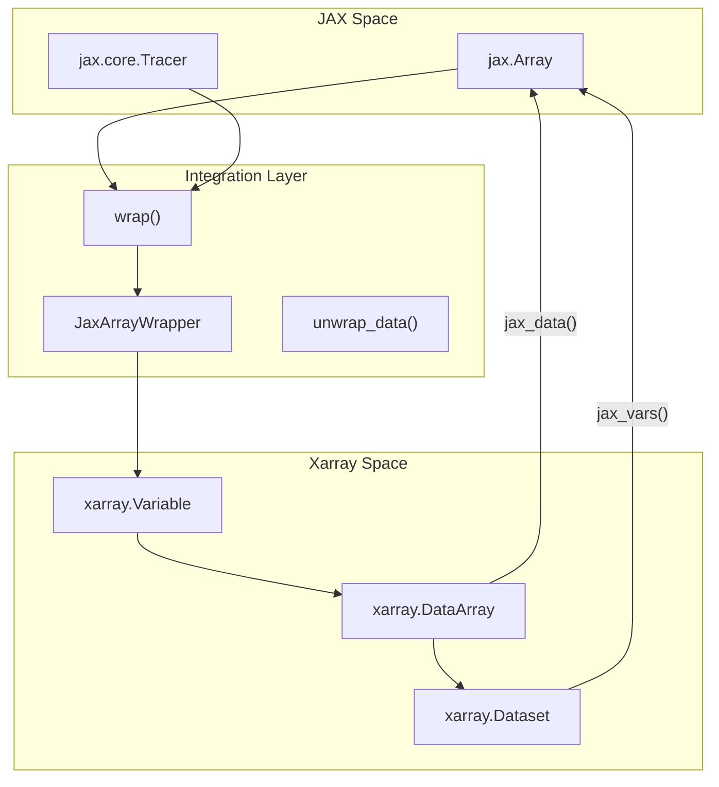
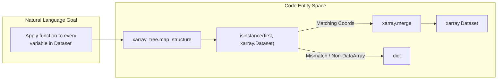

<!-- source: DeepWiki mcp.deepwiki.com · repo google-deepmind/weathernext · page 4.3 xarray–JAX Integration Layer · patched3 2026-10-26 -->

# xarray–JAX Integration Layer
# xarray–JAX Integration Layer

Relevant source files

The following files were used as context for generating this wiki page:

- [weathernext/utils/xarray_dense.py](weathernext/utils/xarray_dense.py)
- [weathernext/utils/xarray_tree.py](weathernext/utils/xarray_tree.py)
- [weathernext/utils/xarray_tree_test.py](weathernext/utils/xarray_tree_test.py)

The xarray–JAX integration layer provides a bridge between `xarray`'s labeled multidimensional arrays and JAX's high-performance computing capabilities. It enables the use of `xarray.Dataset`, `DataArray`, and `Variable` objects directly within JAX transformations (like `jit`, `vmap`, and `pmap`) without converting data to NumPy arrays, thus preserving gradients and device placement. Furthermore, modules like `xarray_tree.py` and `xarray_dense.py` facilitate PyTree-based traversal and dense neural network operations directly over xarray structures.

## Core Architecture and PyTree Treatment

To allow `xarray` to handle JAX arrays seamlessly, integration utilities wrap JAX arrays in specialized proxy structures and register xarray types with JAX's PyTree registry (`jax.tree_util.register_pytree_node`). 

*   **Leaves**: The underlying data arrays (wrapped JAX arrays).
*   **Auxiliary Data**: Metadata including dimension names, coordinates (treated as static), and attributes.

### Data Flow: Code Entity Space
The following diagram illustrates how JAX arrays transition into the xarray ecosystem and are traversed via PyTree utilities.

*Sources: [weathernext/utils/xarray_tree.py:36-40]()*, [weathernext/utils/xarray_dense.py:30-31]()

---

## Dataset Traversal with `xarray_tree.py`

While `jax.tree_util.tree_map` operates on underlying JAX arrays, `xarray_tree.map_structure` operates at the `xarray.DataArray` level [weathernext/utils/xarray_tree.py:36-40](). This is utilized when a function needs to process every variable in a `Dataset` while maintaining access to labels, dimensions, and coordinates.

### Implementation Details

`xarray_tree.map_structure` executes the following logic:
1.  **Dataset Inspection**: If the input structure is an `xarray.Dataset`, it iterates over all keys (variables) [weathernext/utils/xarray_tree.py:55-56]().
2.  **Function Application**: Applies the provided callable `func` to each constituent `DataArray` [weathernext/utils/xarray_tree.py:56-56]().
3.  **Reconstruction**: If the function returns `DataArray` objects (or `None`), it attempts an `xarray.merge(..., join='exact', compat='override')` to return a reconstructed `Dataset` [weathernext/utils/xarray_tree.py:57-61](). If variables are returned with `None`, they are omitted from the resulting dataset [weathernext/utils/xarray_tree.py:59-59]().
4.  **Fallback**: If coordinates do not match or non-DataArray values are returned, it falls back to returning a plain Python `dict` [weathernext/utils/xarray_tree.py:62-64]().

### Natural Language to Code: Mapping Structure Traversal

*Sources: [weathernext/utils/xarray_tree.py:47-70]()*, [weathernext/utils/xarray_tree_test.py:35-85]()*

---

## Dense Layer Application Over Datasets (`xarray_dense.py`)

The `weathernext/utils/xarray_dense.py` module provides dense neural network layers designed specifically for mappings of xarray DataArrays (such as variables in a weather forecast dataset).

### Key Components

*   **`coord_to_str`**: Converts coordinate values for a given dimension into a readable string format `{dim_name}={comma_separated_coord_values}`. Timedeltas are automatically cast to seconds, and compact representations are generated for contiguous ranges [weathernext/utils/xarray_dense.py:33-67]().
*   **`DataArrayDictDenseEncoder`**: A Haiku module (`hk.Module`) that encodes a mapping of data arrays using dense layers [weathernext/utils/xarray_dense.py:88-134](). 

### Dimension Splitting and Grouping

`DataArrayDictDenseEncoder` categorizes input dimensions into three distinct groups:
1.  **`preserved_dims`**: Dimensions preserved in the output as leading dimensions (e.g., batch, latitude, longitude). Sizes and coordinates must remain consistent across input data arrays [weathernext/utils/xarray_dense.py:105-107]().
2.  **`dims_to_split`**: Dimensions across which variables have separate parameter arrays, allowing fine-grained parameter isolation (e.g., splitting by time steps or levels) [weathernext/utils/xarray_dense.py:108-109]().
3.  **`dims_to_keep`**: Remaining dimensions kept together within the same parameter array [weathernext/utils/xarray_dense.py:110-111]().

Despite parameter splitting across inputs, the actual matrix multiplication concatenates data and parameters into a single operation, maintaining computational efficiency equivalent to pre-concatenated inputs [weathernext/utils/xarray_dense.py:92-101]().

*Sources: [weathernext/utils/xarray_dense.py:33-162]()*, [weathernext/utils/xarray_dense.py:88-134]()*

---

## Summary of Key Integration Utilities

| Class / Function | File Path | Role |
| :--- | :--- | :--- |
| `map_structure` | `weathernext/utils/xarray_tree.py:47-70` | Maps functions over xarray trees, treating `DataArray` as leaves and preserving `Dataset` types where possible. |
| `coord_to_str` | `weathernext/utils/xarray_dense.py:33-67` | Generates string representations of xarray coordinates for parameter naming. |
| `DataArrayDictDenseEncoder` | `weathernext/utils/xarray_dense.py:88-162` | Haiku dense encoder supporting flexible dimension splitting (`preserved_dims`, `dims_to_split`) over DataArray mappings. |

*Sources: [weathernext/utils/xarray_tree.py:47-70]()*, [weathernext/utils/xarray_dense.py:33-162]()*

---

