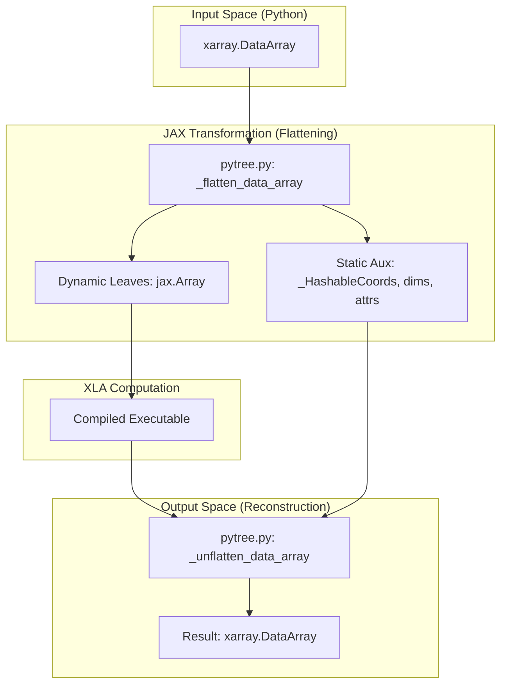
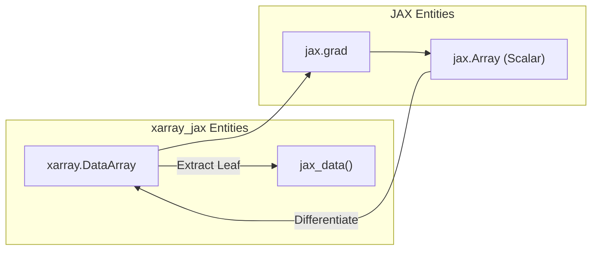

<!-- source: DeepWiki mcp.deepwiki.com · repo google-deepmind/xarray_jax · page 1.1 Getting Started · fetched 2026-10-26 -->

# Getting Started

<details>
<summary>Relevant source files</summary>

The following files were used as context for generating this wiki page:

- [README.md](README.md)
- [pyproject.toml](pyproject.toml)

</details>


This page provides the essential information for installing `xarray_jax` and using it to integrate `xarray` data structures into JAX-accelerated workflows. The library's primary function is to register `xarray` types as JAX PyTrees, enabling them to pass through transformations like `jax.jit`, `jax.grad`, and `jax.vmap` while preserving metadata.

## Installation and Dependencies

`xarray_jax` is distributed as a Python package requiring modern versions of JAX and xarray.

### System Requirements
*   **Python**: `3.10+` (Note: `pyproject.toml` specifies `>=3.13` for the current build environment).
*   **JAX**: `>=0.4.30`
*   **NumPy**: `>=1.24`
*   **xarray**: `>=2026.01.0`

### Installation Commands
To install a specific release directly from the repository:
```bash
pip install git+https://github.com/google-deepmind/xarray_jax.git@v0.1.0
```

For development and testing, you can install the optional test dependencies:
```bash
pip install "gdm-xarray-jax[test]"
```

**Sources:**
* [README.md:1-15]()
* [pyproject.toml:12-34]()

---

## Minimal Working Example: JIT Compilation

The core utility of `xarray_jax` is allowing `jax.jit` to accept and return `xarray.DataArray` or `xarray.Dataset` objects. When a function is JIT-compiled, `xarray_jax` flattens the xarray object into a list of JAX arrays (dynamic leaves) and a set of metadata (static auxiliary data).

### Data Flow in JIT Transformation

The following diagram illustrates how an `xarray.DataArray` moves through a JIT-compiled function.

**Diagram: JIT Data Flow for xarray.DataArray**


**Sources:**
* [README.md:42-81]()
* [pytree.py:1-10]() (Conceptual registration)

### Example Implementation
The following example demonstrates creating a `DataArray` with JAX data and processing it within a JIT-compiled function.

```python
import jax
import jax.numpy as jnp
import xarray as xr
import numpy as np
import xarray_jax

# 1. Initialize DataArray with JAX arrays
temperature = xr.DataArray(
    data=jnp.array([[20.5, 21.2, 22.1], [18.3, 19.7, 20.8]]),
    dims=('time', 'location'),
    coords={
        'time': np.array(['2023-01-01', '2023-01-02'], dtype='datetime64[D]'),
        'location': ['NYC', 'LA', 'Chicago']
    }
)

# 2. Define a function using standard xarray methods
@jax.jit
def process_temperature(temp_data):
    # Arithmetic and reductions are supported
    fahrenheit = temp_data * 9/5 + 32
    return fahrenheit.mean(dim='location')

# 3. Execute
result = process_temperature(temperature)
```

**Sources:**
* [README.md:42-81]()

---

## Basic Usage Patterns

### Computing Gradients
`xarray_jax` supports `jax.grad` for differentiating through xarray operations. Because `jax.grad` requires a scalar output, users must typically extract the underlying JAX scalar from the resulting `DataArray` using the `.data` attribute or `xarray_jax.jax_data`.

**Diagram: Gradient Computation Entities**


**Sources:**
* [README.md:89-119]()

### Working with Datasets
`xarray.Dataset` objects are handled similarly to `DataArray`. All variables within the dataset are treated as dynamic leaves if they contain JAX-compatible arrays.

```python
weather_data = xr.Dataset(
    {
        'temperature': (['time', 'location'], jnp.array([[20.5, 21.2], [18.3, 19.7]])),
        'humidity': (['time', 'location'], jnp.array([[0.65, 0.72], [0.58, 0.69]]))
    }
)

@jax.jit
def weather_model(data):
    # Assigning new variables within JIT is supported
    heat_index = data.temperature + (data.humidity * 10)
    return data.assign(heat_index=heat_index)

result = weather_model(weather_data)
```

**Sources:**
* [README.md:121-160]()

### Coordinate Handling
By default, `xarray` coordinates are treated as **static** metadata. This means:
1.  They are passed as auxiliary data during PyTree flattening.
2.  Changes to coordinate values will trigger a JAX recompilation.
3.  Standard NumPy-based coordinates (like `datetime64`) are recommended for stability.

**Sources:**
* [README.md:49-59]()
* [README.md:184-185]()

---

