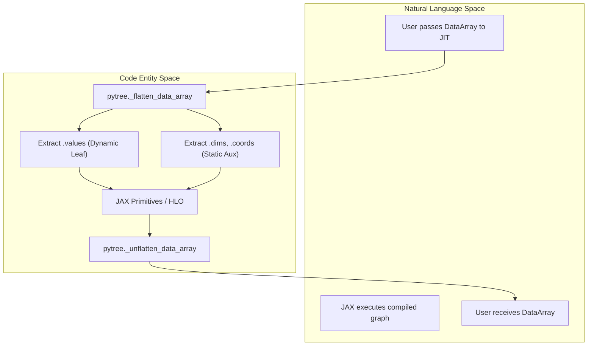
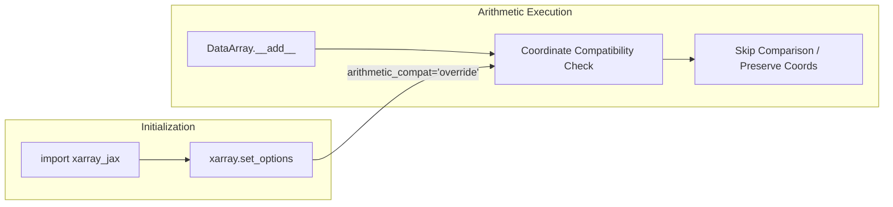

<!-- source: DeepWiki mcp.deepwiki.com · repo google-deepmind/xarray_jax · page 1.2 Key Concepts and Design Philosophy · fetched 2026-10-26 -->

# Key Concepts and Design Philosophy

<details>
<summary>Relevant source files</summary>

The following files were used as context for generating this wiki page:

- [README.md](README.md)
- [xarray_jax/__init__.py](xarray_jax/__init__.py)
- [xarray_jax/core.py](xarray_jax/core.py)

</details>


This page explains the core tension between `xarray`'s metadata-heavy model and JAX's functional/pure-function requirements. It covers the static-vs-dynamic split, the PyTree registration approach, and global configuration for arithmetic compatibility.

## The Core Tension: Metadata vs. Purity

`xarray` is designed for labeled multi-dimensional arrays where metadata (dimensions, coordinates, and attributes) is deeply integrated with the data [xarray_jax/__init__.py:14-20](). In contrast, JAX requires "pure" functions and operates on `PyTrees`—nested structures where leaves are arrays and the structure itself is static during compilation.

The primary challenge is that `xarray` objects (like `DataArray` and `Dataset`) are not natively registered as JAX PyTrees [README.md:23-26](). Without registration, JAX cannot "see" the underlying arrays to differentiate through them or JIT-compile operations on them.

### The Static-vs-Dynamic Split

To bridge these worlds, `xarray_jax` splits an `xarray` object into two parts during JAX transformations:
1.  **Dynamic Leaves (Children):** The actual array data (e.g., `data` in a `DataArray` or variables in a `Dataset`) that JAX can manipulate as tracers or buffers [README.md:28-33]().
2.  **Static Metadata (Auxiliary Data):** Dimension names, attributes, and "static" coordinates. These are treated as part of the tree structure [xarray_jax/__init__.py:72-78]().

**Implication:** If you call a JIT-compiled function with two `Dataset` objects that have different coordinate values, JAX will trigger a recompilation because the "static" structure has changed [xarray_jax/__init__.py:74-77]().

Sources: [xarray_jax/__init__.py:14-82](), [README.md:16-33](), [xarray_jax/core.py:38-45]()

## PyTree Registration

`xarray_jax` registers `xarray.Variable`, `xarray.DataArray`, `xarray.Dataset`, and `DataTree` with JAX's `tree_util` [xarray_jax/__init__.py:45-47](). This allows these types to be used directly as arguments and return values in `jax.jit`, `jax.grad`, and other transformations [README.md:49-81]().

### The Flatten/Unflatten Lifecycle

The diagram below illustrates how `xarray_jax` enables a `jax.jit` boundary to process a `DataArray`.

**Data Flow: xarray to JAX and Back**

Sources: [xarray_jax/pytree.py:1-150](), [README.md:28-33](), [xarray_jax/__init__.py:45-53]()

## Coordinate Management Strategies

Coordinates in `xarray` are traditionally used for indexing (e.g., `.sel(time='2023-01-01')`). However, JAX tracers cannot be used in `xarray`'s indexing logic because it involves non-pure Python code and library-level dispatching [xarray_jax/core.py:53-58]().

`xarray_jax` provides two ways to handle coordinates:

| Feature | Static Coordinates (Default) | JAX Coordinates (`jax_coords`) |
| :--- | :--- | :--- |
| **Data Type** | NumPy arrays / Scalars | JAX arrays / Tracers |
| **JAX Treatment** | Static (triggers recompile on change) | Dynamic (treated as PyTree leaves) |
| **Indexing** | Supports `.sel` and `.isel` | No indexing support (empty indexes) |
| **Purpose** | Fixed grids, time axes, labels | Differentiable coordinates, dynamic metadata |

### JAX Coordinates (`jax_coords`)
The `jax_coords` feature is an experimental mechanism to allow coordinates to be treated as dynamic data [xarray_jax/core.py:49-52](). These are marked internally with the `_jax_coord` attribute [xarray_jax/core.py:23-23](). Because `xarray` tries to build indexes for coordinates sharing names with dimensions, `xarray_jax` explicitly suppresses index creation for these to prevent `TracerBoolConversionError` [xarray_jax/core.py:139-142]().

Sources: [xarray_jax/core.py:23-114](), [xarray_jax/__init__.py:64-82]()

## Global Arithmetic Configuration

A significant design choice in `xarray_jax` is the global override of `xarray`'s arithmetic behavior.

```python
# From xarray_jax/__init__.py
xarray.set_options(arithmetic_compat='override')
```
[xarray_jax/__init__.py:173-173]()

### Why `arithmetic_compat='override'`?
By default, `xarray` uses `minimal` compatibility, which performs checks to ensure coordinates match before performing arithmetic (e.g., `ds1 + ds2`). These checks often involve boolean comparisons of coordinate arrays. When those coordinates contain JAX Tracers, these comparisons raise a `jax.errors.TracerBoolConversionError` [xarray_jax/__init__.py:145-151]().

Setting this to `override` disables these checks for non-index coordinates during arithmetic, allowing JAX coordinates to flow through operations without crashing the JIT compiler [xarray_jax/__init__.py:158-161]().

**System Configuration Relationship**

Sources: [xarray_jax/__init__.py:145-173]()

## Summary of Design Philosophy
1.  **Immutability:** Leverages JAX's functional paradigm while maintaining `xarray`'s API.
2.  **Transparency:** Uses standard `xarray` objects rather than custom subclasses where possible, relying on PyTree registration for interoperability [README.md:28-33]().
3.  **Explicit Staticity:** Forces a distinction between static metadata (which triggers recompilation) and dynamic data (which JAX transforms) to provide predictable performance [xarray_jax/__init__.py:72-78]().

---

