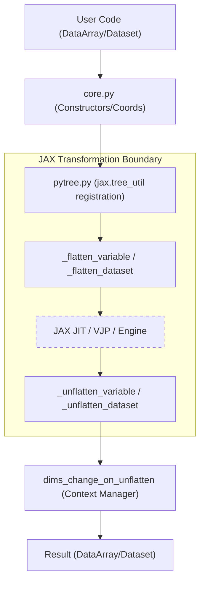

<!-- source: DeepWiki mcp.deepwiki.com · repo google-deepmind/xarray_jax · page 2 Core Architecture · fetched 2026-10-26 -->

# Core Architecture

<details>
<summary>Relevant source files</summary>

The following files were used as context for generating this wiki page:

- [xarray_jax/__init__.py](xarray_jax/__init__.py)
- [xarray_jax/core.py](xarray_jax/core.py)
- [xarray_jax/pytree.py](xarray_jax/pytree.py)

</details>


The `xarray_jax` library is structured around three primary modules that enable seamless integration between `xarray` data structures and the JAX transformation ecosystem. This architecture ensures that `xarray.Dataset`, `DataArray`, and `Variable` objects can be treated as JAX PyTrees while maintaining their rich metadata (dimensions, coordinates, and attributes).

## Three-Module Architecture

The system is divided into functional layers that handle PyTree registration, core data structure construction, and specialized JAX transformation wrappers.

### 1. PyTree Registration (`pytree.py`)
This module is the foundation of the library. it registers `xarray` types with `jax.tree_util` [xarray_jax/pytree.py:155-155](). It defines the logic for "flattening" an xarray object into dynamic JAX leaves (the data) and static auxiliary data (the metadata like dimension names).

Key components include:
*   **Flatten/Unflatten Logic**: Functions like `_flatten_variable` [xarray_jax/pytree.py:200-201]() and `_unflatten_variable` [xarray_jax/pytree.py:222-223]() that separate data from metadata.
*   **NonArrayLeafWrapper**: A shim class that allows non-array values (like scalars or JAX `ShapeDtypeStruct`) to be re-inserted into xarray objects during transformations [xarray_jax/pytree.py:83-93]().
*   **Dimension Management**: The `dims_change_on_unflatten` context manager [xarray_jax/pytree.py:164-182]() allows JAX to reconstruct xarray objects even when the underlying array shapes change (e.g., after a `vmap`).

For details, see [PyTree Registration (pytree.py)](#2.1).

### 2. Core Constructors and Coordinates (`core.py`)
This module provides the user-facing entry points for creating JAX-compatible xarray objects. It handles the complexity of coordinate management, specifically distinguishing between "static" coordinates (standard xarray) and "dynamic" coordinates (`jax_coords`).

Key components include:
*   **Custom Constructors**: `xarray_jax.DataArray` [xarray_jax/core.py:26-33]() and `xarray_jax.Dataset` [xarray_jax/core.py:73-78]() which wrap standard xarray constructors but add support for JAX-backed coordinates.
*   **Coordinate Assignment**: Functions like `assign_jax_coords` [xarray_jax/core.py:93-93]() and `get_jax_coords` [xarray_jax/core.py:94-94]() manage the `JAX_COORD_ATTR_NAME` marker [xarray_jax/core.py:23-23]() used to identify dynamic coordinates.

For details, see [Core Constructors and Coordinate Management (core.py)](#2.2).

### 3. JAX Transformations (`jax_transforms.py`)
Standard JAX transformations like `jax.vmap` often fail on xarray objects because they do not know how to update the dimension metadata when adding or removing axes. This module provides specialized wrappers that use the utilities in `pytree.py` to keep metadata in sync.

Key components include:
*   **Transformation Wrappers**: `vmap`, `pmap`, and `scan` [xarray_jax/__init__.py:97-103]() that automatically handle dimension propagation.
*   **Mapping Utilities**: `tree_map_variables` and `tree_map_with_dims` [xarray_jax/jax_transforms.py:101-102]() for applying functions across xarray structures while accessing dimension information.

**Sources:** [xarray_jax/__init__.py:88-114](), [xarray_jax/core.py:14-23](), [xarray_jax/pytree.py:14-27]()

---

## System Interaction Flow

The following diagram illustrates how a user-defined function interacts with the different modules when wrapped in a JAX transformation like `jax.jit`.

### Data Flow: User Code to JAX Runtime

**Sources:** [xarray_jax/pytree.py:164-192](), [xarray_jax/pytree.py:200-240](), [xarray_jax/core.py:26-78]()

---

## Code Entity Mapping

This table and diagram bridge the gap between high-level architectural concepts and the specific symbols in the codebase.

| Architectural Role | Code Entity (File:Symbol) |
| :--- | :--- |
| **PyTree Flattening** | `pytree.py`: `_flatten_variable`, `_flatten_data_array`, `_flatten_dataset` |
| **PyTree Unflattening** | `pytree.py`: `_unflatten_variable`, `_unflatten_data_array`, `_unflatten_dataset` |
| **Coordinate Marker** | `core.py`: `JAX_COORD_ATTR_NAME` |
| **Dynamic Leaf Handling** | `pytree.py`: `NonArrayLeafWrapper` |
| **Metadata Sync** | `pytree.py`: `dims_change_on_unflatten` |
| **Transformation API** | `jax_transforms.py`: `vmap`, `pmap`, `scan` |

### Code Relationship Diagram
```mermaid
graph LR
    subgraph "xarray_jax.core"
        "core.DataArray" --> "core.assign_coords"
        "core.Dataset" --> "core.assign_coords"
        "core.assign_coords" -- "Marks JAX Coords" --> "core.JAX_COORD_ATTR_NAME"
    end

    subgraph "xarray_jax.pytree"
        "pytree._flatten_dataset" -- "Extracts" --> "Dynamic Leaves (jax.Array)"
        "pytree._unflatten_dataset" -- "Wraps" --> "pytree.NonArrayLeafWrapper"
        "pytree._unflatten_dataset" -- "Reads" --> "pytree._DIMS_CHANGE_ON_UNFLATTEN_FN"
    end

    subgraph "xarray_jax.jax_transforms"
        "jax_transforms.vmap" -- "Sets" --> "pytree.dims_change_on_unflatten"
        "jax_transforms.vmap" -- "Calls" --> "jax.vmap"
    end
```
**Sources:** [xarray_jax/core.py:23-114](), [xarray_jax/pytree.py:83-200](), [xarray_jax/jax_transforms.py:97-103]()

---

## Child Pages
*   [PyTree Registration (pytree.py)](#2.1) — Detailed internals of the flatten/unflatten process and leaf wrapping.
*   [Core Constructors and Coordinate Management (core.py)](#2.2) — Documentation on coordinate handling and the static vs. dynamic split.

---

