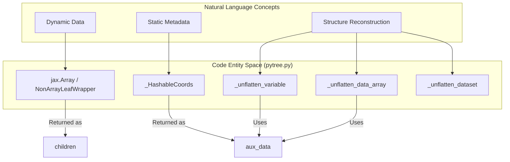
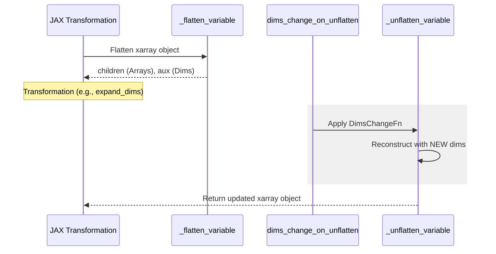

<!-- source: DeepWiki mcp.deepwiki.com · repo google-deepmind/xarray_jax · page 2.1 PyTree Registration (pytree.py) · fetched 2026-10-26 -->

# PyTree Registration (pytree.py)

Relevant source files

The following files were used as context for generating this wiki page:

- [xarray_jax/pytree.py](xarray_jax/pytree.py)
- [xarray_jax/tests/pytree_test.py](xarray_jax/tests/pytree_test.py)

This page provides a high-level overview of how `xarray_jax` integrates `xarray` data structures into the JAX ecosystem by registering them as PyTrees. This registration allows `xarray.Variable`, `DataArray`, `Dataset`, and `DataTree` objects to be passed directly into JAX transformations like `jax.jit`, `jax.grad`, and `jax.vmap`.

The registration logic is primarily contained within `xarray_jax/pytree.py` [xarray_jax/pytree.py:1-300]().

## Overview of PyTree Registration

JAX operates on PyTrees, which are tree-like structures composed of "leaves" (typically JAX arrays) and "nodes" (Python containers). To make `xarray` objects compatible, `xarray_jax` defines how to "flatten" these objects into a list of JAX arrays and "unflatten" them back into their original `xarray` types.

### Key Components of the Registration

*   **Dynamic Leaves**: The actual data arrays (the `.data` attribute of Variables and DataArrays) are treated as dynamic leaves that JAX can transform [xarray_jax/pytree.py:200-205]().
*   **Static Metadata**: Metadata such as dimension names, attributes, and non-JAX coordinates are treated as "auxiliary data." This data is static and used by JAX to cache compiled functions [xarray_jax/pytree.py:206-210]().
*   **Coordinate Handling**: Coordinates are split between static metadata and dynamic leaves based on whether they are marked as `jax_coords` [xarray_jax/pytree.py:231-240]().

### Conceptual Mapping: Natural Language to Code Entities

The following diagram illustrates how abstract `xarray` concepts map to specific implementation entities in the `xarray_jax` PyTree registration system.

**Registration Mapping Diagram**

Sources: [xarray_jax/pytree.py:83-154](), [xarray_jax/pytree.py:200-215](), [xarray_jax/pytree.py:242-260]()

## Flatten and Unflatten Internals

The core of the registration lies in the `_flatten_*` and `_unflatten_*` function pairs for each `xarray` type. These functions ensure that the internal state of `xarray` objects—including nested attributes and complex coordinate mappings—is preserved across JAX transformations.

| Xarray Type | Flatten Function | Unflatten Function |
| :--- | :--- | :--- |
| `xarray.Variable` | `_flatten_variable` | `_unflatten_variable` |
| `xarray.DataArray` | `_flatten_data_array` | `_unflatten_data_array` |
| `xarray.Dataset` | `_flatten_dataset` | `_unflatten_dataset` |
| `xarray.DataTree` | `_flatten_datatree` | `_unflatten_datatree` |

For a deep dive into the logic of these functions, including how they handle `aux_data` hashing for JIT stability, see **[Flatten and Unflatten Internals](#2.1.1)**.

Sources: [xarray_jax/pytree.py:200-290](), [xarray_jax/tests/pytree_test.py:27-90]()

## Specialized Handling

### NonArrayLeafWrapper
During certain JAX operations (like `jax.eval_shape`), leaves may be replaced by `ShapeDtypeStruct` or other non-array objects. `xarray_jax` uses `NonArrayLeafWrapper` to wrap these values, providing a minimal duck-typed interface that allows `xarray` constructors to accept them without error [xarray_jax/pytree.py:83-112]().

### Dimension Change Handling
When JAX transformations change the rank or shape of an array (e.g., `vmap` adding a batch dimension), the static metadata in the PyTree definition may become stale. The `dims_change_on_unflatten` context manager allows developers to provide a function that updates dimension names dynamically during the unflattening process [xarray_jax/pytree.py:164-192]().

For more information on these utilities, see **[NonArrayLeafWrapper and Dimension Change Handling](#2.1.2)**.

**PyTree Lifecycle with Dimension Changes**

Sources: [xarray_jax/pytree.py:164-198](), [xarray_jax/tests/pytree_test.py:92-120]()

## Summary of Data Extraction Utilities

`pytree.py` also provides several public utilities for extracting raw JAX arrays from `xarray` structures, which is often necessary when interfacing with pure JAX functions.

*   `unwrap_data`: Extracts the underlying array from a `Variable` or `DataArray` [xarray_jax/pytree.py:42-47]().
*   `jax_data`: Similar to `unwrap_data`, but enforces that the result is a `jax.Array` [xarray_jax/pytree.py:70-74]().
*   `unwrap_vars`: Extracts a dictionary of arrays from a `Dataset` [xarray_jax/pytree.py:50-58]().
*   `unwrap_coords`: Extracts a dictionary of coordinate arrays [xarray_jax/pytree.py:61-67]().

Sources: [xarray_jax/pytree.py:29-81]()

---

