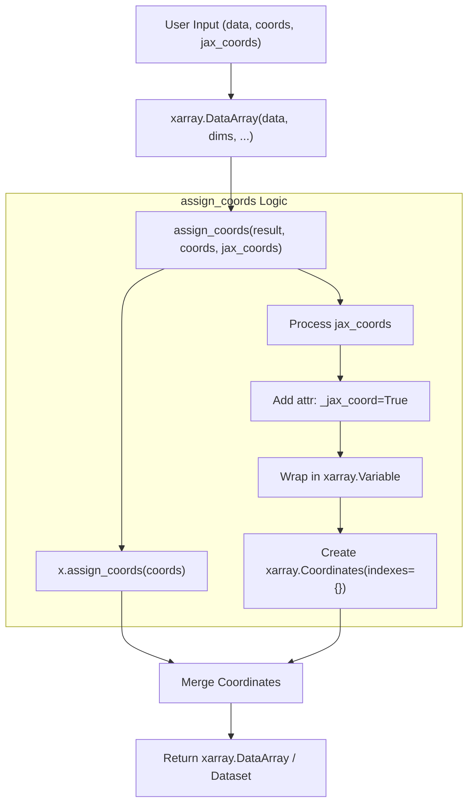
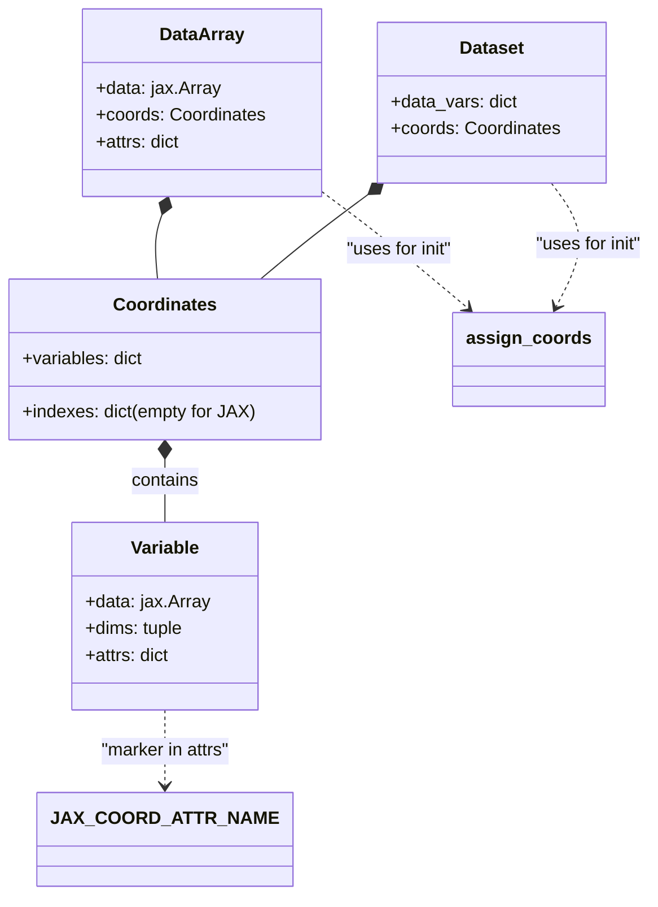

<!-- source: DeepWiki mcp.deepwiki.com · repo google-deepmind/xarray_jax · page 2.2 Core Constructors and Coordinate Management (core.py) · fetched 2026-10-26 -->

# Core Constructors and Coordinate Management (core.py)

Relevant source files

The following files were used as context for generating this wiki page:

- [xarray_jax/core.py](xarray_jax/core.py)
- [xarray_jax/tests/xarray_jax_test.py](xarray_jax/tests/xarray_jax_test.py)

This page documents the core user-facing constructors and coordinate management system in `xarray_jax`. The library provides drop-in replacements for standard `xarray` constructors that are optimized for JAX compatibility, specifically addressing the tension between static metadata and dynamic JAX tracers.

## Overview of Constructors

`xarray_jax` provides `DataArray` and `Dataset` constructors that wrap the standard `xarray` versions. While they accept standard `xarray` arguments, they introduce the `jax_coords` parameter to handle coordinates that need to remain dynamic (tracers) during JAX transformations like `jit`, `vmap`, or `grad`.

### DataArray and Dataset
The `xarray_jax.DataArray` and `xarray_jax.Dataset` functions are the primary entry points for creating JAX-compatible xarray objects [xarray_jax/core.py:26-33](), [xarray_jax/core.py:73-78]().

| Feature | Standard `coords` | `jax_coords` |
| :--- | :--- | :--- |
| **Data Type** | NumPy / Static constants | JAX Arrays / Tracers |
| **JIT Behavior** | Treated as static (triggers recompile on change) | Treated as dynamic (passed as tracers) |
| **Indexing** | Supports `.sel()` and Indexing | No index created (empty indexes) |
| **Implementation** | Standard `xarray.Variable` | `xarray.Variable` + `_jax_coord` attribute |

**Sources:** [xarray_jax/core.py:38-64](), [xarray_jax/core.py:83-107]()

## Coordinate Management Mechanism

The core challenge in `xarray_jax` is that `xarray` typically attempts to create pandas-based indexes for coordinates that share a name with a dimension. Because JAX tracers cannot be converted to pandas indexes, `xarray_jax` uses a specific "empty index" strategy.

### The `jax_coords` Logic
When a coordinate is passed via `jax_coords`, the library:
1.  Wraps the data in an `xarray.Variable`.
2.  Tags the variable with a special marker attribute `JAX_COORD_ATTR_NAME` (defined as `_jax_coord`) [xarray_jax/core.py:23](), [xarray_jax/core.py:165-167]().
3.  Uses `xarray.Coordinates` with explicitly empty indexes to prevent `xarray` from attempting to build a pandas index [xarray_jax/core.py:171-175]().

### Data Flow: Constructor to Object
The following diagram illustrates how the `DataArray` constructor processes standard vs. JAX coordinates.

**Constructor Data Flow**

**Sources:** [xarray_jax/core.py:69-70](), [xarray_jax/core.py:157-175]()

## Key Functions

### `assign_coords`
The `xarray_jax.assign_coords` function is a replacement for the standard `DataArray.assign_coords` method. It is designed to handle the mixture of static NumPy coordinates and dynamic JAX coordinates [xarray_jax/core.py:125-130]().

*   **Static Branch**: If `coords` is provided, it calls the native `x.assign_coords(coords)` [xarray_jax/core.py:157]().
*   **JAX Branch**: For `jax_coords`, it iterates through the mapping, creates `xarray.Variable` objects, and assigns the `_jax_coord` attribute [xarray_jax/core.py:160-167]().

### `get_jax_coords`
This utility extracts only the coordinates that have been marked with the `_jax_coord` attribute [xarray_jax/core.py:214-215](). It is useful for inspecting which parts of the metadata will be treated as dynamic leaves in a PyTree.

### `assign_jax_coords`
A convenience wrapper that calls `assign_coords` with only the `jax_coords` argument [xarray_jax/core.py:202-206]().

**Sources:** [xarray_jax/core.py:154-177](), [xarray_jax/core.py:202-225]()

## Code Entity Map

The following diagram maps the relationship between the user-facing API and the internal markers used to maintain JAX compatibility.

**API and Marker Relationship**

**Sources:** [xarray_jax/core.py:23](), [xarray_jax/core.py:69-70](), [xarray_jax/core.py:112-114](), [xarray_jax/core.py:165-175]()

## Implementation Details: Why Empty Indexes?

In standard `xarray`, a coordinate named `lat` for a dimension `lat` automatically creates a `pandas.Index`. JAX tracers (like those produced during `jax.vmap`) cannot be stored in a `pandas.Index` because pandas requires concrete NumPy arrays. 

By passing `indexes={}` to the `xarray.Coordinates` constructor [xarray_jax/core.py:173](), `xarray_jax` forces `xarray` to treat the coordinate as a "non-index coordinate." This allows the data to remain a JAX tracer while still being associated with the correct dimensions and metadata.

**Consequences:**
*   **No `.sel()`**: Since there is no index, coordinate-based lookups using `.sel(lat=10.0)` will fail for `jax_coords` [xarray_jax/core.py:57-58]().
*   **Functional Alignment**: This aligns with JAX's functional paradigm where metadata (dimensions) is static, but coordinate values can be transformed dynamically [xarray_jax/core.py:49-52]().

**Sources:** [xarray_jax/core.py:53-58](), [xarray_jax/core.py:96-101](), [xarray_jax/core.py:171-175]()

---

