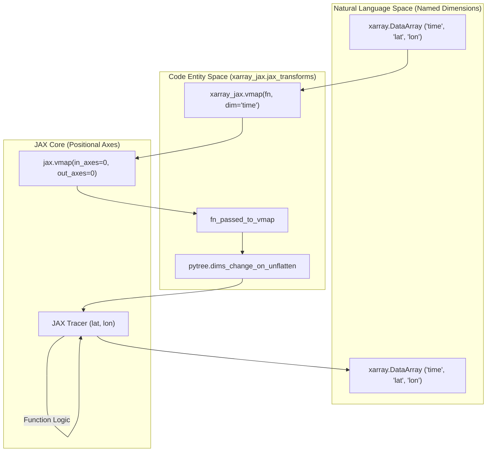
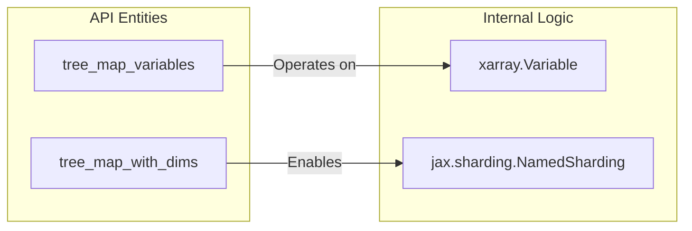

<!-- source: DeepWiki mcp.deepwiki.com · repo google-deepmind/xarray_jax · page 3 JAX Transformations · fetched 2026-10-26 -->

# JAX Transformations

Relevant source files

The following files were used as context for generating this wiki page:

- [README.md](README.md)
- [xarray_jax/jax_transforms.py](xarray_jax/jax_transforms.py)

This page provides an overview of the specialized JAX transformation wrappers provided by `xarray_jax`. While standard JAX transformations like `jax.jit` and `jax.grad` work out-of-the-box once `xarray` objects are registered as PyTrees, certain transformations like `vmap`, `pmap`, and `scan` require dimension-aware handling to maintain the consistency of `xarray` metadata (dimension names and coordinates) during the transformation process.

## Why Specialized Wrappers?

Standard `jax.vmap` or `jax.lax.scan` operate on raw array axes (integers). When JAX flattens an `xarray.DataArray` into a PyTree, it extracts the underlying array. However, transformations often change the rank or interpretation of these axes (e.g., stripping a mapped dimension or adding a leading batch dimension). 

If a standard `jax.vmap` is used, the "unflattening" process might fail or produce inconsistent results because the static metadata (the dimension names stored in the PyTree's auxiliary data) no longer matches the shape of the transformed JAX tracers. The wrappers in `xarray_jax.jax_transforms` solve this by:
1.  **Validating** that the named dimension exists at the expected axis (usually axis 0).
2.  **Intercepting** the unflattening process using a context manager to temporarily modify dimension metadata.
3.  **Restoring** or **Removing** dimension names to ensure the resulting `xarray` object is valid.

### Transformation Architecture

The following diagram illustrates how `xarray_jax` bridges the gap between named dimensions and JAX's axis-based transformations.

**Transformation Lifecycle**

Sources: [xarray_jax/jax_transforms.py:23-91](), [xarray_jax/pytree.py:102-120]()

---

## vmap and pmap

The `xarray_jax.vmap` and `xarray_jax.pmap` functions are thin wrappers around their JAX counterparts. They are designed for cases where you need to vectorize a function over a specific named `xarray` dimension.

**Key Characteristics:**
*   **Leading Axis Constraint:** The dimension being mapped (`dim`) must be the first dimension in the input `DataArray` or `Dataset`. Users should use `.transpose(dim, ...)` if necessary before calling the wrapper [xarray_jax/jax_transforms.py:30-33]().
*   **Dimension Stripping:** Inside the transformed function, the mapped dimension is removed from the `xarray` object's metadata so that the function sees the data as if that dimension does not exist [xarray_jax/jax_transforms.py:58-66]().
*   **Dimension Restoration:** When the function returns, the wrapper restores the mapped dimension name to the leading position of the result [xarray_jax/jax_transforms.py:88-89]().

For details, see [vmap and pmap](#3.1).

Sources: [xarray_jax/jax_transforms.py:23-91](), [xarray_jax/jax_transforms.py:94-164]()

---

## scan

The `xarray_jax.scan` function wraps `jax.lax.scan`. It allows for iterative processing over a named dimension while maintaining `xarray` structures for both the "carry" and the "stacked" output.

**Key Characteristics:**
*   **Dimension Alignment:** It automatically transposes the scan dimension to axis 0 before calling the underlying JAX primitive [xarray_jax/jax_transforms.py:350-354]().
*   **Coordinate Handling:** It attempts to preserve coordinates where possible, though static coordinates along the scanned dimension are typically lost in the "carry" but preserved in the "stacked" output [xarray_jax/jax_transforms.py:317-320]().

For details, see [scan](#3.2).

Sources: [xarray_jax/jax_transforms.py:308-417]()

---

## Utility Tree Maps

Beyond standard JAX transformations, `xarray_jax` provides specialized tree-mapping utilities that treat `xarray` objects differently than standard JAX PyTree leaves.

| Function | Purpose | Leaf Type |
| :--- | :--- | :--- |
| `tree_map_variables` | Maps a function over all `xarray.Variable` objects in a tree. | `xarray.Variable` |
| `tree_map_with_dims` | Maps a function over arrays while providing the dimension names as an argument. | `jax.Array` (with dims) |

**Code Entity Mapping**

Sources: [xarray_jax/jax_transforms.py:169-204](), [xarray_jax/jax_transforms.py:207-251]()

### tree_map_variables
This utility is useful when you need to inspect or modify dimension names during a tree map operation. Unlike `jax.tree.map`, which descends into the `Variable` to find the underlying array, this treats the `Variable` itself as the leaf [xarray_jax/jax_transforms.py:169-181]().

### tree_map_with_dims
This is specifically designed for modern JAX sharding. It passes the dimension names of each array to the mapping function, allowing users to easily construct `jax.sharding.NamedSharding` based on `xarray` dimension names [xarray_jax/jax_transforms.py:207-223]().

For details, see [tree_map_variables and tree_map_with_dims](#3.3).

Sources: [xarray_jax/jax_transforms.py:169-251]()

---

