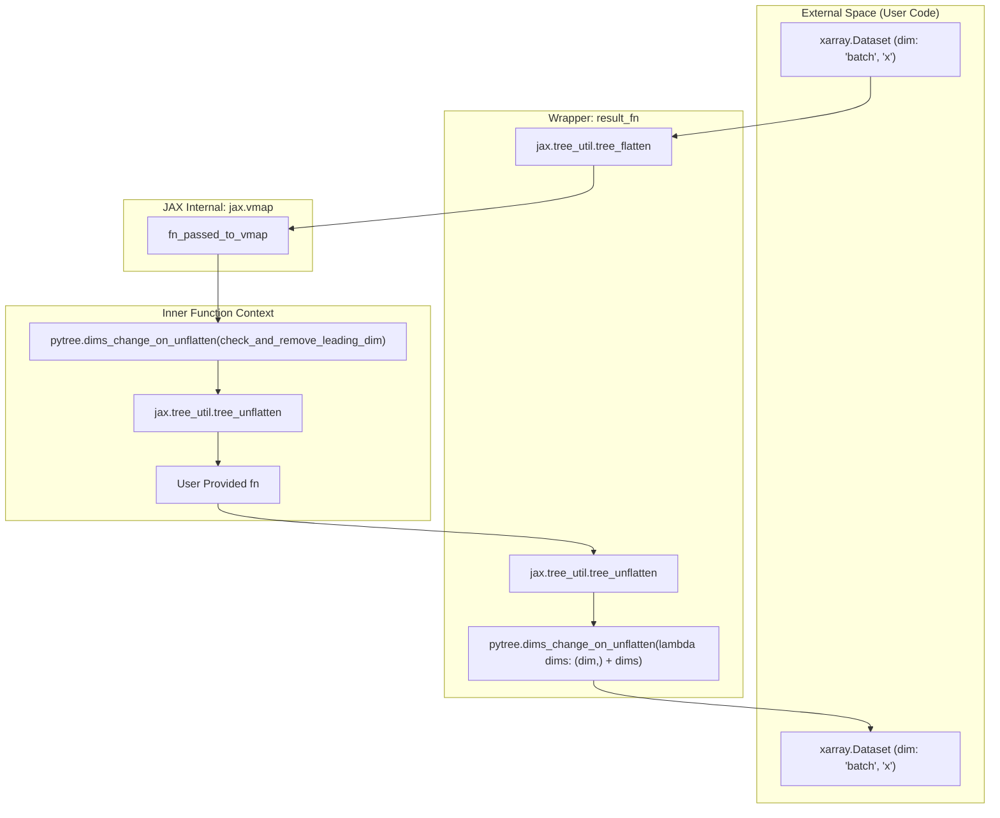
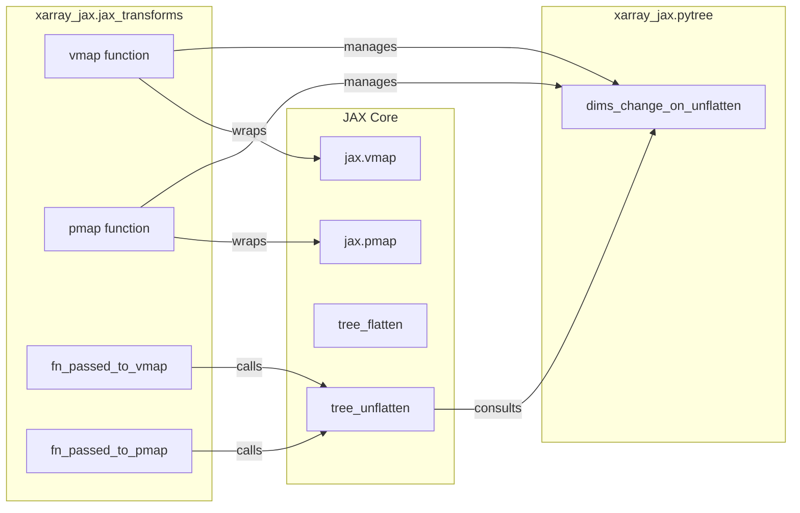

<!-- source: DeepWiki mcp.deepwiki.com · repo google-deepmind/xarray_jax · page 3.1 vmap and pmap · fetched 2026-10-26 -->

# vmap and pmap

Relevant source files

The following files were used as context for generating this wiki page:

- [xarray_jax/jax_transforms.py](xarray_jax/jax_transforms.py)
- [xarray_jax/tests/jax_transforms_test.py](xarray_jax/tests/jax_transforms_test.py)

The `xarray_jax.vmap` and `xarray_jax.pmap` functions are specialized wrappers around `jax.vmap` and `jax.pmap`. They enable vectorization and parallelization across named dimensions in `xarray.DataArray` and `xarray.Dataset` objects while maintaining metadata consistency. Standard JAX transformations cannot natively handle the dimension names and coordinate mapping of xarray objects; these wrappers bridge that gap by managing the lifecycle of dimension stripping and restoration during the transformation.

Sources: [xarray_jax/jax_transforms.py:1-14]()

## Core Constraints and Lifecycle

Both `vmap` and `pmap` in `xarray_jax` operate under a specific set of constraints to ensure compatibility with JAX's positional axis model:

1.  **Leading Axis Requirement**: The dimension being mapped (specified by the `dim` argument) **must** be the first dimension (index 0) in all input `DataArray` or `Dataset` variables [xarray_jax/jax_transforms.py:30-33](). If the dimension is present elsewhere, the user must call `.transpose(dim, ...)` before passing the object to the transformation [xarray_jax/jax_transforms.py:33-33]().
2.  **Fixed Axes**: The wrappers use `in_axes=0` and `out_axes=0` internally [xarray_jax/jax_transforms.py:34-35](). Broadcasting across different axes or mapping multiple dimensions simultaneously is not currently supported via these high-level wrappers.
3.  **Dimension Stripping**: Inside the transformed function, the mapped dimension is removed from the xarray object's metadata. For example, if a `DataArray` with dims `('batch', 'x')` is vmapped over `dim='batch'`, the function body sees a `DataArray` with only dim `('x',)` [xarray_jax/jax_transforms.py:57-65]().
4.  **Dimension Restoration**: Upon returning from the function, the wrapper automatically prepends the mapped dimension name back onto the result's metadata [xarray_jax/jax_transforms.py:88-89]().

### Transformation Lifecycle Diagram

This diagram illustrates how an xarray object moves through the `xarray_jax.vmap` wrapper, interacting with JAX's internal flattening mechanism.

**Data Flow in xarray_jax.vmap**

Sources: [xarray_jax/jax_transforms.py:52-91](), [xarray_jax/jax_transforms.py:125-164]()

## Implementation Details

### The dims_change_on_unflatten Context
The critical mechanism for managing dimension names is `pytree.dims_change_on_unflatten`. This context manager communicates with the PyTree unflattening logic (defined in `pytree.py`) to alter the dimension metadata as JAX reconstructs the xarray objects from flat arrays.

*   **During Input**: The wrapper uses a function `check_and_remove_leading_dim` which validates that `dim` is at index 0 and then returns `dims[1:]` [xarray_jax/jax_transforms.py:58-66]().
*   **During Output**: The wrapper uses a lambda `lambda dims: (dim,) + dims` to restore the mapped dimension to the head of the dimension list [xarray_jax/jax_transforms.py:88-89]().

### Argument and Result Handling
The wrappers maintain `input_treedef` and `output_treedef` as nonlocal variables to ensure that the structure of the PyTree is preserved across the transformation boundary [xarray_jax/jax_transforms.py:52-53](). This allows the wrappers to handle complex nested structures containing mixtures of xarray objects and standard JAX arrays [xarray_jax/tests/jax_transforms_test.py:93-112]().

### Function Signatures and Forwarding

| Feature | `vmap` implementation | `pmap` implementation |
| :--- | :--- | :--- |
| **Axis Identification** | `axis_name` defaults to `dim` [xarray_jax/jax_transforms.py:77-77]() | `axis_name` defaults to `dim` [xarray_jax/jax_transforms.py:148-148]() |
| **SPMD Support** | Forwards `spmd_axis_name` to `jax.vmap` [xarray_jax/jax_transforms.py:79-79]() | N/A |
| **Parallelism** | Sequential vectorization | Parallel execution across `devices` [xarray_jax/jax_transforms.py:151-151]() |
| **Validation** | Checks `axis_size` if provided [xarray_jax/tests/jax_transforms_test.py:152-166]() | Backend/Device forwarding [xarray_jax/jax_transforms.py:151-152]() |

Sources: [xarray_jax/jax_transforms.py:23-91](), [xarray_jax/jax_transforms.py:94-164]()

## Mapping Code Entities to JAX Operations

The following diagram maps the `xarray_jax` wrapper entities to their corresponding JAX and PyTree counterparts.

**Entity Mapping Diagram**

Sources: [xarray_jax/jax_transforms.py:23-164](), [xarray_jax/pytree.py:1-50]()

## Usage and Behavior

### Collective Operations
Because `axis_name` is automatically set to the `dim` name (unless overridden), users can perform collective operations like `jax.lax.psum` inside the mapped function using the dimension name as the axis identifier [xarray_jax/tests/jax_transforms_test.py:132-140]().

### Coordinate Handling
*   **Static Coordinates**: Standard xarray coordinates (which are treated as static metadata) are preserved but are not "mapped" over. They must be consistent across all elements of the mapped dimension.
*   **JAX Coordinates**: If using the experimental `jax_coords` feature, coordinates that vary along the mapped dimension are correctly handled. Inside the `vmap`/`pmap` block, these coordinates are also stripped of the mapped dimension, allowing for coordinate-aware logic inside the vectorized function [xarray_jax/tests/jax_transforms_test.py:51-77]().

### Error Handling
If a `DataArray` or `Dataset` is passed where the specified `dim` is not the leading axis, the wrapper raises a `ValueError` during the unflattening process inside the JAX transformation [xarray_jax/jax_transforms.py:63-64]().

Sources: [xarray_jax/tests/jax_transforms_test.py:114-124](), [xarray_jax/tests/jax_transforms_test.py:125-151]()

---

