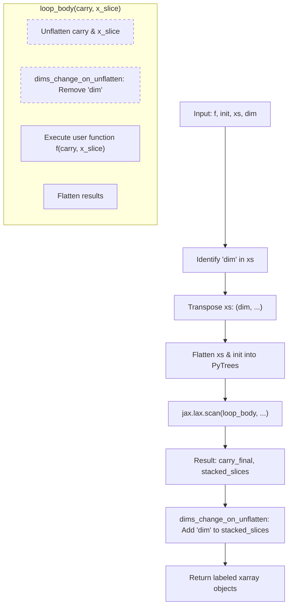

<!-- source: DeepWiki mcp.deepwiki.com · repo google-deepmind/xarray_jax · page 3.2 scan · fetched 2026-10-26 -->

# scan

<details>
<summary>Relevant source files</summary>

The following files were used as context for generating this wiki page:

- [README.md](README.md)
- [xarray_jax/jax_transforms.py](xarray_jax/jax_transforms.py)
- [xarray_jax/tests/jax_transforms_test.py](xarray_jax/tests/jax_transforms_test.py)

</details>


The `xarray_jax.scan` function provides a wrapper around `jax.lax.scan` that is compatible with xarray `DataArray` and `Dataset` objects. It allows for iterative computation over a named xarray dimension while preserving metadata and handling the necessary transposition and PyTree transformations required by JAX.

## Overview and Purpose

In standard JAX, `jax.lax.scan` iterates over the leading axis of an array (axis 0). When working with xarray objects, data variables may have different dimension orderings. `xarray_jax.scan` automates the process of:
1.  Identifying the scan dimension by name.
2.  Transposing all input `xs` so that the scan dimension is at axis 0.
3.  Stripping the scan dimension metadata during the loop body execution so the function `f` sees "slices" of the data.
4.  Re-applying the scan dimension to the stacked results.

### Key Constraints
*   **Leading Axis**: The dimension being scanned over must be present in the input `xs`.
*   **Coordinate Loss**: Standard xarray coordinates associated with the scan dimension are generally lost or become static during the scan unless they are explicitly passed as part of the `carry` or `xs` via `jax_coords` [xarray_jax/jax_transforms.py:214-220]().

## Data Flow and Implementation

The implementation of `xarray_jax.scan` manages the lifecycle of xarray objects through the JAX `scan` primitive using the `dims_change_on_unflatten` context manager.

### Logic Flow Diagram

The following diagram illustrates how `xarray_jax.scan` bridges the gap between labeled xarray objects and the positional requirements of `jax.lax.scan`.

**Diagram: xarray_jax.scan Execution Lifecycle**


Sources: [xarray_jax/jax_transforms.py:222-268]()

### Coordinate Handling

`xarray_jax.scan` handles coordinates based on their type:
*   **Static Coordinates**: Standard xarray coordinates (e.g., `np.ndarray` or `pandas.Index`) are treated as static metadata. If they depend on the scan dimension, they will not be automatically sliced by the scan; the user must handle them manually or use `jax_coords`.
*   **JAX Coordinates**: If coordinates are registered via `jax_coords`, they are treated as dynamic JAX arrays and will be sliced/scanned like data variables [xarray_jax/jax_transforms.py:214-220]().

## Technical Reference

### Function Signature
[xarray_jax/jax_transforms.py:202-211]()
```python
def scan(f: Callable[[_Carry, _X], tuple[_Carry, _Y]],
         init: _Carry,
         xs: _X,
         length: Optional[int] = None,
         reverse: bool = False,
         unroll: int = 1,
         dim: Optional[str] = None) -> tuple[_Carry, _Y]:
```

| Parameter | Description |
| :--- | :--- |
| `f` | The loop body function. It receives `(carry, x_slice)` where `x_slice` has the `dim` dimension removed. |
| `init` | Initial state for the carry. |
| `xs` | The xarray object (or PyTree of objects) to scan over. |
| `dim` | The string name of the xarray dimension to iterate over. |
| `length` | Optional integer specifying the number of iterations (required if `xs` is empty). |

### Implementation Details
The core of the implementation uses `pytree.dims_change_on_unflatten` to dynamically modify the dimension metadata of the xarray objects as they pass through the JAX transformation boundary:

1.  **Inside the loop**: `check_and_remove_scan_dim` ensures the scanned dimension is at index 0 and removes it from the metadata so the user function `f` receives an xarray object with one less dimension [xarray_jax/jax_transforms.py:228-237]().
2.  **Outside the loop**: After `jax.lax.scan` finishes, the results are unflattened using a lambda that prepends the `dim` name back to the dimension list, restoring the original labels to the stacked output [xarray_jax/jax_transforms.py:265-267]().

Sources: [xarray_jax/jax_transforms.py:222-268]()

## Examples

### Scanning over a Dataset
In this example, we iterate over the `time` dimension of a `Dataset`.

```python
import xarray_jax
import jax.numpy as jnp

def integration_step(carry, x_slice):
    # carry is a DataArray, x_slice is a Dataset slice (no 'time' dim)
    new_carry = carry + x_slice.velocity * 0.1
    return new_carry, new_carry

# Dataset with 'time' as leading dim
ds = xarray_jax.Dataset({
    'velocity': (('time', 'x'), jnp.ones((10, 5)))
})
init_pos = xarray_jax.DataArray(jnp.zeros(5), dims=('x',))

final_state, trajectory = xarray_jax.scan(
    integration_step, init=init_pos, xs=ds, dim='time'
)
# trajectory is a DataArray with dims ('time', 'x')
```

### Usage with jax_coords
If a coordinate is marked as a JAX coordinate, it will be sliced during the scan.

```python
# Assuming 'time_coords' is a JAX array
ds = xarray_jax.Dataset(
    {'data': (('time', 'x'), jnp.zeros((10, 5)))},
    jax_coords={'time': (('time',), jnp.arange(10))}
)

def body(carry, x):
    # x.coords['time'] is now a scalar JAX array (the current time step)
    return carry, x.coords['time']

_, scanned_times = xarray_jax.scan(body, init=None, xs=ds, dim='time')
```
Sources: [xarray_jax/tests/jax_transforms_test.py:206-215]() (similar pattern in tests)

## Comparison with vmap
While `vmap` is used for parallel vectorization, `scan` is used for sequential dependencies. Both in `xarray_jax` share the requirement that the target dimension must be the leading axis (axis 0) to avoid ambiguous mapping of JAX's positional indexing to xarray's named indexing [xarray_jax/jax_transforms.py:30-35]().

Sources:
* [xarray_jax/jax_transforms.py:202-268]() (scan implementation)
* [xarray_jax/pytree.py:382-397]() (dims_change_on_unflatten logic)
* [xarray_jax/tests/jax_transforms_test.py:206-230]() (test cases)

---

