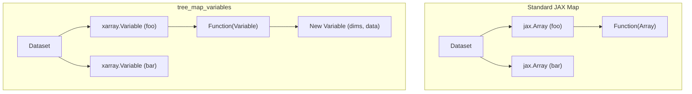
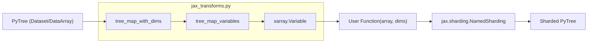

<!-- source: DeepWiki mcp.deepwiki.com · repo google-deepmind/xarray_jax · page 3.3 tree_map_variables and tree_map_with_dims · fetched 2026-10-26 -->

# tree_map_variables and tree_map_with_dims

<details>
<summary>Relevant source files</summary>

The following files were used as context for generating this wiki page:

- [README.md](README.md)
- [xarray_jax/jax_transforms.py](xarray_jax/jax_transforms.py)
- [xarray_jax/tests/jax_transforms_test.py](xarray_jax/tests/jax_transforms_test.py)

</details>


The `xarray_jax` library provides specialized tree-mapping utilities designed to bridge the gap between JAX's generic PyTree structure and xarray's metadata-rich objects. While standard `jax.tree.map` operates on the raw array leaves of an xarray object, `tree_map_variables` and `tree_map_with_dims` allow developers to perform transformations while retaining access to dimension names and variable-level metadata.

## Overview of Mapping Utilities

In the `xarray_jax` implementation, `xarray.Variable`, `xarray.DataArray`, and `xarray.Dataset` are registered as PyTrees [xarray_jax/pytree.py:16-18](). By default, JAX transformations see the underlying arrays as leaves. The utility functions in `jax_transforms.py` provide a higher-level interface:

| Function | Leaf Type | Context Provided |
| :--- | :--- | :--- |
| `tree_map_variables` | `xarray.Variable` | Access to `.dims` and `.attrs` of each variable. |
| `tree_map_with_dims` | `jax.Array` | The dimension names (tuple of strings) associated with the array. |

Sources: [xarray_jax/jax_transforms.py:169-231](), [xarray_jax/pytree.py:16-18]()

## tree_map_variables

`tree_map_variables` acts similarly to `jax.tree.map`, but it treats `xarray.Variable` objects as the leaves of the tree [xarray_jax/jax_transforms.py:169-172](). 

### Behavior and Implementation
This function leverages the fact that `xarray_jax` registration exposes data via `xarray.Variable` nodes during the flatten/unflatten process [xarray_jax/jax_transforms.py:174-177](). 

*   **Scope**: It works with any JAX-registered PyTree containing xarray datatypes (DataArray, Dataset, DataTree) [xarray_jax/jax_transforms.py:174-176]().
*   **Static Data**: Note that static coordinate data (standard xarray coordinates not marked as `jax_coords`) are not mapped over [xarray_jax/jax_transforms.py:177-177]().
*   **Responsibility**: If the mapping function changes the dimensions or shapes of the Variables, the user must ensure they remain consistent with any static coordinates in the container, as these are not updated automatically [xarray_jax/jax_transforms.py:179-183]().

### Data Flow: Variable Mapping
The following diagram illustrates how `tree_map_variables` traverses an xarray structure compared to a standard JAX tree map.

**Variable-Level Mapping Logic**

Sources: [xarray_jax/jax_transforms.py:169-183]()

## tree_map_with_dims

`tree_map_with_dims` is a specialized utility that maps over the JAX array leaves of a PyTree while passing the corresponding dimension names to the mapping function [xarray_jax/jax_transforms.py:207-210]().

### Implementation via tree_map_variables
Internally, `tree_map_with_dims` is implemented using `tree_map_variables` [xarray_jax/jax_transforms.py:228-231](). It extracts the `.data` and `.dims` from the Variable leaf and passes them to the user-provided function [xarray_jax/jax_transforms.py:229-230]().

### Use Case: Sharding with NamedSharding
A primary use case for `tree_map_with_dims` is applying `jax.sharding.NamedSharding` to xarray objects in a distributed environment [xarray_jax/jax_transforms.py:212-215](). Since `NamedSharding` requires a `PartitionSpec` that matches the array's logical axes, having the dimension names available makes it trivial to construct the correct sharding for every variable in a complex `Dataset` or `DataTree`.

**Example Logic for Sharding**
```python
# Conceptual usage for sharding
def apply_sharding(arr, dims):
    # Map xarray dimension names to JAX mesh axis names
    pspec = jax.sharding.PartitionSpec(*(dim_to_mesh_map[d] for d in dims))
    return jax.device_put(arr, jax.sharding.NamedSharding(mesh, pspec))

sharded_ds = tree_map_with_dims(apply_sharding, dataset)
```

### Entity Mapping: Code to Logic
This diagram bridges the functional requirements of sharding with the specific code entities in `jax_transforms.py`.

**Sharding Data Flow**

Sources: [xarray_jax/jax_transforms.py:207-231]()

## Summary Table of Key Functions

| Entity | Location | Role |
| :--- | :--- | :--- |
| `tree_map_variables` | [xarray_jax/jax_transforms.py:169]() | Maps a function `(Variable) -> Variable` over an xarray PyTree. |
| `tree_map_with_dims` | [xarray_jax/jax_transforms.py:207]() | Maps a function `(Array, Dims) -> Array` over an xarray PyTree. |
| `_PyTree` | [xarray_jax/jax_transforms.py:166]() | TypeVar representing any JAX-compatible tree structure. |

Sources: [xarray_jax/jax_transforms.py:166-231]()

---

