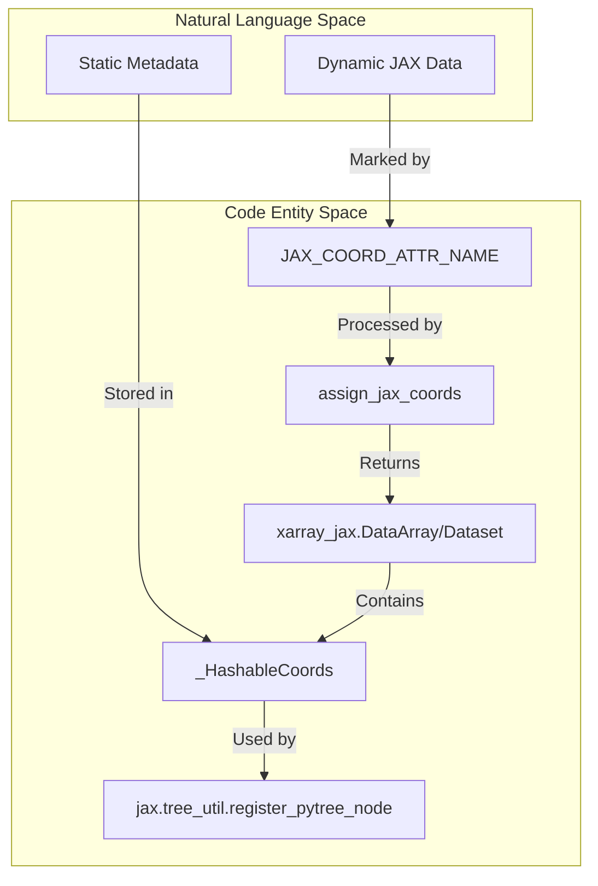
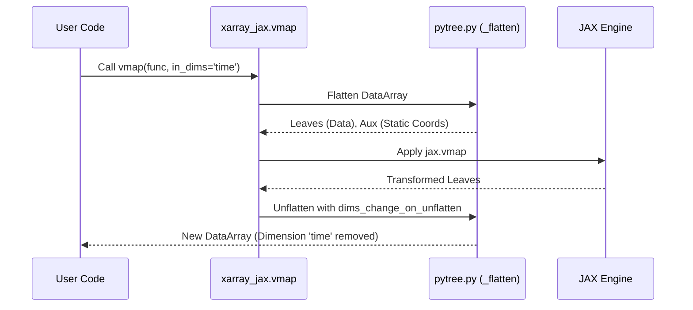

<!-- source: DeepWiki mcp.deepwiki.com · repo google-deepmind/xarray_jax · page 4 Coordinate System · fetched 2026-10-26 -->

# Coordinate System

<details>
<summary>Relevant source files</summary>

The following files were used as context for generating this wiki page:

- [xarray_jax/__init__.py](xarray_jax/__init__.py)
- [xarray_jax/core.py](xarray_jax/core.py)
- [xarray_jax/pytree.py](xarray_jax/pytree.py)

</details>


The `xarray_jax` coordinate system is designed to bridge the gap between `xarray`'s metadata-rich indexing and `JAX`'s requirement for functional purity and static array shapes. Because `xarray` coordinates often involve non-JAX types (like `datetime64`) or trigger non-JITable indexing logic, `xarray_jax` implements a split strategy: **Static Coordinates** (the default) and **JAX Coordinates** (experimental).

### Overview of Coordinate Handling

By default, `xarray_jax` treats coordinates as static metadata. This means they are not "leaves" in the JAX PyTree; instead, they are part of the auxiliary data that defines the tree structure. If you change a coordinate value, JAX sees it as a change in the tree definition, which triggers a recompilation of any JIT-compiled functions.

To allow for dynamic, differentiable, or transformable coordinates, `xarray_jax` provides an experimental `jax_coords` feature. These are treated as dynamic JAX leaves, but they come with significant functional limitations regarding `xarray` indexing.

#### Coordinate Type Comparison

| Feature | Static Coordinates (Default) | JAX Coordinates (`jax_coords`) |
| :--- | :--- | :--- |
| **JAX Role** | Static auxiliary metadata | Dynamic PyTree leaf |
| **JIT Behavior** | Triggers recompilation on change | Passed as Tracers; no recompilation |
| **Indexing (`.sel`)** | Fully supported | Not supported (empty indexes) |
| **Differentiable** | No | Yes |
| **Data Types** | Any (NumPy, datetime, etc.) | JAX-supported types only |

**System Entity Mapping**

The following diagram shows how coordinate data flows through the system and which code entities manage the transition between static and dynamic states.


**Sources:** [xarray_jax/__init__.py:64-82](), [xarray_jax/core.py:23-33](), [xarray_jax/pytree.py:155-200]()

---

### Static Coordinates

Standard `xarray` coordinates are treated as static compile-time constants. When an `xarray.Dataset` or `DataArray` is flattened into a JAX PyTree, these coordinates are bundled into the auxiliary data. This ensures that `xarray`'s advanced indexing and alignment logic remains functional, as the values are concrete NumPy arrays at the time of execution.

To ensure JAX can correctly cache JIT-compiled functions, `xarray_jax` uses internal wrappers like `_HashableCoords` to provide stable hashing for coordinate sets.

For details on recompilation behavior and the `arithmetic_compat='override'` setting, see **[Static Coordinates](#4.1)**.

**Sources:** [xarray_jax/__init__.py:72-78](), [xarray_jax/__init__.py:145-173]()

---

### JAX Coordinates (`jax_coords`)

The `jax_coords` feature allows coordinates to be treated as dynamic JAX arrays. This is useful for workflows where coordinates are the output of a JAX computation or need to be differentiated.

However, because `xarray`'s indexing logic (e.g., `.sel()`, `.loc[]`) relies on concrete values to build indexes, `jax_coords` are explicitly prevented from creating indexes. This results in "empty indexes" for these coordinates, meaning they behave like non-index coordinates in standard `xarray`.

For details on the `JAX_COORD_ATTR_NAME` marker and implementation details, see **[JAX Coordinates (jax_coords)](#4.2)**.

**Sources:** [xarray_jax/core.py:32-64](), [xarray_jax/core.py:125-153]()

---

### Global Arithmetic Compatibility

One critical limitation of mixing JAX tracers with `xarray` is that `xarray`'s default arithmetic behavior (`minimal` compatibility) attempts to compare coordinate values. This comparison triggers a `jax.errors.TracerBoolConversionError` inside JIT blocks.

To resolve this, `xarray_jax` globally sets:
```python
xarray.set_options(arithmetic_compat='override')
```
This ensures that coordinates are preserved during arithmetic operations without triggering illegal tracer-to-boolean conversions.

**Sources:** [xarray_jax/__init__.py:145-173]()

---

### Coordinate Flow and Transformations

When using JAX transformations like `vmap` or `scan`, coordinates must be handled carefully. If a transformation changes the shape of the data (e.g., removing a dimension), the coordinates must be synchronized. `xarray_jax` uses the `dims_change_on_unflatten` context manager to manage this metadata lifecycle.


**Sources:** [xarray_jax/pytree.py:163-198](), [xarray_jax/jax_transforms.py:98-103]()

---

