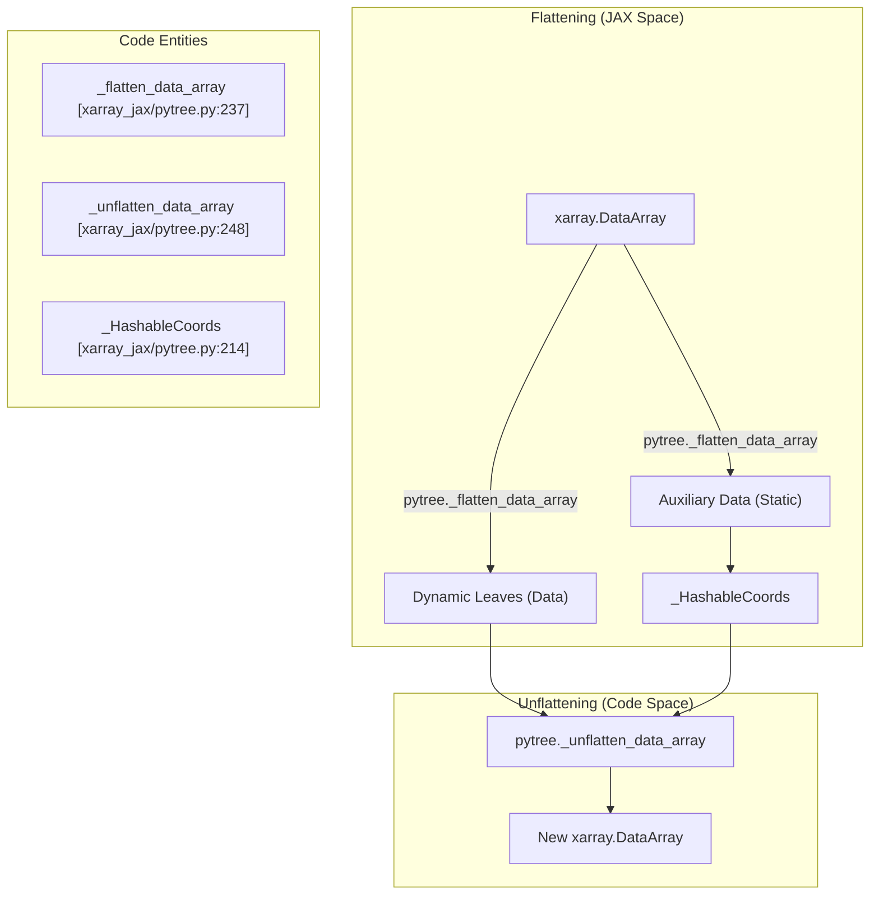
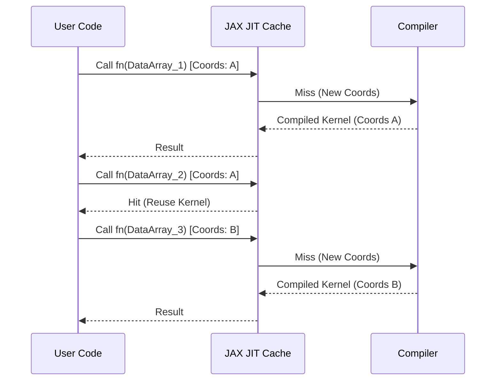

<!-- source: DeepWiki mcp.deepwiki.com · repo google-deepmind/xarray_jax · page 4.1 Static Coordinates · fetched 2026-10-26 -->

# Static Coordinates

<details>
<summary>Relevant source files</summary>

The following files were used as context for generating this wiki page:

- [xarray_jax/__init__.py](xarray_jax/__init__.py)
- [xarray_jax/pytree.py](xarray_jax/pytree.py)
- [xarray_jax/tests/xarray_jax_test.py](xarray_jax/tests/xarray_jax_test.py)

</details>


In `xarray_jax`, standard xarray coordinates are treated as static metadata. This design choice ensures compatibility with JAX's functional requirements while maintaining xarray's powerful indexing capabilities for non-tracing data.

## Static vs. Dynamic Split

The core philosophy of `xarray_jax` is to separate dynamic data (JAX arrays) from static metadata (dimensions, attributes, and standard coordinates). For the purposes of `jax.tree_util` and `jax.jit`, coordinates are not treated as leaves of the PyTree. Instead, they are part of the auxiliary data (the "treedef") `[xarray_jax/__init__.py:72-74]()`.

### Implications for JIT Compilation
Because coordinates are static, they behave like `static_argnums` in `jax.jit`.
*   **Cache Keying**: If a JIT-compiled function is called with a `Dataset` or `DataArray` containing different coordinate values, JAX will trigger a recompilation `[xarray_jax/__init__.py:74-77]()`.
*   **Performance**: This is efficient for coordinates that do not change frequently (e.g., fixed latitude/longitude grids) but can lead to excessive recompilation if coordinates are updated in a loop.
*   **Indexing**: Standard coordinates allow xarray's advanced indexing and slicing to work correctly, which would otherwise fail if coordinates were JAX Tracers `[xarray_jax/__init__.py:65-68]()`.

### Data Flow in PyTree Registration
The following diagram illustrates how coordinates are handled during the JAX `flatten` and `unflatten` process.

**Coordinate Handling in PyTree Lifecycle**

Sources: `[xarray_jax/pytree.py:214-256]()`, `[xarray_jax/__init__.py:72-77]()`

## _HashableCoords and JIT Caching

To enable JAX to correctly identify when a function needs to be recompiled, the static metadata must be hashable and comparable. `xarray_jax` implements a private class `_HashableCoords` to wrap coordinate mappings `[xarray_jax/pytree.py:214-220]()`.

| Feature | Implementation | Purpose |
| :--- | :--- | :--- |
| **Storage** | `collections.abc.Mapping` | Stores coordinate names and values. |
| **Equality** | `__eq__` | Compares coordinate values to detect changes. |
| **Hashing** | `__hash__` | Allows JAX to use coordinates as part of the JIT cache key. |

When a `DataArray` is flattened, the coordinates are extracted and wrapped in `_HashableCoords`, then stored in the `aux_data` of the PyTree `[xarray_jax/pytree.py:242-246]()`.

Sources: `[xarray_jax/pytree.py:214-220]()`, `[xarray_jax/pytree.py:237-246]()`

## Global Workaround: arithmetic_compat='override'

Xarray's default behavior (`arithmetic_compat='minimal'`) performs coordinate compatibility checks during arithmetic operations. When using JAX, these checks can trigger a `jax.errors.TracerBoolConversionError` because they attempt to evaluate the truthiness of JAX Tracers used in coordinates or metadata comparisons `[xarray_jax/__init__.py:145-148]()`.

To resolve this, `xarray_jax` automatically sets a global xarray option upon import:
```python
xarray.set_options(arithmetic_compat='override')
```
`[xarray_jax/__init__.py:173-173]()`

### Effects of 'override'
1.  **Disables Compatibility Checks**: Arithmetic operations no longer strictly validate that non-index coordinates match between operands `[xarray_jax/__init__.py:158-161]()`.
2.  **Prevents Coordinate Dropping**: In standard xarray, a failed compatibility check (swallowed by xarray) would result in coordinates being dropped during JIT. `override` ensures coordinates are preserved `[xarray_jax/__init__.py:149-152]()`.
3.  **Scope**: This primarily affects arithmetic; other xarray APIs may still require explicit `compat='override'` arguments `[xarray_jax/__init__.py:160-161]()`.

Sources: `[xarray_jax/__init__.py:145-173]()`

## Recompilation Behavior

Users should be aware that modifying static coordinates inside a JIT-compiled function is not possible, as they are "baked in" at compile time.

**Static Coordinate Recompilation Flow**

Sources: `[xarray_jax/__init__.py:74-77]()`, `[xarray_jax/tests/xarray_jax_test.py:110-121]()`

### When to Avoid Static Coordinates
If you need to pass dynamic data that varies every step (e.g., a time-varying bias field) and you want to avoid recompilation, do not use standard coordinates. Instead:
1.  Add the data as a **data variable** in a `Dataset` `[xarray_jax/__init__.py:79-80]()`.
2.  Use the experimental **JAX Coordinates** feature (see Section 4.2) `[xarray_jax/__init__.py:23-25]()`.

Sources: `[xarray_jax/__init__.py:79-82]()`

---

