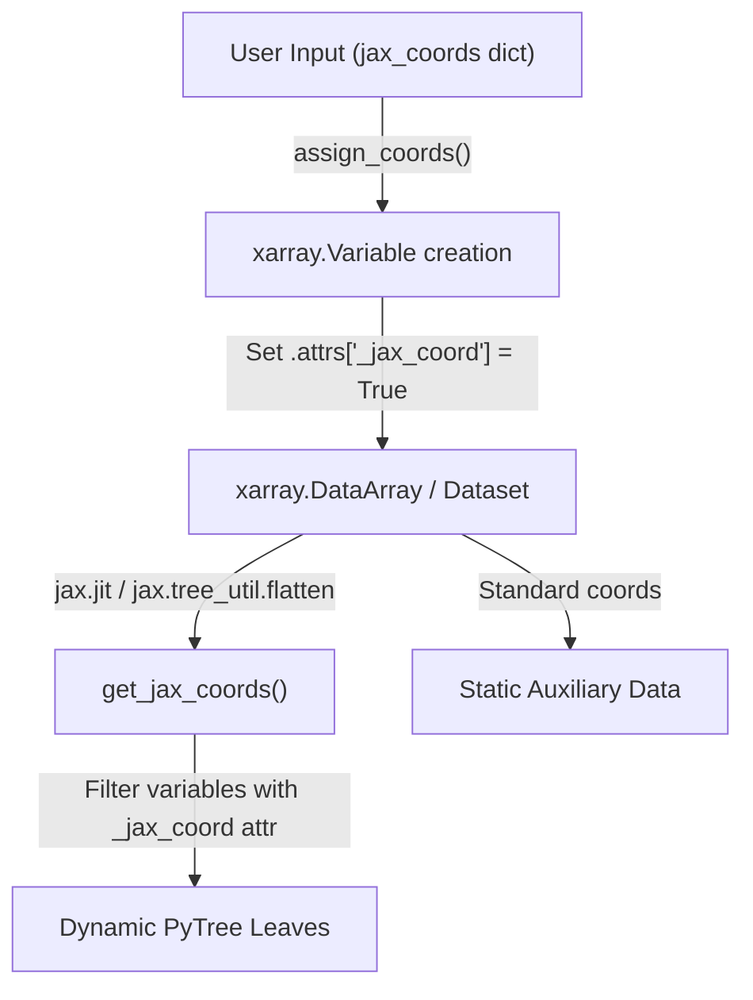
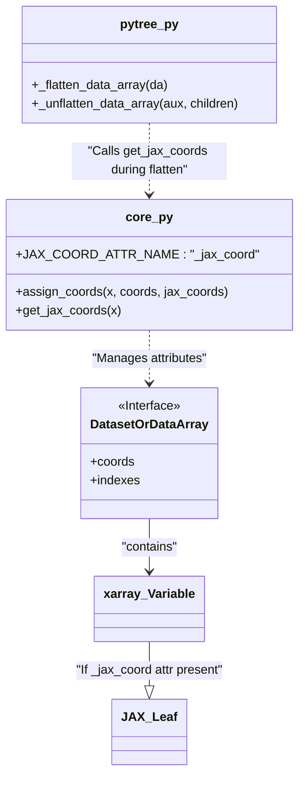

<!-- source: DeepWiki mcp.deepwiki.com · repo google-deepmind/xarray_jax · page 4.2 JAX Coordinates (jax_coords) · fetched 2026-10-26 -->

# JAX Coordinates (jax_coords)

<details>
<summary>Relevant source files</summary>

The following files were used as context for generating this wiki page:

- [xarray_jax/core.py](xarray_jax/core.py)
- [xarray_jax/tests/jax_transforms_test.py](xarray_jax/tests/jax_transforms_test.py)
- [xarray_jax/tests/xarray_jax_test.py](xarray_jax/tests/xarray_jax_test.py)

</details>


The `jax_coords` feature is an experimental mechanism in `xarray_jax` designed to handle coordinates that need to be treated as dynamic JAX data rather than static metadata. While standard xarray coordinates are treated as static compile-time constants by JAX, `jax_coords` allows coordinates to be passed as JAX tracers through `jax.jit` boundaries, enabling gradients and JIT-compiled computations to be performed on coordinate values.

## Purpose and Motivation

In standard `xarray_jax` usage, coordinates are part of the "auxiliary data" in the PyTree structure. This means any change to a coordinate value triggers a re-compilation of a JIT-compiled function [xarray_jax/core.py:40-44](). 

`jax_coords` addresses scenarios where:
1.  **Coordinate values are dynamic**: For example, time coordinates that change every step of a simulation.
2.  **Gradients are required**: When you need to compute the derivative of a result with respect to a coordinate value.
3.  **Large coordinate arrays**: Avoiding re-compilation overhead for large coordinate sets that change frequently.

## The `JAX_COORD_ATTR_NAME` Marker

To distinguish dynamic JAX coordinates from static ones, `xarray_jax` uses a specific attribute marker.

*   **Constant**: `JAX_COORD_ATTR_NAME = '_jax_coord'` [xarray_jax/core.py:23]().
*   **Mechanism**: When a coordinate is designated as a JAX coordinate, `xarray_jax` adds this attribute to the `xarray.Variable` representing that coordinate [xarray_jax/core.py:165-171]().
*   **Discovery**: The `get_jax_coords` utility identifies which coordinates in a Dataset or DataArray carry this marker [xarray_jax/core.py:199-209]().

### Data Flow: Marking and Identification

The following diagram illustrates how a coordinate is promoted to a JAX coordinate and later identified during PyTree flattening.

**Coordinate Promotion Flow**

Sources: [xarray_jax/core.py:154-171](), [xarray_jax/core.py:199-209]()

## Implementation: Suppressing Indexes

A critical technical constraint in xarray is that it automatically attempts to create `pandas.Index` objects for coordinates that share a name with a dimension. Because JAX tracers cannot be converted into pandas indexes (which require concrete numpy values), `xarray_jax` must suppress index creation for `jax_coords`.

### Empty Indexes Pattern
When using `assign_coords` with the `jax_coords` argument, the library uses a specialized internal logic:
1.  It wraps the JAX data in an `xarray.Variable` [xarray_jax/core.py:165]().
2.  It marks the variable with the `_jax_coord` attribute [xarray_jax/core.py:171]().
3.  It updates the object's coordinates using `x.coords.update()`. Because the underlying data is often a JAX tracer, `xarray_jax` ensures that no index is created for these variables [xarray_jax/core.py:173-174]().

As a result, `jax_coords` will appear in `ds.coords` but will **not** appear in `ds.indexes` [xarray_jax/tests/xarray_jax_test.py:172-173]().

## Usage in Constructors

Both `DataArray` and `Dataset` in `xarray_jax` provide a `jax_coords` parameter.

| Feature | `coords` (Standard) | `jax_coords` (Experimental) |
| :--- | :--- | :--- |
| **Data Type** | NumPy / Static | JAX Arrays / Tracers |
| **JAX Treatment** | Static Auxiliary Data | Dynamic PyTree Leaf |
| **JIT Behavior** | Triggers Re-compilation | Passed as Tracer |
| **Indexing** | Supports `.sel()` | **No `.sel()` support** |
| **Marker** | None | `attrs['_jax_coord'] = True` |

Sources: [xarray_jax/core.py:26-68](), [xarray_jax/core.py:73-111]()

## Limitations and Trade-offs

### 1. No `.sel()` Support
Because `jax_coords` do not have associated indexes, xarray's label-based indexing (`.sel()`) will not work on them [xarray_jax/core.py:53-58](). Attempting to use `.sel` on a JAX coordinate will result in an error because xarray cannot find a corresponding index.

### 2. Explicit Specification
`xarray_jax` requires `jax_coords` to be explicitly passed to the constructor or `assign_coords`. It does **not** automatically detect JAX arrays inside the standard `coords` dictionary. This is a design choice to ensure consistent PyTree structure, as the distinction between static and dynamic data must be known at the time of PyTree registration [xarray_jax/core.py:59-64]().

### 3. When to prefer `data_vars`
If you need to perform complex JAX operations on a variable and don't strictly need it to be classified as a "coordinate" by xarray, it is often simpler to include it as a standard data variable in a `Dataset` [xarray_jax/core.py:92-95]().

## Code Entity Map: Coordinate Handling

This diagram maps the high-level coordinate concepts to the specific functions and attributes in the codebase.

**Coordinate Entity Relationship**

Sources: [xarray_jax/core.py:23-33](), [xarray_jax/core.py:199-209](), [xarray_jax/pytree.py:157-165]()

## Examples

### Creating a DataArray with JAX Coordinates
```python
import jax.numpy as jnp
import xarray_jax

# 'lat' is a static coord (numpy), 'lon' is a JAX coord (jnp)
da = xarray_jax.DataArray(
    data=jnp.ones((3, 4)),
    dims=('lat', 'lon'),
    coords={'lat': [10, 20, 30]},
    jax_coords={'lon': jnp.array([1, 2, 3, 4])}
)

# Verification
assert 'lon' in da.coords
assert 'lon' not in da.indexes
assert da.coords['lon'].attrs['_jax_coord'] is True
```
Sources: [xarray_jax/tests/xarray_jax_test.py:163-173]()

### Using JAX Coordinates in `vmap`
When using `xarray_jax.vmap`, `jax_coords` that contain the mapping dimension are correctly sliced and passed into the mapped function as JAX arrays.
```python
def func(d):
    # d.coords['time'] is a JAX tracer here
    return d + d.coords['time']

# 'time' is a jax_coord with a 'batch' dimension
vmapped_func = xarray_jax.vmap(func, dim='batch')
result = vmapped_func(dataset_with_jax_coords)
```
Sources: [xarray_jax/tests/jax_transforms_test.py:51-78]()

---

