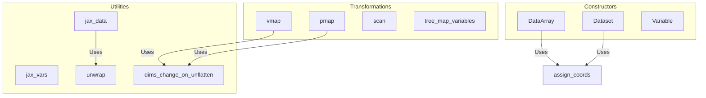
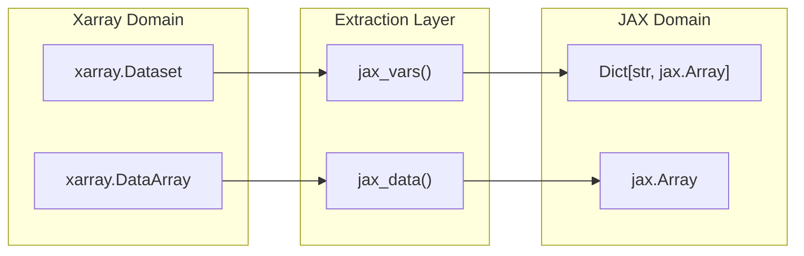

<!-- source: DeepWiki mcp.deepwiki.com · repo google-deepmind/xarray_jax · page 5 Public API Reference · fetched 2026-10-26 -->

# Public API Reference

Relevant source files

The following files were used as context for generating this wiki page:

- [xarray_jax/__init__.py](xarray_jax/__init__.py)
- [xarray_jax/core.py](xarray_jax/core.py)
- [xarray_jax/jax_transforms.py](xarray_jax/jax_transforms.py)
- [xarray_jax/pytree.py](xarray_jax/pytree.py)

This page provides a comprehensive reference for the public symbols exported by the `xarray_jax` package. The API is designed to mirror standard `xarray` as closely as possible while providing the necessary hooks for JAX compatibility, such as PyTree registration and coordinate management.

All symbols documented here are available directly from the top-level `xarray_jax` namespace [xarray_jax/__init__.py:88-114]().

### API Architecture Overview

The `xarray_jax` API bridges the gap between the metadata-rich world of `xarray` and the functional requirements of JAX.

"API Connectivity Map"

Sources: [xarray_jax/__init__.py:88-114](), [xarray_jax/core.py:26-114](), [xarray_jax/jax_transforms.py:23-103]()

---

## Data Structures and Constructors

These functions are the primary entry points for creating JAX-compatible xarray objects. While standard `xarray` constructors now support JAX arrays, these wrappers provide explicit support for the `jax_coords` feature [xarray_jax/__init__.py:23-25]().

| Symbol | Role | Key Difference from xarray |
| :--- | :--- | :--- |
| `DataArray` | Constructor for labeled arrays | Supports `jax_coords` parameter for dynamic coordinates [xarray_jax/core.py:26-33](). |
| `Dataset` | Constructor for multi-variable sets | Supports `jax_coords` parameter; handles tracer-safe coord assignment [xarray_jax/core.py:73-78](). |
| `Variable` | Alias for `xarray.Variable` | Provided for completeness and backward compatibility [xarray_jax/core.py:118](). |
| `apply_ufunc` | JAX-aware ufunc wrapper | Dispatches to `xarray.apply_ufunc` with JAX-compatible defaults [xarray_jax/core.py:213-217](). |

For detailed signature information and usage of the `jax_coords` parameter, see **[Data Structures and Constructors](#5.1)**.

Sources: [xarray_jax/core.py:26-118](), [xarray_jax/__init__.py:88-96]()

---

## Data Extraction Utilities

Once a computation is finished within a JAX transformation (like `jax.jit`), you often need to extract the underlying JAX arrays from the xarray containers.

"Data Flow: Xarray to JAX"

Sources: [xarray_jax/pytree.py:70-81](), [xarray_jax/__init__.py:27-41]()

### Key Utility Functions
*   **`jax_data(obj)`**: Extracts the underlying JAX array from a `DataArray` or `Variable`. Raises a `TypeError` if the data is not a JAX array [xarray_jax/pytree.py:70-75]().
*   **`jax_vars(dataset)`**: Extracts a dictionary of JAX arrays from a `Dataset`. Validates that all variables are JAX-backed [xarray_jax/pytree.py:77-80]().
*   **`unwrap(value, require_jax=False)`**: A low-level utility to strip `NonArrayLeafWrapper` shims used during JAX transformations [xarray_jax/pytree.py:34-39]().

For details on `unwrap_vars`, `unwrap_coords`, and the `require_jax` flag, see **[Data Extraction Utilities](#5.2)**.

Sources: [xarray_jax/pytree.py:29-81](), [xarray_jax/__init__.py:104-114]()

---

## Coordinate Management

These functions handle the assignment and retrieval of coordinates, specifically managing the distinction between **Static Coordinates** (treated as JAX static metadata) and **JAX Coordinates** (treated as dynamic JAX data) [xarray_jax/core.py:125-153]().

*   **`assign_coords`**: The primary mechanism for updating coordinates. It allows simultaneous assignment of standard (static) and JAX (dynamic) coordinates [xarray_jax/core.py:125-130]().
*   **`assign_jax_coords`**: Specialized helper to assign coordinates that should be treated as dynamic JAX data [xarray_jax/core.py:186-191]().
*   **`get_jax_coords`**: Retrieves the subset of coordinates marked as JAX-dynamic [xarray_jax/core.py:202-205]().

Sources: [xarray_jax/core.py:125-211](), [xarray_jax/__init__.py:92-94]()

---

## Transformation Wrappers

Standard JAX transformations like `vmap` and `scan` are not aware of xarray dimension names. `xarray_jax` provides wrappers that handle the flattening and unflattening of xarray objects while preserving (or transforming) dimension metadata.

*   **`vmap`**: Wraps `jax.vmap`. Requires the mapped dimension to be the leading axis. It automatically manages dimension stripping inside the function and restoration in the output [xarray_jax/jax_transforms.py:23-51]().
*   **`pmap`**: Wraps `jax.pmap` for parallel execution across devices, following similar dimension constraints as `vmap` [xarray_jax/jax_transforms.py:94-124]().
*   **`scan`**: Wraps `jax.lax.scan`. Handles the "carry" and "ys" structures while ensuring the scan dimension is correctly transposed to the leading position [xarray_jax/jax_transforms.py:187-219]().
*   **`tree_map_variables`**: A utility that applies a function to every `Variable` in a PyTree, allowing users to manipulate data and dimensions simultaneously [xarray_jax/jax_transforms.py:169-184]().

Sources: [xarray_jax/jax_transforms.py:23-219](), [xarray_jax/__init__.py:97-103]()

---

