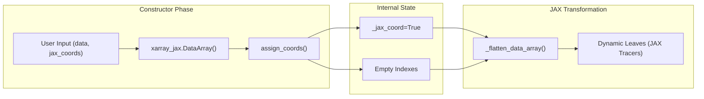

<!-- source: DeepWiki mcp.deepwiki.com · repo google-deepmind/xarray_jax · page 5.1 Data Structures and Constructors · fetched 2026-10-26 -->

# Data Structures and Constructors

<details>
<summary>Relevant source files</summary>

The following files were used as context for generating this wiki page:

- [xarray_jax/__init__.py](xarray_jax/__init__.py)
- [xarray_jax/core.py](xarray_jax/core.py)

</details>


This page provides a technical reference for the core data structures and constructors provided by `xarray_jax`. While `xarray_jax` leverages standard `xarray` objects, it provides specialized constructors and utility functions to handle the integration of JAX arrays, particularly regarding how coordinates are treated during JAX transformations like `jax.jit`.

## Core Data Structures

`xarray_jax` works with the three primary `xarray` data structures. These are registered as JAX PyTrees in `xarray_jax.pytree`, allowing them to be passed directly into JAX-transformed functions.

| Class | Description | JAX Integration |
| :--- | :--- | :--- |
| `xarray.Variable` | The fundamental unit containing an array, dimensions, and attributes. | Registered as a PyTree where the underlying data is a leaf [xarray_jax/pytree.py:228-230](). |
| `xarray.DataArray` | A labeled N-dimensional array with coordinates and attributes. | Registered as a PyTree. Coordinates are typically static metadata unless marked as `jax_coords` [xarray_jax/pytree.py:330-333](). |
| `xarray.Dataset` | A dict-like container of `DataArray` objects. | Registered as a PyTree. Data variables are dynamic leaves; coordinates are static metadata [xarray_jax/pytree.py:440-444](). |

**Note:** `xarray_jax.Variable` is provided as an alias for `xarray.Variable` for API consistency [xarray_jax/core.py:118-118]().

### Data Structure Relationship
The following diagram illustrates how `xarray_jax` maps standard `xarray` entities into the JAX PyTree ecosystem.

**Entity Mapping: Xarray to JAX PyTree**
```mermaid
graph TD
    subgraph "Xarray Entity Space"
        XA_DA["xarray.DataArray"]
        XA_DS["xarray.Dataset"]
        XA_VAR["xarray.Variable"]
    end

    subgraph "JAX PyTree Space"
        PT_NODE["PyTree Node (Internal)"]
        DYNAMIC_LEAF["Dynamic Leaf (Tracer/Array)"]
        STATIC_META["Static Metadata (Auxiliary Data)"]
    end

    XA_VAR -->|Registered via| PT_NODE
    XA_VAR -.->|data| DYNAMIC_LEAF
    XA_VAR -.->|dims/attrs| STATIC_META

    XA_DA -->|Registered via| PT_NODE
    XA_DA -.->|variable| XA_VAR
    XA_DA -.->|coords (standard)| STATIC_META
    XA_DA -.->|jax_coords| DYNAMIC_LEAF

    XA_DS -->|Registered via| PT_NODE
    XA_DS -.->|data_vars| XA_VAR
    XA_DS -.->|coords (standard)| STATIC_META
```
Sources: [xarray_jax/pytree.py:228-230](), [xarray_jax/pytree.py:330-333](), [xarray_jax/pytree.py:440-444](), [xarray_jax/core.py:118-118]()

---

## Constructors

`xarray_jax` provides custom constructors for `DataArray` and `Dataset`. While standard `xarray` constructors now support JAX arrays as data, these custom versions are required to use the `jax_coords` feature.

### `xarray_jax.DataArray`
Wraps the standard `xarray.DataArray` constructor but adds the `jax_coords` parameter.

```python
def DataArray(
    data,
    coords=None,
    dims=None,
    name=None,
    attrs=None,
    jax_coords=None,
) -> xarray.DataArray:
```
*   **`data`**: Supports JAX arrays, tracers, or numpy arrays [xarray_jax/core.py:37-37]().
*   **`coords`**: Standard coordinates. These are treated as **static** by JAX. If these change, JAX will recompile the function [xarray_jax/core.py:38-44]().
*   **`jax_coords`**: Experimental feature for coordinates that should be treated as **dynamic** JAX data (tracers). These do not trigger recompilation when values change but cannot be used for indexing (`.sel`) [xarray_jax/core.py:49-58]().

### `xarray_jax.Dataset`
Wraps the standard `xarray.Dataset` constructor.

```python
def Dataset(
    data_vars=None,
    coords=None,
    attrs=None,
    jax_coords=None,
) -> xarray.Dataset:
```
*   **`data_vars`**: Dictionary mapping names to data. Supports JAX arrays [xarray_jax/core.py:82-82]().
*   **`jax_coords`**: Similar to `DataArray`, allows coordinates to be treated as dynamic PyTree leaves [xarray_jax/core.py:92-107]().

Sources: [xarray_jax/core.py:26-71](), [xarray_jax/core.py:73-114]()

---

## Coordinate Management and `jax_coords`

The `jax_coords` mechanism is a key differentiator in `xarray_jax`. Because `xarray` normally attempts to create indexes (like `pandas.Index`) for coordinates, and these indexes cannot wrap JAX tracers, `xarray_jax` uses a specific implementation strategy.

### The `JAX_COORD_ATTR_NAME` Marker
When a coordinate is assigned via the `jax_coords` argument, `xarray_jax` marks the variable with a special attribute: `_jax_coord` [xarray_jax/core.py:23-23]().

### Implementation via `assign_coords`
The `xarray_jax.assign_coords` function is the underlying engine for managing these coordinates. It performs the following steps:
1.  Assigns standard (static) coordinates using the native `xarray.assign_coords` [xarray_jax/core.py:157-157]().
2.  For `jax_coords`, it creates `xarray.Variable` objects and adds the `JAX_COORD_ATTR_NAME` to their attributes [xarray_jax/core.py:161-163]().
3.  It uses `xarray.Coordinates` with **empty indexes** to prevent `xarray` from attempting to build a non-JIT-compatible index from the JAX array [xarray_jax/core.py:141-142]().

**Data Flow: Constructor to PyTree Registration**

Sources: [xarray_jax/core.py:23-23](), [xarray_jax/core.py:130-163](), [xarray_jax/pytree.py:346-351]()

---

## Universal Function Wrapper: `apply_ufunc`

`xarray_jax.apply_ufunc` is a specialized wrapper for `xarray.apply_ufunc`. It is designed to ensure that when JAX operations are applied to `xarray` objects, the metadata (dimensions and coordinates) is preserved correctly.

### Key Features
*   **JAX Compatibility**: It is specifically tested to work within `jax.jit` and other transformations [xarray_jax/core.py:18-19]().
*   **Coordinate Preservation**: It handles the propagation of `jax_coords` through the function application, ensuring that the `_jax_coord` markers are not lost during the underlying array operations [xarray_jax/core.py:89-89]().

Sources: [xarray_jax/core.py:89-89](), [xarray_jax/__init__.py:89-89]()

## Summary of Differences from Standard Xarray

| Feature | Standard `xarray` | `xarray_jax` |
| :--- | :--- | :--- |
| **Data Storage** | NumPy, Dask, etc. | JAX Arrays / Tracers. |
| **Coordinate Type** | Always static/indexed. | Static (default) or Dynamic (`jax_coords`). |
| **JIT Behavior** | Not natively JIT-able. | Fully JIT-able via PyTree registration. |
| **Indexing** | Supported on all coords. | Not supported on `jax_coords`. |
| **Global Config** | `arithmetic_compat='minimal'` | `arithmetic_compat='override'` (to prevent tracer errors) [xarray_jax/__init__.py:173-173](). |

Sources: [xarray_jax/__init__.py:145-173](), [xarray_jax/core.py:49-58]()

---

