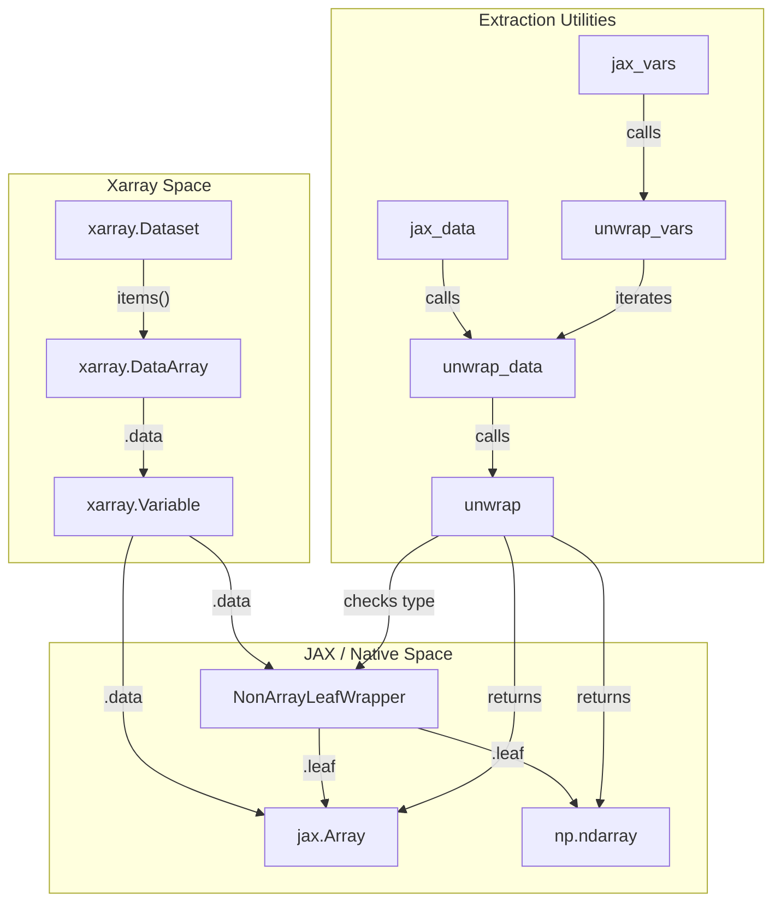

<!-- source: DeepWiki mcp.deepwiki.com · repo google-deepmind/xarray_jax · page 5.2 Data Extraction Utilities · fetched 2026-10-26 -->

# Data Extraction Utilities

<details>
<summary>Relevant source files</summary>

The following files were used as context for generating this wiki page:

- [xarray_jax/__init__.py](xarray_jax/__init__.py)
- [xarray_jax/pytree.py](xarray_jax/pytree.py)
- [xarray_jax/tests/xarray_jax_test.py](xarray_jax/tests/xarray_jax_test.py)

</details>


Data extraction utilities in `xarray_jax` provide a standardized way to retrieve underlying JAX arrays or raw data from `xarray` structures. These utilities are essential when transitioning from `xarray`-land (metadata-heavy) back to pure JAX-land (array-heavy), particularly for operations like computing gradients or interfacing with libraries that expect raw `jax.Array` objects.

### Overview of Extraction Functions

The library distinguishes between "unwrapping" (extracting data while allowing non-JAX types) and "JAX-only" extraction (which enforces that the data must be a JAX array).

| Function | Input Type | Requirement | Return Type |
| :--- | :--- | :--- | :--- |
| `jax_data` | `Variable`, `DataArray` | Must be JAX | `jax.Array` |
| `jax_vars` | `Dataset` / `Mapping` | Must be JAX | `Mapping[str, jax.Array]` |
| `unwrap_data` | `Variable`, `DataArray` | Optional JAX | `jax.Array` or `np.ndarray` |
| `unwrap_vars` | `Dataset` / `Mapping` | Optional JAX | `Mapping[str, jax.Array \| np.ndarray]` |
| `unwrap_coords`| `Dataset`, `DataArray` | Optional JAX | `Mapping[str, jax.Array \| np.ndarray]` |
| `unwrap` | `Any` | Optional JAX | Raw leaf value |

Sources: [xarray_jax/__init__.py:27-41](), [xarray_jax/pytree.py:34-81]()

---

### Implementation and Data Flow

The extraction utilities operate by accessing the `.data` attribute of `xarray` objects and processing them through a central `unwrap` logic. This logic is specifically designed to handle `NonArrayLeafWrapper`, a shim used during JAX transformations to represent non-array leaves (like scalars or `ShapeDtypeStruct`) within an `xarray` container.

#### Extraction Logic Flow
The following diagram illustrates how data flows from an `xarray.Dataset` through the extraction utilities to become raw JAX arrays.

**Data Extraction Path**

Sources: [xarray_jax/pytree.py:34-81](), [xarray_jax/pytree.py:83-113]()

---

### Detailed Function Reference

#### `unwrap(value, require_jax=False)`
The core utility for stripping `NonArrayLeafWrapper` containers. If `require_jax` is `True`, it validates that the resulting object is a `jax.Array` [xarray_jax/pytree.py:34-39]().

#### `unwrap_data(value, require_jax=False)`
Retrieves the underlying data from a `Variable` or `DataArray`. It is the primary way to get a "clean" array that can be passed to native JAX functions [xarray_jax/pytree.py:42-47]().

#### `jax_data(value)`
A strict version of `unwrap_data`. It is used when the user must ensure the computation has remained within JAX (e.g., to avoid silent conversion to NumPy which would break `jax.jit` or `jax.grad`) [xarray_jax/__init__.py:32-34](), [xarray_jax/pytree.py:70-75]().

#### `unwrap_vars(dataset, require_jax=False)`
Iterates over a `Dataset` (or a mapping of `DataArray` objects) and returns a dictionary of unwrapped arrays. It explicitly converts coordinate/variable names to `str` to ensure a consistent return type [xarray_jax/pytree.py:50-59]().

#### `jax_vars(dataset)`
The strict version of `unwrap_vars`. This is commonly used at the end of a JIT-compiled function to return raw JAX arrays to the caller [xarray_jax/pytree.py:77-80]().

#### `unwrap_coords(dataset, require_jax=False)`
Similar to `unwrap_vars`, but specifically targets the `.coords` attribute of a `Dataset` or `DataArray`. This is particularly useful when working with `jax_coords` [xarray_jax/pytree.py:61-68]().

---

### Use Cases and Examples

#### Ensuring JIT Compatibility
When performing operations inside `jax.jit`, calling `.values` on an `xarray` object will trigger a `TracerArrayConversionError` because `.values` attempts to force the data into a concrete NumPy array [xarray_jax/tests/xarray_jax_test.py:139-144](). Instead, `jax_data` should be used to extract the `Tracer` or `Array` safely.

```python
@jax.jit
def my_func(da):
    # BAD: data = da.values 
    # GOOD:
    data = xarray_jax.jax_data(da)
    return jax.numpy.sum(data)
```
Sources: [xarray_jax/tests/xarray_jax_test.py:139-144](), [xarray_jax/tests/xarray_jax_test.py:146-149]()

#### Handling Backward Compatibility
The `wrap` function is provided as a deprecated identity function (`lambda x: x`) to maintain compatibility with older versions of the API where explicit wrapping might have been required [xarray_jax/pytree.py:29-31]().

### The `require_jax` Flag
The `require_jax` flag serves as a safety mechanism. When set to `True`:
1. It performs an `isinstance(unwrapped, jax.Array)` check [xarray_jax/pytree.py:37-38]().
2. If the data is a standard NumPy array or a raw Python scalar, it raises a `TypeError` [xarray_jax/pytree.py:38]().
3. This prevents "silent" performance degradation where a JAX transformation might accidentally fall back to CPU-based NumPy execution.

Sources: [xarray_jax/pytree.py:34-40](), [xarray_jax/pytree.py:70-81]()

---

