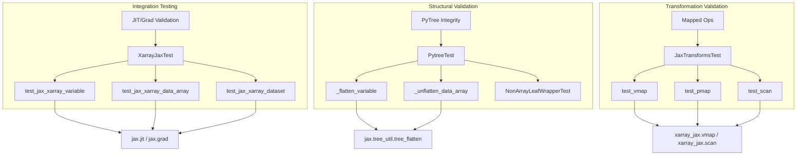
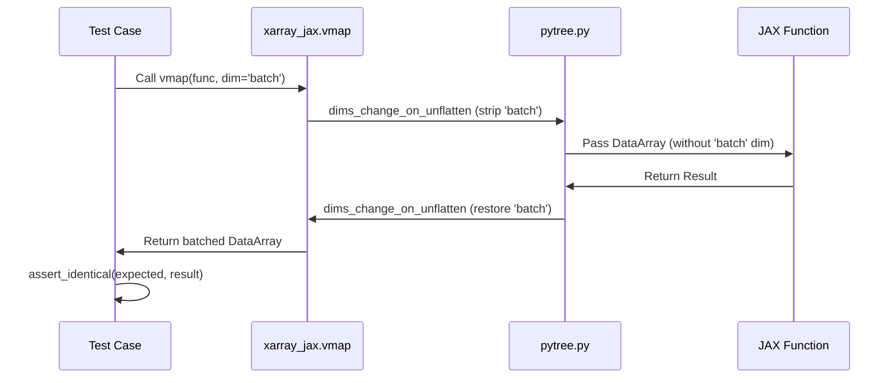

<!-- source: DeepWiki mcp.deepwiki.com · repo google-deepmind/xarray_jax · page 6 Testing · fetched 2026-10-26 -->

# Testing

<details>
<summary>Relevant source files</summary>

The following files were used as context for generating this wiki page:

- [pyproject.toml](pyproject.toml)
- [xarray_jax/tests/__init__.py](xarray_jax/tests/__init__.py)
- [xarray_jax/tests/jax_transforms_test.py](xarray_jax/tests/jax_transforms_test.py)
- [xarray_jax/tests/pytree_test.py](xarray_jax/tests/pytree_test.py)
- [xarray_jax/tests/xarray_jax_test.py](xarray_jax/tests/xarray_jax_test.py)

</details>


The `xarray_jax` test suite is designed to ensure that `xarray` data structures behave correctly when subjected to JAX transformations, JIT compilation, and gradient calculations. Because `xarray_jax` relies on registering `xarray` types as JAX PyTrees, the tests focus heavily on the stability of the flatten/unflatten operations and the preservation of metadata (dimensions and coordinates) across functional boundaries.

## Test Suite Structure

The test suite is organized into three primary modules located in `xarray_jax/tests/` [pyproject.toml:44-44](). It utilizes `absl-py` for test execution and `chex` for specialized JAX assertions [pyproject.toml:31-34]().

| Test Module | Focus | Key Components Tested |
| :--- | :--- | :--- |
| `xarray_jax_test.py` | **Integration** | `jax.jit`, `jax.grad`, `DataTree` support, AOT compilation. |
| `pytree_test.py` | **PyTree Internals** | `_flatten`/`_unflatten` logic, `NonArrayLeafWrapper`, `dims_change_on_unflatten`. |
| `jax_transforms_test.py` | **Transformations** | `xarray_jax.vmap`, `xarray_jax.pmap`, `xarray_jax.scan`. |

**Sources:** [xarray_jax/tests/xarray_jax_test.py:25-25](), [xarray_jax/tests/pytree_test.py:25-25](), [xarray_jax/tests/jax_transforms_test.py:23-23]()

## Dependencies and Running Tests

The testing environment requires additional dependencies beyond the core library requirements:
*   **absl-py**: Used for the `absltest` framework [xarray_jax/tests/xarray_jax_test.py:15-15]().
*   **chex**: Used for tree comparisons and JAX-specific assertions [xarray_jax/tests/xarray_jax_test.py:16-16]().

To run the tests, ensure the `test` optional dependencies are installed:
```bash
pip install .[test]
python -m absl.testing.absltest xarray_jax/tests/xarray_jax_test.py
```

**Sources:** [pyproject.toml:30-34]()

## System Mapping: Test Entities

The following diagram maps the logical testing concepts to the specific classes and functions implemented in the test suite.

### Testing Logic to Code Entity Mapping

**Sources:** [xarray_jax/tests/xarray_jax_test.py:25-107](), [xarray_jax/tests/pytree_test.py:25-91](), [xarray_jax/tests/jax_transforms_test.py:25-210]()

## Key Test Categories

### Integration and JIT Stability
The integration tests verify that passing `xarray` objects through `jax.jit` does not trigger unnecessary recompilations. This is achieved by ensuring that the "auxiliary data" (static metadata like dimension names) returned during PyTree flattening is hashable and comparable [xarray_jax/tests/xarray_jax_test.py:114-120]().

For details, see [Integration Tests (xarray_jax_test.py)](#6.1).

### PyTree Round-trips
These tests ensure that an `xarray` object can be decomposed into JAX-compatible leaves and reconstructed perfectly. They specifically validate `NonArrayLeafWrapper`, which handles non-array types (like `None` or `ShapeDtypeStruct`) that might appear in `xarray` metadata or during AOT lowering [xarray_jax/tests/pytree_test.py:144-168]().

### Transformation Correctness
Tests for `vmap`, `pmap`, and `scan` ensure that dimension names are correctly stripped inside the transformed function and restored in the output. They also validate that `jax_coords` (dynamic coordinates) are correctly handled during batching operations [xarray_jax/tests/jax_transforms_test.py:51-78]().

For details, see [PyTree and Transform Tests (pytree_test.py, jax_transforms_test.py)](#6.2).

## Test Data Flow

The diagram below illustrates how tests validate the lifecycle of an `xarray` object as it moves through a JAX transformation.

### Transformation Lifecycle Test Flow

**Sources:** [xarray_jax/tests/jax_transforms_test.py:25-50](), [xarray_jax/tests/pytree_test.py:132-141]()

---

